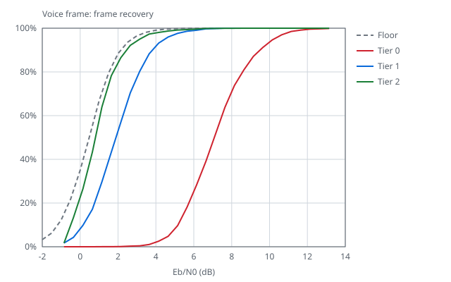
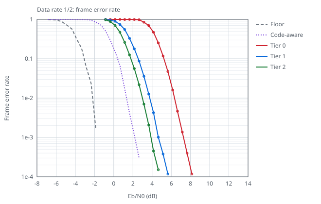
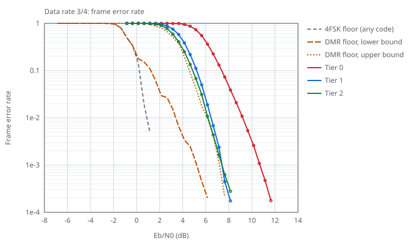
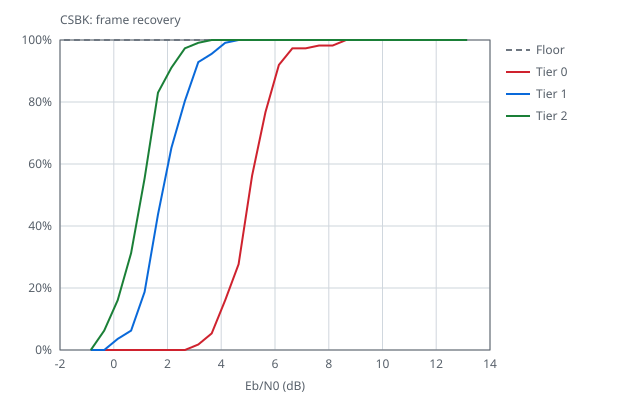
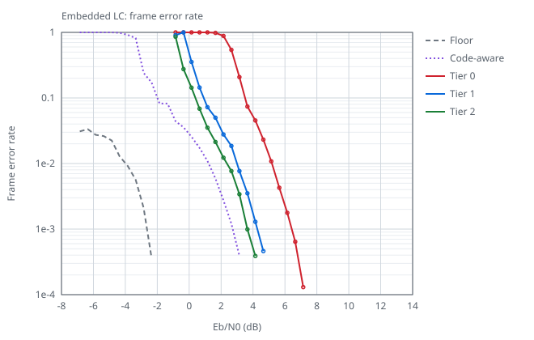

# dmrgo

[](https://github.com/USA-RedDragon/dmrgo) [](https://github.com/USA-RedDragon/dmrgo/actions/workflows/test.yaml) [](https://github.com/USA-RedDragon/dmrgo/blob/main/LICENSE)

Decode and encode DMR (Digital Mobile Radio) bursts and PDUs as defined in [ETSI TS 102 361](https://www.etsi.org/standards) parts 1 to 4.

[DMRHub](https://github.com/USA-RedDragon/DMRHub) and [ipsc2mmdvm](https://github.com/USA-RedDragon/ipsc2mmdvm) use it.

## Installation

Requires Go 1.24 or later.

```sh
go get github.com/USA-RedDragon/dmrgo/v2
```

## Getting started

```go
package main

import (
	"fmt"
	"log"

	"github.com/USA-RedDragon/dmrgo/v2/layer2"
	"github.com/USA-RedDragon/dmrgo/v2/layer2/pdu"
)

func main() {
	// A Voice LC Header burst as received from a repeater.
	raw := [33]byte{
		68, 75, 3, 135, 36, 66, 12, 240, 21, 240,
		12, 161, 196, 109, 255, 87, 215, 93, 245, 222,
		49, 168, 53, 24, 63, 48, 61, 97, 56, 82,
		151, 134, 91,
	}

	burst, err := layer2.NewBurstFromBytes(raw)
	if err != nil {
		log.Fatal(err)
	}
	if err := burst.FEC.Aggregate().Err(); err != nil {
		log.Fatal(err)
	}
	if lc, ok := burst.Data.(*pdu.FullLinkControl); ok {
		target, source, _ := lc.Addresses()
		fmt.Printf("%s: call from %d to %d\n", burst.SlotType.DataType, source, target)
	}

	encoded, err := burst.Encode()
	if err != nil {
		log.Fatal(err)
	}
	fmt.Println("re-encoded unchanged:", encoded == raw)
}
```

The program prints `Voice LC Header: call from 3191868 to 9990` and `re-encoded unchanged: true`. An FEC or CRC error does not make `NewBurstFromBytes` fail: `burst.FEC` reports it and `burst.Data` still holds the decoded PDU. Change a field of `burst.Data` and `Encode` writes a new burst with new parity. The [package documentation](https://pkg.go.dev/github.com/USA-RedDragon/dmrgo/v2) has the package map and the errors to match.

More in [v2/examples](v2/examples), which run offline on the captures in `v2/layer2/testdata` (`go run -C v2 ./examples/<name>`): [hotspot](v2/examples/hotspot/main.go) (MMDVMHost check and regenerated bursts), [bridge](v2/examples/bridge/main.go) (rewrite a call's talkgroup and source), [scanner](v2/examples/scanner/main.go) (find bursts in a bit stream), [trunking](v2/examples/trunking/main.go) (Tier III CSBKs, MBC and CACH), [data](v2/examples/data/main.go) (packet data and selective retry), [transcoder](v2/examples/transcoder/main.go) (AMBE+2 FEC and Codec2) and [conformance](v2/examples/conformance/main.go) (byte-for-byte re-encode of every capture). [tinygo](v2/examples/tinygo/main.go) decodes and re-encodes a call on a microcontroller follows it with `voice.Receiver` and relays it with `voice.Transmitter` (see [TinyGo](#tinygo)).

## Features

- Bursts (`layer2`):
  - Decode and encode voice, data and standalone Reverse Channel bursts, including data bursts that carry an EMB in place of the SYNC.
  - Read and write single fields of a 33-byte burst in place with `RawBurst`.
  - Build data bursts from a PDU or a 12-byte payload, and voice superframes with `VoiceTransmitter`.
  - Receive calls with `VoiceReceiver`, the embedded LC assembler and the CACH Short LC assembler.
  - Check and reseal bursts the way MMDVMHost does.
- PDUs (`layer2/pdu`), generated from struct tags by `dmrgen`:
  - CSBK and MBC, with the Tier II and Tier III payloads, and the Motorola radio check and call alert.
  - Full LC and Short LC, with their payloads.
  - Data headers, data blocks at rate 1/2, 3/4 and 1, USBD and the compressed UDP/IPv4 header.
  - Slot type, EMB, TACT, PI header, Reverse Channel and PR FILL.
  - Byte-level editors for LC, CSBK and data header octets, and `Seal` to recompute parity or CRC.
- Packet data (`layer2/packet`): segmentation and reassembly of confirmed and unconfirmed packets, with response packets and selective retry:
  - `Builder.Retry` builds the later try that a SACK asks for.
  - The `Assembler` counts a block burst lost on air with `Lost`, reads the Full Message Flag, takes later tries of confirmed and short data packets, and with `AcceptBadCRC` delivers a packet whose CRC failed, as the "skip CRC" setting of some radios does.
- Voice calls (`voice`), without I/O or goroutines:
  - `Receiver` turns the bursts of one logical channel into call events: call start with where the call came from, voice bursts with their superframe position, lost count and frame quality, embedded GPS and talker alias, and call end with a reason. It handles late entry, duplicate and lost bursts, transport hints (`layer2.Hint`) and the call hang time.
  - `Transmitter` sends a call one burst per 60 ms slot: from AMBE+2 frames with the headers, embedded talker alias and GPS, padding, terminators and the transmit timeout, or as a relay of the events of a `Receiver`, with the local color code and SYNC.
- FEC: BPTC(196,96), embedded LC BPTC, rate 3/4 trellis, RS(12,9), Golay(20,8), Golay(23,12), Golay(24,12), QR(16,7), Hamming codes and the CRCs. Each decoder reports its result in one `fec.Result`.
- Burst finding in a demodulated bit stream (`layer2/framer`).
- Vocoders (`vocoder`):
  - The AMBE+2 frame FEC. AMBE+2 itself is not included.
  - A `Codec` interface with a registry, and a Codec2 codec (`vocoder/codec2`).
- No cgo outside `vocoder/codec2`.
- No allocation on the hot path: see [Allocation](#allocation).

## Allocation

The hot path allocates nothing. After construction, decoding, encoding, building, receiving and assembling bursts and packets do not allocate, with gc (Go 1.24 or later) and with TinyGo at the default stack size of a microcontroller target. This covers `Burst.DecodeFromBytes` and `Encode`, the `RawBurst` builders, `VoiceTransmitter`, `VoiceReceiver`, `voice.Receiver`, `voice.Transmitter`, `framer.Framer`, `packet.Assembler` and `packet.Builder`, the `Into` and `Append` forms of the PDU decoders, and the FEC. Errors are static values, so a call that fails does not allocate either; an error does not hold the value that failed.

The rest allocates as little as it can. These are all the places where the library can allocate, and when. The gate in [v2/internal/allocgate](v2/internal/allocgate) generates this table from its rules and fails when the README differs:

<!-- allocgate:begin -->

| What may allocate | When | Functions |
| --- | --- | ---: |
| The initialization of a package-level variable, such as a lookup table or a joined sentinel error | Once, when the program starts. | 2 |
| A String, GoString or Error method | When the text is built, for a person to read. | 97 |
| An exported package-level New function | Once, at construction: it allocates what it returns, sized up front. | 14 |
| An exported function or method that takes a slice dst and returns a slice of the same type | Only to grow dst when dst has no room. The caller sizes dst. | 20 |
| An exported X with an exported twin AppendX or XInto that does not allocate | X allocates the slice, string or struct it returns; the twin writes into storage of the caller. | 23 |
| An exported X whose whole body is return Twin(nil, its parameters), where Twin allocates only to grow dst | X allocates the slice it returns; Twin with room in dst does not. | 3 |
| A type assertion or type switch to an interface type, and a goroutine that blocks | Once for each call site and dynamic type, as the runtime fills the cache of the assertion or switch, and when no sudog is free for a goroutine that blocks on a mutex or a channel. The runtime keeps both. | 5 |
| The runtime print functions, which the runtime calls on its debug paths | Never: they format into fixed buffers that the gate cannot prove are large enough. | 1 |

The counts are of exported functions and methods, for linux/amd64 with cgo. `DMRGO_README=write go test -run TestHeapAllocations ./internal/allocgate` in v2 writes the table.

<!-- allocgate:end -->

Each exported function that a rule covers says in its doc when it allocates, and the gate checks that the sentence is there. Some types keep pointers into their own storage, so they must not be copied after first use: `layer2.Burst`, `packet.Assembler`, `packet.Builder` and `voice.Receiver`. `go vet` reports a copy. A `layer2.Burst` keeps its decoded `Data` and the payload structs that `Data` points to until the next decode into it. `packet.Builder` and `packet.Assembler` keep their results the same way.

Three checks keep this so, with no list of functions to maintain:

- [v2/internal/allocgate](v2/internal/allocgate) reads the machine code that the compiler emits. It builds the library and its dependencies with `go list -export`, disassembles them with `go tool objdump`, and builds the call graph from the relocations: direct calls, the functions whose address the code takes, interface method calls resolved to the library types that implement the interface, and func value calls resolved by signature. The allocator is every runtime function that takes memory from the cache of the P. Paths that end in a panic, a throw or a goroutine switch do not count; the gate reads the functions that never return from the source of the compiler. The gate fails on each exported function that reaches the allocator outside the rules of the table, with the call chain. For the dst growth rule it also proves from the source that every append on the way grows dst, or a slice that the function derives from dst, also in the unexported helpers that take and return the slice, and that every function on a path to the growth is such a helper; when it cannot prove that, it fails. It fails when a function has the name or the shape of a rule but breaks the rule, when a rule covers nothing, when a doc sentence names the wrong twin, and when a tool it needs cannot run. It does not follow a call through the dictionary of a generic function, exported generic code, which has machine code only where a caller instantiates it, or a callback that package-level data holds and that the stdlib calls. The library has none of these. A test fails when the library gains generic code that the gate cannot follow, so the callbacks are the one known limit that no test checks. Its own test cases in `testdata/cases` allocate in ways that the escape analysis of their own body does not show, such as a map write, a call of `strconv.Itoa` and an interface call.
- The same package builds a program that references every exported function and method (`go generate` writes it from the exports) with `tinygo build -print-allocs` for the pico and for `riscv-qemu`, and adds each allocation site that TinyGo reports to the same call graph and rules.
- [v2/internal/allocs](v2/internal/allocs) checks decode and encode of every capture, packet assembly, a voice superframe, `voice.Receiver` and `voice.Transmitter`, the vocoder frames and the framer with `testing.AllocsPerRun`, and under TinyGo reads `runtime.MemStats` around the main decode and encode calls.

## Codec2

`vocoder/codec2` links the system libcodec2 (LGPL 2.1) with cgo. A program that imports it needs a C compiler, libcodec2 and pkg-config, for example `apt-get install libcodec2-dev pkg-config`. Build with `-tags nocodec2` or `CGO_ENABLED=0` to leave it out: `codec2.New` then returns `codec2.ErrUnavailable`. TinyGo builds always leave it out.

The package does not register itself. A program that creates codecs by name registers it once at startup:

```go
if err := vocoder.Register(codec2.Name, codec2.NewFactory(codec2.Config{})); err != nil {
	return err
}
enc, err := vocoder.New(codec2.Name)
```

| Item | Value |
| --- | --- |
| Modes | `Mode2400`, `Mode3200`, one 20 ms frame per 72-bit voice slot, MSB first, zero padded, no FEC |
| Feature set ID | `0xC2` in the Full LC (self-assigned, compatible with QRadioLink) |
| Silence | `Silence()` is 20 ms of silence in the selected mode |

Both ends must agree on the mode, because the FID does not identify it.

## TinyGo

The library builds with TinyGo 0.41 for microcontrollers (for example RP2040, RP2350, ESP32-C3) and for WebAssembly. CI builds [v2/examples/tinygo](v2/examples/tinygo/main.go) for the Raspberry Pi Pico and runs the library tests with TinyGo.

```sh
cd v2
tinygo flash -target=pico ./examples/tinygo
```

- Decode and encode make no heap garbage at the default stack size of these targets (8 KB), where TinyGo puts each local variable larger than 256 bytes on the heap. The library has no such local on those paths.
- `vocoder/codec2` always uses its stub, so `codec2.New` returns `codec2.ErrUnavailable`.

The example prints its counts on the serial console once a second.

## Receiver

[v2/cmd/dmrrf](v2/cmd/dmrrf/README.md) receives DMR from RTL-SDR captures with one of four tiers, from a discriminator that fits a microcontroller to a coherent trellis detector with soft-decision decoding of each FEC field. The tables below come from a sweep over synthetic noise and from captures of a repeater.

<!-- rxbench:begin -->
Loss is the Eb/N0 in dB above the ideal receiver at 90% frame recovery. The ideal receiver has perfect timing and carrier, detects the symbols with a coherent BCJR over the exact CPM phase trellis and decodes each FEC field by soft-decision maximum likelihood; for voice it also detects each burst again with its decoded C0, C1, EMB and embedded LC bits.

| Tier | Voice | Data rate 1/2 | CSBK | Data rate 3/4 | ns per second of signal | RAM | Allocs |
|------|-------|---------------|------|---------------|-------------------------|-----|--------|
| 0: discriminator | 7.3 dB | 4.9 dB | 5.0 dB | 4.5 dB | 4,000,000 | 68 KiB | 0 |
| 1: coherent, two pass | 1.7 dB | 1.9 dB | 2.0 dB | 1.1 dB | 20,000,000 | 183 KiB | 0 |
| 2: phase trellis, two pass | 0.3 dB | 0.8 dB | 1.0 dB | 0.6 dB | 196,000,000 | 2878 KiB | 0 |

Cost is the CPU time on AMD Ryzen 9 7950X 16-Core Processor. RAM is the heap that NewReceiver keeps for input at 48 kHz with ReceiverConfig.OnBurst set; without it the slice of bursts that Write returns adds 28 KiB. Tier 3, a five-symbol window with all 200 carrier phases, is for offline decoding and is not in these tables.

<details><summary>Sensitivity per payload type</summary>

Eb/N0 in dB for 90% recovery, C/N in 12.5 kHz in parentheses. A tier can be under the floor where it uses more than one burst: it combines the embedded LC over superframes, its second pass puts priors on the EMB, and the stream gives each burst its neighbors, while the floor detects one MS burst alone.

| Payload | Floor | Tier 0: discriminator | Tier 1: coherent, two pass | Tier 2: phase trellis, two pass |
|---------|-------|------|------|------|
| Voice frame (AMBE+2, 49 bits) | 2.2 (1.0) | 9.5 (8.4) | 3.8 (2.7) | 2.5 (1.3) |
| Voice frame, protected bits (C0 and C1) | 1.3 (0.2) | 6.6 (5.5) | 2.7 (1.6) | 1.6 (0.5) |
| Data block, rate 1/2 | 1.3 (0.2) | 6.2 (5.1) | 3.2 (2.1) | 2.1 (1.0) |
| Data block, rate 3/4 | 4.0 (2.9) | 8.5 (7.4) | 5.1 (4.0) | 4.6 (3.5) |
| Data block, rate 1 | 7.1 (5.9) | 10.9 (9.7) | 7.2 (6.1) | 7.2 (6.1) |
| CSBK | 1.0 (-0.1) | 6.1 (4.9) | 3.0 (1.9) | 2.1 (0.9) |
| Voice LC header and terminator | 1.0 (-0.1) | 6.0 (4.9) | 2.9 (1.8) | 1.7 (0.6) |
| Data header | 1.0 (-0.1) | 6.2 (5.1) | 3.2 (2.1) | 2.3 (1.2) |
| Embedded LC | 1.7 (0.6) | 6.7 (5.6) | 1.5 (0.4) | 1.4 (0.2) |
| EMB | 0.8 (-0.4) | 4.7 (3.5) | 1.2 (0.1) | 1.0 (-0.1) |
| Slot type | -0.1 (-1.3) | 4.5 (3.3) | -0.0 (-1.2) | -0.4 (-1.5) |
| SYNC detection | - | 2.4 (1.3) | -0.9 (-2.0) | -0.6 (-1.8) |

</details>

<details><summary>Real recordings</summary>

Voice frames recovered exactly from captures of a Motorola XPR 8400 repeater with an RTL-SDR, by tier.

| Recording | Frames | Tier 0 | Tier 1 | Tier 2 |
|-----------|--------|--------|--------|--------|
| MS voice relayed, HackRF on the uplink (9.3 dB C/N) | 2013 | 1389 | 1730 | 1765 |
| Late entry voice relayed, HackRF on the uplink (11.1 dB C/N) | 1890 | 1423 | 1610 | 1613 |
| Voice with PI header relayed, HackRF on the uplink (17.3 dB C/N) | 1818 | 1818 | 1818 | 1818 |
| Mixed voice and data, network to air, run 1 (9.7 dB C/N) | 144 | 108 | 120 | 120 |
| Mixed voice and data, network to air, run 2 (10.6 dB C/N) | 144 | 115 | 120 | 120 |
| Voice, network to air (10.0 dB C/N) | 90 | 90 | 90 | 90 |
| Voice, network to air (11.6 dB C/N) | 90 | 86 | 90 | 90 |
| Gain sweep, RTL gain 0 dB (9.9 dB C/N) | 51 | 17 | 48 | 48 |
| Gain sweep, RTL gain 9.7 dB (7.3 dB C/N) | 54 | 32 | 42 | 42 |
| Gain sweep, RTL gain 19.7 dB (10.4 dB C/N) | 51 | 47 | 51 | 51 |
| Gain sweep, RTL gain 29.7 dB (11.2 dB C/N) | 54 | 47 | 50 | 50 |

</details>







<!-- rxbench:end -->

## Tooling

- `go generate ./...` from the repository root runs `cmd/tablegen`, which writes the FEC and CRC lookup tables (`tables_gen.go`), and `cmd/dmrgen`, which writes the decoder and encoder of each struct with `dmr` field tags (`*_decode_gen.go`). Do not edit generated files.
- `env CGO_ENABLED=0 go run -C cmd/speccheck . -update-readme` runs the tests that `spec_matrix.yaml` maps to each ETSI clause and writes the table below. `-check-readme` fails when the table is out of date.
- `go run -C cmd/rxbench . -update-readme` runs the receiver sweep of `v2/cmd/dmrrf` (about an hour on 32 cores) and writes the receiver tables and the graphs in `docs/rx`. `-check-readme` fails when they differ from the sweep data in `v2/cmd/dmrrf/testdata`.

## ETSI TS 102 361 Specification Coverage

<!-- BEGIN ETSI COVERAGE -->

*Generated by `cmd/speccheck -update-readme`. The status of each section comes from its tests.*

### Summary

| Metric | Count |
| --- | --- |
| Total sections | 126 |
| Verified (tests pass) | 126 |
| Failing (tests fail) | 0 |
| Untested (has source, no tests) | 0 |
| Unimplemented | 0 |

**Overall: 126/126 verified (100.0%)**

### ETSI TS 102 361-1: Air Interface Protocol

64 sections: 64 verified, 0 failing, 0 untested, 0 unimplemented.

| Section | Title | Status | Tests | Source Files |
| --- | --- | --- | --- | --- |
| 6.1 | Vocoder socket | verified | 23/23 passed | `v2/layer2/burst.go`, `v2/vocoder/frame.go`, `v2/internal/fec/ambe/ambe.go`, `v2/vocoder/codec.go`, `v2/layer2/voice_superframe.go`, `v2/internal/fec/golay/golay_23_12_7.go`, `v2/internal/fec/golay/golay_24_12_8.go`, `v2/enums/voice_burst_types.go` |
| 6.2 | Data and control | verified | 6/6 passed | `v2/layer2/burst.go`, `v2/layer2/pdu/pi_header.go`, `v2/layer2/voice_transmitter_options.go` |
| 6.3 | Common Announcement Channel burst | verified | 5/5 passed | `v2/layer2/cach.go`, `v2/layer2/pdu/tact.go` |
| 6.4 | Reverse Channel | verified | 17/17 passed | `v2/layer2/reverse_channel.go`, `v2/layer2/burst.go` |
| 7.1.1 | Voice LC header | verified | 10/10 passed | `v2/layer2/burst.go`, `v2/layer2/pdu/full_link_control.go`, `v2/layer2/voice_superframe.go`, `v2/layer2/voice_transmitter_options.go` |
| 7.1.2 | Terminator with LC | verified | 7/7 passed | `v2/layer2/burst.go`, `v2/layer2/pdu/full_link_control.go`, `v2/layer2/voice_superframe.go` |
| 7.1.3 | Embedded signalling | verified | 26/26 passed | `v2/layer2/burst.go`, `v2/layer2/pdu/embedded_signalling.go`, `v2/layer2/embedded_lc.go`, `v2/layer2/embedded_lc_bytes.go`, `v2/layer2/voice_superframe.go`, `v2/layer2/voice_receiver.go`, `v2/layer2/voice_transmitter_options.go` |
| 7.1.4 | Short Link Control in CACH | verified | 12/12 passed | `v2/layer2/short_lc_assembler.go`, `v2/layer2/short_lc_cach.go`, `v2/internal/fec/bptc/bptc_cach.go` |
| 7.2.1 | Control Signalling BlocK (CSBK) | verified | 4/4 passed | `v2/layer2/pdu/csbk.go` |
| 7.3 | Idle message | verified | 6/6 passed | `v2/layer2/idle.go`, `v2/layer2/pdu/pr_fill.go`, `v2/layer2/burst.go` |
| 7.4.1 | Multi Block Control (MBC) | verified | 17/17 passed | `v2/layer2/pdu/mbc.go`, `v2/layer2/burst.go` |
| 8.2.1 | Header block structure | verified | 7/7 passed | `v2/layer2/pdu/data_header.go`, `v2/layer2/pdu/data_header_bytes.go` |
| 8.2.2 | Data block structure | verified | 13/13 passed | `v2/layer2/packet/packet.go`, `v2/layer2/packet/assembler.go`, `v2/layer2/packet/bursts.go` |
| 8.2.2.3 | Response packet format | verified | 3/3 passed | `v2/layer2/packet/response.go` |
| 8.2.3.1 | Unified Single Block Data block structure | verified | 10/10 passed | `v2/layer2/pdu/usbd.go`, `v2/layer2/burst.go` |
| 9.1.1 | Synchronization (SYNC) PDU | verified | 19/19 passed | `v2/enums/sync_patterns.go`, `v2/layer2/burst.go`, `v2/layer2/decode_options.go`, `v2/layer2/framer/framer.go` |
| 9.1.2 | Embedded signalling (EMB) PDU | verified | 9/9 passed | `v2/layer2/pdu/embedded_signalling.go`, `v2/layer2/pdu/emb_info.go` |
| 9.1.3 | Slot Type (SLOT) PDU | verified | 9/9 passed | `v2/layer2/pdu/slot_type.go`, `v2/layer2/pdu/slot_type_info.go` |
| 9.1.4 | TACT PDU | verified | 6/6 passed | `v2/layer2/pdu/tact.go`, `v2/internal/fec/hamming/hamming_7_4_3.go` |
| 9.1.5 | Reverse Channel (RC) PDU | verified | 6/6 passed | `v2/layer2/pdu/reverse_channel.go` |
| 9.1.6 | Full Link Control (FULL LC) PDU | verified | 10/10 passed | `v2/layer2/pdu/full_link_control.go`, `v2/layer2/pdu/full_link_control_bytes.go` |
| 9.1.7 | Short Link Control (SHORT LC) PDU | verified | 14/14 passed | `v2/layer2/pdu/short_link_control.go`, `v2/enums/slco.go`, `v2/internal/crc/crc8.go` |
| 9.1.8 | Control Signalling Block (CSBK) PDU | verified | 7/7 passed | `v2/layer2/pdu/csbk.go`, `v2/layer2/pdu/csbk_bytes.go` |
| 9.1.9 | Pseudo Random Fill Bit (PR FILL) PDU | verified | 8/8 passed | `v2/layer2/pdu/pr_fill.go` |
| 9.2.2 | Rate ¾ coded packet Data (R_3_4_DATA) PDU | verified | 10/10 passed | `v2/layer2/pdu/rate34_data.go`, `v2/layer2/pdu/confirmed_block.go` |
| 9.2.6 | Unconfirmed data packet Header (U_HEAD) PDU | verified | 3/3 passed | `v2/layer2/pdu/data_header.go` |
| 9.2.7 | Rate ½ coded packet Data (R_1_2_DATA) PDU | verified | 7/7 passed | `v2/layer2/pdu/rate12_data.go`, `v2/layer2/pdu/confirmed_block.go` |
| 9.2.9 | Proprietary Header (P_HEAD) PDU | verified | 3/3 passed | `v2/layer2/pdu/data_header.go` |
| 9.2.13 | Unified Data Transport Header (UDT_HEAD) PDU | verified | 3/3 passed | `v2/layer2/pdu/data_header.go` |
| 9.2.15 | Rate 1 coded packet Data (R_1_DATA) PDU | verified | 9/9 passed | `v2/layer2/pdu/rate1_data.go`, `v2/layer2/pdu/confirmed_block.go` |
| 9.3.1 | Colour Code (CC) | verified | 4/4 passed | `v2/enums/color_code.go`, `v2/layer2/pdu/embedded_signalling.go`, `v2/layer2/pdu/slot_type.go` |
| 9.3.2 | Pre-emption and power control Indicator (PI) | verified | 1/1 passed | `v2/layer2/pdu/embedded_signalling.go` |
| 9.3.3 | LC Start/Stop (LCSS) | verified | 3/3 passed | `v2/enums/lcss.go` |
| 9.3.4 | EMB parity | verified | 4/4 passed | `v2/internal/fec/quadraticresidue/quadratic_residue_16_7_6.go`, `v2/layer2/pdu/embedded_signalling.go` |
| 9.3.5 | Feature set ID (FID) | verified | 11/11 passed | `v2/enums/feature_set_id.go`, `v2/layer2/pdu/full_link_control.go`, `v2/layer2/pdu/csbk.go` |
| 9.3.6 | Data Type | verified | 6/6 passed | `v2/enums/data_type.go`, `v2/layer2/data.go` |
| 9.3.10 | Protect Flag (PF) | verified | 2/2 passed | `v2/layer2/pdu/full_link_control.go`, `v2/layer2/pdu/csbk.go` |
| 9.3.11 | Full Link Control Opcode (FLCO) | verified | 3/3 passed | `v2/enums/flco.go` |
| 9.3.17 | Data Packet Format (DPF) | verified | 1/1 passed | `v2/layer2/pdu/data_header.go` |
| 9.3.18 | SAP identifier (SAP) | verified | 2/2 passed | `v2/layer2/pdu/data_header.go`, `v2/enums/sap.go` |
| 9.3.19 | Logical Link ID (LLID) | verified | 3/3 passed | `v2/layer2/pdu/full_link_control.go`, `v2/layer2/pdu/csbk.go` |
| 9.3.32 | Control Signalling BlocK Opcode (CSBKO) | verified | 1/1 passed | `v2/layer2/pdu/csbk.go` |
| B.1.1 | BPTC (196,96) | verified | 11/11 passed | `v2/internal/fec/bptc/bptc_196_96.go` |
| B.2.1 | Variable length BPTC for embedded signalling | verified | 16/16 passed | `v2/internal/fec/bptc/bptc_embedded_lc.go` |
| B.2.2 | Single Burst Variable length BPTC | verified | 14/14 passed | `v2/internal/fec/bptc/bptc_single_burst.go` |
| B.2.3 | Variable length BPTC for CACH signalling | verified | 13/13 passed | `v2/internal/fec/bptc/bptc_cach.go` |
| B.2.4 | Rate ¾ Trellis code | verified | 10/10 passed | `v2/internal/fec/trellis/trellis_3_4.go` |
| B.2.5 | Rate 1 coded data | verified | 1/1 passed | `v2/layer2/burst.go` |
| B.3.1 | Golay (20,8) | verified | 3/3 passed | `v2/internal/fec/golay/golay_20_8_7.go` |
| B.3.2 | Quadratic residue (16,7,6) | verified | 2/2 passed | `v2/internal/fec/quadraticresidue/quadratic_residue_16_7_6.go` |
| B.3.3 | Hamming (17,12,3) | verified | 1/1 passed | `v2/internal/fec/bptc/bptc_196_96.go` |
| B.3.4 | Hamming (13,9,3), Hamming (15,11,3), and Hamming (16,11,4) | verified | 4/4 passed | `v2/internal/fec/bptc/bptc_196_96.go`, `v2/internal/fec/bptc/bptc_embedded_lc.go` |
| B.3.5 | Hamming (7,4,3) | verified | 2/2 passed | `v2/internal/fec/hamming/hamming_7_4_3.go` |
| B.3.6 | Reed-Solomon (12,9) | verified | 22/22 passed | `v2/internal/fec/reedsolomon/reed_solomon_12_9_4.go` |
| B.3.7 | 8-bit CRC calculation | verified | 7/7 passed | `v2/internal/crc/crc8.go` |
| B.3.8 | CRC-CCITT calculation | verified | 5/5 passed | `v2/internal/crc/crc_ccitt.go` |
| B.3.9 | 32-bit CRC calculation | verified | 9/9 passed | `v2/internal/crc/crc32.go` |
| B.3.10 | CRC-9 calculation | verified | 9/9 passed | `v2/internal/crc/crc9.go` |
| B.3.11 | 5-bit Checksum (CS) calculation | verified | 9/9 passed | `v2/internal/crc/checksum5.go`, `v2/layer2/embedded_lc.go` |
| B.3.12 | Data Type CRC Mask | verified | 26/26 passed | `v2/internal/crc/crc_ccitt.go`, `v2/layer2/pdu/full_link_control.go`, `v2/layer2/mmdvmhost.go`, `v2/layer2/pdu/codeword_bytes.go`, `v2/layer2/mmdvmhost_seal.go` |
| B.3.13 | 7-bit CRC calculation | verified | 7/7 passed | `v2/internal/crc/crc7.go` |
| B.4 | Interleaving | verified | 8/8 passed | `v2/layer2/cach_interleave.go` |
| D | Idle and Null message bit definition | verified | 9/9 passed | `v2/layer2/idle.go` |
| E | Transmit bit order | verified | 14/14 passed | `v2/layer2/transmit_order.go`, `v2/layer2/raw_burst.go` |

### ETSI TS 102 361-2: DMR Voice and Generic Services and Facilities

36 sections: 36 verified, 0 failing, 0 untested, 0 unimplemented.

| Section | Title | Status | Tests | Source Files |
| --- | --- | --- | --- | --- |
| 5.4.2 | Inband positioning data service | verified | 1/1 passed | `v2/layer2/pdu/full_link_control.go` |
| 5.4.3 | Inband talker alias data service | verified | 5/5 passed | `v2/layer2/pdu/full_link_control.go`, `v2/layer3/talker_alias_data_format.go`, `v2/layer2/pdu/talker_alias.go` |
| 6.1 | Transmit timeout | verified | 2/2 passed | `v2/constants/constants.go` |
| 6.3 | Reverse Channel Transmitter Interrupt | verified | 10/10 passed | `v2/layer2/pdu/reverse_channel.go`, `v2/enums/rc_command.go`, `v2/constants/constants.go` |
| 7.1.1 | Full Link Control PDUs | verified | 3/3 passed | `v2/layer2/pdu/full_link_control.go` |
| 7.1.1.1 | Group Voice Channel User LC PDU | verified | 6/6 passed | `v2/layer2/pdu/full_link_control.go`, `v2/layer2/pdu/lc_bytes.go` |
| 7.1.1.2 | Unit to Unit Voice Channel User LC PDU | verified | 6/6 passed | `v2/layer2/pdu/full_link_control.go`, `v2/layer2/pdu/lc_bytes.go` |
| 7.1.1.3 | GPS Info LC PDU | verified | 1/1 passed | `v2/layer2/pdu/full_link_control.go` |
| 7.1.1.4 | Talker Alias header LC PDU | verified | 3/3 passed | `v2/layer2/pdu/full_link_control.go`, `v2/layer3/talker_alias_data_format.go` |
| 7.1.1.5 | Talker Alias block LC PDU | verified | 2/2 passed | `v2/layer2/pdu/full_link_control.go` |
| 7.1.2 | Control Signalling BlocK (CSBK) PDUs | verified | 6/6 passed | `v2/layer2/pdu/csbk.go`, `v2/layer2/pdu/csbk_addresses.go`, `v2/layer2/pdu/csbk_bytes.go` |
| 7.1.2.1 | BS Outbound Activation CSBK PDU | verified | 2/2 passed | `v2/layer2/pdu/csbk.go` |
| 7.1.2.2 | Unit to Unit Voice Service Request CSBK PDU | verified | 2/2 passed | `v2/layer2/pdu/csbk.go` |
| 7.1.2.3 | Unit to Unit Voice Service Answer Response CSBK PDU | verified | 2/2 passed | `v2/layer2/pdu/csbk.go` |
| 7.1.2.4 | Negative Acknowledge Response CSBK PDU | verified | 1/1 passed | `v2/layer2/pdu/csbk.go` |
| 7.1.2.5 | Preamble CSBK PDU | verified | 1/1 passed | `v2/layer2/pdu/csbk.go` |
| 7.1.2.6 | Channel Timing CSBK PDU | verified | 2/2 passed | `v2/layer2/pdu/csbk.go` |
| 7.1.3 | Short Link Control PDUs | verified | 18/18 passed | `v2/layer2/pdu/short_link_control.go`, `v2/enums/slco.go`, `v2/enums/activity_id.go`, `v2/layer2/pdu/address_hash.go` |
| 7.2.1 | Service Options | verified | 4/4 passed | `v2/layer3/service_options.go` |
| 7.2.2 | Answer Response | verified | 1/1 passed | `v2/layer2/pdu/csbk.go` |
| 7.2.3 | Reason Code | verified | 1/1 passed | `v2/layer2/pdu/csbk.go` |
| 7.2.4 | Service Type | verified | 2/2 passed | `v2/layer2/pdu/csbk.go` |
| 7.2.5 | Source Type | verified | 5/5 passed | `v2/layer3/source_type.go`, `v2/layer2/pdu/csbk.go` |
| 7.2.6 | Additional Information Field | verified | 5/5 passed | `v2/layer3/additional_information_field.go`, `v2/layer2/pdu/csbk.go` |
| 7.2.7 | CSBK Blocks to Follow (CBF) | verified | 1/1 passed | `v2/layer2/pdu/csbk.go` |
| 7.2.8 | Identifier (ID) | verified | 3/3 passed | `v2/layer2/pdu/full_link_control.go`, `v2/layer2/pdu/csbk.go` |
| 7.2.15 | Position Error | verified | 3/3 passed | `v2/layer3/position_error.go` |
| 7.2.16 | Longitude | verified | 5/5 passed | `v2/layer2/pdu/full_link_control.go` |
| 7.2.17 | Latitude | verified | 5/5 passed | `v2/layer2/pdu/full_link_control.go` |
| 7.2.18 | Talker Alias Data Format | verified | 3/3 passed | `v2/layer3/talker_alias_data_format.go` |
| 7.2.19 | Talker Alias Data Length | verified | 1/1 passed | `v2/layer2/pdu/full_link_control.go` |
| 7.2.20 | Tier 2 Reverse Channel (RC) Command | verified | 9/9 passed | `v2/enums/rc_command.go`, `v2/layer2/pdu/reverse_channel.go` |
| A | Timers and constants in DMR | verified | 4/4 passed | `v2/constants/constants.go` |
| B.1 | Full Link Control Opcode List | verified | 2/2 passed | `v2/layer2/pdu/full_link_control.go` |
| B.2 | CSBK Opcode List | verified | 1/1 passed | `v2/layer2/pdu/csbk.go` |
| B.3 | Short Link Control Opcode List | verified | 8/8 passed | `v2/enums/slco.go`, `v2/enums/activity_id.go`, `v2/layer2/pdu/short_link_control.go` |

### ETSI TS 102 361-3: DMR Data Protocol

13 sections: 13 verified, 0 failing, 0 untested, 0 unimplemented.

| Section | Title | Status | Tests | Source Files |
| --- | --- | --- | --- | --- |
| 5.3 | Unconfirmed data DLL bearer service | verified | 1/1 passed | `v2/layer2/pdu/data_header.go` |
| 5.4 | Confirmed data DLL bearer service | verified | 3/3 passed | `v2/layer2/pdu/data_header.go` |
| 5.5 | UDP/IPv4 data | verified | 6/6 passed | `v2/layer2/pdu/udp_ipv4_compressed.go`, `v2/enums/said.go`, `v2/enums/daid.go`, `v2/enums/spid.go`, `v2/enums/dpid.go` |
| 5.6 | UDP/IPv4 header compression | verified | 1/1 passed | `v2/layer2/pdu/udp_ipv4_compressed.go`, `v2/enums/said.go`, `v2/enums/daid.go`, `v2/enums/spid.go`, `v2/enums/dpid.go` |
| 6.1 | Defined Data | verified | 1/1 passed | `v2/layer2/pdu/data_header.go` |
| 6.2 | Raw data | verified | 1/1 passed | `v2/layer2/pdu/data_header.go` |
| 6.3 | Status/precoded data | verified | 1/1 passed | `v2/layer2/pdu/data_header.go` |
| 6.4 | Short data confirmed response | verified | 1/1 passed | `v2/layer2/pdu/data_header.go` |
| 7.1.1 | Full Link Control (FULL LC) PDUs | verified | 1/1 passed | `v2/layer2/pdu/full_link_control.go` |
| 7.1.1.1 | Terminator Data Link Control PDU | verified | 1/1 passed | `v2/layer2/pdu/full_link_control.go`, `v2/enums/flco.go` |
| 7.2 | UDP/IPv4 Compressed Header | verified | 1/1 passed | `v2/layer2/pdu/udp_ipv4_compressed.go` |
| A | PDP timers and constants in DMR | verified | 2/2 passed | `v2/constants/constants.go` |
| B.1 | PDP Full Link Control Opcode list | verified | 1/1 passed | `v2/enums/flco.go`, `v2/layer2/pdu/full_link_control.go` |

### ETSI TS 102 361-4: DMR Trunking Protocol

13 sections: 13 verified, 0 failing, 0 untested, 0 unimplemented.

| Section | Title | Status | Tests | Source Files |
| --- | --- | --- | --- | --- |
| 5.1 | The Use of the CACH | verified | 7/7 passed | `v2/layer2/pdu/short_link_control.go`, `v2/layer2/cach.go`, `v2/layer2/pdu/syscode.go` |
| 5.2 | Tier III Signalling | verified | 4/4 passed | `v2/layer2/pdu/csbk.go`, `v2/layer2/burst.go` |
| 5.3 | Modes of Control Channel | verified | 2/2 passed | `v2/layer2/burst.go` |
| 5.4 | CSBK/MBC/UDT/USBD Block Structure | verified | 4/4 passed | `v2/layer2/pdu/csbk.go`, `v2/layer2/pdu/mbc.go`, `v2/layer2/pdu/data_header.go` |
| 6.2 | Random Access Procedures | verified | 2/2 passed | `v2/layer2/pdu/csbk.go`, `v2/constants/constants.go` |
| 6.6 | Call Procedures | verified | 3/3 passed | `v2/layer2/pdu/csbk.go` |
| 7.1.1 | Control Signalling Block (CSBK/MBC/UDT) PDUs | verified | 17/17 passed | `v2/layer2/pdu/csbk.go`, `v2/layer2/pdu/mbc.go`, `v2/layer2/pdu/data_header.go`, `v2/enums/announcement_type.go` |
| 7.1.1.1 | TSCC Outbound channel CSBK/MBC/UDT | verified | 10/10 passed | `v2/layer2/pdu/csbk.go`, `v2/layer2/pdu/mbc.go`, `v2/layer3/cdef_parms.go` |
| 7.1.2 | Short Link Control PDUs | verified | 3/3 passed | `v2/layer2/pdu/short_link_control.go`, `v2/enums/slco.go` |
| 7.2 | Layer 3 Information Element Coding | verified | 6/6 passed | `v2/layer3/cdef_parms.go`, `v2/enums/announcement_type.go` |
| A | Timers, constants levels and addresses | verified | 5/5 passed | `v2/constants/constants.go` |
| B.1 | CSBK/MBC/UDT Opcode List | verified | 1/1 passed | `v2/layer2/pdu/csbk.go` |
| B.2 | Short Link Control Opcode List | verified | 1/1 passed | `v2/enums/slco.go` |

<!-- END ETSI COVERAGE -->
