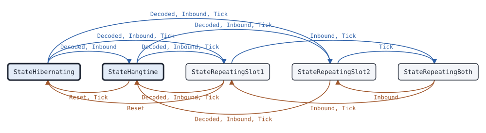
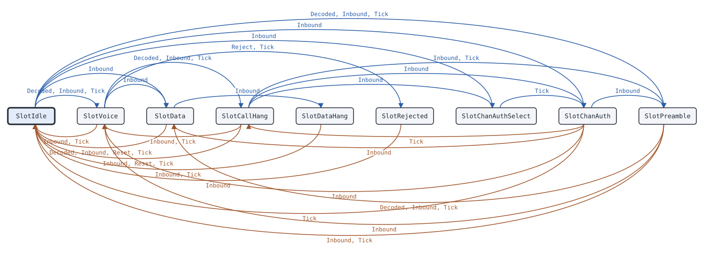

# bs.Repeater

This page describes the base station state machine of package bs: a repeater, a hotspot or the slot arbiter of a network server.

## What it does

[`bs.Repeater`](https://pkg.go.dev/github.com/USA-RedDragon/dmrgo/v2/bs#Repeater) is the base station of one carrier with two TDMA slots. It takes inbound bursts from RF and from network peers, checks the color code of the RF bursts, and gives each slot to one source at a time. It refuses the other sources, or queues them until the slot is free. It regenerates each burst that it repeats: voice goes through a [`voice.Receiver`](https://pkg.go.dev/github.com/USA-RedDragon/dmrgo/v2/voice#Receiver) and a [`voice.Transmitter`](https://pkg.go.dev/github.com/USA-RedDragon/dmrgo/v2/voice#Transmitter) per slot in relay mode, and data, CSBK and header bursts are built again from their corrected payload. After a voice call it holds the slot for the call hang time and sends Terminators with the call LC. After confirmed data it sends TD_LC for the data hang time. Pre_CSBKs before data or a CSBK hold the slot for their source. In RF mode it makes one outbound burst per slot time, with the CACH, the TC bit, the AT bit and the Short LC, and it wakes up and hibernates as the activation rules give. With channel authorization it repeats the ChanAuth PDU of one MS and gives the slot only to that MS. Voice bursts from a network source go through a [`voice.Jitter`](https://pkg.go.dev/github.com/USA-RedDragon/dmrgo/v2/voice#Jitter) per slot, which puts them back in order and plays them at a fixed delay. (ETSI TS 102 361-1 clause 5.2 and Annex G, ETSI TS 102 361-2 clause 5.1.1, ETSI TS 102 361-3 clause 5.4.3.3)

The Repeater does no I/O. Each method takes the time `now` on a monotonic clock that the caller picks, and appends outputs to a slice of the caller.

## When to use it

Use a Repeater in [`bs.ModeRF`](https://pkg.go.dev/github.com/USA-RedDragon/dmrgo/v2/bs#ModeRF) when you build a hotspot or a repeater that has a transmitter: an MMDVM modem, an SDR or a microcontroller modulator. Set `Config.CACH` when your modulator does not make the CACH and Idle bursts itself, as with an SDR. Leave it off for an MMDVM modem, whose firmware makes them.

Use it in [`bs.ModeNetwork`](https://pkg.go.dev/github.com/USA-RedDragon/dmrgo/v2/bs#ModeNetwork) for a network server without RF. In this mode the Repeater gives each slot to one peer at a time and forwards the regenerated bursts of that peer to the other peers. It makes no CACH, no hang time bursts and no Idle bursts, and it never hibernates.

Do not use a Repeater only to follow calls. A monitor or a scanner needs a [`voice.Receiver`](https://pkg.go.dev/github.com/USA-RedDragon/dmrgo/v2/voice#Receiver) and a [`data.Receiver`](https://pkg.go.dev/github.com/USA-RedDragon/dmrgo/v2/data#Receiver) per slot. If you make the CACH with your own slot logic, use [`bs.CACH`](https://pkg.go.dev/github.com/USA-RedDragon/dmrgo/v2/bs#CACH) alone.

## Config

[`bs.New`](https://pkg.go.dev/github.com/USA-RedDragon/dmrgo/v2/bs#New) takes a [`*bs.Config`](https://pkg.go.dev/github.com/USA-RedDragon/dmrgo/v2/bs#Config). A nil config is the zero Config. A duration of 0 selects the default in the field doc, and a negative duration turns that timer off. New returns a `*dmrgo.ConfigError` for a field out of range.

<!-- dmrgo:config pkg=bs type=Config -->
| Field | Type | Default | Description |
|---|---|---|---|
| `Mode` | `Mode` | zero value | Mode selects RF repeater or network arbiter. |
| `ColorCode` | `enums.ColorCode` | zero value | ColorCode is the color code of the bursts the Repeater sends, and the only one it takes from RF. |
| `Activation` | `Activation` | zero value | Activation selects what wakes up the Repeater in ModeRF. |
| `CACH` | `bool` | zero value | CACH makes the Repeater send the CACH and Idle bursts in ModeRF: true for an SDR or a microcontroller modulator, false for an MMDVM modem, whose firmware makes them. |
| `CallHang` | `time.Duration` | not machine-readable; see the description | CallHang is the call hang time T_CallHt. 0 means constants.TCallHang (3 s). A broadcast call and a call to constants.AllMSID have none (ETSI TS 102 361-2 clause 5.3.2.3.2). |
| `DataHang` | `time.Duration` | not machine-readable; see the description | DataHang is the data hang time T_DataHngtime after confirmed data. 0 means constants.TDataHangtime (180 ms). |
| `Inactivity` | `time.Duration` | not machine-readable; see the description | Inactivity is T_MSInactiv. 0 means DefaultInactivity. A negative value keeps the transmitter on once it wakes up. |
| `Lost` | `time.Duration` | not machine-readable; see the description | Lost is the time without a burst from the owner of a slot after which its call or its Pre_CSBKs end. 0 means voice.DefaultLost (1 s). |
| `Timeout` | `time.Duration` | not machine-readable; see the description | Timeout is the longest call. 0 means constants.TTO (180 s). A longer call ends with a Terminator and the rest of it is dropped. |
| `Headers` | `int` | not machine-readable; see the description | Headers is the number of Voice LC Headers that start a repeated call. 0 means 1, at most voice.MaxHeaders. A call that the Repeater joins late, without its Voice LC Header, starts with one header, as voice.Transmitter.Relay does. |
| `Terminators` | `int` | not machine-readable; see the description | Terminators is the number of Terminators with LC that end a repeated call, before the call hang time. 0 means 1, at most voice.MaxTerminators. |
| `Pending` | `int` | `DefaultPending` (8) | Pending is the number of refused sources per slot that wait for the slot and get it in turn when it is free. 0 means DefaultPending, at most MaxPending. A negative value queues none: the first burst after the slot is free takes it. |
| `PendingAge` | `time.Duration` | not machine-readable; see the description | PendingAge is the longest time a source waits for a slot. 0 means DefaultPendingAge. |
| `DataQueue` | `int` | `DefaultDataQueue` (4) | DataQueue is the number of data and CSBK bursts per slot that wait for the outbound channel in ModeRF. 0 means DefaultDataQueue, at most MaxDataQueue. |
| `Silence` | `[9]byte` | zero value | Silence is the 72-bit vocoder slot that fills lost voice. The zero value means vocoder.AMBESilenceSlot. A call with a FID other than enums.FIDStandardized and enums.FIDMotorola, such as a Codec2 call, repeats its last vocoder slot instead, as voice.TransmitterConfig gives. |
| `Lead` | `time.Duration` | not machine-readable; see the description | Lead makes Tick emit an outbound burst this long before its Due time in ModeRF, so that a transmit FIFO can be filled ahead. 0 means at Due; it must not be negative. |
| `ChannelAuth` | `ChannelAuth` | zero value | ChannelAuth selects the channel authorization of RF access in the call and channel hang time in ModeRF. ModeNetwork ignores it. (ETSI TS 102 361-2 clause 5.1.1.6) |
| `ChanAuthResponse` | `time.Duration` | not machine-readable; see the description | ChanAuthResponse is T_BS_ChanAuthRsp, how long the Repeater repeats a ChanAuth PDU while it waits for the authorized MS. 0 means constants.TBSChanAuthRspVoice for a Voice LC Header, and constants.TBSChanAuthRspCSBKSingle or constants.TBSChanAuthRspCSBKMulti for a Pre_CSBK. (ETSI TS 102 361-2 clause A.1) |
| `ChanAuthSelect` | `time.Duration` | not machine-readable; see the description | ChanAuthSelect is T_BS_ChanAuthSel of ChannelAuthMultiSite. 0 means constants.TBSChanAuthSel (240 ms). (ETSI TS 102 361-2 clause A.1) |
| `Scratch` | `*layer2.Burst` | `layer2.NewBurst()` | Scratch, when set, is the Burst that the Repeater decodes into. It can be shared with other machines on the same goroutine, because the Repeater is done with it when its method returns. Nil means the Repeater makes its own. |
| `Jitter` | `time.Duration` | not machine-readable; see the description | Jitter is the playout delay of the network jitter buffer of each slot, a voice.Jitter, which puts the voice bursts from a network source back in the order of Hint.Seq and plays them this long after the first burst of a stream arrived, as the Jitter of MMDVMHost does. Voice bursts are the voice bursts, the Voice LC Header, the PI Header and the Terminator with LC. 0 means voice.DefaultJitter (360 ms), and a negative value turns the buffer off, so that each burst is taken as it comes. At most voice.MaxJitter. RF bursts, and bursts without Hint.HasSeq, are taken as they come. In ModeRF the Repeater takes a burst from the buffer up to one burst period and Lead before its time, because the outbound channel takes the voice of a slot that far ahead. The voice.Jitter doc gives the rules for late, lost and duplicate bursts, stalls and new streams. Data, CSBK, MBC and other bursts of a network source have no playout delay. Such a burst is taken when it comes, in ModeRF as soon as the data queue of the slot has room, with these exceptions. A burst after a gap in Hint.Seq waits for the gap to fill for at most one burst period (60 ms) after the first burst behind the gap came, because the blocks of unconfirmed data must go out in order; a stream whose gaps never fill, such as one of a sender that counts both slots, does not wait again. A rate 1/2, 3/4 or 1 data block whose own Data Header has not come yet waits for it at most one superframe (360 ms) after the block came, because a block without its header is dropped. A copy of a burst taken is dropped, and a burst that comes after a later one of its stream is taken late. A burst of a data stream that a source starts while its voice is still in the jitter buffer waits for that voice to play, because the slot carries one call at a time: until the Terminator of the call plays, or the buffer holds no more voice of the source. |
<!-- /dmrgo:config -->

## States and transitions

The Repeater has two levels of state. [`Repeater.State`](https://pkg.go.dev/github.com/USA-RedDragon/dmrgo/v2/bs#Repeater.State) returns the state of the carrier: off, keyed with both slots free, or repeating one or both slots (ETSI TS 102 361-1 Figure G.5).

<!-- dmrgo:states pkg=bs type=State -->
States of [`Repeater`](https://pkg.go.dev/github.com/USA-RedDragon/dmrgo/v2/bs#Repeater), from [`Repeater.State`](https://pkg.go.dev/github.com/USA-RedDragon/dmrgo/v2/bs#Repeater.State):

| State | Meaning | Seen in tests |
|---|---|---|
| [`StateHibernating`](https://pkg.go.dev/github.com/USA-RedDragon/dmrgo/v2/bs#StateHibernating) | StateHibernating has the transmitter off. ModeNetwork never hibernates. | yes, first state |
| [`StateHangtime`](https://pkg.go.dev/github.com/USA-RedDragon/dmrgo/v2/bs#StateHangtime) | StateHangtime is keyed with both slots free. | yes, first state |
| [`StateRepeatingSlot1`](https://pkg.go.dev/github.com/USA-RedDragon/dmrgo/v2/bs#StateRepeatingSlot1) | StateRepeatingSlot1 repeats slot 1. | yes |
| [`StateRepeatingSlot2`](https://pkg.go.dev/github.com/USA-RedDragon/dmrgo/v2/bs#StateRepeatingSlot2) | StateRepeatingSlot2 repeats slot 2. | yes |
| [`StateRepeatingBoth`](https://pkg.go.dev/github.com/USA-RedDragon/dmrgo/v2/bs#StateRepeatingBoth) | StateRepeatingBoth repeats both slots. | yes |

Transitions seen in tests:

| From | Method call | To |
|---|---|---|
| StateHibernating | `Decoded`, `Inbound` | StateHangtime |
| StateHibernating | `Decoded`, `Inbound`, `Tick` | StateRepeatingSlot1 |
| StateHibernating | `Decoded`, `Inbound`, `Tick` | StateRepeatingSlot2 |
| StateHangtime | `Reset`, `Tick` | StateHibernating |
| StateHangtime | `Decoded`, `Inbound`, `Tick` | StateRepeatingSlot1 |
| StateHangtime | `Decoded`, `Inbound`, `Tick` | StateRepeatingSlot2 |
| StateRepeatingSlot1 | `Reset` | StateHibernating |
| StateRepeatingSlot1 | `Decoded`, `Inbound`, `Tick` | StateHangtime |
| StateRepeatingSlot1 | `Inbound`, `Tick` | StateRepeatingBoth |
| StateRepeatingSlot2 | `Decoded`, `Inbound`, `Tick` | StateHangtime |
| StateRepeatingSlot2 | `Tick` | StateRepeatingBoth |
| StateRepeatingBoth | `Inbound`, `Tick` | StateRepeatingSlot1 |
| StateRepeatingBoth | `Inbound` | StateRepeatingSlot2 |


<!-- /dmrgo:states -->

[`Repeater.SlotState`](https://pkg.go.dev/github.com/USA-RedDragon/dmrgo/v2/bs#Repeater.SlotState) returns the state of one slot (ETSI TS 102 361-1 Figure G.6, ETSI TS 102 361-3 clause 5.4.3.3).

<!-- dmrgo:states pkg=bs type=SlotState -->
States of [`Repeater`](https://pkg.go.dev/github.com/USA-RedDragon/dmrgo/v2/bs#Repeater), from [`Repeater.SlotState`](https://pkg.go.dev/github.com/USA-RedDragon/dmrgo/v2/bs#Repeater.SlotState) for each `enums.Slot`:

| State | Meaning | Seen in tests |
|---|---|---|
| [`SlotIdle`](https://pkg.go.dev/github.com/USA-RedDragon/dmrgo/v2/bs#SlotIdle) | SlotIdle is the channel hang time: the slot is free and gets Idle bursts. | yes, first state |
| [`SlotVoice`](https://pkg.go.dev/github.com/USA-RedDragon/dmrgo/v2/bs#SlotVoice) | SlotVoice repeats a voice call. | yes |
| [`SlotData`](https://pkg.go.dev/github.com/USA-RedDragon/dmrgo/v2/bs#SlotData) | SlotData repeats a data header and its blocks. | yes |
| [`SlotCallHang`](https://pkg.go.dev/github.com/USA-RedDragon/dmrgo/v2/bs#SlotCallHang) | SlotCallHang is the call hang time after a voice call: only a call to the same target takes the slot, and it gets Terminators with the call LC. | yes |
| [`SlotDataHang`](https://pkg.go.dev/github.com/USA-RedDragon/dmrgo/v2/bs#SlotDataHang) | SlotDataHang is the data hang time after confirmed data: it gets TD_LC and waits for the response. | yes |
| [`SlotRejected`](https://pkg.go.dev/github.com/USA-RedDragon/dmrgo/v2/bs#SlotRejected) | SlotRejected drops a call that timed out or was rejected until it ends. | yes |
| [`SlotChanAuthSelect`](https://pkg.go.dev/github.com/USA-RedDragon/dmrgo/v2/bs#SlotChanAuthSelect) | SlotChanAuthSelect collects ChanAuth PDUs for T_BS_ChanAuthSel and keeps sending the hang time bursts (ETSI TS 102 361-2 clause 5.1.1.6.1.2). | yes |
| [`SlotChanAuth`](https://pkg.go.dev/github.com/USA-RedDragon/dmrgo/v2/bs#SlotChanAuth) | SlotChanAuth repeats the ChanAuth PDU of the authorized MS until T_BS_ChanAuthRsp runs out or a burst with its source address comes (ETSI TS 102 361-2 clause 5.1.1.6.1). | yes |
| [`SlotPreamble`](https://pkg.go.dev/github.com/USA-RedDragon/dmrgo/v2/bs#SlotPreamble) | SlotPreamble repeats the Pre_CSBKs of one source before its data or CSBK. The CACH marks the slot busy and the Activity Update carries the data or CSBK activity until the data header or the CSBK comes, or Config.Lost passes without a Pre_CSBK (ETSI TS 102 361-1 clause 6.3, ETSI TS 102 361-2 clause 7.1.2.5). | yes |

Transitions seen in tests:

| From | Method call | To |
|---|---|---|
| SlotIdle | `Decoded`, `Inbound`, `Tick` | SlotVoice |
| SlotIdle | `Inbound` | SlotData |
| SlotIdle | `Inbound` | SlotChanAuthSelect |
| SlotIdle | `Inbound` | SlotChanAuth |
| SlotIdle | `Decoded`, `Inbound`, `Tick` | SlotPreamble |
| SlotVoice | `Inbound`, `Tick` | SlotIdle |
| SlotVoice | `Inbound` | SlotData |
| SlotVoice | `Decoded`, `Inbound`, `Tick` | SlotCallHang |
| SlotVoice | `Reject`, `Tick` | SlotRejected |
| SlotData | `Decoded`, `Inbound`, `Reset`, `Tick` | SlotIdle |
| SlotData | `Inbound` | SlotDataHang |
| SlotCallHang | `Inbound`, `Reset`, `Tick` | SlotIdle |
| SlotCallHang | `Inbound`, `Tick` | SlotVoice |
| SlotCallHang | `Inbound` | SlotChanAuthSelect |
| SlotCallHang | `Inbound` | SlotChanAuth |
| SlotCallHang | `Inbound`, `Tick` | SlotPreamble |
| SlotDataHang | `Inbound`, `Tick` | SlotIdle |
| SlotRejected | `Inbound` | SlotIdle |
| SlotChanAuthSelect | `Tick` | SlotChanAuth |
| SlotChanAuth | `Tick` | SlotIdle |
| SlotChanAuth | `Inbound` | SlotVoice |
| SlotChanAuth | `Inbound` | SlotData |
| SlotChanAuth | `Tick` | SlotCallHang |
| SlotChanAuth | `Inbound` | SlotPreamble |
| SlotPreamble | `Inbound`, `Tick` | SlotIdle |
| SlotPreamble | `Inbound` | SlotVoice |
| SlotPreamble | `Decoded`, `Inbound`, `Tick` | SlotData |


<!-- /dmrgo:states -->

These inputs move the slot state:

- A Voice LC Header, or a voice burst of a call that the Repeater joins late, starts a voice call on a free slot. A data header starts data. A Pre_CSBK holds the slot for its source until the data header or the CSBK comes, or until `Config.Lost` passes without a Pre_CSBK. The carrier counts a slot that holds Pre_CSBKs as repeating.
- The Terminator of a voice call, or `Config.Lost` without a burst from the owner, ends the call and starts the call hang time. In the call hang time, a call to the same target from any source takes the slot, and so does a call to any target from the source of the last call. All RF MSs count as one source, so after an RF call any RF MS can take the slot; the politeness rules of the MSs keep the others off. A broadcast call and a call to the all-MS ID get no call hang time (ETSI TS 102 361-2 clause 5.3.2.3.2).
- The last block of confirmed data starts the data hang time, which waits for the response.
- A call that runs longer than `Config.Timeout`, or that the caller refuses with [`Repeater.Reject`](https://pkg.go.dev/github.com/USA-RedDragon/dmrgo/v2/bs#Repeater.Reject), goes to the state that drops the rest of the call until it ends. A call that ends in this state gets no hang time.
- With `Config.ChannelAuth`, the first MS that starts a transmission in hang time moves the slot to channel authorization. The multi-site mode first collects ChanAuth PDUs from RF and from the network for T_BS_ChanAuthSel and picks the lowest source address (ETSI TS 102 361-2 clause 5.1.1.6).
- In RF mode, a network burst keys the transmitter. From RF, [`bs.ActivationAny`](https://pkg.go.dev/github.com/USA-RedDragon/dmrgo/v2/bs#ActivationAny) keys it on any valid burst with the own color code, and [`bs.ActivationWakeup`](https://pkg.go.dev/github.com/USA-RedDragon/dmrgo/v2/bs#ActivationWakeup) keys it only on a BS_Dwn_Act CSBK with the own color code (ETSI TS 102 361-2 clause 5.1.1.1). T_MSInactiv without inbound activity puts the carrier back to hibernation (ETSI TS 102 361-1 clause 5.2.1.3).

## Inputs and outputs

Every method that takes `dst` appends at most [`bs.MaxOutputs`](https://pkg.go.dev/github.com/USA-RedDragon/dmrgo/v2/bs#MaxOutputs) outputs. Give it a slice with that capacity, and the method does not allocate.

| Method | Takes | Returns |
|---|---|---|
| [`Inbound`](https://pkg.go.dev/github.com/USA-RedDragon/dmrgo/v2/bs#Repeater.Inbound) | a raw burst, its [`layer2.Hint`](https://pkg.go.dev/github.com/USA-RedDragon/dmrgo/v2/layer2#Hint) and its [`bs.Source`](https://pkg.go.dev/github.com/USA-RedDragon/dmrgo/v2/bs#Source) | `dst` with the outputs |
| [`Decoded`](https://pkg.go.dev/github.com/USA-RedDragon/dmrgo/v2/bs#Repeater.Decoded) | a burst that the caller decoded, or nil for one that did not decode | `dst` with the outputs |
| [`Lost`](https://pkg.go.dev/github.com/USA-RedDragon/dmrgo/v2/bs#Repeater.Lost) | a slot and a source whose signal the transport lost | `dst` with the outputs |
| [`Tick`](https://pkg.go.dev/github.com/USA-RedDragon/dmrgo/v2/bs#Repeater.Tick) | the time now | `dst` with at most one outbound burst and the outputs of the timers |
| [`Deadline`](https://pkg.go.dev/github.com/USA-RedDragon/dmrgo/v2/bs#Repeater.Deadline) | nothing | the time of the next Tick, and false when no timer runs |
| [`Reject`](https://pkg.go.dev/github.com/USA-RedDragon/dmrgo/v2/bs#Repeater.Reject) | a slot | an error |
| [`State`](https://pkg.go.dev/github.com/USA-RedDragon/dmrgo/v2/bs#Repeater.State), [`SlotState`](https://pkg.go.dev/github.com/USA-RedDragon/dmrgo/v2/bs#Repeater.SlotState), [`JitterStats`](https://pkg.go.dev/github.com/USA-RedDragon/dmrgo/v2/bs#Repeater.JitterStats) | nothing, or a slot | the state, or the jitter buffer counts of a slot |
| [`Reset`](https://pkg.go.dev/github.com/USA-RedDragon/dmrgo/v2/bs#Repeater.Reset) | nothing | nothing; it ends every call without outputs |

`Inbound` is the usual input. Set `Source.RF` for a burst from your receiver, and set `Source.Peer` to the peer ID for a burst from the network. Put the slot in `Hint.Slot`. A burst on a slot other than slot 1 or slot 2 is dropped without an output; use [`bs.CheckSlot`](https://pkg.go.dev/github.com/USA-RedDragon/dmrgo/v2/bs#CheckSlot) to find such a burst first. A nil raw burst is a transport frame without a burst: only the Hint applies, and `Hint.SyncLost` ends a call of that source. A network voice burst with `Hint.HasSeq` goes into the jitter buffer of its slot, and a later Tick takes it.

Use `Decoded` when you feed one decoded burst to several machines. The Repeater sends the burst as it encodes it again.

Each [`bs.Output`](https://pkg.go.dev/github.com/USA-RedDragon/dmrgo/v2/bs#Output) has a [`Kind`](https://pkg.go.dev/github.com/USA-RedDragon/dmrgo/v2/bs#OutputKind):

- `OutputBurst` is a burst to send at `Due` to the places in `To`: [`ToRF`](https://pkg.go.dev/github.com/USA-RedDragon/dmrgo/v2/bs#ToRF), [`ToNetwork`](https://pkg.go.dev/github.com/USA-RedDragon/dmrgo/v2/bs#ToNetwork) or both. With `Config.CACH`, an RF burst also has `HasCACH` and the `CACH` field. `Hint` gives the slot and the burst kind for your transport.
- `OutputCallStart` and `OutputCallEnd` mark a source that takes a slot and the end of its call or data, with `Service`, `Call` and, at the end, `End`.
- `OutputRejected` is a source that the Repeater refused, with a [`Reason`](https://pkg.go.dev/github.com/USA-RedDragon/dmrgo/v2/bs#Reason).
- `OutputKey` and `OutputDekey` turn the transmitter on and off in RF mode.

The time loop is the same as for every dmrgo machine. After each call, read `Deadline` and call `Tick` at that time. In RF mode `Tick` makes one outbound burst per slot time while the carrier is keyed. `Tick` takes at most one burst from the jitter buffers per call, so a caller that runs late calls `Tick` until `Deadline` is in the future. `Config.Lead` makes `Tick` emit each outbound burst early, so that you can fill a transmit FIFO.

To refuse a call for an access rule of your own, call `Reject` on its `OutputCallStart`. The next method that takes `dst` appends `OutputRejected` with `ReasonRejected`, and `OutputCallEnd` follows when the call ends.

## Timers

| Timer | Config field | Default |
|---|---|---|
| Slot time, the period of Tick in RF mode (ETSI TS 102 361-1 clause 4.2.2) | none | <!-- dmrgo:const pkg=bs name=SlotTime -->`30ms`<!-- /dmrgo:const --> |
| Call hang time T_CallHt | `CallHang` | <!-- dmrgo:const pkg=constants name=TCallHang -->`3s`<!-- /dmrgo:const --> |
| Data hang time T_DataHngtime | `DataHang` | <!-- dmrgo:const pkg=constants name=TDataHangtime -->`180ms`<!-- /dmrgo:const --> |
| T_MSInactiv, the time to hibernation (ETSI TS 102 361-1 clause F.1) | `Inactivity` | <!-- dmrgo:const pkg=bs name=DefaultInactivity -->`5s`<!-- /dmrgo:const --> |
| Time without a burst from the slot owner that ends its call | `Lost` | <!-- dmrgo:const pkg=voice name=DefaultLost -->`1s`<!-- /dmrgo:const --> |
| Longest call | `Timeout` | <!-- dmrgo:const pkg=constants name=TTO -->`3m0s`<!-- /dmrgo:const --> |
| Longest wait of a queued source | `PendingAge` | <!-- dmrgo:const pkg=bs name=DefaultPendingAge -->`30s`<!-- /dmrgo:const --> |
| T_BS_ChanAuthRsp after a Voice LC Header | `ChanAuthResponse` | <!-- dmrgo:const pkg=constants name=TBSChanAuthRspVoice -->`720ms`<!-- /dmrgo:const --> |
| T_BS_ChanAuthRsp after a Pre_CSBK, single site | `ChanAuthResponse` | <!-- dmrgo:const pkg=constants name=TBSChanAuthRspCSBKSingle -->`900ms`<!-- /dmrgo:const --> |
| T_BS_ChanAuthRsp after a Pre_CSBK, multi-site | `ChanAuthResponse` | <!-- dmrgo:const pkg=constants name=TBSChanAuthRspCSBKMulti -->`1.14s`<!-- /dmrgo:const --> |
| T_BS_ChanAuthSel of multi-site channel authorization | `ChanAuthSelect` | <!-- dmrgo:const pkg=constants name=TBSChanAuthSel -->`240ms`<!-- /dmrgo:const --> |
| Playout delay of the network jitter buffer | `Jitter` | <!-- dmrgo:const pkg=voice name=DefaultJitter -->`360ms`<!-- /dmrgo:const -->, at most <!-- dmrgo:const pkg=voice name=MaxJitter -->`2s`<!-- /dmrgo:const --> |

A negative `Inactivity` keeps the transmitter on after it wakes up. A negative `Jitter` turns the buffer off, and each network burst is taken as it comes. Data and CSBK bursts from the network have no playout delay. They wait only for a short gap in their sequence to fill, for the Data Header of their block, or for voice of the same source that is still in the jitter buffer; the `Config.Jitter` doc gives these waits.

## Worked example

This example feeds a recorded SMS to slot 2 of a hotspot in RF mode, with a Tick every slot time, and counts the bursts that go out on each slot.

<!-- dmrgo:code file=v2/bs/example_test.go symbol=ExampleRepeater -->
```go
func ExampleRepeater() {
	data, err := os.ReadFile("../layer2/testdata/d-sms.bin")
	if err != nil {
		fmt.Println(err)
		return
	}
	r, err := bs.New(&bs.Config{ColorCode: 1, CACH: true})
	if err != nil {
		fmt.Println(err)
		return
	}
	out := make([]bs.Output, 0, bs.MaxOutputs)
	sent := map[enums.Slot]map[enums.DataType]int{enums.Slot1: {}, enums.Slot2: {}}
	handle := func(out []bs.Output) {
		for _, o := range out {
			switch o.Kind {
			case bs.OutputBurst:
				sent[o.Slot][o.Burst.SlotType().DataType]++
			case bs.OutputCallStart:
				fmt.Printf("%v: %v from %d to %d\n", o.Slot, o.Service, o.Call.Source, o.Call.Target)
			default:
				fmt.Println(o.Kind)
			}
		}
	}
	next := 0
	for now := time.Duration(0); now < 6*time.Second; now += bs.SlotTime {
		if next+33 <= len(data) && now >= time.Duration(next/33)*60*time.Millisecond {
			raw := layer2.RawBurst(data[next : next+33])
			next += 33
			handle(r.Inbound(now, &raw, layer2.Hint{Slot: enums.Slot2}, bs.Source{RF: true}, out[:0]))
		}
		handle(r.Tick(now, out[:0]))
	}
	fmt.Println("TS1:", sent[enums.Slot1])
	fmt.Println("TS2:", sent[enums.Slot2])
}
```
<!-- /dmrgo:code -->

Output:

<!-- dmrgo:output test=bs.ExampleRepeater -->
```text
Key
TS2: Data from 3191868 to 9990
CallEnd
Dekey
TS1: map[Idle:93]
TS2: map[CSBK:5 Data Header:1 Rate 1/2:5 Idle:83]
```
<!-- /dmrgo:output -->

The first valid burst keys the transmitter. The Pre_CSBKs, the data header and the rate 1/2 blocks go out again on slot 2, and both slots get Idle bursts between them. After T_MSInactiv without activity the transmitter dekeys.

[`bs.Config.ChannelAuth`](https://pkg.go.dev/github.com/USA-RedDragon/dmrgo/v2/bs#Config) has its own example, `ExampleConfig_channelAuth`, in the package docs.

## Errors

<!-- dmrgo:errors pkg=bs type=Repeater -->
| Error | Returned by | Meaning |
|---|---|---|
| [`bs.ErrSlot`](https://pkg.go.dev/github.com/USA-RedDragon/dmrgo/v2/bs#ErrSlot) | `Repeater.Reject` | ErrSlot is returned for a slot other than enums.Slot1 or enums.Slot2. |
| [`dmrgo.ErrZeroValue`](https://pkg.go.dev/github.com/USA-RedDragon/dmrgo/v2#ErrZeroValue) | `Repeater.Reject` | ErrZeroValue is returned by a method of a state machine that starts work, such as Start, Request or Send, when the machine is a zero value and not made with its constructor. |
<!-- /dmrgo:errors -->

Only `New` and `Reject` return errors. The burst methods drop what they cannot use and do not return an error: a burst on a bad slot, an RF burst with another color code, and any call on a zero Repeater. No method panics.

## Related machines and guides

- [voice.Receiver](voice-receiver.md), [voice.Transmitter](voice-transmitter.md) and [voice.Jitter](voice-jitter.md) are the voice machines that the Repeater runs on each slot.
- [data.Receiver](data-receiver.md) follows the data calls that a Repeater repeats, for a gateway or a monitor.
- [csbk.Wakeup](csbk-wakeup.md) is the MS side of the BS_Dwn_Act wakeup that `ActivationWakeup` waits for.
- [csbk.Preambles](csbk-preambles.md) follows Pre_CSBKs on the MS side.
- The guides [Receive with an SDR or an FM radio](../guides/receive-sdr-fm.md) and [Use an MMDVM modem](../guides/mmdvm-modem.md) pass the bursts of a radio or a modem to the service machines, such as a Repeater.
