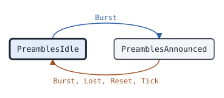

# csbk.Preambles

This page describes the Pre_CSBK state machine of package csbk: it follows the Pre_CSBKs on a channel and reports the CSBK or data that they announce.

## What it does

[`csbk.Preambles`](https://pkg.go.dev/github.com/USA-RedDragon/dmrgo/v2/csbk#Preambles) follows the Pre_CSBKs of one logical channel. A Pre_CSBK with CSBK Blocks to Follow n announces n more blocks: more Pre_CSBKs, then a CSBK or a data message. The Preambles reports the first Pre_CSBK of a transfer. It then reports the CSBK, MBC header or data header that follows, joined with the addresses of the Pre_CSBKs, or it reports that nothing followed by the end of the announced blocks. A repeater can send more Pre_CSBKs than the radio did, each with CSBK Blocks to Follow 1, and each one moves the end of the transfer later. (ETSI TS 102 361-2 clauses 7.1.2.5 and 7.2.7)

The Preambles does no I/O. Each method takes the time `now` on a monotonic clock that the caller picks, and appends outputs to a slice of the caller.

## When to use it

Use a Preambles in a monitor, a bridge or a gateway that must have the parties of a CSBK or a data message before it comes, or that must join a CSBK with the Pre_CSBKs before it. For example, a bridge can hold a slot for the parties of the Pre_CSBKs, and a monitor can show a CSBK with the addresses that its Pre_CSBKs carry.

A [`data.Receiver`](https://pkg.go.dev/github.com/USA-RedDragon/dmrgo/v2/data#Receiver) already starts a data call at a Pre_CSBK, so a data receiver alone does not need a Preambles. A [`bs.Repeater`](https://pkg.go.dev/github.com/USA-RedDragon/dmrgo/v2/bs#Repeater) has its own Pre_CSBK handling for the slot it repeats.

## Config

[`csbk.NewPreambles`](https://pkg.go.dev/github.com/USA-RedDragon/dmrgo/v2/csbk#NewPreambles) takes a [`*csbk.PreamblesConfig`](https://pkg.go.dev/github.com/USA-RedDragon/dmrgo/v2/csbk#PreamblesConfig). A nil config is the zero config, which is the usual choice. The only field is the scratch burst that `Burst` decodes into, which machines on one goroutine can share.

<!-- dmrgo:config pkg=csbk type=PreamblesConfig -->
| Field | Type | Default | Description |
|---|---|---|---|
| `Scratch` | `*layer2.Burst` | `layer2.NewBurst()` | Scratch, when set, is the Burst that Burst decodes into, as for RequesterConfig.Scratch. |
<!-- /dmrgo:config -->

## States and transitions

<!-- dmrgo:states pkg=csbk type=PreamblesState -->
States of [`Preambles`](https://pkg.go.dev/github.com/USA-RedDragon/dmrgo/v2/csbk#Preambles), from [`Preambles.State`](https://pkg.go.dev/github.com/USA-RedDragon/dmrgo/v2/csbk#Preambles.State):

| State | Meaning | Seen in tests |
|---|---|---|
| [`PreamblesIdle`](https://pkg.go.dev/github.com/USA-RedDragon/dmrgo/v2/csbk#PreamblesIdle) | PreamblesIdle follows no announced transfer. | yes, first state |
| [`PreamblesAnnounced`](https://pkg.go.dev/github.com/USA-RedDragon/dmrgo/v2/csbk#PreamblesAnnounced) | PreamblesAnnounced waits for the CSBK or data that Pre_CSBKs announced. | yes |

Transitions seen in tests:

| From | Method call | To |
|---|---|---|
| PreamblesIdle | `Burst` | PreamblesAnnounced |
| PreamblesAnnounced | `Burst`, `Lost`, `Reset`, `Tick` | PreamblesIdle |


<!-- /dmrgo:states -->

These inputs move the state:

- In idle, a Pre_CSBK starts a transfer and appends `OutputAnnounced`.
- While a transfer is announced, a Pre_CSBK with the same target, source, group flag and data flag moves the end of the transfer later and appends nothing. A Pre_CSBK with other parties appends `OutputExpired` for the old transfer and `OutputAnnounced` for the new one.
- While a transfer is announced, the next CSBK that is not a Pre_CSBK, MBC header or data header appends `OutputJoined` and returns to idle. The Preambles does not compare the addresses of that burst with the addresses of the Pre_CSBKs: it reports the burst with the addresses of the Pre_CSBKs.
- When one burst interval has passed after the last announced block, `Tick` appends `OutputExpired` and returns to idle.
- `Reset` returns to idle without an output.

Other bursts, voice included, do not change the state. `Lost` does not end the transfer, because the announced burst can still come after a short loss of signal.

## Inputs and outputs

Every method that takes `dst` appends at most [`csbk.MaxOutputs`](https://pkg.go.dev/github.com/USA-RedDragon/dmrgo/v2/csbk#MaxOutputs) outputs, and does not allocate when `dst` has that room.

| Method | Takes | Returns |
|---|---|---|
| [`Burst`](https://pkg.go.dev/github.com/USA-RedDragon/dmrgo/v2/csbk#Preambles.Burst) | a raw burst and its [`layer2.Hint`](https://pkg.go.dev/github.com/USA-RedDragon/dmrgo/v2/layer2#Hint) | `dst` with the outputs |
| [`Decoded`](https://pkg.go.dev/github.com/USA-RedDragon/dmrgo/v2/csbk#Preambles.Decoded) | a burst that the caller decoded, or nil | `dst` with the outputs |
| [`Tick`](https://pkg.go.dev/github.com/USA-RedDragon/dmrgo/v2/csbk#Preambles.Tick) | the time now | `dst` with `OutputExpired` when the transfer did not come |
| [`Deadline`](https://pkg.go.dev/github.com/USA-RedDragon/dmrgo/v2/csbk#Preambles.Deadline) | nothing | the time of the next Tick, and false when no transfer is announced |
| [`Lost`](https://pkg.go.dev/github.com/USA-RedDragon/dmrgo/v2/csbk#Preambles.Lost) | the time now | `dst`; it runs the timer as `Tick` does |
| [`State`](https://pkg.go.dev/github.com/USA-RedDragon/dmrgo/v2/csbk#Preambles.State), [`Reset`](https://pkg.go.dev/github.com/USA-RedDragon/dmrgo/v2/csbk#Preambles.Reset) | nothing | the state, or nothing |

Feed every burst of the logical channel to `Burst`, or to `Decoded` when you decode the burst once for several machines. Pass `now` as the start of the received burst, because the end of the transfer counts from it. A nil raw burst only runs the timer. A CSBK whose CRC fails is dropped.

Each [`csbk.Output`](https://pkg.go.dev/github.com/USA-RedDragon/dmrgo/v2/csbk#Output) has the `Call` of the Pre_CSBKs, with `Group` set for a talkgroup target:

- `OutputAnnounced`: the first Pre_CSBK of a transfer. `Data` reports that data follows, and `Until` is the time of the last announced block.
- `OutputJoined`: the CSBK, MBC header or data header after the Pre_CSBKs. `Data` reports a data header, and `CSBK` holds the CSBK when one came.
- `OutputExpired`: a transfer that did not come by `Until`, or that a Pre_CSBK of other parties replaced.

## Timers

| Timer | Config field | Value |
|---|---|---|
| Time per announced block, from the start of the Pre_CSBK | none | <!-- dmrgo:const pkg=csbk name=BurstInterval -->`60ms`<!-- /dmrgo:const --> |
| Wait after the last announced block before `OutputExpired` | none | <!-- dmrgo:const pkg=csbk name=BurstInterval -->`60ms`<!-- /dmrgo:const --> |

A Pre_CSBK at time t with CSBK Blocks to Follow n sets `Until` to t plus n burst intervals. The most Pre_CSBKs before one CSBK is <!-- dmrgo:const pkg=csbk name=MaxPreambles -->`255`<!-- /dmrgo:const -->, the 8 bits of CSBK Blocks to Follow.

## Worked example

This example uses a [csbk.Requester](csbk-requester.md) to make a Motorola call alert with 2 Pre_CSBKs, and feeds its three bursts to a Preambles.

<!-- dmrgo:code file=v2/csbk/example_test.go symbol=ExamplePreambles -->
```go
func ExamplePreambles() {
	q, _ := csbk.NewRequester(&csbk.RequesterConfig{Slot: enums.Slot1, Source: layer2.SyncSourceMS})
	_ = q.RequestCallAlert(0, 3191868, 3140598, &csbk.RequestOptions{Preambles: 2})
	p, err := csbk.NewPreambles(nil)
	if err != nil {
		fmt.Println(err)
		return
	}
	out := make([]csbk.Output, 0, csbk.MaxOutputs)
	for range 3 {
		at, _ := q.Deadline()
		sent := q.Tick(at, nil)
		out = p.Burst(at, &sent[0].Burst, layer2.Hint{}, out[:0])
		for i := range out {
			fmt.Println(out[i].Kind, "to", out[i].Call.Target, "until", out[i].Until)
		}
	}
}
```
<!-- /dmrgo:code -->

Output:

<!-- dmrgo:output test=csbk.ExamplePreambles -->
```text
Announced to 3191868 until 120ms
Joined to 3191868 until 0s
```
<!-- /dmrgo:output -->

The first Pre_CSBK announces two more blocks, so `Until` is the time of the call alert. The second Pre_CSBK has the same parties and appends nothing. The call alert joins the transfer.

## Errors

<!-- dmrgo:errors pkg=csbk type=Preambles -->
The doc comments of [`Preambles`](https://pkg.go.dev/github.com/USA-RedDragon/dmrgo/v2/csbk#Preambles) and its methods name no error.
<!-- /dmrgo:errors -->

No config is out of range, so `NewPreambles` returns a nil error; it returns one only to have the shape of the other constructors. The other methods return no error. A burst that does not decode, or a CSBK whose CRC fails, is dropped.

## Related machines and guides

- [csbk.Requester](csbk-requester.md) sends Pre_CSBKs before a request.
- [data.Sender](data-sender.md) sends Pre_CSBKs before each try of a data message, and [data.Receiver](data-receiver.md) starts a data call at them.
- [bs.Repeater](bs-repeater.md) holds a slot for the source of Pre_CSBKs.
- The guides [Send SMS and confirmed data with retries](../guides/send-data.md) and [Radio check, call alert and other CSBK services](../guides/csbk-services.md) show Pre_CSBKs on air.
