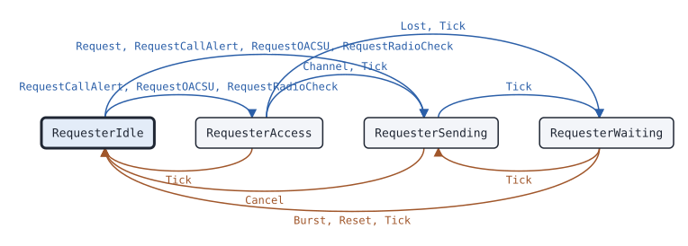

# csbk.Requester

This page describes the CSBK request state machine of package csbk: it sends one CSBK request, waits for the answer and sends it again when no answer comes.

## What it does

[`csbk.Requester`](https://pkg.go.dev/github.com/USA-RedDragon/dmrgo/v2/csbk#Requester) sends CSBK requests on one logical channel, one request at a time. It can send Pre_CSBKs before the request, for radios that scan or sleep. Each try uses the channel access of the request: an impolite try goes at once, and a polite try waits for an idle channel. A time critical polite try waits up to T_IdleSrch and then fails. A polite try that is not time critical waits a random holdoff T_Holdoff, and then another one while the channel stays busy. After each try the Requester waits T_AckWait for the answer and tries again up to N_CSBKRetry times. It reports the answer, a NACK_Rsp for the request, or why no answer came. It has built-in requests for the OACSU presence check (UU_V_Req, answered by UU_Ans_Rsp) and for the Motorola radio check and call alert (FID 0x10). Any other CSBK goes out with a [`csbk.Match`](https://pkg.go.dev/github.com/USA-RedDragon/dmrgo/v2/csbk#Match) that gives the answer. (ETSI TS 102 361-1 clause 5.2.2, ETSI TS 102 361-2 clauses 5.1.2 and 5.2.2)

The Motorola radio check and call alert have no public spec. Their layouts and answer times come from captures of an AnyTone radio through a Motorola XPR 8400 repeater.

The Requester does no I/O. Each method takes the time `now` on a monotonic clock that the caller picks, and appends outputs to a slice of the caller.

## When to use it

Use a Requester when your radio, hotspot or gateway starts a CSBK service and needs its answer: a radio check of another radio, a call alert, the presence check before an OACSU individual call, or a CSBK of your own design with a known answer.

Use a [csbk.Responder](csbk-responder.md) for the other side, the radio that answers. Use a [csbk.Wakeup](csbk-wakeup.md) to wake a BS outbound, which has no CSBK answer.

## Config

[`csbk.NewRequester`](https://pkg.go.dev/github.com/USA-RedDragon/dmrgo/v2/csbk#NewRequester) takes a [`*csbk.RequesterConfig`](https://pkg.go.dev/github.com/USA-RedDragon/dmrgo/v2/csbk#RequesterConfig). A nil config is the zero config. `Slot` must be slot 1 or slot 2, so a nil config returns an error. `Source` selects the SYNC: BS sourced for a repeater outbound, MS sourced for a radio.

<!-- dmrgo:config pkg=csbk type=RequesterConfig -->
| Field | Type | Default | Description |
|---|---|---|---|
| `ColorCode` | `enums.ColorCode` | zero value | ColorCode is the color code of the slot types of the bursts sent. |
| `Source` | `layer2.SyncSource` | zero value | Source selects the SYNC pattern: layer2.SyncSourceBS, the zero value, for a repeater outbound, layer2.SyncSourceMS for a radio. |
| `Slot` | `enums.Slot` | zero value | Slot is the TDMA slot of the machine, which it puts in the Hint of each burst it sends. It must be Slot1 or Slot2. |
| `AckWait` | `time.Duration` | `constants.TAckWait` (360ms) or `DefaultMotorolaAckWait` (2s) | AckWait is T_AckWait, the wait for the answer after each try. 0 means constants.TAckWait (360 ms), and DefaultMotorolaAckWait for the Motorola radio check and call alert. A negative value waits until an answer or Cancel. (ETSI TS 102 361-2 clause A.1) |
| `Retries` | `int` | `constants.NCSBKRetry` (1) | Retries is N_CSBKRetry, the number of tries after the first. 0 means constants.NCSBKRetry (1), a negative value means none, and it is at most MaxRetries. |
| `IdleSearch` | `time.Duration` | `DefaultIdleSearch` (540ms) | IdleSearch is T_IdleSrch, the wait for an idle channel before a polite time critical try. 0 means DefaultIdleSearch, and a negative value does not wait. |
| `HoldoffMax` | `time.Duration` | `DefaultHoldoffMax` (1s) | HoldoffMax is the upper end of the random holdoff T_Holdoff of a request that is not time critical: a polite try on a busy channel waits a random holdoff, and then another while the channel stays busy. 0 means DefaultHoldoffMax, and a negative value means no holdoff: the try waits for an idle channel. (ETSI TS 102 361-1 clause 5.2.2.3) |
| `Seed` | `uint64` | zero value | Seed seeds the generator of the random holdoff, so that the same inputs give the same outputs. Requesters on one channel need different seeds. |
| `Lead` | `time.Duration` | not machine-readable; see the description | Lead makes Tick emit a burst this long before its Due time, so that an RF FIFO can be filled ahead. 0 means at Due; it must not be negative. The timers of the machine keep to the Due times. |
| `Scratch` | `*layer2.Burst` | `layer2.NewBurst()` | Scratch, when set, is the Burst that Burst decodes into. Machines that run on one goroutine can share one, because a machine is done with it when its method returns. Make it with layer2.NewBurst. Nil means the Requester makes its own. |
<!-- /dmrgo:config -->

Each request also takes a [`*csbk.RequestOptions`](https://pkg.go.dev/github.com/USA-RedDragon/dmrgo/v2/csbk#RequestOptions). A nil value is polite to own color code, not time critical, and without Pre_CSBKs.

<!-- dmrgo:config pkg=csbk type=RequestOptions -->
| Field | Type | Default | Description |
|---|---|---|---|
| `Access` | `enums.Access` | zero value | Access is the channel access policy of each try. A polite try waits for Channel to report an idle channel. |
| `TimeCritical` | `bool` | zero value | TimeCritical denies the request when the channel stays busy for T_IdleSrch, without a random holdoff (ETSI TS 102 361-2 Figure 5.22). |
| `Preambles` | `int` | not machine-readable; see the description | Preambles is the number of Pre_CSBKs before the first try, for radios that scan or sleep. 0 means none; at most MaxPreambles. An AnyTone radio sends 5 before a radio check. |
| `RetryPreambles` | `int` | `o.Preambles` | RetryPreambles is the number of Pre_CSBKs before each retry. 0 means Preambles; at most MaxPreambles. An AnyTone radio sends 15. |
<!-- /dmrgo:config -->

## States and transitions

<!-- dmrgo:states pkg=csbk type=RequesterState -->
States of [`Requester`](https://pkg.go.dev/github.com/USA-RedDragon/dmrgo/v2/csbk#Requester), from [`Requester.State`](https://pkg.go.dev/github.com/USA-RedDragon/dmrgo/v2/csbk#Requester.State):

| State | Meaning | Seen in tests |
|---|---|---|
| [`RequesterIdle`](https://pkg.go.dev/github.com/USA-RedDragon/dmrgo/v2/csbk#RequesterIdle) | RequesterIdle runs no request. | yes, first state |
| [`RequesterAccess`](https://pkg.go.dev/github.com/USA-RedDragon/dmrgo/v2/csbk#RequesterAccess) | RequesterAccess waits for an idle channel or the end of a holdoff. | yes |
| [`RequesterSending`](https://pkg.go.dev/github.com/USA-RedDragon/dmrgo/v2/csbk#RequesterSending) | RequesterSending sends the Pre_CSBKs and the request. | yes |
| [`RequesterWaiting`](https://pkg.go.dev/github.com/USA-RedDragon/dmrgo/v2/csbk#RequesterWaiting) | RequesterWaiting waits T_AckWait for the answer. | yes |

Transitions seen in tests:

| From | Method call | To |
|---|---|---|
| RequesterIdle | `RequestCallAlert`, `RequestOACSU`, `RequestRadioCheck` | RequesterAccess |
| RequesterIdle | `Request`, `RequestCallAlert`, `RequestOACSU`, `RequestRadioCheck` | RequesterSending |
| RequesterAccess | `Tick` | RequesterIdle |
| RequesterAccess | `Channel`, `Tick` | RequesterSending |
| RequesterAccess | `Lost`, `Tick` | RequesterWaiting |
| RequesterSending | `Cancel` | RequesterIdle |
| RequesterSending | `Tick` | RequesterWaiting |
| RequesterWaiting | `Burst`, `Reset`, `Tick` | RequesterIdle |
| RequesterWaiting | `Tick` | RequesterSending |


<!-- /dmrgo:states -->

These inputs move the state:

- A request method starts a request. An impolite request, or a polite one on an idle channel, goes to sending at once. A polite request on a busy channel waits for channel access.
- In channel access, `Channel` with an idle channel starts the try of a time critical request, or of a request without a holdoff. A request that is not time critical starts its try when its holdoff ends on an idle channel, or waits another holdoff. A time critical request that waits T_IdleSrch ends with `ResultDenied` (ETSI TS 102 361-2 Figure 5.22).
- In sending, each Tick emits one burst: the Pre_CSBKs, then the request. After the request the Requester waits for the answer.
- While it waits, an answer ends the request. When T_AckWait passes, the Requester starts the next try with `RequestOptions.RetryPreambles` Pre_CSBKs, through channel access again, or ends with `ResultNoAnswer` after the last try.
- `Cancel` ends a running request with `ResultCanceled`. `Reset` ends it without an output.

An answer counts only after the first try went out. An answer that comes while a retry goes out also ends the request.

## Inputs and outputs

Every method that takes `dst` appends at most [`csbk.MaxOutputs`](https://pkg.go.dev/github.com/USA-RedDragon/dmrgo/v2/csbk#MaxOutputs) outputs, and does not allocate when `dst` has that room.

| Method | Takes | Returns |
|---|---|---|
| [`RequestOACSU`](https://pkg.go.dev/github.com/USA-RedDragon/dmrgo/v2/csbk#Requester.RequestOACSU) | target, source, the service options and the request options | an error |
| [`RequestRadioCheck`](https://pkg.go.dev/github.com/USA-RedDragon/dmrgo/v2/csbk#Requester.RequestRadioCheck) | target, source and the request options | an error |
| [`RequestCallAlert`](https://pkg.go.dev/github.com/USA-RedDragon/dmrgo/v2/csbk#Requester.RequestCallAlert) | target, source and the request options | an error |
| [`Request`](https://pkg.go.dev/github.com/USA-RedDragon/dmrgo/v2/csbk#Requester.Request) | a [`*pdu.CSBK`](https://pkg.go.dev/github.com/USA-RedDragon/dmrgo/v2/layer2/pdu#CSBK), a `Match` and the request options | an error |
| [`Channel`](https://pkg.go.dev/github.com/USA-RedDragon/dmrgo/v2/csbk#Requester.Channel) | whether the channel is busy | nothing |
| [`Burst`](https://pkg.go.dev/github.com/USA-RedDragon/dmrgo/v2/csbk#Requester.Burst) | a raw burst and its [`layer2.Hint`](https://pkg.go.dev/github.com/USA-RedDragon/dmrgo/v2/layer2#Hint) | `dst` with the outputs |
| [`Decoded`](https://pkg.go.dev/github.com/USA-RedDragon/dmrgo/v2/csbk#Requester.Decoded) | a burst that the caller decoded, or nil | `dst` with the outputs |
| [`Tick`](https://pkg.go.dev/github.com/USA-RedDragon/dmrgo/v2/csbk#Requester.Tick) | the time now | `dst` with at most one burst, and the end of a request |
| [`Deadline`](https://pkg.go.dev/github.com/USA-RedDragon/dmrgo/v2/csbk#Requester.Deadline) | nothing | the time of the next Tick, and false when no timer runs |
| [`Lost`](https://pkg.go.dev/github.com/USA-RedDragon/dmrgo/v2/csbk#Requester.Lost) | the time now | `dst`; the channel counts as idle |
| [`Cancel`](https://pkg.go.dev/github.com/USA-RedDragon/dmrgo/v2/csbk#Requester.Cancel) | the time now | `dst` with `ResultCanceled` when a request runs |
| [`State`](https://pkg.go.dev/github.com/USA-RedDragon/dmrgo/v2/csbk#Requester.State), [`Reset`](https://pkg.go.dev/github.com/USA-RedDragon/dmrgo/v2/csbk#Requester.Reset) | nothing | the state, or nothing |

A request method only starts the request. The first burst comes from the next `Tick`, so call `Deadline` after the request and `Tick` at that time.

`RequestOACSU` is always time critical and must be polite; it returns an error for impolite access. When the answer is Proceed, the individual call that follows may use impolite access (ETSI TS 102 361-2 clause 5.2.2.3).

`Request` sends your CSBK with the Last Block bit and its CRC set, and does not change your value. It takes the target and source from the CSBK: from the standard addresses for the standard FID, from the payload for the Motorola CSBKs, and from octets 4 to 6 and 7 to 9 for any other FID. Make the `Match` with [`csbk.NewMatch`](https://pkg.go.dev/github.com/USA-RedDragon/dmrgo/v2/csbk#NewMatch): a FID and up to four answer opcodes. A NACK_Rsp from the target that names the opcode of the request also ends a custom request.

Call `Channel` each time the activity on the logical channel changes, from the CACH AT bit, the carrier or a repeater. Until the first report the channel counts as idle, as it is for a network transport.

Feed every burst that you receive on the channel to `Burst`, or to `Decoded` when you decode the burst once for several machines. The Requester takes only an answer addressed from the target of the request to its source, and drops a CSBK whose CRC fails.

Each [`csbk.Output`](https://pkg.go.dev/github.com/USA-RedDragon/dmrgo/v2/csbk#Output) is one of:

- `OutputBurst`: a burst to send at `Due`, with a `Hint` of a CSBK on the configured slot, and the `Call` of the request.
- `OutputDone`: the end of the request, with its `Service`, its [`Result`](https://pkg.go.dev/github.com/USA-RedDragon/dmrgo/v2/csbk#Result), the `Call`, and the answer in `CSBK` when one came. For `ResultNACK`, `Reason` has the reason code of the NACK_Rsp.

## Timers

| Timer | Config field | Default |
|---|---|---|
| T_AckWait, the wait for the answer after each try (ETSI TS 102 361-2 clause A.1) | `AckWait` | <!-- dmrgo:const pkg=constants name=TAckWait -->`360ms`<!-- /dmrgo:const --> |
| T_AckWait of the Motorola radio check and call alert | `AckWait` | <!-- dmrgo:const pkg=csbk name=DefaultMotorolaAckWait -->`2s`<!-- /dmrgo:const --> |
| N_CSBKRetry, the tries after the first | `Retries` | <!-- dmrgo:const pkg=constants name=NCSBKRetry -->`1`<!-- /dmrgo:const -->, at most <!-- dmrgo:const pkg=csbk name=MaxRetries -->`255`<!-- /dmrgo:const --> |
| T_IdleSrch of a time critical try (ETSI TS 102 361-1 clause F.1) | `IdleSearch` | <!-- dmrgo:const pkg=csbk name=DefaultIdleSearch -->`540ms`<!-- /dmrgo:const --> |
| Upper end of the random holdoff T_Holdoff (ETSI TS 102 361-1 clause 5.2.2.3) | `HoldoffMax` | <!-- dmrgo:const pkg=csbk name=DefaultHoldoffMax -->`1s`<!-- /dmrgo:const --> |
| Time between two bursts of a try | none | <!-- dmrgo:const pkg=csbk name=BurstInterval -->`60ms`<!-- /dmrgo:const --> |

A negative `AckWait` waits until an answer or `Cancel`. A negative `Retries` sends no retry. A negative `IdleSearch` does not wait for an idle channel. A negative `HoldoffMax` turns the holdoff off, and the try waits for an idle channel. Pre_CSBKs per try are at most <!-- dmrgo:const pkg=csbk name=MaxPreambles -->`255`<!-- /dmrgo:const -->.

T_AckWait starts at the `Due` time of the request burst. `Config.Lead` makes `Tick` emit each burst early, for an RF FIFO, and the timers still keep to the `Due` times. `Config.Seed` seeds the holdoff, so the same inputs give the same outputs. Give each Requester on a channel its own seed.

## Worked example

This example sends a Motorola radio check with 5 Pre_CSBKs and no retries. No radio answers, so the request ends when T_AckWait passes after the request burst.

<!-- dmrgo:code file=v2/csbk/example_test.go symbol=ExampleRequester_RequestRadioCheck -->
```go
func ExampleRequester_RequestRadioCheck() {
	q, _ := csbk.NewRequester(&csbk.RequesterConfig{Slot: enums.Slot1, ColorCode: 7, Source: layer2.SyncSourceMS, Retries: -1})
	if err := q.RequestRadioCheck(0, 3140598, 3191868, &csbk.RequestOptions{Preambles: 5}); err != nil {
		panic(err)
	}
	out := make([]csbk.Output, 0, csbk.MaxOutputs)
	bursts := 0
	for {
		at, ok := q.Deadline()
		if !ok {
			break
		}
		out = q.Tick(at, out[:0])
		for i := range out {
			if out[i].Kind == csbk.OutputBurst {
				bursts++
			} else {
				fmt.Println(bursts, "bursts,", out[i].Result, "at", at)
			}
		}
	}
}
```
<!-- /dmrgo:code -->

Output:

<!-- dmrgo:output test=csbk.ExampleRequester_RequestRadioCheck -->
```text
6 bursts, NoAnswer at 2.3s
```
<!-- /dmrgo:output -->

The package example sends an OACSU presence check from a Requester to a [csbk.Responder](csbk-responder.md) and reads the answer back:

<!-- dmrgo:code file=v2/csbk/example_test.go symbol=Example -->
```go
func Example() {
	q, _ := csbk.NewRequester(&csbk.RequesterConfig{Slot: enums.Slot1, ColorCode: 1, Source: layer2.SyncSourceMS})
	r, _ := csbk.NewResponder(&csbk.ResponderConfig{Slot: enums.Slot1, Address: 1002, ColorCode: 1, Source: layer2.SyncSourceMS})
	out := make([]csbk.Output, 0, csbk.MaxOutputs)

	if err := q.RequestOACSU(0, 1002, 1001, layer3.ServiceOptions{}, nil); err != nil {
		panic(err)
	}
	out = q.Tick(0, out[:0])
	request := out[0].Burst

	out = r.Burst(out[0].Due, &request, layer2.Hint{}, out[:0])
	fmt.Println(out[0].Kind, out[0].Service, "from", out[0].Call.Source)
	at, _ := r.Deadline()
	out = r.Tick(at, out[:0])
	answer, due := out[0].Burst, out[0].Due

	out = q.Burst(due, &answer, layer2.Hint{}, out[:0])
	fmt.Println(out[0].Kind, out[0].Result, "at", due)
}
```
<!-- /dmrgo:code -->

Output:

<!-- dmrgo:output test=csbk.Example -->
```text
Request OACSU from 1001
Done Answered at 60ms
```
<!-- /dmrgo:output -->

## Errors

<!-- dmrgo:errors pkg=csbk type=Requester -->
| Error | Returned by | Meaning |
|---|---|---|
| [`csbk.ErrBusy`](https://pkg.go.dev/github.com/USA-RedDragon/dmrgo/v2/csbk#ErrBusy) | `Requester.Request`, `Requester.RequestOACSU` | ErrBusy is returned by a request or a wakeup while another one runs. |
| [`csbk.ErrNoAddresses`](https://pkg.go.dev/github.com/USA-RedDragon/dmrgo/v2/csbk#ErrNoAddresses) | `Requester.Request` | ErrNoAddresses is returned by Requester.Request for a standard CSBK without both a target and a source address. |
| [`dmrgo.ConfigError`](https://pkg.go.dev/github.com/USA-RedDragon/dmrgo/v2#ConfigError) | `Requester.Request`, `Requester.RequestOACSU` | ConfigError is the error of a constructor, and of a machine method that takes a config, option or argument field, for a field with a value out of range. |
| [`dmrgo.ErrNilArgument`](https://pkg.go.dev/github.com/USA-RedDragon/dmrgo/v2#ErrNilArgument) | `Requester.Request` | ErrNilArgument is returned by a function or method of the library that returns an error when a pointer, func or interface argument it needs is nil. |
| [`dmrgo.ErrZeroValue`](https://pkg.go.dev/github.com/USA-RedDragon/dmrgo/v2#ErrZeroValue) | `Requester.Request`, `Requester.RequestOACSU` | ErrZeroValue is returned by a method of a state machine that starts work, such as Start, Request or Send, when the machine is a zero value and not made with its constructor. |
<!-- /dmrgo:errors -->

Match [`csbk.ErrBusy`](https://pkg.go.dev/github.com/USA-RedDragon/dmrgo/v2/csbk#ErrBusy) and [`csbk.ErrNoAddresses`](https://pkg.go.dev/github.com/USA-RedDragon/dmrgo/v2/csbk#ErrNoAddresses) with `errors.Is`, and a [`*dmrgo.ConfigError`](https://pkg.go.dev/github.com/USA-RedDragon/dmrgo/v2#ConfigError) with `errors.As`; its `Field` names the field out of range. A request that fails returns its error at once and starts nothing. A request that starts and then fails ends with an `OutputDone` and gives no error.

## Related machines and guides

- [csbk.Responder](csbk-responder.md) answers the requests of a Requester.
- [csbk.Preambles](csbk-preambles.md) follows the Pre_CSBKs that a Requester sends before its request.
- [csbk.Wakeup](csbk-wakeup.md) wakes a BS before a request on a repeater that hibernates.
- [data.Sender](data-sender.md) uses the same channel access rules for data.
- The guide [Radio check, call alert and other CSBK services](../guides/csbk-services.md) uses a Requester.
