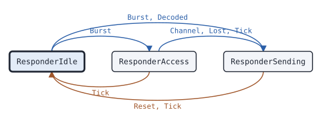

# csbk.Responder

This page describes the CSBK answer state machine of package csbk: it answers the CSBK requests that address one radio.

## What it does

[`csbk.Responder`](https://pkg.go.dev/github.com/USA-RedDragon/dmrgo/v2/csbk#Responder) answers the CSBKs on one logical channel that address its radio. It answers UU_V_Req, the presence check of an OACSU individual call, with UU_Ans_Rsp. It answers the Motorola radio check with the radio check answer and the Motorola call alert with the call alert acknowledgement. It answers any other standard CSBK that addresses the radio, and that it does not support, with the Feature Not Supported NACK_Rsp, which an MS must send. It answers one request at a time: a request that comes before the answer to the one before has gone out replaces that answer. The answer goes in a slot of the logical channel of the request, a TDMA frame or more after the start of the request. On the offset channel timing of a BS, the answer goes one slot later, as the first inbound slot leaves no time to decode the request; ETSI gives no answer delay, so this is the choice of dmrgo. (ETSI TS 102 361-1 clauses 5.1.1 and 5.2.1.7, Table 5.1, ETSI TS 102 361-2 clauses 5.1.2 and 5.2.2)

The Motorola radio check and call alert have no public spec. Their layouts and answer times come from captures of an AnyTone radio through a Motorola XPR 8400 repeater.

The Responder does no I/O. Each method takes the time `now` on a monotonic clock that the caller picks, and appends outputs to a slice of the caller.

## When to use it

Use a Responder in a radio, or in a hotspot or gateway that acts as a radio with its own address, so that other radios get an answer to a radio check, a call alert or an OACSU call. An MS must answer an unsupported CSBK with a Feature Not Supported NACK_Rsp, and the Responder sends it unless you set `NoFNS`.

Use a [csbk.Requester](csbk-requester.md) to send the requests. Do not use a Responder for group CSBKs: it drops a CSBK whose target is a talkgroup.

## Config

[`csbk.NewResponder`](https://pkg.go.dev/github.com/USA-RedDragon/dmrgo/v2/csbk#NewResponder) takes a [`*csbk.ResponderConfig`](https://pkg.go.dev/github.com/USA-RedDragon/dmrgo/v2/csbk#ResponderConfig). It has no nil default: a nil config, and an `Address` of 0, return an error. `Slot` must be slot 1 or slot 2.

<!-- dmrgo:config pkg=csbk type=ResponderConfig -->
| Field | Type | Default | Description |
|---|---|---|---|
| `Address` | `uint32` | zero value | Address is the 24-bit address of the radio. The Responder answers the CSBKs that address it. |
| `ColorCode` | `enums.ColorCode` | zero value | ColorCode is the color code of the slot types of the bursts sent. |
| `Source` | `layer2.SyncSource` | zero value | Source selects the SYNC pattern: layer2.SyncSourceBS, the zero value, for a repeater outbound, layer2.SyncSourceMS for a radio. |
| `Slot` | `enums.Slot` | zero value | Slot is the TDMA slot of the machine, which it puts in the Hint of each burst it sends. It must be Slot1 or Slot2. |
| `Access` | `enums.Access` | zero value | Access is the channel access policy of the answers. The zero value is polite to own color code. |
| `Offset` | `bool` | zero value | Offset puts the answers on the offset channel timing of a BS, in which the inbound slot of a logical channel starts half a TDMA frame after its outbound slot: the answer starts 90 ms after the start of the request, and then on that grid. The zero value is the aligned channel timing of a BS, and a direct channel, where it starts 60 ms after. (ETSI TS 102 361-1 clause 5.1.1, Table 5.1) |
| `OACSU` | `OACSUAnswer` | zero value | OACSU is the answer to UU_V_Req. The zero value is OACSUProceed. |
| `NoRadioCheck` | `bool` | zero value | NoRadioCheck leaves Motorola radio checks without an answer and without an OutputRequest. An AnyTone radio answers them only when its settings allow it. |
| `NoCallAlert` | `bool` | zero value | NoCallAlert leaves Motorola call alerts without an acknowledgement and without an OutputRequest. |
| `NoFNS` | `bool` | zero value | NoFNS leaves standard CSBKs that the Responder does not support without the Feature Not Supported NACK_Rsp, which is mandatory for an MS. Their OutputRequest stays. (ETSI TS 102 361-2 clause 5.1.2) |
| `IdleSearch` | `time.Duration` | `DefaultIdleSearch` (540ms) | IdleSearch is T_IdleSrch, the wait for an idle channel before a polite answer other than NACK_Rsp. 0 means DefaultIdleSearch, and a negative value does not wait. |
| `HoldoffMax` | `time.Duration` | `DefaultHoldoffMax` (1s) | HoldoffMax is the upper end of the random holdoff T_Holdoff of a NACK_Rsp: a polite NACK_Rsp on a busy channel waits a random holdoff, and then another while the channel stays busy. 0 means DefaultHoldoffMax, and a negative value means no holdoff: the NACK_Rsp waits for an idle channel. (ETSI TS 102 361-2 clause 5.1.2.2) |
| `Seed` | `uint64` | zero value | Seed seeds the generator of the random holdoff. |
| `Lead` | `time.Duration` | not machine-readable; see the description | Lead makes Tick emit a burst this long before its Due time, so that an RF FIFO can be filled ahead. 0 means at Due; it must not be negative. The timers of the machine keep to the Due times. |
| `Scratch` | `*layer2.Burst` | `layer2.NewBurst()` | Scratch, when set, is the Burst that Burst decodes into, as for RequesterConfig.Scratch. |
<!-- /dmrgo:config -->

`OACSU` sets the answer to UU_V_Req: Proceed, Deny or the Feature Not Supported NACK_Rsp, as [`csbk.OACSUAnswer`](https://pkg.go.dev/github.com/USA-RedDragon/dmrgo/v2/csbk#OACSUAnswer) gives. `NoRadioCheck` and `NoCallAlert` turn off the Motorola answers, as a radio does when its settings turn them off. `Offset` selects the offset channel timing of a BS.

## States and transitions

<!-- dmrgo:states pkg=csbk type=ResponderState -->
States of [`Responder`](https://pkg.go.dev/github.com/USA-RedDragon/dmrgo/v2/csbk#Responder), from [`Responder.State`](https://pkg.go.dev/github.com/USA-RedDragon/dmrgo/v2/csbk#Responder.State):

| State | Meaning | Seen in tests |
|---|---|---|
| [`ResponderIdle`](https://pkg.go.dev/github.com/USA-RedDragon/dmrgo/v2/csbk#ResponderIdle) | ResponderIdle has no answer to send. | yes, first state |
| [`ResponderAccess`](https://pkg.go.dev/github.com/USA-RedDragon/dmrgo/v2/csbk#ResponderAccess) | ResponderAccess waits for an idle channel or the end of a holdoff before it sends the answer. | yes |
| [`ResponderSending`](https://pkg.go.dev/github.com/USA-RedDragon/dmrgo/v2/csbk#ResponderSending) | ResponderSending sends the answer at the next Tick. | yes |

Transitions seen in tests:

| From | Method call | To |
|---|---|---|
| ResponderIdle | `Burst` | ResponderAccess |
| ResponderIdle | `Burst` | ResponderSending |
| ResponderAccess | `Tick` | ResponderIdle |
| ResponderAccess | `Channel`, `Lost`, `Tick` | ResponderSending |
| ResponderSending | `Reset`, `Tick` | ResponderIdle |


<!-- /dmrgo:states -->

These inputs move the state:

- A CSBK that addresses the radio, and that the Responder answers, queues the answer. On an idle channel, or with impolite access, the answer is ready to send at the next slot of the answer grid. On a busy channel with polite access, it waits for channel access.
- In channel access, the answers to the radio check, the call alert and UU_V_Req are time critical: `Channel` with an idle channel lets the answer go, and when T_IdleSrch passes on a busy channel the Responder drops the answer and appends `OutputDone` with `ResultDenied`. A NACK_Rsp is not time critical: it waits a random holdoff, and then another while the channel stays busy (ETSI TS 102 361-2 clause 5.1.2.2).
- The Tick at the `Due` time of the answer emits it and returns to idle.
- `Reset` drops the queued answer without an output.

A request whose answer is turned off by `NoFNS` still gives an `OutputRequest`, but it queues no answer and leaves a queued answer as it is.

## Inputs and outputs

Every method that takes `dst` appends at most [`csbk.MaxOutputs`](https://pkg.go.dev/github.com/USA-RedDragon/dmrgo/v2/csbk#MaxOutputs) outputs, and does not allocate when `dst` has that room.

| Method | Takes | Returns |
|---|---|---|
| [`Burst`](https://pkg.go.dev/github.com/USA-RedDragon/dmrgo/v2/csbk#Responder.Burst) | a raw burst and its [`layer2.Hint`](https://pkg.go.dev/github.com/USA-RedDragon/dmrgo/v2/layer2#Hint) | `dst` with an `OutputRequest` for a request it answers |
| [`Decoded`](https://pkg.go.dev/github.com/USA-RedDragon/dmrgo/v2/csbk#Responder.Decoded) | a burst that the caller decoded, or nil | the same as `Burst` |
| [`Channel`](https://pkg.go.dev/github.com/USA-RedDragon/dmrgo/v2/csbk#Responder.Channel) | whether the channel is busy | nothing |
| [`Tick`](https://pkg.go.dev/github.com/USA-RedDragon/dmrgo/v2/csbk#Responder.Tick) | the time now | `dst` with the answer burst, or `OutputDone` with `ResultDenied` |
| [`Deadline`](https://pkg.go.dev/github.com/USA-RedDragon/dmrgo/v2/csbk#Responder.Deadline) | nothing | the time of the next Tick, and false when no answer waits |
| [`Lost`](https://pkg.go.dev/github.com/USA-RedDragon/dmrgo/v2/csbk#Responder.Lost) | the time now | `dst`; the channel counts as idle |
| [`State`](https://pkg.go.dev/github.com/USA-RedDragon/dmrgo/v2/csbk#Responder.State), [`Reset`](https://pkg.go.dev/github.com/USA-RedDragon/dmrgo/v2/csbk#Responder.Reset) | nothing | the state, or nothing |

Feed every burst of the logical channel to `Burst`, or to `Decoded` when you decode the burst once for several machines. Pass `now` as the start of the received burst, because the answer grid starts there. The Responder takes a CSBK whose target is its `Address` and whose source is another radio, and drops a CSBK whose CRC fails. It does not check the color code of the bursts it receives; `ColorCode` sets only the color code of the answers.

Each [`csbk.Output`](https://pkg.go.dev/github.com/USA-RedDragon/dmrgo/v2/csbk#Output) is one of:

- `OutputRequest`: a request for the radio, with its `Service`, its `Call` and the request in `CSBK`. For `ServiceCallAlert`, alert the user of the radio.
- `OutputBurst`: the answer to send at `Due`, with a `Hint` of a CSBK on the configured slot. Its `Call` goes from the radio back to the source of the request.
- `OutputDone` with `ResultDenied`: a time critical answer that the channel denied.

Call `Channel` each time the activity on the channel changes. Until the first report the channel counts as idle.

## Timers

| Timer | Config field | Default |
|---|---|---|
| Answer grid: the answer goes this long after the start of the request, or a whole number of these later | none | <!-- dmrgo:const pkg=csbk name=BurstInterval -->`60ms`<!-- /dmrgo:const --> |
| T_IdleSrch of a time critical answer (ETSI TS 102 361-1 clause F.1) | `IdleSearch` | <!-- dmrgo:const pkg=csbk name=DefaultIdleSearch -->`540ms`<!-- /dmrgo:const --> |
| Upper end of the random holdoff T_Holdoff of a NACK_Rsp | `HoldoffMax` | <!-- dmrgo:const pkg=csbk name=DefaultHoldoffMax -->`1s`<!-- /dmrgo:const --> |

With `Offset`, the answer grid starts half a `BurstInterval` later. A polite answer that gets channel access between two slots of the grid goes in the next slot of the grid. A negative `IdleSearch` denies a time critical answer on a busy channel at once. A negative `HoldoffMax` turns the holdoff off, and the NACK_Rsp waits for an idle channel. `Lead` makes `Tick` emit the answer early, for an RF FIFO; when the lead is more than one `BurstInterval`, the answer moves to a later slot of the grid.

## Worked example

This example sends a Motorola radio check from a Requester to two Responders: one on the aligned channel timing of a BS, and one with `Offset`. It prints when each answer goes on air.

<!-- dmrgo:code file=v2/csbk/example_test.go symbol=ExampleResponder -->
```go
func ExampleResponder() {
	q, _ := csbk.NewRequester(&csbk.RequesterConfig{Slot: enums.Slot1, ColorCode: 1, Source: layer2.SyncSourceMS})
	if err := q.RequestRadioCheck(0, 3140598, 3191868, nil); err != nil {
		fmt.Println(err)
		return
	}
	sent := q.Tick(0, nil)
	request := sent[0].Burst
	for _, offset := range []bool{false, true} {
		r, err := csbk.NewResponder(&csbk.ResponderConfig{Slot: enums.Slot1, Address: 3140598, ColorCode: 1, Source: layer2.SyncSourceMS, Offset: offset})
		if err != nil {
			fmt.Println(err)
			return
		}
		out := make([]csbk.Output, 0, csbk.MaxOutputs)
		for _, o := range r.Burst(sent[0].Due, &request, layer2.Hint{}, out[:0]) {
			fmt.Println(o.Kind, o.Service, "from", o.Call.Source, "state", r.State())
		}
		at, _ := r.Deadline()
		for _, o := range r.Tick(at, out[:0]) {
			fmt.Println("offset", offset, o.Kind, "due", o.Due, "state", r.State())
		}
	}
}
```
<!-- /dmrgo:code -->

Output:

<!-- dmrgo:output test=csbk.ExampleResponder -->
```text
Request RadioCheck from 3191868 state Sending
offset false Burst due 60ms state Idle
Request RadioCheck from 3191868 state Sending
offset true Burst due 90ms state Idle
```
<!-- /dmrgo:output -->

## Errors

<!-- dmrgo:errors pkg=csbk type=Responder -->
The doc comments of [`Responder`](https://pkg.go.dev/github.com/USA-RedDragon/dmrgo/v2/csbk#Responder) and its methods name no error.
<!-- /dmrgo:errors -->

Only `NewResponder` returns an error, a [`*dmrgo.ConfigError`](https://pkg.go.dev/github.com/USA-RedDragon/dmrgo/v2#ConfigError). Match it with `errors.As`; its `Field` names the field out of range. The package example `ExampleNewResponder_configError` shows a config without an address. An answer that the channel denies gives an `OutputDone` with `ResultDenied`, and no error.

## Related machines and guides

- [csbk.Requester](csbk-requester.md) sends the requests that a Responder answers.
- [csbk.Preambles](csbk-preambles.md) follows the Pre_CSBKs that come before a request.
- The guide [Radio check, call alert and other CSBK services](../guides/csbk-services.md) uses a Responder.
