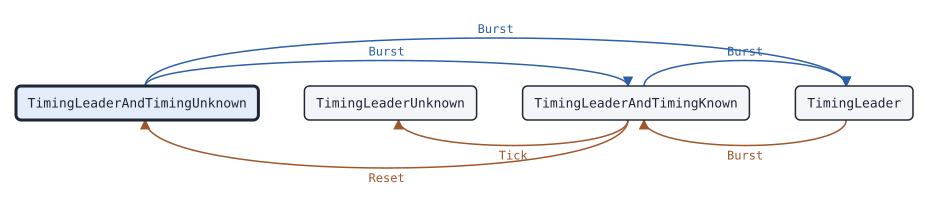

# csbk.Timing

This page describes the TDMA direct mode wide area timing state machine of package csbk: it finds, elects and follows the timing leader with CT_CSBKs.

## What it does

[`csbk.Timing`](https://pkg.go.dev/github.com/USA-RedDragon/dmrgo/v2/csbk#Timing) runs the TDMA direct mode wide area timing of one radio. It takes the leader and the channel slot timing from the CT_CSBKs of other radios. When no radio is the leader, it elects one and appoints it with a CT_CSBK. It propagates the leader beacon, answers requests, corrects radios with old timing, and sends the beacon when it is the leader itself. It sends each CT_CSBK after the random holdoff CT_RHOT, polite to all, in the provisioned slot, with the All Site color code. When the radio must take the channel slot timing of a CT_CSBK, the Timing reports it to the caller; the caller moves its own slot clock. (ETSI TS 102 361-2 clause 6.2)

When two radios with the same leader preference hear each other and neither has a leader, ETSI TS 102 361-2 clause 6.2.3.7 has both send CT_CSBK_Req, so that neither appoints a leader. dmrgo breaks the tie: the radio with the higher wide area timing identifier (dynamic identifier and ID) becomes the leader. (ETSI TS 102 361-2 clause 6.2.3.7)

The Timing does no I/O. Each method takes the time `now` on a monotonic clock that the caller picks, and appends outputs to a slice of the caller.

## When to use it

Use a Timing in a radio that works in TDMA direct mode, where two calls share one frequency in two time slots and the radios on the frequency must agree on one slot timing. Call `Join` when the radio arrives on the channel.

A radio on a repeater takes its timing from the BS outbound and does not need a Timing. A radio in plain direct mode, with one call per frequency, does not need one either.

## Config

[`csbk.NewTiming`](https://pkg.go.dev/github.com/USA-RedDragon/dmrgo/v2/csbk#NewTiming) takes a [`*csbk.TimingConfig`](https://pkg.go.dev/github.com/USA-RedDragon/dmrgo/v2/csbk#TimingConfig). It has no nil default: a nil config, and an `ID` of 0, return an error. `ID` and `DynamicID` form the wide area timing identifier of the radio. A `DynamicID` of 0 makes the radio not eligible to be the leader. `Slot` is the provisioned time slot, which selects the TDMA direct mode SYNC of the CT_CSBKs.

<!-- dmrgo:config pkg=csbk type=TimingConfig -->
| Field | Type | Default | Description |
|---|---|---|---|
| `ID` | `uint32` | zero value | ID is MS_ID, the 20-bit identifier of the radio in its wide area timing identifier, from 1 to MaxTimingID. The Timing picks a new one when another radio uses it (ETSI TS 102 361-2 clause 6.2.3.7). |
| `DynamicID` | `uint8` | not machine-readable; see the description | DynamicID is MS_DI, the leader preference of the radio from 0 to MaxDynamicID. 0 means the radio is not eligible to be the leader. (ETSI TS 102 361-2 clause 7.2.9) When a radio without a leader hears one with the same DynamicID, other than 0, the one with the higher WATID (DynamicID and ID) becomes the leader. This is a tie-break of dmrgo: ETSI TS 102 361-2 clause 6.2.3.7 has both radios send CT_CSBK_Req, so that neither ever appoints a leader. |
| `Slot` | `enums.Slot` | zero value | Slot is the provisioned time slot, enums.Slot1 or enums.Slot2. It selects the TDMA direct mode SYNC of the CT_CSBKs, and is the Slot of the Hint of each burst. (ETSI TS 102 361-2 clause 6.2) |
| `Seed` | `uint64` | zero value | Seed seeds the generator of CT_RHOT and of new identifiers, so that the same inputs give the same outputs. Radios on one channel need different seeds. (ETSI TS 102 361-2 clause 6.2) |
| `Lead` | `time.Duration` | not machine-readable; see the description | Lead makes Tick emit a burst this long before its Due time, so that an RF FIFO can be filled ahead. 0 means at Due; it must not be negative. The timers of the machine keep to the Due times. |
| `Scratch` | `*layer2.Burst` | `layer2.NewBurst()` | Scratch, when set, is the Burst that Burst decodes into, as for RequesterConfig.Scratch. (ETSI TS 102 361-2 clause 6.2) |
<!-- /dmrgo:config -->

The ID range is 1 to <!-- dmrgo:const pkg=csbk name=MaxTimingID -->`1048575`<!-- /dmrgo:const -->, and the dynamic identifier range is 0 to <!-- dmrgo:const pkg=csbk name=MaxDynamicID -->`3`<!-- /dmrgo:const -->. When another radio uses the same ID, the Timing picks a new one from its random generator (ETSI TS 102 361-2 clause 6.2.3.7). Give each radio its own `Seed`.

## States and transitions

<!-- dmrgo:states pkg=csbk type=TimingState -->
States of [`Timing`](https://pkg.go.dev/github.com/USA-RedDragon/dmrgo/v2/csbk#Timing), from [`Timing.State`](https://pkg.go.dev/github.com/USA-RedDragon/dmrgo/v2/csbk#Timing.State):

| State | Meaning | Seen in tests |
|---|---|---|
| [`TimingLeaderAndTimingUnknown`](https://pkg.go.dev/github.com/USA-RedDragon/dmrgo/v2/csbk#TimingLeaderAndTimingUnknown) | TimingLeaderAndTimingUnknown has neither the channel slot timing nor the leader: after Join, and when no leader was ever found. (ETSI TS 102 361-2 clause 6.2) | yes, first state |
| [`TimingLeaderUnknown`](https://pkg.go.dev/github.com/USA-RedDragon/dmrgo/v2/csbk#TimingLeaderUnknown) | TimingLeaderUnknown had the timing, but SyncAge ran out, and has no leader. (ETSI TS 102 361-2 clause 6.2) | yes |
| [`TimingLeaderAndTimingKnown`](https://pkg.go.dev/github.com/USA-RedDragon/dmrgo/v2/csbk#TimingLeaderAndTimingKnown) | TimingLeaderAndTimingKnown follows the leader and its slot timing. (ETSI TS 102 361-2 clause 6.2) | yes |
| [`TimingLeader`](https://pkg.go.dev/github.com/USA-RedDragon/dmrgo/v2/csbk#TimingLeader) | TimingLeader is the wide area timing leader and sets the slot timing. (ETSI TS 102 361-2 clause 6.2) | yes |

Transitions seen in tests:

| From | Method call | To |
|---|---|---|
| TimingLeaderAndTimingUnknown | `Burst` | TimingLeaderAndTimingKnown |
| TimingLeaderAndTimingUnknown | `Burst` | TimingLeader |
| TimingLeaderAndTimingKnown | `Reset` | TimingLeaderAndTimingUnknown |
| TimingLeaderAndTimingKnown | `Tick` | TimingLeaderUnknown |
| TimingLeaderAndTimingKnown | `Burst` | TimingLeader |
| TimingLeader | `Burst` | TimingLeaderAndTimingKnown |


<!-- /dmrgo:states -->

These inputs move the state (ETSI TS 102 361-2 clauses 6.2.1 and 6.2.3.1 to 6.2.3.11):

- `Join` starts the Timing with no leader and no timing. If no CT_CSBK comes for NoLeader, it sends CT_CSBK_Req, and again NoLeader after each CT_CSBK_Req while it has no leader.
- Without a leader, an aligned CT_CSBK that names a leader makes the radio follow that leader. A CT_CSBK_Prop also makes the radio propagate the beacon.
- Without a leader, a CT_CSBK from a radio that has no leader either makes the radio appoint that radio, when its leader preference is higher, or makes it send CT_CSBK_Req.
- A CT_CSBK that appoints this radio as the leader makes it the leader. It sends the beacon at once, in the first slot that can carry it, and then each BeaconInterval.
- While it follows a leader, a CT_CSBK with a better leader, or with newer timing of the same leader, moves the radio to it. A CT_CSBK with a worse leader or older timing makes the radio send a CT_CSBK_Resp to correct it, or appoint the sender when its preference is higher.
- While it is the leader, a CT_CSBK that names a better leader makes the radio follow that leader, and a CT_CSBK from a radio with a higher preference than its leader makes the radio appoint that radio. A CT_CSBK that names this radio with a conflicting sync age makes it take a new ID.
- When the timing of the leader reaches the age SyncAgeWarning, the radio sends a CT_CSBK_Req for new timing. When it reaches SyncAge, the radio loses its leader and waits NoLeader again.
- `Reset` stops the Timing until the next `Join`.

A CT_CSBK that another radio sends while this radio waits for its own CT_RHOT can make the radio drop its own CT_CSBK, when the other one carries the same or better information.

## Inputs and outputs

Every method that takes `dst` appends at most [`csbk.MaxOutputs`](https://pkg.go.dev/github.com/USA-RedDragon/dmrgo/v2/csbk#MaxOutputs) outputs, and does not allocate when `dst` has that room.

| Method | Takes | Returns |
|---|---|---|
| [`Join`](https://pkg.go.dev/github.com/USA-RedDragon/dmrgo/v2/csbk#Timing.Join) | the time now | an error |
| [`Burst`](https://pkg.go.dev/github.com/USA-RedDragon/dmrgo/v2/csbk#Timing.Burst) | a raw burst from either slot and its [`layer2.Hint`](https://pkg.go.dev/github.com/USA-RedDragon/dmrgo/v2/layer2#Hint) | `dst` with `OutputTiming` when the radio takes the slot timing of the burst |
| [`Decoded`](https://pkg.go.dev/github.com/USA-RedDragon/dmrgo/v2/csbk#Timing.Decoded) | a burst that the caller decoded, or nil | the same as `Burst` |
| [`Channel`](https://pkg.go.dev/github.com/USA-RedDragon/dmrgo/v2/csbk#Timing.Channel) | whether either slot has RF activity | nothing |
| [`Terminator`](https://pkg.go.dev/github.com/USA-RedDragon/dmrgo/v2/csbk#Timing.Terminator) | the time of the burst after a transmission of the radio | `dst` with the CT_CSBK_Term burst |
| [`Tick`](https://pkg.go.dev/github.com/USA-RedDragon/dmrgo/v2/csbk#Timing.Tick) | the time now | `dst` with at most one CT_CSBK burst |
| [`Deadline`](https://pkg.go.dev/github.com/USA-RedDragon/dmrgo/v2/csbk#Timing.Deadline) | nothing | the time of the next Tick, and false when no timer runs |
| [`Lost`](https://pkg.go.dev/github.com/USA-RedDragon/dmrgo/v2/csbk#Timing.Lost) | the time now | `dst`; it runs the timers as `Tick` does |
| [`Leader`](https://pkg.go.dev/github.com/USA-RedDragon/dmrgo/v2/csbk#Timing.Leader) | nothing | the dynamic identifier and ID of the leader, and false without one |
| [`State`](https://pkg.go.dev/github.com/USA-RedDragon/dmrgo/v2/csbk#Timing.State), [`Reset`](https://pkg.go.dev/github.com/USA-RedDragon/dmrgo/v2/csbk#Timing.Reset) | nothing | the state, or nothing |

Feed the bursts of both slots to `Burst`, or to `Decoded` when you decode the burst once for several machines. Pass `now` as the start of the burst. The SYNC of the burst gives its slot, else `Hint.Slot`; a burst of unknown slot counts as one in the provisioned slot. The Timing sends no CT_CSBK before the slot of the last burst heard ends. A burst heard after CT_RHOT started counts as RF activity while it fills its slot, as a busy channel does.

Call `Channel` each time the RF activity on the frequency changes. Until the first report the channel counts as idle. A CT_CSBK whose CT_RHOT ends on a busy channel waits another CT_RHOT, and the Timing drops it after a give-up time that the `Tick` doc gives.

Call `Terminator` after each voice, data or CSBK transmission of the radio, at the time of the burst after it, and send the burst that it appends. A response data header and a CSBK acknowledgement get no CT_CSBK_Term (ETSI TS 102 361-2 clauses 6.2.2.3.3 and 6.2.3.12).

Each [`csbk.Output`](https://pkg.go.dev/github.com/USA-RedDragon/dmrgo/v2/csbk#Output) has `ServiceTiming` and no addresses:

- `OutputBurst`: a CT_CSBK to send at `Due`, with a `Hint` of a CSBK on the provisioned slot.
- `OutputTiming`: the caller must set its channel slot timing from the CT_CSBK in `CSBK`, which it passed at `Due` (ETSI TS 102 361-2 clause 6.2.2.3).

## Timers

| Timer | Config field | Value |
|---|---|---|
| NoLeader, the wait for CT_CSBKs before a CT_CSBK_Req | none | <!-- dmrgo:const pkg=constants name=NoLeader -->`4m30s`<!-- /dmrgo:const --> |
| SyncAge, the life of the timing of a leader | none | <!-- dmrgo:const pkg=constants name=SyncAge -->`10m0s`<!-- /dmrgo:const --> |
| SyncAgeWarning, the age at which a follower requests new timing | none | <!-- dmrgo:const pkg=constants name=SyncAgeWarning -->`9m0s`<!-- /dmrgo:const --> |
| SAIncr, the unit of the sync age in a CT_CSBK | none | <!-- dmrgo:const pkg=constants name=SyncAgeIncrement -->`500ms`<!-- /dmrgo:const --> |
| BeaconInterval, the time between two beacons of the leader | none | <!-- dmrgo:const pkg=constants name=BeaconInterval -->`4m30s`<!-- /dmrgo:const --> |
| Length of a CT_CSBK_Beacon or CT_CSBK_Prop | none | <!-- dmrgo:const pkg=constants name=BeaconDuration -->`600ms`<!-- /dmrgo:const --> |
| Length of the other CT_CSBKs | none | <!-- dmrgo:const pkg=constants name=CTDuration -->`180ms`<!-- /dmrgo:const --> |
| Upper end of CT_RHOT | none | <!-- dmrgo:const pkg=constants name=CTRHOTMax -->`3.24s`<!-- /dmrgo:const --> |
| Step of CT_RHOT | none | <!-- dmrgo:const pkg=constants name=CTRHOTIncrement -->`60ms`<!-- /dmrgo:const --> |
| Time between two bursts of one CT_CSBK | none | <!-- dmrgo:const pkg=csbk name=BurstInterval -->`60ms`<!-- /dmrgo:const --> |

The timer values come from ETSI TS 102 361-2 clauses A.1 and A.2 and have no config field. Without the timing of a leader, CT_RHOT is uniform from 0 to its upper end, in steps. With the timing of a leader, after the radio sends a CT_CSBK, the range has a higher lower end (ETSI TS 102 361-2 clause A.1). Each time the radio then drops its own CT_CSBK for one that another radio sent, the range moves down. `Lead` makes `Tick` emit each burst early, for an RF FIFO, and the timers still keep to the `Due` times.

## Worked example

This example joins the channel, takes the timing of a leader from a CT_CSBK_Beacon, and counts the CT_CSBK_Prop bursts that it then sends.

<!-- dmrgo:code file=v2/csbk/timing_example_test.go symbol=ExampleTiming -->
```go
func ExampleTiming() {
	m, err := csbk.NewTiming(&csbk.TimingConfig{ID: 100, DynamicID: 2, Slot: enums.Slot1, Seed: 1})
	if err != nil {
		fmt.Println(err)
		return
	}
	if err := m.Join(0); err != nil {
		fmt.Println(err)
		return
	}
	beacon := pdu.ChannelTimingPDU{LeaderDynamicIdentifier: 3, LeaderIdentifier: 7, ChannelTimingOp1: true, ChannelTimingOp0: true, SourceDynamicIdentifier: 3, SourceIdentifier: 7}
	c := pdu.CSBK{LastBlock: true}
	if err := c.SetChannelTiming(beacon); err != nil {
		fmt.Println(err)
		return
	}
	raw, _ := layer2.BuildBurst(&c, csbk.AllSiteColorCode, layer2.SyncSourceDirectTS2)
	out := make([]csbk.Output, 0, csbk.MaxOutputs)
	for _, o := range m.Burst(time.Minute, &raw, layer2.Hint{}, out[:0]) {
		fmt.Println(o.Kind, o.Service)
	}
	di, id, _ := m.Leader()
	fmt.Println(m.State(), di, id)
	bursts := 0
	for {
		at, ok := m.Deadline()
		if !ok || at > 2*time.Minute {
			break
		}
		bursts += len(m.Tick(at, out[:0]))
	}
	fmt.Println("CT_CSBK_Prop bursts:", bursts)
}
```
<!-- /dmrgo:code -->

Output:

<!-- dmrgo:output test=csbk.ExampleTiming -->
```text
Timing Timing
LeaderAndTimingKnown 3 7
CT_CSBK_Prop bursts: 10
```
<!-- /dmrgo:output -->

The beacon names a leader, so the radio takes its slot timing at once (`OutputTiming`) and follows it. A beacon is a push, so the radio propagates it after its CT_RHOT, for the length of a CT_CSBK_Prop.

## Errors

<!-- dmrgo:errors pkg=csbk type=Timing -->
| Error | Returned by | Meaning |
|---|---|---|
| [`dmrgo.ErrZeroValue`](https://pkg.go.dev/github.com/USA-RedDragon/dmrgo/v2#ErrZeroValue) | `Timing.Join` | ErrZeroValue is returned by a method of a state machine that starts work, such as Start, Request or Send, when the machine is a zero value and not made with its constructor. |
<!-- /dmrgo:errors -->

`NewTiming` returns a [`*dmrgo.ConfigError`](https://pkg.go.dev/github.com/USA-RedDragon/dmrgo/v2#ConfigError) for a value out of range; match it with `errors.As`. `Join` on a zero Timing returns `dmrgo.ErrZeroValue`. The other methods return no error: before `Join` they do nothing, and a CSBK whose CRC fails is dropped.

## Related machines and guides

- [csbk.Requester](csbk-requester.md) and [csbk.Responder](csbk-responder.md) run CSBK services on the same channel. Call `Terminator` after a request that the Requester sends.
- [voice.Transmitter](voice-transmitter.md) and [data.Sender](data-sender.md) send the transmissions that a CT_CSBK_Term follows.
- The guide [Radio check, call alert and other CSBK services](../guides/csbk-services.md) covers CSBKs on air.
