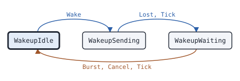

# csbk.Wakeup

This page describes the BS wakeup state machine of package csbk: it sends BS_Dwn_Act until the outbound of a BS starts.

## What it does

[`csbk.Wakeup`](https://pkg.go.dev/github.com/USA-RedDragon/dmrgo/v2/csbk#Wakeup) is the MS side of the BS outbound activation. It sends a BS_Dwn_Act CSBK with MS sourced SYNC to the address of a BS. It then waits T_SyncWu for a BS sourced burst with the color code of the BS, and sends BS_Dwn_Act again, up to N_Wakeup times in all. It reports that the outbound started, that it did not start after the last BS_Dwn_Act, or that the caller canceled the wakeup. (ETSI TS 102 361-1 clause 5.2.2.2.4)

The Wakeup does no I/O. Each method takes the time `now` on a monotonic clock that the caller picks, and appends outputs to a slice of the caller.

## When to use it

Use a Wakeup in a radio, or in a device that acts as a radio, before it transmits to a repeater that hibernates and wakes only on BS_Dwn_Act. Run the wakeup first, and start the call, the data or the CSBK request when the Wakeup reports `ResultAnswered`.

A repeater that wakes on any valid burst does not need a Wakeup. On the BS side, a [bs.Repeater](bs-repeater.md) with `Config.Activation` set to [`bs.ActivationWakeup`](https://pkg.go.dev/github.com/USA-RedDragon/dmrgo/v2/bs#ActivationWakeup) wakes only on BS_Dwn_Act.

## Config

[`csbk.NewWakeup`](https://pkg.go.dev/github.com/USA-RedDragon/dmrgo/v2/csbk#NewWakeup) takes a [`*csbk.WakeupConfig`](https://pkg.go.dev/github.com/USA-RedDragon/dmrgo/v2/csbk#WakeupConfig). A nil config is the zero config. `Slot` must be slot 1 or slot 2, so a nil config returns an error. `ColorCode` is the color code of the BS: the Wakeup sends BS_Dwn_Act with it and takes only an outbound data burst with it.

<!-- dmrgo:config pkg=csbk type=WakeupConfig -->
| Field | Type | Default | Description |
|---|---|---|---|
| `ColorCode` | `enums.ColorCode` | zero value | ColorCode is the color code of the BS, of the slot type of the BS_Dwn_Act bursts and of the outbound that ends the wakeup. |
| `Slot` | `enums.Slot` | zero value | Slot is the TDMA slot of the machine, which it puts in the Hint of each burst it sends. It must be Slot1 or Slot2. |
| `SyncWait` | `time.Duration` | `DefaultSyncWait` (360ms) | SyncWait is T_SyncWu, the wait for the outbound after each BS_Dwn_Act. 0 means DefaultSyncWait, and a negative value waits until the outbound or Cancel. |
| `Attempts` | `int` | `DefaultWakeups` (2) | Attempts is N_Wakeup, the most BS_Dwn_Act bursts. 0 means DefaultWakeups; at most MaxRetries. |
| `Lead` | `time.Duration` | not machine-readable; see the description | Lead makes Tick emit a burst this long before its Due time, so that an RF FIFO can be filled ahead. 0 means at Due; it must not be negative. The timers of the machine keep to the Due times. |
| `Scratch` | `*layer2.Burst` | `layer2.NewBurst()` | Scratch, when set, is the Burst that Burst decodes into, as for RequesterConfig.Scratch. |
<!-- /dmrgo:config -->

## States and transitions

<!-- dmrgo:states pkg=csbk type=WakeupState -->
States of [`Wakeup`](https://pkg.go.dev/github.com/USA-RedDragon/dmrgo/v2/csbk#Wakeup), from [`Wakeup.State`](https://pkg.go.dev/github.com/USA-RedDragon/dmrgo/v2/csbk#Wakeup.State):

| State | Meaning | Seen in tests |
|---|---|---|
| [`WakeupIdle`](https://pkg.go.dev/github.com/USA-RedDragon/dmrgo/v2/csbk#WakeupIdle) | WakeupIdle runs no wakeup. | yes, first state |
| [`WakeupSending`](https://pkg.go.dev/github.com/USA-RedDragon/dmrgo/v2/csbk#WakeupSending) | WakeupSending sends a BS_Dwn_Act at the next Tick. | yes |
| [`WakeupWaiting`](https://pkg.go.dev/github.com/USA-RedDragon/dmrgo/v2/csbk#WakeupWaiting) | WakeupWaiting waits T_SyncWu for the BS outbound. | yes |

Transitions seen in tests:

| From | Method call | To |
|---|---|---|
| WakeupIdle | `Wake` | WakeupSending |
| WakeupSending | `Lost`, `Tick` | WakeupWaiting |
| WakeupWaiting | `Burst`, `Cancel`, `Tick` | WakeupIdle |


<!-- /dmrgo:states -->

These inputs move the state:

- `Wake` starts a wakeup. The first BS_Dwn_Act goes out at the next Tick.
- In sending, the Tick at the `Due` time emits one BS_Dwn_Act, and the Wakeup waits T_SyncWu for the outbound.
- While it waits, a BS sourced burst, or `OutboundSync`, ends the wakeup with `ResultAnswered`. When T_SyncWu passes, the Wakeup sends again, or ends with `ResultNoAnswer` after N_Wakeup BS_Dwn_Act bursts.
- `Cancel` ends a running wakeup with `ResultCanceled`. `Reset` ends it without an output.

The outbound counts only after the first BS_Dwn_Act went out. A BS data burst counts only when its slot type decodes and has the color code of the BS. A BS voice burst has no slot type, so its BS sourced voice SYNC is enough.

## Inputs and outputs

Every method that takes `dst` appends at most [`csbk.MaxOutputs`](https://pkg.go.dev/github.com/USA-RedDragon/dmrgo/v2/csbk#MaxOutputs) outputs, and does not allocate when `dst` has that room.

| Method | Takes | Returns |
|---|---|---|
| [`Wake`](https://pkg.go.dev/github.com/USA-RedDragon/dmrgo/v2/csbk#Wakeup.Wake) | the address of the BS and the source address of the radio | an error |
| [`Burst`](https://pkg.go.dev/github.com/USA-RedDragon/dmrgo/v2/csbk#Wakeup.Burst) | a raw burst and its [`layer2.Hint`](https://pkg.go.dev/github.com/USA-RedDragon/dmrgo/v2/layer2#Hint) | `dst` with `OutputDone` when the burst is the outbound |
| [`Decoded`](https://pkg.go.dev/github.com/USA-RedDragon/dmrgo/v2/csbk#Wakeup.Decoded) | a burst that the caller decoded, or nil | the same as `Burst` |
| [`OutboundSync`](https://pkg.go.dev/github.com/USA-RedDragon/dmrgo/v2/csbk#Wakeup.OutboundSync) | the time now | `dst` with `OutputDone` and `ResultAnswered` while a wakeup runs |
| [`Tick`](https://pkg.go.dev/github.com/USA-RedDragon/dmrgo/v2/csbk#Wakeup.Tick) | the time now | `dst` with a BS_Dwn_Act burst, or `OutputDone` with `ResultNoAnswer` |
| [`Deadline`](https://pkg.go.dev/github.com/USA-RedDragon/dmrgo/v2/csbk#Wakeup.Deadline) | nothing | the time of the next Tick, and false when no timer runs |
| [`Lost`](https://pkg.go.dev/github.com/USA-RedDragon/dmrgo/v2/csbk#Wakeup.Lost) | the time now | `dst`; it runs the timers as `Tick` does |
| [`Cancel`](https://pkg.go.dev/github.com/USA-RedDragon/dmrgo/v2/csbk#Wakeup.Cancel) | the time now | `dst` with `ResultCanceled` while a wakeup runs |
| [`State`](https://pkg.go.dev/github.com/USA-RedDragon/dmrgo/v2/csbk#Wakeup.State), [`Reset`](https://pkg.go.dev/github.com/USA-RedDragon/dmrgo/v2/csbk#Wakeup.Reset) | nothing | the state, or nothing |

Feed the bursts that you receive to `Burst` or `Decoded`. If your modem reports the outbound SYNC itself and gives you no burst, call `OutboundSync` when it does. `OutboundSync` and `Cancel` do not run the timers; `now` only gives them the shape of the other methods.

Each [`csbk.Output`](https://pkg.go.dev/github.com/USA-RedDragon/dmrgo/v2/csbk#Output) is one of:

- `OutputBurst`: a BS_Dwn_Act to send at `Due`, with a `Hint` of a CSBK on the configured slot. Its `Call` has the BS address as the target and the radio as the source.
- `OutputDone`: the end of the wakeup, with `ServiceWakeup` and its [`Result`](https://pkg.go.dev/github.com/USA-RedDragon/dmrgo/v2/csbk#Result).

## Timers

| Timer | Config field | Default |
|---|---|---|
| T_SyncWu, the wait for the outbound after each BS_Dwn_Act (ETSI TS 102 361-1 clause F.1) | `SyncWait` | <!-- dmrgo:const pkg=csbk name=DefaultSyncWait -->`360ms`<!-- /dmrgo:const --> |
| N_Wakeup, the most BS_Dwn_Act bursts (ETSI TS 102 361-1 clause F.2) | `Attempts` | <!-- dmrgo:const pkg=csbk name=DefaultWakeups -->`2`<!-- /dmrgo:const -->, at most <!-- dmrgo:const pkg=csbk name=MaxRetries -->`255`<!-- /dmrgo:const --> |

T_SyncWu starts at the `Due` time of each BS_Dwn_Act. A negative `SyncWait` waits until the outbound or `Cancel`, and sends one BS_Dwn_Act only. `Lead` makes `Tick` emit each burst early, for an RF FIFO; the next BS_Dwn_Act then goes out when T_SyncWu ends, with its `Due` time one lead later.

## Worked example

This example wakes a repeater that does not answer. With the defaults, the Wakeup sends two BS_Dwn_Act bursts, one T_SyncWu apart, and ends one T_SyncWu after the second.

<!-- dmrgo:code file=v2/csbk/example_test.go symbol=ExampleWakeup -->
```go
func ExampleWakeup() {
	w, _ := csbk.NewWakeup(&csbk.WakeupConfig{Slot: enums.Slot1, ColorCode: 7})
	_ = w.Wake(0, 314926, 3191868)
	for {
		at, ok := w.Deadline()
		if !ok {
			break
		}
		for _, o := range w.Tick(at, nil) {
			if o.Kind == csbk.OutputDone {
				fmt.Println(at, o.Kind, o.Result)
			} else {
				fmt.Println(at, o.Kind)
			}
		}
	}
}
```
<!-- /dmrgo:code -->

Output:

<!-- dmrgo:output test=csbk.ExampleWakeup -->
```text
0s Burst
360ms Burst
720ms Done NoAnswer
```
<!-- /dmrgo:output -->

## Errors

<!-- dmrgo:errors pkg=csbk type=Wakeup -->
| Error | Returned by | Meaning |
|---|---|---|
| [`csbk.ErrBusy`](https://pkg.go.dev/github.com/USA-RedDragon/dmrgo/v2/csbk#ErrBusy) | `Wakeup.Wake` | ErrBusy is returned by a request or a wakeup while another one runs. |
| [`dmrgo.ConfigError`](https://pkg.go.dev/github.com/USA-RedDragon/dmrgo/v2#ConfigError) | `Wakeup.Wake` | ConfigError is the error of a constructor, and of a machine method that takes a config, option or argument field, for a field with a value out of range. |
| [`dmrgo.ErrZeroValue`](https://pkg.go.dev/github.com/USA-RedDragon/dmrgo/v2#ErrZeroValue) | `Wakeup.Wake` | ErrZeroValue is returned by a method of a state machine that starts work, such as Start, Request or Send, when the machine is a zero value and not made with its constructor. |
<!-- /dmrgo:errors -->

`Wake` returns [`csbk.ErrBusy`](https://pkg.go.dev/github.com/USA-RedDragon/dmrgo/v2/csbk#ErrBusy) while a wakeup runs; match it with `errors.Is`. `NewWakeup` and `Wake` return a [`*dmrgo.ConfigError`](https://pkg.go.dev/github.com/USA-RedDragon/dmrgo/v2#ConfigError) for a value out of range; match it with `errors.As`. A BS that does not wake gives an `OutputDone` with `ResultNoAnswer`, and no error.

## Related machines and guides

- [bs.Repeater](bs-repeater.md) is the BS side, which wakes on BS_Dwn_Act with `ActivationWakeup`.
- [csbk.Requester](csbk-requester.md) and [data.Sender](data-sender.md) send after the outbound starts.
- The guide [Radio check, call alert and other CSBK services](../guides/csbk-services.md) wakes a repeater with a Wakeup.
