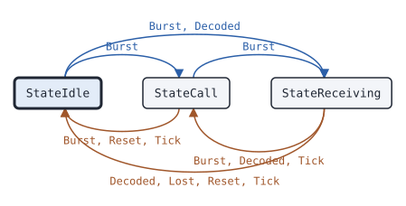

# data.Receiver

This page describes the data receive state machine of package data: it turns the bursts of a channel into data calls, packets and responses.

## What it does

[`data.Receiver`](https://pkg.go.dev/github.com/USA-RedDragon/dmrgo/v2/data#Receiver) turns the bursts of one logical channel into data events: the start and end of a data call, each complete packet, the responses heard on the channel, and the responses to send. It starts a data call at a data Pre_CSBK or a header. It ends the call after a time without bursts, at a voice or idle burst, at a transport end flag, or at the loss of the signal. It checks the header CRC, the CRC-9 of each confirmed block and the message CRC, and delivers each complete packet. A block that does not arrive counts as lost, from the transport sequence number when the Hint has one, else from the time, so the last block of a try that is lost on air still ends the try. With `Respond` set, it answers a confirmed packet to its own address with an ACK, a SACK for the blocks that failed, or a NACK, and applies the sequence rules of the layer. It delivers each fragment of a confirmed message at once, and then the whole message after the last fragment. (ETSI TS 102 361-1 clauses 8.2, 9.3.23 to 9.3.25, ETSI TS 102 361-3 clauses 5 and 6)

The sequence rule depends on the layer. A packet of the IP bearer service gets no N(S) check: each valid packet is delivered and gets an ACK, so a packet sent again after a lost response is delivered again (ETSI TS 102 361-3 clauses 5.4.1.3 and 5.4.2.2). For any other SAP, a packet with N(S) equal to VI is a copy that gets an ACK and is not delivered, a packet with N(S) equal to VI + 1 is the next one, and any other N(S) gets a NACK out of sequence. The first packet of a link, or a packet with the S flag, sets VI (ETSI TS 102 361-1 clauses 8.2.2.3, 9.3.23 and 9.3.24). For a sliding window, the Receiver answers at the last packet of the window for all of them and uses go back N, as the [package doc](https://pkg.go.dev/github.com/USA-RedDragon/dmrgo/v2/data) gives in full (ETSI TS 102 361-3 clause 5.4.4).

The Receiver does no I/O. Each method takes the time `now` on a monotonic clock that the caller picks, and appends events to a slice of the caller.

## When to use it

Use a Receiver for every place that takes data from a channel:

- In a radio or a gateway that receives SMS, location reports or IP datagrams, set `Respond` and `Address`, so that confirmed packets get their responses.
- In a gateway that answers for many radios, set `Respond` and leave `Address` 0: the Receiver answers every confirmed packet to a radio.
- In a scanner, a monitor or a bridge, leave `Respond` off. The Receiver then delivers every complete packet and answers none. It reports the responses that it hears, so a bridge can forward them.

To send data, use a [data.Sender](data-sender.md). Run one Receiver per logical channel, so two for the two slots of a carrier.

## Config

[`data.NewReceiver`](https://pkg.go.dev/github.com/USA-RedDragon/dmrgo/v2/data#NewReceiver) takes a [`*data.ReceiverConfig`](https://pkg.go.dev/github.com/USA-RedDragon/dmrgo/v2/data#ReceiverConfig). A nil config is the zero config: it accepts every color code and answers no packet. A duration of 0 selects the default in the field doc, and the field doc gives what a negative duration does.

<!-- dmrgo:config pkg=data type=ReceiverConfig -->
| Field | Type | Default | Description |
|---|---|---|---|
| `ColorCode` | `*enums.ColorCode` | zero value | ColorCode, when set, drops bursts with another color code, and is the color code of the responses. Nil accepts every color code and answers with the color code of the packet. |
| `Address` | `uint32` | zero value | Address is the LLID of this station. A confirmed packet gets a response only when its destination is Address. 0 answers every confirmed packet to a radio, as a gateway does. |
| `Respond` | `bool` | zero value | Respond makes the Receiver answer confirmed packets with an ACK, NACK or SACK (EventRespond), and drop duplicate and out of sequence packets outside the IP bearer service, as the package doc describes. False delivers every complete packet and answers none, as a scanner or bridge needs. |
| `Source` | `layer2.SyncSource` | zero value | Source selects the SYNC of the responses: layer2.SyncSourceBS, the zero value, for a repeater outbound, layer2.SyncSourceMS for a radio. |
| `ResponseDelay` | `time.Duration` | not machine-readable; see the description | ResponseDelay is the time from the last block of a packet to the first response burst. 0 means one slot period (60 ms), the next burst of the logical channel, and a negative value means at once. |
| `MaxBlocks` | `int` | not machine-readable; see the description | MaxBlocks is the most data blocks of a packet. 0 means MaxBlocks; a larger packet is dropped. Each block takes 24 bytes, so a microcontroller can set 16. |
| `MaxFragment` | `int` | not machine-readable; see the description | MaxFragment is the largest payload of one packet. 0 means DefaultMaxFragment; at most MaxMessage. A larger confirmed packet gets a NACK for memory full, and any larger packet is dropped. |
| `MaxMessage` | `int` | not machine-readable; see the description | MaxMessage is the size of the buffer that joins the fragments of a confirmed message. 0 means DefaultMaxMessage; at most MaxMessage. A longer message is not joined; its fragments are still delivered. |
| `Peers` | `int` | not machine-readable; see the description | Peers is the number of links whose receive sequence number VI the Receiver keeps. 0 means DefaultPeers; at most MaxPeers. When the table is full, the link heard least recently is dropped (ETSI TS 102 361-1 clause 9.3.24). |
| `Lost` | `time.Duration` | not machine-readable; see the description | Lost is the time without a burst, while a packet waits for blocks, after which the slots that passed count as lost blocks, one each 60 ms. 0 means DefaultLost, and a negative value counts lost blocks only from the transport sequence number and at the end of the call. A network transport with jitter sets Hint.Seq and a longer Lost. |
| `Hang` | `time.Duration` | not machine-readable; see the description | Hang is the time without a burst after which a data call ends with EndQuiet. 0 means DefaultHang, and a negative value turns the timer off. |
| `AcceptBadCRC` | `bool` | zero value | AcceptBadCRC delivers packets whose CRC failed, with Message.BadCRC set, as packet.Assembler.AcceptBadCRC describes. A confirmed packet still gets a NACK, so that a good copy can follow. |
| `Scratch` | `*layer2.Burst` | `layer2.NewBurst()` | Scratch, when set, is the Burst that Burst decodes into. Machines that run on one goroutine can share one, because a Receiver is done with it when its method returns. Make it with layer2.NewBurst. Nil means the Receiver makes its own. |
<!-- /dmrgo:config -->

`MaxBlocks`, `MaxFragment` and `MaxMessage` set the memory of the Receiver. A microcontroller can set a small `MaxBlocks`. [`Receiver.MaxOutputOctets`](https://pkg.go.dev/github.com/USA-RedDragon/dmrgo/v2/data#Receiver.MaxOutputOctets) returns the most payload octets that the events of one call can hold.

## States and transitions

<!-- dmrgo:states pkg=data type=State -->
States of [`Receiver`](https://pkg.go.dev/github.com/USA-RedDragon/dmrgo/v2/data#Receiver), from [`Receiver.State`](https://pkg.go.dev/github.com/USA-RedDragon/dmrgo/v2/data#Receiver.State):

| State | Meaning | Seen in tests |
|---|---|---|
| [`StateIdle`](https://pkg.go.dev/github.com/USA-RedDragon/dmrgo/v2/data#StateIdle) | StateIdle has no data call. | yes, first state |
| [`StateCall`](https://pkg.go.dev/github.com/USA-RedDragon/dmrgo/v2/data#StateCall) | StateCall has a data call, between packets. | yes |
| [`StateReceiving`](https://pkg.go.dev/github.com/USA-RedDragon/dmrgo/v2/data#StateReceiving) | StateReceiving has a packet that waits for blocks. | yes |

Transitions seen in tests:

| From | Method call | To |
|---|---|---|
| StateIdle | `Burst` | StateCall |
| StateIdle | `Burst`, `Decoded` | StateReceiving |
| StateCall | `Burst`, `Reset`, `Tick` | StateIdle |
| StateCall | `Burst` | StateReceiving |
| StateReceiving | `Decoded`, `Lost`, `Reset`, `Tick` | StateIdle |
| StateReceiving | `Burst`, `Decoded`, `Tick` | StateCall |


<!-- /dmrgo:states -->

These inputs move the state:

- In idle, a Pre_CSBK with the data flag, or a data header, starts a data call and appends `EventCallStart`. A header whose packet has blocks to come moves the Receiver to wait for them.
- While it waits for blocks, each block goes to the packet. The last block, or the lost blocks that the sequence number or the `Lost` timer count, completes the packet. The Receiver then appends `EventDelivered`, `EventResponse` or `EventRespond` as the packet gives, and returns to the call between packets.
- In a call, a header or a Pre_CSBK of other parties ends the call with `EndSuperseded` and starts a new one. A header from the target back to the source, such as a response, stays in the same call.
- A call ends with `EventCallEnd` after `Hang` without a burst (`EndQuiet`), at an idle burst between packets (`EndIdle`), at a voice burst or a Voice LC Header (`EndVoice`), at `Hint.SyncLost` or `Lost` (`EndSyncLost`), and at a strong transport end flag (`EndTransport`). The blocks still due count as lost first, which can complete a packet.
- `Reset` ends the call without events and clears the sequence numbers of every link.

## Inputs and outputs

Every method that takes `dst` appends at most [`data.MaxEvents`](https://pkg.go.dev/github.com/USA-RedDragon/dmrgo/v2/data#MaxEvents) events, and does not allocate when `dst` has that room.

| Method | Takes | Returns |
|---|---|---|
| [`Burst`](https://pkg.go.dev/github.com/USA-RedDragon/dmrgo/v2/data#Receiver.Burst) | a raw burst and its [`layer2.Hint`](https://pkg.go.dev/github.com/USA-RedDragon/dmrgo/v2/layer2#Hint) | `dst` with the events |
| [`Decoded`](https://pkg.go.dev/github.com/USA-RedDragon/dmrgo/v2/data#Receiver.Decoded) | a burst that the caller decoded, or nil, and its Hint | `dst` with the events |
| [`Tick`](https://pkg.go.dev/github.com/USA-RedDragon/dmrgo/v2/data#Receiver.Tick) | the time now | `dst` with the events of the lost blocks and the end of the call |
| [`Deadline`](https://pkg.go.dev/github.com/USA-RedDragon/dmrgo/v2/data#Receiver.Deadline) | nothing | the time of the next Tick, and false when no timer runs |
| [`Lost`](https://pkg.go.dev/github.com/USA-RedDragon/dmrgo/v2/data#Receiver.Lost) | the time now | `dst`; the call ends with `EndSyncLost` |
| [`State`](https://pkg.go.dev/github.com/USA-RedDragon/dmrgo/v2/data#Receiver.State), [`Reset`](https://pkg.go.dev/github.com/USA-RedDragon/dmrgo/v2/data#Receiver.Reset) | nothing | the state, or nothing |

Feed every burst of the logical channel to `Burst`. A burst that does not decode, or that has another color code than `ColorCode`, is dropped, but its Hint still applies. A nil raw burst is a transport frame without a burst: only the Hint applies. Use `Decoded` when you decode the burst once for several machines; `ColorCode` does not apply there, so set the color code in your decode options. Pass `Hint.Seq` from a network transport, so that lost blocks count from the sequence number. A network transport with jitter also sets a longer `Lost`.

Each [`data.Event`](https://pkg.go.dev/github.com/USA-RedDragon/dmrgo/v2/data#Event) has the `Call` it belongs to and one of these [kinds](https://pkg.go.dev/github.com/USA-RedDragon/dmrgo/v2/data#EventKind):

- `EventCallStart` and `EventCallEnd`: the start and end of a data call. The end has the [`EndReason`](https://pkg.go.dev/github.com/USA-RedDragon/dmrgo/v2/data#EndReason) and the [`Stats`](https://pkg.go.dev/github.com/USA-RedDragon/dmrgo/v2/data#Stats) of the call.
- `EventDelivered`: a complete packet in `Message`. `Message.Fragmented` marks a packet that continues a message of several fragments.
- `EventReassembled`: a confirmed message joined from its fragments, after the `EventDelivered` of its last fragment.
- `EventResponse`: a response packet heard on the channel, with `Retry` for a SACK.
- `EventRespond`: a response burst to send at `Due`. A response of several bursts gives one event per burst.

`Message.Payload` and `Retry` point into the memory of the Receiver, and stay valid only until its next method call. Copy them if you keep them.

For a packet of IP based packet data, [`Event.ICMP`](https://pkg.go.dev/github.com/USA-RedDragon/dmrgo/v2/data#Event.ICMP) returns the ICMP error message that a radio sends about the IPv4 packet that it received, for an accessory interface with a given MTU (ETSI TS 102 361-3 clause 5.2, Table 5.1).

## Timers

| Timer | Config field | Default |
|---|---|---|
| Time without a burst, while a packet waits for blocks, after which the slots that passed count as lost blocks | `Lost` | <!-- dmrgo:const pkg=data name=DefaultLost -->`90ms`<!-- /dmrgo:const --> |
| Time without a burst after which a data call ends | `Hang` | <!-- dmrgo:const pkg=data name=DefaultHang -->`360ms`<!-- /dmrgo:const --> |
| Time from the last block of a packet to the first response burst | `ResponseDelay` | one slot period of the logical channel, as the field doc gives |

`DefaultHang` covers the response wait of the sender, <!-- dmrgo:const pkg=constants name=TResponseWait -->`180ms`<!-- /dmrgo:const -->, and the data hang time of a repeater, <!-- dmrgo:const pkg=constants name=TDataHangtime -->`180ms`<!-- /dmrgo:const -->. A negative `Lost` counts lost blocks only from the transport sequence number and at the end of the call. A negative `Hang` turns the end timer off. A negative `ResponseDelay` sends the response at once.

| Limit | Config field | Default | Most |
|---|---|---|---|
| Blocks of one packet | `MaxBlocks` | <!-- dmrgo:const pkg=data name=MaxBlocks -->`127`<!-- /dmrgo:const --> | <!-- dmrgo:const pkg=data name=MaxBlocks -->`127`<!-- /dmrgo:const --> |
| Payload of one packet | `MaxFragment` | <!-- dmrgo:const pkg=data name=DefaultMaxFragment -->`1500`<!-- /dmrgo:const --> | <!-- dmrgo:const pkg=data name=MaxMessage -->`65535`<!-- /dmrgo:const --> |
| Message joined from fragments | `MaxMessage` | <!-- dmrgo:const pkg=data name=DefaultMaxMessage -->`1500`<!-- /dmrgo:const --> | <!-- dmrgo:const pkg=data name=MaxMessage -->`65535`<!-- /dmrgo:const --> |
| Links whose VI the Receiver keeps | `Peers` | <!-- dmrgo:const pkg=data name=DefaultPeers -->`8`<!-- /dmrgo:const --> | <!-- dmrgo:const pkg=data name=MaxPeers -->`64`<!-- /dmrgo:const --> |

A confirmed packet over `MaxFragment` gets a NACK for memory full, and any packet over it is dropped. A message over `MaxMessage` is not joined, but its fragments are still delivered. When the table of links is full, the link heard least recently is dropped (ETSI TS 102 361-1 clause 9.3.24).

## Worked example

This example follows a recorded SMS of one logical channel, with the bursts one TDMA frame apart, and prints its events.

<!-- dmrgo:code file=v2/data/example_test.go symbol=ExampleReceiver -->
```go
func ExampleReceiver() {
	capture, err := os.ReadFile("../layer2/testdata/d-sms.bin")
	if err != nil {
		fmt.Println(err)
		return
	}
	rx, err := data.NewReceiver(nil)
	if err != nil {
		fmt.Println(err)
		return
	}
	events := make([]data.Event, 0, data.MaxEvents)
	var now time.Duration
	handle := func(events []data.Event) {
		for _, e := range events {
			switch e.Kind {
			case data.EventCallStart:
				fmt.Printf("data call from %d to %d\n", e.Call.Source, e.Call.Target)
			case data.EventDelivered:
				fmt.Printf("%v packet, %d octets\n", e.Message.Header.Format(), len(e.Message.Payload))
			case data.EventCallEnd:
				fmt.Printf("end: %v after %v\n", e.Reason, e.Stats.Duration)
			case data.EventResponse, data.EventRespond, data.EventReassembled:
			}
		}
	}
	for off := 0; off+33 <= len(capture); off += 33 {
		raw := layer2.RawBurst(capture[off : off+33])
		handle(rx.Burst(now, &raw, layer2.Hint{}, events[:0]))
		now += 60 * time.Millisecond
	}
	if at, ok := rx.Deadline(); ok {
		handle(rx.Tick(at, events[:0]))
	}
}
```
<!-- /dmrgo:code -->

Output:

<!-- dmrgo:output test=data.ExampleReceiver -->
```text
data call from 3191868 to 9990
Unconfirmed packet, 56 octets
end: Quiet after 960ms
```
<!-- /dmrgo:output -->

The call ends with `EndQuiet` at the Tick after the last burst, when `Hang` has passed.

The next example answers a confirmed packet from a recording with its real times: the Receiver of the addressed radio returns the ACK burst to send, with its `Due` time.

<!-- dmrgo:code file=v2/data/example_test.go symbol=ExampleReceiver_respond -->
```go
func ExampleReceiver_respond() {
	bursts := readTimedExample("testdata/anytone_sms_xpr.txt")
	rx, err := data.NewReceiver(&data.ReceiverConfig{Address: 3140598, Respond: true})
	if err != nil {
		fmt.Println(err)
		return
	}
	events := make([]data.Event, 0, data.MaxEvents)
	for _, b := range bursts[:14] {
		for _, e := range rx.Burst(b.at, &b.raw, layer2.Hint{}, events[:0]) {
			switch e.Kind {
			case data.EventDelivered:
				fmt.Printf("delivered %d octets at %v\n", len(e.Message.Payload), e.Message.Rate)
			case data.EventRespond:
				fmt.Printf("send %v at %v\n", e.Response, e.Due)
			case data.EventCallStart, data.EventResponse, data.EventCallEnd, data.EventReassembled:
			}
		}
	}
}
```
<!-- /dmrgo:code -->

Output:

<!-- dmrgo:output test=data.ExampleReceiver_respond -->
```text
delivered 122 octets at Rate 3/4
send ACK at 4.14329s
```
<!-- /dmrgo:output -->

## Errors

<!-- dmrgo:errors pkg=data type=Receiver -->
The doc comments of [`Receiver`](https://pkg.go.dev/github.com/USA-RedDragon/dmrgo/v2/data#Receiver) and its methods name no error.
<!-- /dmrgo:errors -->

Only `NewReceiver` returns an error, a [`*dmrgo.ConfigError`](https://pkg.go.dev/github.com/USA-RedDragon/dmrgo/v2#ConfigError) for a field out of range. Match it with `errors.As`; its `Field` names the field. The package example `ExampleNewReceiver_configError` shows a `MaxBlocks` out of range. The burst methods return no error: a bad header CRC, a bad packet CRC, a copy and a packet out of sequence are counts in `Stats`, and with `Respond` a NACK or SACK goes back to the sender.

## Related machines and guides

- [data.Sender](data-sender.md) sends the packets and takes the responses of a Receiver.
- [csbk.Preambles](csbk-preambles.md) follows Pre_CSBKs that announce a CSBK as well as data.
- [voice.Receiver](voice-receiver.md) follows the voice calls of the same channel. A monitor feeds one decoded burst to both with `Decoded`.
- [bs.Repeater](bs-repeater.md) repeats the data of a channel.
- The guides [Send SMS and confirmed data with retries](../guides/send-data.md), [Run TCP or UDP over DMR data](../guides/tcp-udp-over-dmr.md) and [Report and request location: LIP, LRRP, NMEA](../guides/location.md) use a Receiver.
