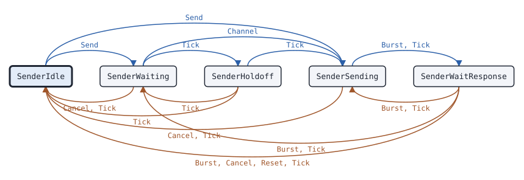

# data.Sender

This page describes the data send state machine of package data: it sends data messages, waits for the response to a confirmed message and sends again.

## What it does

[`data.Sender`](https://pkg.go.dev/github.com/USA-RedDragon/dmrgo/v2/data#Sender) sends data messages on one logical channel. Each try is the Pre_CSBKs, the header and the blocks of the packet, one burst per Tick, one TDMA frame apart, after the channel access of the config. An unconfirmed message ends when its last burst goes out. For a confirmed message the Sender waits for the response and sends again: only the blocks that a SACK requests, the whole packet after a NACK for a bad CRC or after no response, and the whole packet as a first try after a NACK for N(S) out of sequence. By default it uses stop and wait, so each message requests its own response. With a window, it sends up to a set number of C_HEAD messages of the IP bearer service one after the other, and only the last one requests a response. (ETSI TS 102 361-1 clauses 5.2.1.6, 8.2 and 9.3.24, ETSI TS 102 361-3 clauses 5.4 and 5.4.4)

When a NACK for N(S) out of sequence carries a VI that is not the N(S) of the message, and that VI is the N(S) of the last message to the link that got an ACK, or no message got one yet, the message takes N(S) VI + 1 and the messages after it follow on. ETSI TS 102 361-1 clause 9.3.24 does not increment N(S) on an automatic retry, and gives only the S flag to resynchronize, which clause 9.3.23 keeps for registration messages. Without one of the two, the link stays stopped, so here the Sender departs from clause 9.3.24 and takes the N(S) that the receiver requests (ETSI TS 102 361-1 Table 8.3).

The Sender does no I/O. Each method takes the time `now` on a monotonic clock that the caller picks, and appends outputs to a slice of the caller.

## When to use it

Use a Sender in a radio, a hotspot or a gateway that sends SMS, location reports, IP datagrams or other data packets. It covers U_HEAD, C_HEAD, DD_HEAD and R_HEAD messages, with an optional P_HEAD after the header.

Feed the bursts that come back on the channel to the Sender too, so that it gets the responses. To receive data, or to answer the confirmed messages of others, use a [data.Receiver](data-receiver.md).

Turn on the window only for receivers that keep every packet of it. The AnyTone D890UV firmware, also in the BTECH DA-7X2, sends an ACK for the last packet of a window and keeps only that packet, so the earlier ones are lost.

## Config

[`data.NewSender`](https://pkg.go.dev/github.com/USA-RedDragon/dmrgo/v2/data#NewSender) takes a [`*data.SenderConfig`](https://pkg.go.dev/github.com/USA-RedDragon/dmrgo/v2/data#SenderConfig). A nil config is the zero config. `Slot` must be slot 1 or slot 2, so a nil config returns an error. `Source` selects the SYNC: BS sourced for a repeater outbound, MS sourced for a radio. A duration of 0 selects the default in the field doc, and the field doc gives what a negative duration does.

<!-- dmrgo:config pkg=data type=SenderConfig -->
| Field | Type | Default | Description |
|---|---|---|---|
| `ColorCode` | `enums.ColorCode` | zero value | ColorCode is the color code of the bursts. |
| `Source` | `layer2.SyncSource` | zero value | Source selects the SYNC patterns: layer2.SyncSourceBS, the zero value, for a repeater outbound, layer2.SyncSourceMS for a radio. |
| `Access` | `enums.Access` | zero value | Access is the channel access policy. The zero value, enums.AccessPoliteOwnCC, sends only while Channel last reported the channel idle (ETSI TS 102 361-1 clause 5.2.1.6). |
| `Preambles` | `int` | `DefaultPreambles` (5) | Preambles is the number of preamble CSBKs before the header of each try, so that a radio in power save wakes up. A try that starts within DefaultHang of a response from the target sends at most one, as the target is still in the data call, and one Pre_CSBK is the ChanAuth PDU of data in channel hangtime (ETSI TS 102 361-2 clause 5.1.1.6.0). 0 means DefaultPreambles, and a negative value sends none; at most MaxPreambles. |
| `IdleSearch` | `time.Duration` | not machine-readable; see the description | IdleSearch is the time that a polite Sender waits for an idle channel before it holds off. 0 means DefaultIdleSearch, and a negative value holds off at once. |
| `Holdoff` | `time.Duration` | not machine-readable; see the description | Holdoff is the longest random holdoff T_Holdoff after a busy channel. 0 means constants.THoldoffMax (2 s), and a negative value turns the holdoff off. |
| `ResponseWait` | `time.Duration` | not machine-readable; see the description | ResponseWait is the time T_RspnsWait from the end of the last burst to the response of a confirmed packet. 0 means constants.TResponseWait (180 ms). A response that comes through a network can need more; constants.TResponseWaitSimulcast is 2 s. |
| `TxLimit` | `time.Duration` | not machine-readable; see the description | TxLimit is the time T_DataTxLmt from Send after which no new try starts. 0 means constants.TDataTxLimit (60 s), and a negative value turns the limit off. |
| `Retries` | `int` | not machine-readable; see the description | Retries is the most transmissions N_RtryLmt of a confirmed message, the first one included. 0 means constants.NRetryLimit (8); at most MaxRetries. |
| `MaxBlocks` | `int` | not machine-readable; see the description | MaxBlocks is the most data blocks of a packet. 0 means MaxBlocks. Each block takes about 110 bytes, so a microcontroller can set 16. |
| `Peers` | `int` | not machine-readable; see the description | Peers is the number of links whose send sequence number V(S) the Sender keeps. 0 means DefaultPeers; at most MaxPeers. |
| `Resync` | `bool` | zero value | Resync sets the S flag on the first packet to a link and on the resend after a NACK for N(S) out of sequence, so that the receiver takes the N(S). ETSI TS 102 361-1 clause 9.3.23 keeps S for special registration messages, so false, the default, never sets it. |
| `Window` | `int` | zero value | Window is the most C_HEAD messages of the IP bearer service in progress at once, for sliding window flow control. Send queues up to Window of them to one link, and the Sender sends them one after the other with the Response Requested flag set only on the last, then takes one response for all of them. 0 or 1, the default, means stop and wait: each message requests its own response. At most MaxWindow. Each message of the window takes its own packet.Builder. Use a window only with receivers known to keep every packet of it: the AnyTone D890UV firmware (also in the BTECH DA-7X2) sends an ACK for the last packet of a window and keeps only that packet, so the earlier ones are lost. (ETSI TS 102 361-3 clause 5.4.4) |
| `Seed` | `uint64` | zero value | Seed seeds the random holdoff. Two Senders with the same seed hold off for the same times, so give each radio its own seed. |
| `Slot` | `enums.Slot` | zero value | Slot is the TDMA slot of the Sender, which it puts in the Hint of each burst it sends. It must be Slot1 or Slot2. |
| `Lead` | `time.Duration` | not machine-readable; see the description | Lead makes Tick emit a burst this long before its Due time, so that an RF FIFO can be filled ahead. 0 means at Due; it must not be negative. The timers of the Sender keep to the Due times. |
<!-- /dmrgo:config -->

## States and transitions

<!-- dmrgo:states pkg=data type=SenderState -->
States of [`Sender`](https://pkg.go.dev/github.com/USA-RedDragon/dmrgo/v2/data#Sender), from [`Sender.State`](https://pkg.go.dev/github.com/USA-RedDragon/dmrgo/v2/data#Sender.State):

| State | Meaning | Seen in tests |
|---|---|---|
| [`SenderIdle`](https://pkg.go.dev/github.com/USA-RedDragon/dmrgo/v2/data#SenderIdle) | SenderIdle has no message. | yes, first state |
| [`SenderWaiting`](https://pkg.go.dev/github.com/USA-RedDragon/dmrgo/v2/data#SenderWaiting) | SenderWaiting waits for an idle channel. | yes |
| [`SenderHoldoff`](https://pkg.go.dev/github.com/USA-RedDragon/dmrgo/v2/data#SenderHoldoff) | SenderHoldoff waits for the random holdoff after a busy channel. | yes |
| [`SenderSending`](https://pkg.go.dev/github.com/USA-RedDragon/dmrgo/v2/data#SenderSending) | SenderSending sends the bursts of a try, one per Tick. | yes |
| [`SenderWaitResponse`](https://pkg.go.dev/github.com/USA-RedDragon/dmrgo/v2/data#SenderWaitResponse) | SenderWaitResponse waits for the response to a confirmed packet. | yes |

Transitions seen in tests:

| From | Method call | To |
|---|---|---|
| SenderIdle | `Send` | SenderWaiting |
| SenderIdle | `Send` | SenderSending |
| SenderWaiting | `Cancel`, `Tick` | SenderIdle |
| SenderWaiting | `Tick` | SenderHoldoff |
| SenderWaiting | `Channel` | SenderSending |
| SenderHoldoff | `Tick` | SenderIdle |
| SenderHoldoff | `Tick` | SenderWaiting |
| SenderHoldoff | `Tick` | SenderSending |
| SenderSending | `Cancel`, `Tick` | SenderIdle |
| SenderSending | `Burst`, `Tick` | SenderWaitResponse |
| SenderWaitResponse | `Burst`, `Cancel`, `Reset`, `Tick` | SenderIdle |
| SenderWaitResponse | `Burst`, `Tick` | SenderWaiting |
| SenderWaitResponse | `Burst`, `Tick` | SenderSending |


<!-- /dmrgo:states -->

These inputs move the state:

- `Send` on an idle Sender starts the first try. With impolite access, or a channel that `Channel` last reported idle, the try starts at once. Else the Sender waits for an idle channel.
- While it waits, `Channel` with an idle channel starts the try. When the idle search passes on a busy channel, the Sender waits a random holdoff. When the holdoff ends, the try starts on an idle channel, or the Sender waits for an idle channel again.
- While it sends, each Tick emits one burst. After the last burst, an unconfirmed message ends with `ResultSent`, and a confirmed message waits for the response.
- While it waits for the response, an ACK ends the message with `ResultDelivered`. A NACK that a resend cannot fix ends it with `ResultRefused`. A SACK, a NACK for a bad CRC or for N(S) out of sequence, or no response before the response wait ends, starts the next try through channel access.
- A next try does not start after the last try that `Retries` allows (`ResultRetryLimit`), or after `TxLimit` has passed since `Send` (`ResultTimeLimit`).
- `Cancel` ends every message in progress with `ResultCancelled`. `Reset` ends them without an output.

## Inputs and outputs

Every method that takes `dst` appends at most [`data.MaxOutputs`](https://pkg.go.dev/github.com/USA-RedDragon/dmrgo/v2/data#MaxOutputs) outputs: one burst and the end of each message of a window. With that room in `dst`, the method does not allocate.

| Method | Takes | Returns |
|---|---|---|
| [`Send`](https://pkg.go.dev/github.com/USA-RedDragon/dmrgo/v2/data#Sender.Send) | a [`*data.Message`](https://pkg.go.dev/github.com/USA-RedDragon/dmrgo/v2/data#Message) | an error |
| [`Channel`](https://pkg.go.dev/github.com/USA-RedDragon/dmrgo/v2/data#Sender.Channel) | whether the channel is busy | nothing |
| [`Burst`](https://pkg.go.dev/github.com/USA-RedDragon/dmrgo/v2/data#Sender.Burst) | a raw burst and its [`layer2.Hint`](https://pkg.go.dev/github.com/USA-RedDragon/dmrgo/v2/layer2#Hint) | `dst` with the end of each message that a response ends |
| [`Decoded`](https://pkg.go.dev/github.com/USA-RedDragon/dmrgo/v2/data#Sender.Decoded) | a burst that the caller decoded, or nil | the same as `Burst` |
| [`Tick`](https://pkg.go.dev/github.com/USA-RedDragon/dmrgo/v2/data#Sender.Tick) | the time now | `dst` with at most one burst, and the ends of messages |
| [`Deadline`](https://pkg.go.dev/github.com/USA-RedDragon/dmrgo/v2/data#Sender.Deadline) | nothing | the time of the next Tick, and false when no timer runs |
| [`Lost`](https://pkg.go.dev/github.com/USA-RedDragon/dmrgo/v2/data#Sender.Lost) | the time now | `dst`; the channel counts as idle |
| [`Cancel`](https://pkg.go.dev/github.com/USA-RedDragon/dmrgo/v2/data#Sender.Cancel) | the time now | `dst` with `ResultCancelled` for each message in progress |
| [`State`](https://pkg.go.dev/github.com/USA-RedDragon/dmrgo/v2/data#Sender.State), [`Reset`](https://pkg.go.dev/github.com/USA-RedDragon/dmrgo/v2/data#Sender.Reset) | nothing | the state, or nothing |

Before `Send`, set `Message.Header` with a `SetX` method of [`pdu.DataHeader`](https://pkg.go.dev/github.com/USA-RedDragon/dmrgo/v2/layer2/pdu#DataHeader), or with [`Message.SetRawData`](https://pkg.go.dev/github.com/USA-RedDragon/dmrgo/v2/data#Message.SetRawData) for an R_HEAD. Set `Message.Rate`; the zero value is rate 1/2. `Send` copies the header and the payload, so you can reuse them. It sets the block count, the pad octets and the Full Message Flag. For a C_HEAD it also sets N(S) from the link, the S flag with `Resync`, and the Response Requested flag. A DD_HEAD or R_HEAD message is confirmed when its Response Requested flag is set, and `Send` sets that flag when SARQ is set (ETSI TS 102 361-3 clause 6.4, Table 6.5). A confirmed message to a talkgroup is an error.

With `Window` above 1, `Send` takes more C_HEAD messages of the IP bearer service to the same link while fewer than `Window` are in progress. A message goes in the window on air when the last header of that window has not gone out yet, else in the next window. `Send` returns `ErrBusy` for any other message while one is in progress.

Call `Channel` each time the activity on the channel changes, from the CACH AT bit, the carrier or a repeater. An impolite Sender ignores it. Feed the bursts that you receive on the channel to `Burst`, or to `Decoded` when you decode the burst once for several machines. The Sender takes only a response from the target of the messages to their source. In stop and wait, it ignores a response whose status is the N(S) of an earlier message.

Each [`data.Output`](https://pkg.go.dev/github.com/USA-RedDragon/dmrgo/v2/data#Output) is one of:

- `OutputBurst`: a burst to send at `Due`, with a `Hint` that has the data type of the burst and the configured slot. `Try` is the try that the burst belongs to, from 1, and `Seq` is the N(S) of a C_HEAD message.
- `OutputDone`: the end of a message, with its [`Result`](https://pkg.go.dev/github.com/USA-RedDragon/dmrgo/v2/data#Result), the last `Response` when `HasResponse` is set, `Try`, `Seq` and `Call`. With a window, `Seq` gives the message that ended.

For a message of the IP bearer service, [`Output.ICMP`](https://pkg.go.dev/github.com/USA-RedDragon/dmrgo/v2/data#Output.ICMP) returns the ICMP error message that an `OutputDone` reports to the IP layer, such as host unreachable after the last try (ETSI TS 102 361-3 clauses 5.2 and 5.4.2.1).

## Timers

| Timer | Config field | Default |
|---|---|---|
| Idle search, the wait for an idle channel before a holdoff (ETSI TS 102 361-1 clause F.1) | `IdleSearch` | <!-- dmrgo:const pkg=data name=DefaultIdleSearch -->`540ms`<!-- /dmrgo:const --> |
| Upper end of the random holdoff T_Holdoff | `Holdoff` | <!-- dmrgo:const pkg=constants name=THoldoffMax -->`2s`<!-- /dmrgo:const --> |
| T_RspnsWait, the wait for the response after a try | `ResponseWait` | <!-- dmrgo:const pkg=constants name=TResponseWait -->`180ms`<!-- /dmrgo:const --> |
| T_DataTxLmt, the time from `Send` after which no new try starts | `TxLimit` | <!-- dmrgo:const pkg=constants name=TDataTxLimit -->`1m0s`<!-- /dmrgo:const --> |
| N_RtryLmt, the most transmissions of a confirmed message | `Retries` | <!-- dmrgo:const pkg=constants name=NRetryLimit -->`8`<!-- /dmrgo:const -->, at most <!-- dmrgo:const pkg=data name=MaxRetries -->`64`<!-- /dmrgo:const --> |
| Pre_CSBKs before the header of each try | `Preambles` | <!-- dmrgo:const pkg=data name=DefaultPreambles -->`5`<!-- /dmrgo:const -->, at most <!-- dmrgo:const pkg=data name=MaxPreambles -->`64`<!-- /dmrgo:const --> |
| Time after a response from the target in which a try sends at most one Pre_CSBK | none | <!-- dmrgo:const pkg=data name=DefaultHang -->`360ms`<!-- /dmrgo:const --> |
| Most C_HEAD messages in a window | `Window` | stop and wait, at most <!-- dmrgo:const pkg=data name=MaxWindow -->`8`<!-- /dmrgo:const --> |

A response that comes through a network can need a longer `ResponseWait`; <!-- dmrgo:const pkg=constants name=TResponseWaitSimulcast -->`2s`<!-- /dmrgo:const --> is the simulcast value. A try that starts soon after a response from the target sends at most one Pre_CSBK, because the target is still in the data call; one Pre_CSBK is also the ChanAuth PDU of data in channel hang time (ETSI TS 102 361-2 clause 5.1.1.6.0). `Lead` makes `Tick` emit each burst early, for an RF FIFO, and the timers still keep to the `Due` times. `Seed` seeds the holdoff; give each radio its own seed.

## Worked example

This example sends a confirmed message to a [data.Receiver](data-receiver.md). The air between them loses one block of the first try, so the Receiver requests that block again with a SACK, and the Sender resends only that block.

<!-- dmrgo:code file=v2/data/sender_example_test.go symbol=ExampleSender -->
```go
func ExampleSender() {
	tx, err := data.NewSender(&data.SenderConfig{Slot: enums.Slot1, Source: layer2.SyncSourceMS, ColorCode: 1})
	if err != nil {
		fmt.Println(err)
		return
	}
	rx, err := data.NewReceiver(&data.ReceiverConfig{Address: 3120002, Respond: true})
	if err != nil {
		fmt.Println(err)
		return
	}
	m := &data.Message{Rate: enums.DataTypeRate12, Payload: []byte("a confirmed message of a few blocks")}
	if err := m.Header.SetConfirmed(pdu.ConfirmedDataHeader{
		SAP: enums.SAPIPBasedPacketData, LLIDDestination: 3120002, LLIDSource: 3120001,
	}); err != nil {
		fmt.Println(err)
		return
	}
	if err := tx.Send(0, m); err != nil {
		fmt.Println(err)
		return
	}
	outputs := make([]data.Output, 0, data.MaxOutputs)
	events := make([]data.Event, 0, data.MaxEvents)
	var replies []data.Event
	sent := 0
	for now := time.Duration(0); tx.State() != data.SenderIdle; now += 10 * time.Millisecond {
		for _, e := range replies {
			for _, o := range tx.Burst(e.Due, &e.Burst, layer2.Hint{}, outputs[:0]) {
				fmt.Printf("%v after %d tries (%v)\n", o.Result, o.Try, o.Response)
			}
		}
		replies = replies[:0]
		for _, o := range tx.Tick(now, outputs[:0]) {
			sent++
			if sent == data.DefaultPreambles+3 {
				continue
			}
			for _, e := range rx.Burst(o.Due, &o.Burst, layer2.Hint{}, events[:0]) {
				switch e.Kind {
				case data.EventDelivered:
					fmt.Printf("delivered %q\n", e.Message.Payload)
				case data.EventRespond:
					if e.Burst.SlotType().DataType == enums.DataTypeDataHeader {
						fmt.Printf("receiver sends %v\n", e.Response)
					}
					replies = append(replies, e)
				case data.EventCallStart, data.EventResponse, data.EventCallEnd, data.EventReassembled:
				}
			}
		}
	}
}
```
<!-- /dmrgo:code -->

Output:

<!-- dmrgo:output test=data.ExampleSender -->
```text
receiver sends SACK
delivered "a confirmed message of a few blocks"
receiver sends ACK
Delivered after 2 tries (ACK)
```
<!-- /dmrgo:output -->

The next example sends three IP messages in one window. Only the last header requests a response, and one ACK delivers all three.

<!-- dmrgo:code file=v2/data/sender_example_test.go symbol=ExampleSender_window -->
```go
func ExampleSender_window() {
	tx, err := data.NewSender(&data.SenderConfig{Slot: enums.Slot1, Source: layer2.SyncSourceMS, ColorCode: 1, Window: 3})
	if err != nil {
		fmt.Println(err)
		return
	}
	rx, err := data.NewReceiver(&data.ReceiverConfig{Address: 3120002, Respond: true})
	if err != nil {
		fmt.Println(err)
		return
	}
	for _, text := range []string{"one", "two", "three"} {
		m := &data.Message{Rate: enums.DataTypeRate12, Payload: []byte(text)}
		if err := m.Header.SetConfirmed(pdu.ConfirmedDataHeader{
			SAP: enums.SAPIPBasedPacketData, LLIDDestination: 3120002, LLIDSource: 3120001,
		}); err != nil {
			fmt.Println(err)
			return
		}
		if err := tx.Send(0, m); err != nil {
			fmt.Println(err)
			return
		}
	}
	outputs := make([]data.Output, 0, data.MaxOutputs)
	events := make([]data.Event, 0, data.MaxEvents)
	var replies []data.Event
	for now := time.Duration(0); tx.State() != data.SenderIdle; now += 10 * time.Millisecond {
		for _, e := range replies {
			for _, o := range tx.Burst(e.Due, &e.Burst, layer2.Hint{}, outputs[:0]) {
				fmt.Printf("N(S) %d: %v (%v)\n", o.Seq, o.Result, o.Response)
			}
		}
		replies = replies[:0]
		for _, o := range tx.Tick(now, outputs[:0]) {
			for _, e := range rx.Burst(o.Due, &o.Burst, layer2.Hint{}, events[:0]) {
				switch e.Kind {
				case data.EventDelivered:
					c, _ := e.Message.Header.AsConfirmed()
					fmt.Printf("delivered %q, response requested %v\n", e.Message.Payload, c.ResponseRequested)
				case data.EventRespond:
					replies = append(replies, e)
				case data.EventCallStart, data.EventResponse, data.EventCallEnd, data.EventReassembled:
				}
			}
		}
	}
}
```
<!-- /dmrgo:code -->

Output:

<!-- dmrgo:output test=data.ExampleSender_window -->
```text
delivered "one", response requested false
delivered "two", response requested false
delivered "three", response requested true
N(S) 0: Delivered (ACK)
N(S) 1: Delivered (ACK)
N(S) 2: Delivered (ACK)
```
<!-- /dmrgo:output -->

## Errors

<!-- dmrgo:errors pkg=data type=Sender -->
| Error | Returned by | Meaning |
|---|---|---|
| [`data.ErrBusy`](https://pkg.go.dev/github.com/USA-RedDragon/dmrgo/v2/data#ErrBusy) | `Sender.Send` | ErrBusy is returned by Sender.Send while a message is in progress. |
| [`dmrgo.ConfigError`](https://pkg.go.dev/github.com/USA-RedDragon/dmrgo/v2#ConfigError) | `Sender.Send` | ConfigError is the error of a constructor, and of a machine method that takes a config, option or argument field, for a field with a value out of range. |
| [`dmrgo.ErrNilArgument`](https://pkg.go.dev/github.com/USA-RedDragon/dmrgo/v2#ErrNilArgument) | `Sender.Send` | ErrNilArgument is returned by a function or method of the library that returns an error when a pointer, func or interface argument it needs is nil. |
| [`dmrgo.ErrZeroValue`](https://pkg.go.dev/github.com/USA-RedDragon/dmrgo/v2#ErrZeroValue) | `Sender.Send` | ErrZeroValue is returned by a method of a state machine that starts work, such as Start, Request or Send, when the machine is a zero value and not made with its constructor. |
<!-- /dmrgo:errors -->

Match [`data.ErrBusy`](https://pkg.go.dev/github.com/USA-RedDragon/dmrgo/v2/data#ErrBusy) and the errors of [`packet.Builder.Segment`](https://pkg.go.dev/github.com/USA-RedDragon/dmrgo/v2/layer2/packet#Builder.Segment) with `errors.Is`, and a [`*dmrgo.ConfigError`](https://pkg.go.dev/github.com/USA-RedDragon/dmrgo/v2#ConfigError) with `errors.As`; its `Field` names the field, such as `Header`, `Proprietary` or `Header.Group`. A `Send` that fails returns its error at once and queues nothing. A message that starts and then fails ends with an `OutputDone` and gives no error. A burst that the Sender cannot build ends every message in progress with `ResultRefused`.

## Related machines and guides

- [data.Receiver](data-receiver.md) receives the messages and sends the responses.
- [csbk.Preambles](csbk-preambles.md) follows the Pre_CSBKs that a Sender sends.
- [bs.Repeater](bs-repeater.md) repeats the data and holds the data hang time for the response.
- [csbk.Requester](csbk-requester.md) uses the same channel access ideas for CSBK requests.
- The guides [Send SMS and confirmed data with retries](../guides/send-data.md) and [Run TCP or UDP over DMR data](../guides/tcp-udp-over-dmr.md) use a Sender.
