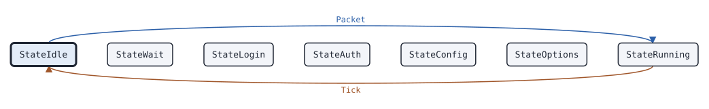

# dmrdsession Bridge

This page covers the dmrdsession Bridge, the state machine of one OpenBridge link between two masters.

## What it does

A [Bridge](https://pkg.go.dev/github.com/USA-RedDragon/dmrgo/v2/transport/dmrd/dmrdsession#Bridge) is one end of an OpenBridge link. OpenBridge carries DMRD packets between masters, signed with a key that both ends share; it has no login. The Bridge checks the signature of each packet that it takes, and signs the packets that you send with [SignInPlace](https://pkg.go.dev/github.com/USA-RedDragon/dmrgo/v2/transport/dmrd/dmrdsession#Bridge.SignInPlace). With the enhanced OpenBridge of FreeDMR, it also sends the BCKA keepalive and tracks whether the other end is alive. The Bridge is not a dialect of the MMDVM network protocol or HBRP: OpenBridge is a separate protocol built on the same DMRD packet. It does no I/O. (BrandMeister Open Bridge; FreeDMR 546165eb hblink.py and bridge_master.py; HBlink3 1db2730)

## When to use it

Use a Bridge in a master that links to another master over OpenBridge, such as a BrandMeister, HBlink3 or FreeDMR server. Use one Bridge for each link. Turn on the enhanced mode only when the other end runs the enhanced OpenBridge of FreeDMR. Use [dmrd.DecodeBridge](https://pkg.go.dev/github.com/USA-RedDragon/dmrgo/v2/transport/dmrd#DecodeBridge) to read the data packets that the Bridge passes on.

## Config

Pass a [BridgeConfig](https://pkg.go.dev/github.com/USA-RedDragon/dmrgo/v2/transport/dmrd/dmrdsession#BridgeConfig) to [NewBridge](https://pkg.go.dev/github.com/USA-RedDragon/dmrgo/v2/transport/dmrd/dmrdsession#NewBridge). The config is required. Key is the passphrase of the link, as [dmrdauth.NewBridgeKey](https://pkg.go.dev/github.com/USA-RedDragon/dmrgo/v2/transport/dmrd/dmrdauth#NewBridgeKey) takes it. Keepalive and Timeout apply only with Enhanced.

<!-- dmrgo:config pkg=transport/dmrd/dmrdsession type=BridgeConfig -->
| Field | Type | Default | Description |
|---|---|---|---|
| `Key` | `[]byte` | zero value | Key is the passphrase of the OpenBridge link (see dmrdauth.NewBridgeKey). |
| `Enhanced` | `bool` | zero value | Enhanced turns on FreeDMR's enhanced OpenBridge: the Bridge sends a BCKA every Keepalive. Without it OpenBridge has no keepalive, and the Bridge sends nothing of its own. |
| `Keepalive` | `time.Duration` | not machine-readable; see the description | Keepalive is the BCKA period. 0 means KeepaliveDefault. |
| `Timeout` | `time.Duration` | not machine-readable; see the description | Timeout is the time without a packet with a good signature after which the Bridge reports OutputDown. 0 means TimeoutDefault, the time after which FreeDMR stops sending to a peer. |
<!-- /dmrgo:config -->

## States and transitions

[State](https://pkg.go.dev/github.com/USA-RedDragon/dmrgo/v2/transport/dmrd/dmrdsession#Bridge.State) returns the current state. The Peer, the Master and the Bridge share the [State](https://pkg.go.dev/github.com/USA-RedDragon/dmrgo/v2/transport/dmrd/dmrdsession#State) type. A Bridge uses only two of its values: the link is idle, or it runs.

<!-- dmrgo:states pkg=transport/dmrd/dmrdsession type=Bridge -->
States of [`Bridge`](https://pkg.go.dev/github.com/USA-RedDragon/dmrgo/v2/transport/dmrd/dmrdsession#Bridge), from [`Bridge.State`](https://pkg.go.dev/github.com/USA-RedDragon/dmrgo/v2/transport/dmrd/dmrdsession#Bridge.State):

| State | Meaning | Seen in tests |
|---|---|---|
| [`StateIdle`](https://pkg.go.dev/github.com/USA-RedDragon/dmrgo/v2/transport/dmrd/dmrdsession#StateIdle) | StateIdle has no session: a Peer after Close, a Master before an RPTL or after the end of a session, a Bridge, enhanced or not, before the first packet with a good signature and after Timeout without one. | yes, first state |
| [`StateWait`](https://pkg.go.dev/github.com/USA-RedDragon/dmrgo/v2/transport/dmrd/dmrdsession#StateWait) | StateWait is a Peer that waits to log in again. | no |
| [`StateLogin`](https://pkg.go.dev/github.com/USA-RedDragon/dmrgo/v2/transport/dmrd/dmrdsession#StateLogin) | StateLogin is a Peer that sent RPTL, or a Master that waits for Admit or Refuse. | no |
| [`StateAuth`](https://pkg.go.dev/github.com/USA-RedDragon/dmrgo/v2/transport/dmrd/dmrdsession#StateAuth) | StateAuth is a Peer that sent RPTK, or a Master that sent the salt. | no |
| [`StateConfig`](https://pkg.go.dev/github.com/USA-RedDragon/dmrgo/v2/transport/dmrd/dmrdsession#StateConfig) | StateConfig is a Peer that sent RPTC, or a Master that waits for it or for Accept or Refuse. | no |
| [`StateOptions`](https://pkg.go.dev/github.com/USA-RedDragon/dmrgo/v2/transport/dmrd/dmrdsession#StateOptions) | StateOptions is a Peer that sent RPTO. | no |
| [`StateRunning`](https://pkg.go.dev/github.com/USA-RedDragon/dmrgo/v2/transport/dmrd/dmrdsession#StateRunning) | StateRunning is a logged-in session, or a Bridge, enhanced or not, whose peer sent a packet with a good signature within Timeout. | yes |

Transitions seen in tests:

| From | Method call | To |
|---|---|---|
| StateIdle | `Packet` | StateRunning |
| StateRunning | `Tick` | StateIdle |


<!-- /dmrgo:states -->

Only an enhanced Bridge tracks the link. Its link runs while the other end sent a packet with a good signature, a BCKA or any other, within Timeout. The first such packet after an idle link reports the link up. When Timeout passes without one, Tick reports the link down. Without the enhanced mode, OpenBridge has no keepalive: the Bridge only checks signatures, and its State stays idle.

## Inputs and outputs

Inputs:

- [Packet](https://pkg.go.dev/github.com/USA-RedDragon/dmrgo/v2/transport/dmrd/dmrdsession#Bridge.Packet) takes each UDP packet from the other end.
- [SignInPlace](https://pkg.go.dev/github.com/USA-RedDragon/dmrgo/v2/transport/dmrd/dmrdsession#Bridge.SignInPlace) writes the signature into the last octets of an OpenBridge packet that you send.
- [Tick](https://pkg.go.dev/github.com/USA-RedDragon/dmrgo/v2/transport/dmrd/dmrdsession#Bridge.Tick) sends the keepalive and runs the timeout of an enhanced Bridge. Call it at the time [Deadline](https://pkg.go.dev/github.com/USA-RedDragon/dmrgo/v2/transport/dmrd/dmrdsession#Bridge.Deadline) returns. A Bridge without the enhanced mode has no deadline.

Outputs are [Output](https://pkg.go.dev/github.com/USA-RedDragon/dmrgo/v2/transport/dmrd/dmrdsession#Output) values with an [OutputKind](https://pkg.go.dev/github.com/USA-RedDragon/dmrgo/v2/transport/dmrd/dmrdsession#OutputKind): the BCKA to send, the link up and down, the DMRD and DMRE data packets with a good signature, and the BCSQ, BCST and BCVE messages. A packet without a good signature, or that is not OpenBridge, gives no output. The packets of the data and message outputs point into the packet that you passed in. Give each method a slice with capacity <!-- dmrgo:const pkg=transport/dmrd/dmrdsession name=MaxOutputs -->`4`<!-- /dmrgo:const -->.

## Timers

- Keepalive: the BCKA period of an enhanced Bridge. The default is <!-- dmrgo:const pkg=transport/dmrd/dmrdsession name=KeepaliveDefault --><!-- /dmrgo:const -->, the BCKA period of FreeDMR. The first BCKA goes out at the first Tick.
- Timeout: the time without a packet with a good signature after which an enhanced Bridge reports the link down. The default is <!-- dmrgo:const pkg=transport/dmrd/dmrdsession name=TimeoutDefault --><!-- /dmrgo:const -->, the time after which FreeDMR stops sending to a peer.

## Worked example

This example runs both ends of an enhanced link in memory. The BCKA of one end brings the link up at the other. A signed BCSQ passes, the same packet with one bit changed is dropped, and the link goes down one Timeout after the last good packet.

<!-- dmrgo:code file=v2/transport/dmrd/dmrdsession/example_test.go symbol=ExampleBridge -->
```go
func ExampleBridge() {
	cfg := dmrdsession.BridgeConfig{Key: []byte("bridge passphrase"), Enhanced: true}
	a, _ := dmrdsession.NewBridge(&cfg)
	b, err := dmrdsession.NewBridge(&cfg)
	if err != nil {
		fmt.Println(err)
		return
	}
	out := make([]dmrdsession.Output, 0, dmrdsession.MaxOutputs)
	for _, ka := range a.Tick(0, out[:0]) {
		for _, o := range b.Packet(0, ka.Packet, nil) {
			fmt.Println("b:", o.Kind)
		}
	}
	sq := dmrd.BridgeControl{Command: dmrd.CommandBCSQ, TalkGroup: 91, Stream: 7}
	p, _ := sq.AppendBinary(nil)
	if err := a.SignInPlace(p); err != nil {
		fmt.Println(err)
		return
	}
	for _, o := range b.Packet(time.Second, p, out[:0]) {
		fmt.Println("b:", o.Kind, o.Command)
	}
	p[len(p)-1] ^= 1
	fmt.Println("b: bad signature,", len(b.Packet(2*time.Second, p, out[:0])), "outputs")
	for {
		at, _ := b.Deadline()
		out = b.Tick(at, out[:0])
		if len(out) > 0 && out[0].Kind == dmrdsession.OutputDown {
			fmt.Println("b:", at, out[0].Kind, out[0].Reason, b.State())
			break
		}
	}
}
```
<!-- /dmrgo:code -->

Output:

<!-- dmrgo:output test=transport/dmrd/dmrdsession.ExampleBridge -->
```text
b: Up
b: Message BCSQ
b: bad signature, 0 outputs
b: 1m1s Down Timeout Idle
```
<!-- /dmrgo:output -->

## Errors

Packet and Tick return no errors: a packet with a bad signature gives no output. SignInPlace returns an error for a Bridge that NewBridge did not make and for a packet that is not OpenBridge. NewBridge returns an error for a nil config, and a configuration error for a negative Keepalive or Timeout.

<!-- dmrgo:errors pkg=transport/dmrd/dmrdsession type=Bridge -->
| Error | Returned by | Meaning |
|---|---|---|
| [`dmrgo.ErrZeroValue`](https://pkg.go.dev/github.com/USA-RedDragon/dmrgo/v2#ErrZeroValue) | `Bridge.SignInPlace` | ErrZeroValue is returned by a method of a state machine that starts work, such as Start, Request or Send, when the machine is a zero value and not made with its constructor. |
<!-- /dmrgo:errors -->

## Related machines and guides

Machines:

- [dmrdsession Master](dmrdsession-master.md): the master side of the repeater sessions that a linked master runs.
- [dmrdsession Peer](dmrdsession-peer.md): the repeater side of those sessions.
- [voice Jitter](voice-jitter.md): puts the voice packets of the link in order.

Guides:

- Connect to a network (MMDVM network protocol, HBRP, IPSC, Hytera)
- Rewrite and relay a voice call
