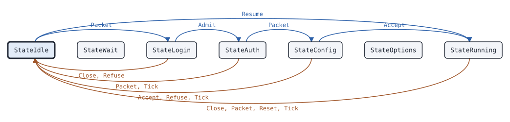

# dmrdsession Master

This page covers the dmrdsession Master, the state machine of the master side of the session of one repeater, for the MMDVM network protocol or the HomeBrew Repeater Protocol (HBRP).

## What it does

A [Master](https://pkg.go.dev/github.com/USA-RedDragon/dmrgo/v2/transport/dmrd/dmrdsession#Master) is the master side of the session of one repeater. It speaks one of two dialects of package [dmrd](https://pkg.go.dev/github.com/USA-RedDragon/dmrgo/v2/transport/dmrd): the MMDVM network protocol of MMDVMHost and DMRGateway ([DialectMMDVM](https://pkg.go.dev/github.com/USA-RedDragon/dmrgo/v2/transport/dmrd#DialectMMDVM)), or the HomeBrew Repeater Protocol in the hex text form of its 2015 specification and of BrandMeister ([DialectHBRP](https://pkg.go.dev/github.com/USA-RedDragon/dmrgo/v2/transport/dmrd#DialectHBRP)). It answers each login step. It reports the RPTL and the RPTC to you before it answers them, so that you decide which repeaters log in and with which password. It takes the RPTO of a logged-in repeater with an RPTACK, as DMRGateway waits for it before it sends traffic. It answers a packet from a repeater that is not logged in with MSTNAK. It ends the session after LoginTimeout without a packet during the login, and Timeout after it. It does no I/O. (DL5DI, G4KLX and DG1HT, IPSC Protocol Specs for homebrew DMR repeater, 2015-07-26; HBlink3 1db2730 hblink.py master_maintenance_loop; DMRGateway ee79d38)

## When to use it

Use a Master in a server that repeaters, hotspots and gateways log in to: a network master, a test master for a repeater, or a bridge between networks. Keep one Master for each source address that sends you packets, and pass it the packets of that address. A Master makes no random numbers and keeps no password list: you draw the salt and look up the password when the Master reports a login.

## Config

Pass a [MasterConfig](https://pkg.go.dev/github.com/USA-RedDragon/dmrgo/v2/transport/dmrd/dmrdsession#MasterConfig) to [NewMaster](https://pkg.go.dev/github.com/USA-RedDragon/dmrgo/v2/transport/dmrd/dmrdsession#NewMaster). The config is required, and the dialect must be the MMDVM network protocol or HBRP.

<!-- dmrgo:config pkg=transport/dmrd/dmrdsession type=MasterConfig -->
| Field | Type | Default | Description |
|---|---|---|---|
| `Dialect` | `dmrd.Dialect` | zero value | Dialect is dmrd.DialectMMDVM or dmrd.DialectHBRP. |
| `Timeout` | `time.Duration` | not machine-readable; see the description | Timeout is the time without a packet from the repeater after which the Master ends the session. 0 means TimeoutDefault. |
| `LoginTimeout` | `time.Duration` | not machine-readable; see the description | LoginTimeout is the time after the first RPTL of a login, and after the RPTK that proves the password, in which the repeater must finish its login, or the Master ends the session. A repeated RPTL does not restart it. 0 means LoginTimeoutDefault. |
<!-- /dmrgo:config -->

## States and transitions

[State](https://pkg.go.dev/github.com/USA-RedDragon/dmrgo/v2/transport/dmrd/dmrdsession#Master.State) returns the current state, and [ID](https://pkg.go.dev/github.com/USA-RedDragon/dmrgo/v2/transport/dmrd/dmrdsession#Master.ID) the repeater ID from the last RPTL. The Peer, the Master and the Bridge share the [State](https://pkg.go.dev/github.com/USA-RedDragon/dmrgo/v2/transport/dmrd/dmrdsession#State) type, and each uses some of its values.

<!-- dmrgo:states pkg=transport/dmrd/dmrdsession type=Master -->
States of [`Master`](https://pkg.go.dev/github.com/USA-RedDragon/dmrgo/v2/transport/dmrd/dmrdsession#Master), from [`Master.State`](https://pkg.go.dev/github.com/USA-RedDragon/dmrgo/v2/transport/dmrd/dmrdsession#Master.State):

| State | Meaning | Seen in tests |
|---|---|---|
| [`StateIdle`](https://pkg.go.dev/github.com/USA-RedDragon/dmrgo/v2/transport/dmrd/dmrdsession#StateIdle) | StateIdle has no session: a Peer after Close, a Master before an RPTL or after the end of a session, a Bridge that has not heard its peer within Timeout. | yes, first state |
| [`StateWait`](https://pkg.go.dev/github.com/USA-RedDragon/dmrgo/v2/transport/dmrd/dmrdsession#StateWait) | StateWait is a Peer that waits to log in again. | no |
| [`StateLogin`](https://pkg.go.dev/github.com/USA-RedDragon/dmrgo/v2/transport/dmrd/dmrdsession#StateLogin) | StateLogin is a Peer that sent RPTL, or a Master that waits for Admit or Refuse. | yes |
| [`StateAuth`](https://pkg.go.dev/github.com/USA-RedDragon/dmrgo/v2/transport/dmrd/dmrdsession#StateAuth) | StateAuth is a Peer that sent RPTK, or a Master that sent the salt. | yes |
| [`StateConfig`](https://pkg.go.dev/github.com/USA-RedDragon/dmrgo/v2/transport/dmrd/dmrdsession#StateConfig) | StateConfig is a Peer that sent RPTC, or a Master that waits for it or for Accept or Refuse. | yes |
| [`StateOptions`](https://pkg.go.dev/github.com/USA-RedDragon/dmrgo/v2/transport/dmrd/dmrdsession#StateOptions) | StateOptions is a Peer that sent RPTO. | no |
| [`StateRunning`](https://pkg.go.dev/github.com/USA-RedDragon/dmrgo/v2/transport/dmrd/dmrdsession#StateRunning) | StateRunning is a logged-in session, or a Bridge that heard its peer within Timeout. | yes |

Transitions seen in tests:

| From | Method call | To |
|---|---|---|
| StateIdle | `Packet` | StateLogin |
| StateIdle | `Resume` | StateRunning |
| StateLogin | `Close`, `Refuse` | StateIdle |
| StateLogin | `Admit` | StateAuth |
| StateAuth | `Packet`, `Tick` | StateIdle |
| StateAuth | `Packet` | StateConfig |
| StateConfig | `Accept`, `Refuse` | StateIdle |
| StateConfig | `Accept` | StateRunning |
| StateRunning | `Close`, `Packet`, `Reset`, `Tick` | StateIdle |


<!-- /dmrgo:states -->

An RPTL starts a login: the Master reports it and waits for [Admit](https://pkg.go.dev/github.com/USA-RedDragon/dmrgo/v2/transport/dmrd/dmrdsession#Master.Admit) or [Refuse](https://pkg.go.dev/github.com/USA-RedDragon/dmrgo/v2/transport/dmrd/dmrdsession#Master.Refuse). Admit sends the salt. An RPTK with the token of the salt and the password gets an acknowledgement, and the Master waits for the RPTC. The Master reports the RPTC and waits for [Accept](https://pkg.go.dev/github.com/USA-RedDragon/dmrgo/v2/transport/dmrd/dmrdsession#Master.Accept) or Refuse. Accept completes the login and the session runs. A wrong token, Refuse, an RPTCL, a new RPTL of a logged-in repeater, the login timeout, the timeout, or [Close](https://pkg.go.dev/github.com/USA-RedDragon/dmrgo/v2/transport/dmrd/dmrdsession#Master.Close) ends the session. [Resume](https://pkg.go.dev/github.com/USA-RedDragon/dmrgo/v2/transport/dmrd/dmrdsession#Master.Resume) starts a logged-in session without a login, for a repeater that logged in to another replica of a server and now sends its packets here.

## Inputs and outputs

Inputs:

- [Packet](https://pkg.go.dev/github.com/USA-RedDragon/dmrgo/v2/transport/dmrd/dmrdsession#Master.Packet) takes each UDP packet from the repeater. Each packet that the Master takes restarts Timeout.
- [Admit](https://pkg.go.dev/github.com/USA-RedDragon/dmrgo/v2/transport/dmrd/dmrdsession#Master.Admit), [Accept](https://pkg.go.dev/github.com/USA-RedDragon/dmrgo/v2/transport/dmrd/dmrdsession#Master.Accept) and [Refuse](https://pkg.go.dev/github.com/USA-RedDragon/dmrgo/v2/transport/dmrd/dmrdsession#Master.Refuse) answer the login and config reports.
- [Close](https://pkg.go.dev/github.com/USA-RedDragon/dmrgo/v2/transport/dmrd/dmrdsession#Master.Close) sends MSTCL, as a master that shuts down sends it.
- [Resume](https://pkg.go.dev/github.com/USA-RedDragon/dmrgo/v2/transport/dmrd/dmrdsession#Master.Resume) starts a session without a login.
- [Tick](https://pkg.go.dev/github.com/USA-RedDragon/dmrgo/v2/transport/dmrd/dmrdsession#Master.Tick) runs the timeout. Call it at the time [Deadline](https://pkg.go.dev/github.com/USA-RedDragon/dmrgo/v2/transport/dmrd/dmrdsession#Master.Deadline) returns.
- [Reset](https://pkg.go.dev/github.com/USA-RedDragon/dmrgo/v2/transport/dmrd/dmrdsession#Master.Reset) ends the session without a packet or an output.

Outputs are [Output](https://pkg.go.dev/github.com/USA-RedDragon/dmrgo/v2/transport/dmrd/dmrdsession#Output) values with an [OutputKind](https://pkg.go.dev/github.com/USA-RedDragon/dmrgo/v2/transport/dmrd/dmrdsession#OutputKind): packets to send to the repeater; the login and the config to check; the accepted options; the session up and down, with a [Reason](https://pkg.go.dev/github.com/USA-RedDragon/dmrgo/v2/transport/dmrd/dmrdsession#Reason); the DMRD, DMRA and DMRG packets; the RPTG, RPTRSSI and RPTINTR messages; and each ping that the Master answered, so you can keep the time of the last ping. Every output but a send carries the repeater ID. The packet of a send output points into the Master and is valid until the next call. The packets of the other outputs point into the packet that you passed in. Copy a packet that you keep.

Give each method a slice with capacity <!-- dmrgo:const pkg=transport/dmrd/dmrdsession name=MaxOutputs -->`4`<!-- /dmrgo:const -->.

## Timers

- LoginTimeout: the time after the first RPTL, and after the RPTK that proves the password, in which the repeater must finish its login. The default is <!-- dmrgo:const pkg=transport/dmrd/dmrdsession name=LoginTimeoutDefault -->`15s`<!-- /dmrgo:const -->, the time after which an HBlink3 master drops a repeater. A repeated RPTL does not restart it.
- Timeout: the time without a packet from the repeater after which the Master ends the session. The default is <!-- dmrgo:const pkg=transport/dmrd/dmrdsession name=TimeoutDefault -->`1m0s`<!-- /dmrgo:const -->.

Tick sends nothing when the session times out. A packet of the repeater after that gets MSTNAK, so the repeater logs in again.

## Worked example

The package example logs a [Peer](dmrdsession-peer.md) into a Master over the MMDVM network protocol in memory. The Master reports the config, which the example accepts, and the options:

<!-- dmrgo:code file=v2/transport/dmrd/dmrdsession/example_test.go symbol=Example -->
```go
func Example() {
	var rptc dmrd.MMDVMConfig
	copy(rptc[:], "RPTC")
	rptc.SetID(3129100)
	peer, _ := dmrdsession.NewPeer(&dmrdsession.PeerConfig{
		Dialect: dmrd.DialectMMDVM, ID: 3129100, Password: []byte("passw0rd"), Config: rptc[:], Options: []byte("TS2=91;"),
	})
	master, _ := dmrdsession.NewMaster(&dmrdsession.MasterConfig{Dialect: dmrd.DialectMMDVM})

	now := time.Duration(0)
	var toMaster, toPeer [][]byte
	keep := func(q [][]byte, o dmrdsession.Output) [][]byte {
		return append(q, append([]byte(nil), o.Packet...))
	}
	for _, o := range peer.Tick(now, nil) {
		toMaster = keep(toMaster, o)
	}
	for len(toMaster) > 0 {
		for _, p := range toMaster {
			fmt.Println("repeater:", dmrd.Classify(p, dmrd.DialectMMDVM))
			for _, o := range master.Packet(now, p, nil) {
				switch o.Kind {
				case dmrdsession.OutputSend:
					toPeer = keep(toPeer, o)
				case dmrdsession.OutputLogin:
					for _, a := range master.Admit(now, 0xfcb17c08, []byte("passw0rd"), nil) {
						toPeer = keep(toPeer, a)
					}
				case dmrdsession.OutputConfig:
					fmt.Println("master event:", o.Kind)
					for _, a := range master.Accept(now, nil) {
						if a.Kind == dmrdsession.OutputSend {
							toPeer = keep(toPeer, a)
						} else {
							fmt.Println("master event:", a.Kind)
						}
					}
				default:
					fmt.Println("master event:", o.Kind)
				}
			}
		}
		toMaster = nil
		for _, p := range toPeer {
			fmt.Println("master:", dmrd.Classify(p, dmrd.DialectMMDVM))
			for _, o := range peer.Packet(now, p, nil) {
				if o.Kind == dmrdsession.OutputSend {
					toMaster = keep(toMaster, o)
				} else {
					fmt.Println("repeater event:", o.Kind)
				}
			}
		}
		toPeer = nil
	}
}
```
<!-- /dmrgo:code -->

<!-- dmrgo:output test=transport/dmrd/dmrdsession.Example -->
```text
repeater: RPTL
master: RPTACK
repeater: RPTK
master: RPTACK
repeater: RPTC
master event: Config
master event: Up
master: RPTACK
repeater: RPTO
master event: Options
master: RPTACK
repeater event: Up
```
<!-- /dmrgo:output -->

The next example resumes the session of a repeater, lets it time out, and shows the MSTNAK that answers the next ping of the repeater.

<!-- dmrgo:code file=v2/transport/dmrd/dmrdsession/example_test.go symbol=ExampleMaster -->
```go
func ExampleMaster() {
	master, err := dmrdsession.NewMaster(&dmrdsession.MasterConfig{Dialect: dmrd.DialectMMDVM})
	if err != nil {
		fmt.Println(err)
		return
	}
	out := make([]dmrdsession.Output, 0, dmrdsession.MaxOutputs)
	for _, o := range master.Resume(0, 3129100, out[:0]) {
		fmt.Println(o.Kind, o.ID)
	}
	at, _ := master.Deadline()
	for _, o := range master.Tick(at, out[:0]) {
		fmt.Println(at, o.Kind, o.Reason, "in", o.State)
	}
	ping := dmrd.Control{Command: dmrd.CommandRPTPING, ID: 3129100}
	p, _ := ping.AppendBinary(nil, dmrd.DialectMMDVM)
	for _, o := range master.Packet(at, p, out[:0]) {
		fmt.Println("answer", dmrd.Classify(o.Packet, dmrd.DialectMMDVM))
	}
}
```
<!-- /dmrgo:code -->

<!-- dmrgo:output test=transport/dmrd/dmrdsession.ExampleMaster -->
```text
Up 3129100
1m0s Down Timeout in Running
answer MSTNAK
```
<!-- /dmrgo:output -->

## Errors

Packet, Tick and the answer methods return no errors. NewMaster returns an error for a nil config, and a configuration error for a dialect other than the MMDVM network protocol or HBRP, or a negative timer.

<!-- dmrgo:errors pkg=transport/dmrd/dmrdsession type=Master -->
The doc comments of [`Master`](https://pkg.go.dev/github.com/USA-RedDragon/dmrgo/v2/transport/dmrd/dmrdsession#Master) and its methods name no error.
<!-- /dmrgo:errors -->

## Related machines and guides

Machines:

- [dmrdsession Peer](dmrdsession-peer.md): the repeater side of the same protocols.
- [dmrdsession Bridge](dmrdsession-bridge.md): OpenBridge links to other masters.
- [ipscsession Master](ipscsession-master.md): the master side of IPSC.
- [voice Jitter](voice-jitter.md): puts the voice packets of each repeater in order.

Guides:

- Connect to a network (MMDVM network protocol, HBRP, IPSC, Hytera)
- Rewrite and relay a voice call
