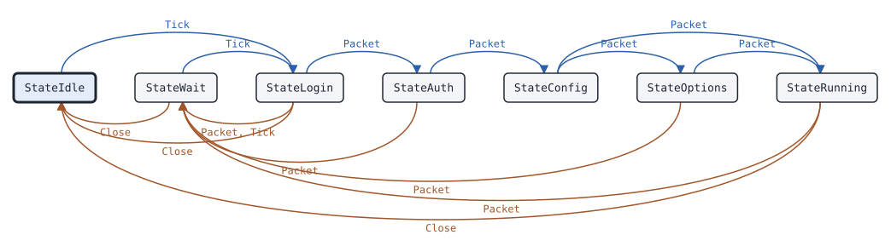

# dmrdsession Peer

This page covers the dmrdsession Peer, the state machine of the repeater side of a session of the MMDVM network protocol or of the HomeBrew Repeater Protocol (HBRP).

## What it does

A [Peer](https://pkg.go.dev/github.com/USA-RedDragon/dmrgo/v2/transport/dmrd/dmrdsession#Peer) is the repeater side of one session with a master, as a repeater, a hotspot or DMRGateway runs it. It speaks one of two dialects of package [dmrd](https://pkg.go.dev/github.com/USA-RedDragon/dmrgo/v2/transport/dmrd): the MMDVM network protocol of MMDVMHost and DMRGateway ([DialectMMDVM](https://pkg.go.dev/github.com/USA-RedDragon/dmrgo/v2/transport/dmrd#DialectMMDVM)), which BrandMeister, DMR+, HBlink, FreeDMR and DMRHub masters accept, or the HomeBrew Repeater Protocol in the hex text form of its 2015 specification and of BrandMeister ([DialectHBRP](https://pkg.go.dev/github.com/USA-RedDragon/dmrgo/v2/transport/dmrd#DialectHBRP)). The two dialects share the DMRD packet and differ in the login and keepalive messages. The Peer follows DMRGateway: it sends RPTL, RPTK with the SHA-256 token of the salt and the password, RPTC and, when it has options, RPTO, each after the acknowledgement of the one before. It sends a step again every Retry, pings every Retry when logged in, and logs in again after Timeout without a reply, after MSTNAK and after MSTCL. It does no I/O: you send and receive the UDP packets. (DMRGateway ee79d38 DMRNetwork.cpp; DL5DI, G4KLX and DG1HT, IPSC Protocol Specs for homebrew DMR repeater, 2015-07-26)

## When to use it

Use a Peer to connect a repeater, a hotspot, a gateway or a test client to a master that speaks the MMDVM network protocol or HBRP. Pick the dialect of the master: most masters today take the MMDVM network protocol. The Peer handles the session only. Decode and encode the DMRD packets with package dmrd, and give the voice to a [Jitter](voice-jitter.md) and a [Receiver](voice-receiver.md).

## Config

Pass a [PeerConfig](https://pkg.go.dev/github.com/USA-RedDragon/dmrgo/v2/transport/dmrd/dmrdsession#PeerConfig) to [NewPeer](https://pkg.go.dev/github.com/USA-RedDragon/dmrgo/v2/transport/dmrd/dmrdsession#NewPeer). The config is required. Config is the RPTC message of the dialect: build it with [dmrd.MMDVMConfig](https://pkg.go.dev/github.com/USA-RedDragon/dmrgo/v2/transport/dmrd#MMDVMConfig) or [dmrd.HBRPConfig](https://pkg.go.dev/github.com/USA-RedDragon/dmrgo/v2/transport/dmrd#HBRPConfig), with the same repeater ID as the config. Options apply to the MMDVM network protocol only: HBRP has no RPTO. Set Backoff to wait longer after each failed login.

<!-- dmrgo:config pkg=transport/dmrd/dmrdsession type=PeerConfig -->
| Field | Type | Default | Description |
|---|---|---|---|
| `Dialect` | `dmrd.Dialect` | zero value | Dialect is dmrd.DialectMMDVM or dmrd.DialectHBRP. |
| `ID` | `uint32` | zero value | ID is the repeater ID. |
| `Password` | `[]byte` | zero value | Password is the password of the master. The Peer copies it. |
| `Config` | `[]byte` | zero value | Config is the RPTC message: a dmrd.MMDVMConfig (302 octets) for DialectMMDVM, a dmrd.HBRPConfig (306 octets) for DialectHBRP. The Peer copies it. |
| `Options` | `[]byte` | zero value | Options is the RPTO options text, at most MaxOptions octets, which the Peer sends after the RPTC is acknowledged. Empty sends no RPTO. DialectHBRP has no RPTO. |
| `Retry` | `time.Duration` | not machine-readable; see the description | Retry is the time between two sends of a login step, between two pings, and before a new login after the session ended. 0 means RetryDefault. |
| `Timeout` | `time.Duration` | not machine-readable; see the description | Timeout is the time without an acknowledgement or a pong after which the Peer ends the session and logs in again. 0 means TimeoutDefault. |
| `Backoff` | `time.Duration` | zero value | Backoff is the longest wait before a new login. Each session that ends before the login completes doubles the wait from Retry up to Backoff. 0, or a value up to Retry, waits Retry each time, as DMRGateway does. |
<!-- /dmrgo:config -->

## States and transitions

[State](https://pkg.go.dev/github.com/USA-RedDragon/dmrgo/v2/transport/dmrd/dmrdsession#Peer.State) returns the current state. The Peer, the Master and the Bridge share the [State](https://pkg.go.dev/github.com/USA-RedDragon/dmrgo/v2/transport/dmrd/dmrdsession#State) type, and each uses some of its values.

<!-- dmrgo:states pkg=transport/dmrd/dmrdsession type=Peer -->
States of [`Peer`](https://pkg.go.dev/github.com/USA-RedDragon/dmrgo/v2/transport/dmrd/dmrdsession#Peer), from [`Peer.State`](https://pkg.go.dev/github.com/USA-RedDragon/dmrgo/v2/transport/dmrd/dmrdsession#Peer.State):

| State | Meaning | Seen in tests |
|---|---|---|
| [`StateIdle`](https://pkg.go.dev/github.com/USA-RedDragon/dmrgo/v2/transport/dmrd/dmrdsession#StateIdle) | StateIdle has no session: a Peer after Close, a Master before an RPTL or after the end of a session, a Bridge that has not heard its peer within Timeout. | yes, first state |
| [`StateWait`](https://pkg.go.dev/github.com/USA-RedDragon/dmrgo/v2/transport/dmrd/dmrdsession#StateWait) | StateWait is a Peer that waits to log in again. | yes |
| [`StateLogin`](https://pkg.go.dev/github.com/USA-RedDragon/dmrgo/v2/transport/dmrd/dmrdsession#StateLogin) | StateLogin is a Peer that sent RPTL, or a Master that waits for Admit or Refuse. | yes |
| [`StateAuth`](https://pkg.go.dev/github.com/USA-RedDragon/dmrgo/v2/transport/dmrd/dmrdsession#StateAuth) | StateAuth is a Peer that sent RPTK, or a Master that sent the salt. | yes |
| [`StateConfig`](https://pkg.go.dev/github.com/USA-RedDragon/dmrgo/v2/transport/dmrd/dmrdsession#StateConfig) | StateConfig is a Peer that sent RPTC, or a Master that waits for it or for Accept or Refuse. | yes |
| [`StateOptions`](https://pkg.go.dev/github.com/USA-RedDragon/dmrgo/v2/transport/dmrd/dmrdsession#StateOptions) | StateOptions is a Peer that sent RPTO. | yes |
| [`StateRunning`](https://pkg.go.dev/github.com/USA-RedDragon/dmrgo/v2/transport/dmrd/dmrdsession#StateRunning) | StateRunning is a logged-in session, or a Bridge that heard its peer within Timeout. | yes |

Transitions seen in tests:

| From | Method call | To |
|---|---|---|
| StateIdle | `Tick` | StateLogin |
| StateWait | `Close` | StateIdle |
| StateWait | `Tick` | StateLogin |
| StateLogin | `Close` | StateIdle |
| StateLogin | `Packet`, `Tick` | StateWait |
| StateLogin | `Packet` | StateAuth |
| StateAuth | `Packet` | StateWait |
| StateAuth | `Packet` | StateConfig |
| StateConfig | `Packet` | StateOptions |
| StateConfig | `Packet` | StateRunning |
| StateOptions | `Packet` | StateWait |
| StateOptions | `Packet` | StateRunning |
| StateRunning | `Close` | StateIdle |
| StateRunning | `Packet` | StateWait |


<!-- /dmrgo:states -->

The first Tick sends the RPTL. Each acknowledgement moves the Peer to the next login step: the token, the config, and the options when it has them. The acknowledgement of the last step completes the login, and the Peer reports that the session is up. When the session ends, by Timeout without an acknowledgement or a pong, by MSTNAK, or by MSTCL, the Peer reports it down and waits before it logs in again. A session that ends before the login completes doubles the wait, from Retry up to Backoff. [Close](https://pkg.go.dev/github.com/USA-RedDragon/dmrgo/v2/transport/dmrd/dmrdsession#Peer.Close) ends the session for good, until [Reset](https://pkg.go.dev/github.com/USA-RedDragon/dmrgo/v2/transport/dmrd/dmrdsession#Peer.Reset).

## Inputs and outputs

Inputs:

- [Packet](https://pkg.go.dev/github.com/USA-RedDragon/dmrgo/v2/transport/dmrd/dmrdsession#Peer.Packet) takes each UDP packet from the master.
- [Tick](https://pkg.go.dev/github.com/USA-RedDragon/dmrgo/v2/transport/dmrd/dmrdsession#Peer.Tick) runs the timers. Call it at the time [Deadline](https://pkg.go.dev/github.com/USA-RedDragon/dmrgo/v2/transport/dmrd/dmrdsession#Peer.Deadline) returns.
- [Close](https://pkg.go.dev/github.com/USA-RedDragon/dmrgo/v2/transport/dmrd/dmrdsession#Peer.Close) sends RPTCL when the Peer is logged in, as DMRGateway does when it closes.
- [Reset](https://pkg.go.dev/github.com/USA-RedDragon/dmrgo/v2/transport/dmrd/dmrdsession#Peer.Reset) makes the Peer new, so the next Tick sends the RPTL.

Outputs are [Output](https://pkg.go.dev/github.com/USA-RedDragon/dmrgo/v2/transport/dmrd/dmrdsession#Output) values with an [OutputKind](https://pkg.go.dev/github.com/USA-RedDragon/dmrgo/v2/transport/dmrd/dmrdsession#OutputKind): a packet to send to the master, the session up, the session down with a [Reason](https://pkg.go.dev/github.com/USA-RedDragon/dmrgo/v2/transport/dmrd/dmrdsession#Reason) and the state it ended in, and the DMRD, DMRA, DMRG and RPTSBKN packets of a logged-in session. The packet of a send output points into the Peer and is valid until the next call. The packet of a data output points into the packet that you passed in. Copy a packet that you keep.

Give each method a slice with capacity <!-- dmrgo:const pkg=transport/dmrd/dmrdsession name=MaxOutputs -->`4`<!-- /dmrgo:const -->. The Peer drops a packet longer than <!-- dmrgo:const pkg=transport/dmrd/dmrdsession name=MaxPacket -->`512`<!-- /dmrgo:const --> octets.

## Timers

- Retry: the time between two sends of a login step, between two pings, and before a new login. The default is <!-- dmrgo:const pkg=transport/dmrd/dmrdsession name=RetryDefault -->`10s`<!-- /dmrgo:const -->, as DMRGateway sets it.
- Timeout: the time without an acknowledgement or a pong after which the Peer ends the session. The default is <!-- dmrgo:const pkg=transport/dmrd/dmrdsession name=TimeoutDefault -->`1m0s`<!-- /dmrgo:const -->.
- Backoff: the longest wait before a new login. By default the Peer waits Retry each time, as DMRGateway does.

## Worked example

The package example logs a Peer into a [Master](dmrdsession-master.md) over the MMDVM network protocol in memory, and passes each packet that one sends to the other:

<!-- dmrgo:code file=v2/transport/dmrd/dmrdsession/example_test.go symbol=Example -->
```go
func Example() {
	var rptc dmrd.MMDVMConfig
	copy(rptc[:], "RPTC")
	rptc.SetID(3129100)
	peer, _ := dmrdsession.NewPeer(&dmrdsession.PeerConfig{
		Dialect: dmrd.DialectMMDVM, ID: 3129100, Password: []byte("passw0rd"), Config: rptc[:], Options: []byte("TS2=91;"),
	})
	master, _ := dmrdsession.NewMaster(&dmrdsession.MasterConfig{Dialect: dmrd.DialectMMDVM})

	now := time.Duration(0)
	var toMaster, toPeer [][]byte
	keep := func(q [][]byte, o dmrdsession.Output) [][]byte {
		return append(q, append([]byte(nil), o.Packet...))
	}
	for _, o := range peer.Tick(now, nil) {
		toMaster = keep(toMaster, o)
	}
	for len(toMaster) > 0 {
		for _, p := range toMaster {
			fmt.Println("repeater:", dmrd.Classify(p, dmrd.DialectMMDVM))
			for _, o := range master.Packet(now, p, nil) {
				switch o.Kind {
				case dmrdsession.OutputSend:
					toPeer = keep(toPeer, o)
				case dmrdsession.OutputLogin:
					for _, a := range master.Admit(now, 0xfcb17c08, []byte("passw0rd"), nil) {
						toPeer = keep(toPeer, a)
					}
				case dmrdsession.OutputConfig:
					fmt.Println("master event:", o.Kind)
					for _, a := range master.Accept(now, nil) {
						if a.Kind == dmrdsession.OutputSend {
							toPeer = keep(toPeer, a)
						} else {
							fmt.Println("master event:", a.Kind)
						}
					}
				default:
					fmt.Println("master event:", o.Kind)
				}
			}
		}
		toMaster = nil
		for _, p := range toPeer {
			fmt.Println("master:", dmrd.Classify(p, dmrd.DialectMMDVM))
			for _, o := range peer.Packet(now, p, nil) {
				if o.Kind == dmrdsession.OutputSend {
					toMaster = keep(toMaster, o)
				} else {
					fmt.Println("repeater event:", o.Kind)
				}
			}
		}
		toPeer = nil
	}
}
```
<!-- /dmrgo:code -->

<!-- dmrgo:output test=transport/dmrd/dmrdsession.Example -->
```text
repeater: RPTL
master: RPTACK
repeater: RPTK
master: RPTACK
repeater: RPTC
master event: Config
master event: Up
master: RPTACK
repeater: RPTO
master event: Options
master: RPTACK
repeater event: Up
```
<!-- /dmrgo:output -->

The next example runs an HBRP Peer whose master does not answer, with short timers. The Peer sends the RPTL again each Retry, ends the session at Timeout, and logs in again after the Retry wait.

<!-- dmrgo:code file=v2/transport/dmrd/dmrdsession/example_test.go symbol=ExamplePeer -->
```go
func ExamplePeer() {
	var rptc dmrd.HBRPConfig
	copy(rptc[:], "RPTC")
	rptc.SetID(2620001)
	peer, err := dmrdsession.NewPeer(&dmrdsession.PeerConfig{
		Dialect: dmrd.DialectHBRP, ID: 2620001, Password: []byte("passw0rd"), Config: rptc[:],
		Retry: 5 * time.Second, Timeout: 15 * time.Second,
	})
	if err != nil {
		fmt.Println(err)
		return
	}
	out := make([]dmrdsession.Output, 0, dmrdsession.MaxOutputs)
	for {
		at, ok := peer.Deadline()
		if !ok || at > 25*time.Second {
			break
		}
		for _, o := range peer.Tick(at, out[:0]) {
			switch o.Kind {
			case dmrdsession.OutputSend:
				fmt.Println(at, "send", dmrd.Classify(o.Packet, dmrd.DialectHBRP))
			case dmrdsession.OutputDown:
				fmt.Println(at, o.Kind, o.Reason, "in", o.State)
			default:
				fmt.Println(at, o.Kind)
			}
		}
	}
	fmt.Println(peer.State())
}
```
<!-- /dmrgo:code -->

<!-- dmrgo:output test=transport/dmrd/dmrdsession.ExamplePeer -->
```text
0s send RPTL
5s send RPTL
10s send RPTL
15s Down Timeout in Login
20s send RPTL
25s send RPTL
Login
```
<!-- /dmrgo:output -->

## Errors

Packet and Tick return no errors. The Peer ignores a packet it cannot use. NewPeer returns an error for a nil config, and a configuration error for a dialect other than the MMDVM network protocol or HBRP, a Config that is not an RPTC of the dialect for the ID, Options with HBRP or longer than <!-- dmrgo:const pkg=transport/dmrd/dmrdsession name=MaxOptions -->`291`<!-- /dmrgo:const --> octets, or a negative timer.

<!-- dmrgo:errors pkg=transport/dmrd/dmrdsession type=Peer -->
The doc comments of [`Peer`](https://pkg.go.dev/github.com/USA-RedDragon/dmrgo/v2/transport/dmrd/dmrdsession#Peer) and its methods name no error.
<!-- /dmrgo:errors -->

## Related machines and guides

Machines:

- [dmrdsession Master](dmrdsession-master.md): the master side of the same protocols.
- [dmrdsession Bridge](dmrdsession-bridge.md): OpenBridge links between masters.
- [ipscsession Peer](ipscsession-peer.md): the peer side of IPSC.
- [voice Jitter](voice-jitter.md) and [voice Receiver](voice-receiver.md): take the voice of the DMRD packets.
- bs Repeater (docs/machines/bs-repeater.md): a repeater whose network side a Peer can carry.

Guides:

- Connect to a network (MMDVM network protocol, HBRP, IPSC, Hytera)
- Clean up bursts for a hotspot
