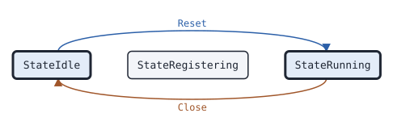

# ipscsession Master

This page covers the ipscsession Master, the state machine of the master of a Motorola IP Site Connect (IPSC) system.

## What it does

A [Master](https://pkg.go.dev/github.com/USA-RedDragon/dmrgo/v2/transport/ipsc/ipscsession#Master) is the master of an IPSC system, as DMRlink and ipsc2hbrp run it. It registers peers and answers their keepalives. It sends the peer list to every peer when one requests it, and when a peer leaves, times out or is dropped. It passes the voice and data packets of registered peers on. With authentication on, it checks the HMAC-SHA1 trailer of each packet and signs what it sends. A peer can register with a key of its own: the Master then signs what it sends to that peer with its key, and puts the peer in a system of its own, so one Master can serve many repeaters with their own keys. It does no I/O. No public specification covers IPSC; the machine follows DMRlink and captures of a MOTOTRBO repeater. (DMRlink 1f50db2 dmrlink.py and ipsc_const.py; ipsc2hbrp; captures of a Motorola XPR 8400, 2026-10-15 to 2026-10-20)

## When to use it

Use a Master to run an IPSC system that MOTOTRBO repeaters register with: a gateway that bridges repeaters to another network, as ipsc2hbrp does, or a test master for a repeater. One Master holds every peer, so keep one per system and pass it every packet of the system. When several replicas of a server share the repeaters, set AdoptKnown or call [Adopt](https://pkg.go.dev/github.com/USA-RedDragon/dmrgo/v2/transport/ipsc/ipscsession#Master.Adopt), so a peer that registered with another replica needs no new registration.

## Config

Pass a [MasterConfig](https://pkg.go.dev/github.com/USA-RedDragon/dmrgo/v2/transport/ipsc/ipscsession#MasterConfig) to [NewMaster](https://pkg.go.dev/github.com/USA-RedDragon/dmrgo/v2/transport/ipsc/ipscsession#NewMaster). The config is required. Set the master ID. Set Auth and Key when the system uses authentication; [ipscauth.ParseKey](https://pkg.go.dev/github.com/USA-RedDragon/dmrgo/v2/transport/ipsc/ipscauth#ParseKey) reads the hex key of a MOTOTRBO or DMRlink configuration. Leave Mode, Flags and the versions zero unless the repeaters need other values.

<!-- dmrgo:config pkg=transport/ipsc/ipscsession type=MasterConfig -->
| Field | Type | Default | Description |
|---|---|---|---|
| `ID` | `uint32` | zero value | ID is the peer ID of the master. |
| `Mode` | `ipsc.Mode` | `ModeDefault` (106) | Mode is the mode that the master sends. 0 means ModeDefault. |
| `Flags` | `ipsc.Flags` | zero value | Flags is the flags that the master sends. The zero Flags means voice and data calls. The Master sets ipsc.FlagMasterPeer, and ipsc.FlagAuth with Auth. |
| `RegisterVersion` | `[4]byte` | not machine-readable; see the description | RegisterVersion is the protocol version that the master sends in a register request or reply (0x90, 0x91, 0x94, 0x95). Zero means RegisterVersionDefault. |
| `AliveVersion` | `[4]byte` | not machine-readable; see the description | AliveVersion is the protocol version that the master sends in a keepalive request or reply (0x96, 0x97). Zero means AliveVersionDefault. |
| `Auth` | `bool` | zero value | Auth turns on the HMAC-SHA1 trailer with Key: the Master drops a packet without a good trailer and signs what it sends. |
| `Key` | `[20]byte` | zero value | Key is the authentication key (see ipscauth.ParseKey). |
| `Timeout` | `time.Duration` | not machine-readable; see the description | Timeout is the time without a packet from a peer after which the Master drops it. 0 means TimeoutDefault. |
| `MaxPeers` | `int` | `MaxPeersDefault` (15) | MaxPeers is the most peers that the Master registers. 0 means MaxPeersDefault. |
| `AdoptKnown` | `bool` | zero value | AdoptKnown makes Packet adopt a peer that is not registered, as Adopt does, when the trailer of its packet proves the key of the config or the key that the caller passed, so that a peer that registered with another Master needs no Adopt call. Without a key it does nothing. |
<!-- /dmrgo:config -->

## States and transitions

[State](https://pkg.go.dev/github.com/USA-RedDragon/dmrgo/v2/transport/ipsc/ipscsession#Master.State) returns the state of the Master. The Peer and the Master share the [State](https://pkg.go.dev/github.com/USA-RedDragon/dmrgo/v2/transport/ipsc/ipscsession#State) type. A Master runs from NewMaster until [Close](https://pkg.go.dev/github.com/USA-RedDragon/dmrgo/v2/transport/ipsc/ipscsession#Master.Close), and [Reset](https://pkg.go.dev/github.com/USA-RedDragon/dmrgo/v2/transport/ipsc/ipscsession#Master.Reset) runs it again.

<!-- dmrgo:states pkg=transport/ipsc/ipscsession type=Master -->
States of [`Master`](https://pkg.go.dev/github.com/USA-RedDragon/dmrgo/v2/transport/ipsc/ipscsession#Master), from [`Master.State`](https://pkg.go.dev/github.com/USA-RedDragon/dmrgo/v2/transport/ipsc/ipscsession#Master.State):

| State | Meaning | Seen in tests |
|---|---|---|
| [`StateIdle`](https://pkg.go.dev/github.com/USA-RedDragon/dmrgo/v2/transport/ipsc/ipscsession#StateIdle) | StateIdle is a Peer or Master after Close. | yes, first state |
| [`StateRegistering`](https://pkg.go.dev/github.com/USA-RedDragon/dmrgo/v2/transport/ipsc/ipscsession#StateRegistering) | StateRegistering is a Peer that is not registered with the master. | no |
| [`StateRunning`](https://pkg.go.dev/github.com/USA-RedDragon/dmrgo/v2/transport/ipsc/ipscsession#StateRunning) | StateRunning is a registered Peer, or a running Master. | yes, first state |

Transitions seen in tests:

| From | Method call | To |
|---|---|---|
| StateIdle | `Reset` | StateRunning |
| StateRunning | `Close` | StateIdle |


<!-- /dmrgo:states -->

Each peer has a link of its own, with no state type. A registration request registers a peer and reports it up. With a key, a keepalive whose trailer proves the key also registers a peer that is not registered, as a repeater keeps sending keepalives for a while after its master restarts. Each packet of a registered peer restarts its Timeout. A peer goes down on a de-registration request from the address it registered from, on Timeout without a packet, or on [Drop](https://pkg.go.dev/github.com/USA-RedDragon/dmrgo/v2/transport/ipsc/ipscsession#Master.Drop). The Master then sends the new peer list to the peers left. [Peers](https://pkg.go.dev/github.com/USA-RedDragon/dmrgo/v2/transport/ipsc/ipscsession#Master.Peers), [PeerAt](https://pkg.go.dev/github.com/USA-RedDragon/dmrgo/v2/transport/ipsc/ipscsession#Master.PeerAt) and [Peer](https://pkg.go.dev/github.com/USA-RedDragon/dmrgo/v2/transport/ipsc/ipscsession#Master.Peer) return the registered peers.

## Inputs and outputs

Inputs:

- [Packet](https://pkg.go.dev/github.com/USA-RedDragon/dmrgo/v2/transport/ipsc/ipscsession#Master.Packet) takes each UDP packet with the [Addr](https://pkg.go.dev/github.com/USA-RedDragon/dmrgo/v2/transport/ipsc/ipscsession#Addr) it came from, and the own key of the sending peer, or nil for the key of the config. Look up the key by the peer ID in octets 1 to 4 of the packet.
- [Adopt](https://pkg.go.dev/github.com/USA-RedDragon/dmrgo/v2/transport/ipsc/ipscsession#Master.Adopt) registers a peer without a registration request, for a peer that registered with another Master.
- [Drop](https://pkg.go.dev/github.com/USA-RedDragon/dmrgo/v2/transport/ipsc/ipscsession#Master.Drop) removes a peer at once, such as after a change of its key.
- [Tick](https://pkg.go.dev/github.com/USA-RedDragon/dmrgo/v2/transport/ipsc/ipscsession#Master.Tick) drops the peers that timed out. Call it at the time [Deadline](https://pkg.go.dev/github.com/USA-RedDragon/dmrgo/v2/transport/ipsc/ipscsession#Master.Deadline) returns.
- [Sign](https://pkg.go.dev/github.com/USA-RedDragon/dmrgo/v2/transport/ipsc/ipscsession#Master.Sign) and [SignFor](https://pkg.go.dev/github.com/USA-RedDragon/dmrgo/v2/transport/ipsc/ipscsession#Master.SignFor) append the authentication trailer to a voice or data packet that you send, with the key of the config or the own key of a peer.
- [Close](https://pkg.go.dev/github.com/USA-RedDragon/dmrgo/v2/transport/ipsc/ipscsession#Master.Close) sends a de-registration request to every peer, as DMRlink does when it shuts down.

Outputs are [Output](https://pkg.go.dev/github.com/USA-RedDragon/dmrgo/v2/transport/ipsc/ipscsession#Output) values with an [OutputKind](https://pkg.go.dev/github.com/USA-RedDragon/dmrgo/v2/transport/ipsc/ipscsession#OutputKind): a packet to send to an address; a peer up or down, with a [Reason](https://pkg.go.dev/github.com/USA-RedDragon/dmrgo/v2/transport/ipsc/ipscsession#Reason); the voice and data packets of registered peers, without the trailer; and the packets that the Master dropped, with the reason: a bad trailer, a malformed packet, an unregistered sender, a full table, or a de-registration from the wrong address. A reply or status packet needs no answer and gives no output.

[MaxOutputs](https://pkg.go.dev/github.com/USA-RedDragon/dmrgo/v2/transport/ipsc/ipscsession#Master.MaxOutputs) returns the most outputs of one call. It depends on MaxPeers, so give each method a slice with that capacity.

## Timers

- Timeout: the time without a packet from a peer after which the Master drops it. The default is <!-- dmrgo:const pkg=transport/ipsc/ipscsession name=TimeoutDefault -->`2m0s`<!-- /dmrgo:const -->, after which DMRlink drops a silent peer.

The Master registers at most MaxPeers peers. The default is <!-- dmrgo:const pkg=transport/ipsc/ipscsession name=MaxPeersDefault -->`15`<!-- /dmrgo:const --> and the largest is <!-- dmrgo:const pkg=transport/ipsc/ipscsession name=MaxPeersLimit -->`134`<!-- /dmrgo:const -->, the most peers whose peer list fits in one packet.

## Worked example

This example runs a Master with authentication. A peer with the key registers. A peer with another key is dropped for its trailer. The registered peer then sends nothing, and the Master drops it at Timeout.

<!-- dmrgo:code file=v2/transport/ipsc/ipscsession/example_test.go symbol=ExampleMaster -->
```go
func ExampleMaster() {
	key := [20]byte{1, 2, 3, 4}
	master, err := ipscsession.NewMaster(&ipscsession.MasterConfig{ID: 1, Auth: true, Key: key})
	if err != nil {
		fmt.Println(err)
		return
	}
	masterAddr := ipscsession.Addr{IP: [4]byte{192, 168, 0, 10}, Port: 50000}
	good, _ := ipscsession.NewPeer(&ipscsession.PeerConfig{ID: 315950, Master: masterAddr, Auth: true, Key: key})
	bad, _ := ipscsession.NewPeer(&ipscsession.PeerConfig{ID: 315951, Master: masterAddr, Auth: true, Key: [20]byte{9}})
	addrs := []ipscsession.Addr{{IP: [4]byte{192, 168, 0, 231}, Port: 50000}, {IP: [4]byte{192, 168, 0, 232}, Port: 50000}}
	out := make([]ipscsession.Output, 0, master.MaxOutputs())
	for i, peer := range []*ipscsession.Peer{good, bad} {
		for _, req := range peer.Tick(0, nil) {
			for _, o := range master.Packet(0, addrs[i], req.Packet, nil, out[:0]) {
				switch o.Kind {
				case ipscsession.OutputUp:
					fmt.Println(o.Kind, o.ID)
				case ipscsession.OutputDropped:
					fmt.Println(o.Kind, o.Reason)
				default:
				}
			}
		}
	}
	fmt.Println("peers", master.Peers())
	at, _ := master.Deadline()
	for _, o := range master.Tick(at, out[:0]) {
		fmt.Println(at, o.Kind, o.ID, o.Reason)
	}
}
```
<!-- /dmrgo:code -->

Output:

<!-- dmrgo:output test=transport/ipsc/ipscsession.ExampleMaster -->
```text
Up 315950
Dropped Auth
peers 1
2m0s Down 315950 Timeout
```
<!-- /dmrgo:output -->

The package example on the [Peer page](ipscsession-peer.md#worked-example) shows a full registration from both sides.

## Errors

Packet, Tick and Adopt return no errors: a packet that the Master does not take gives a dropped output with its reason. Sign and SignFor return an error for a nil Master. NewMaster returns an error for a nil config, and a configuration error for a negative Timeout or a MaxPeers out of range.

<!-- dmrgo:errors pkg=transport/ipsc/ipscsession type=Master -->
| Error | Returned by | Meaning |
|---|---|---|
| [`dmrgo.ErrNilReceiver`](https://pkg.go.dev/github.com/USA-RedDragon/dmrgo/v2#ErrNilReceiver) | `Master.Sign`, `Master.SignFor` | ErrNilReceiver is returned by a method of the library that returns an error when it is called on a nil pointer. |
<!-- /dmrgo:errors -->

## Related machines and guides

Machines:

- [ipscsession Peer](ipscsession-peer.md): the peers that register with the Master.
- [dmrdsession Master](dmrdsession-master.md): the master side of the MMDVM network protocol and HBRP.
- [voice Jitter](voice-jitter.md): puts the voice packets of each peer in order.

Guides:

- Connect to a network (MMDVM network protocol, HBRP, IPSC, Hytera)
- Rewrite and relay a voice call
