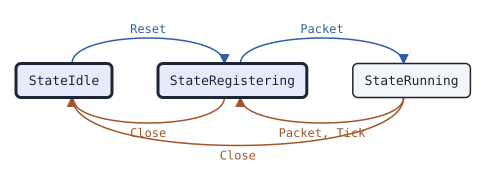

# ipscsession Peer

This page covers the ipscsession Peer, the state machine of a peer of a Motorola IP Site Connect (IPSC) system.

## What it does

A [Peer](https://pkg.go.dev/github.com/USA-RedDragon/dmrgo/v2/transport/ipsc/ipscsession#Peer) runs the link control of one IPSC peer, as a MOTOTRBO repeater and DMRlink run it. It registers with the master and sends it keepalives, requests the peer list, registers with each other peer of the list and sends it keepalives, and answers the registrations and keepalives of the other peers. It passes the voice and data packets of the master and the peers on. With authentication on, it signs each packet with the HMAC-SHA1 trailer and drops a packet without a good trailer. Every Alive period it sends what the state needs, as DMRlink does. It does no I/O: you send and receive the UDP packets, each with its address. No public specification covers IPSC; the machine follows DMRlink and captures of a MOTOTRBO repeater. (DMRlink 1f50db2 dmrlink.py and ipsc_const.py; ipsc2hbrp; captures of a Motorola XPR 8400, 2026-10-15 to 2026-10-20)

## When to use it

Use a Peer to join an IPSC system as a repeater would: a gateway between IPSC and another network, a recorder or console on an IP Site Connect system, or a test peer for an IPSC master. Decode and encode the voice and data packets with package [ipsc](https://pkg.go.dev/github.com/USA-RedDragon/dmrgo/v2/transport/ipsc), and give the voice to a [Jitter](voice-jitter.md) and a [Receiver](voice-receiver.md).

## Config

Pass a [PeerConfig](https://pkg.go.dev/github.com/USA-RedDragon/dmrgo/v2/transport/ipsc/ipscsession#PeerConfig) to [NewPeer](https://pkg.go.dev/github.com/USA-RedDragon/dmrgo/v2/transport/ipsc/ipscsession#NewPeer). The config is required. Set the peer ID and the address of the master. Set Auth and Key when the system uses authentication; [ipscauth.ParseKey](https://pkg.go.dev/github.com/USA-RedDragon/dmrgo/v2/transport/ipsc/ipscauth#ParseKey) reads the hex key of a MOTOTRBO or DMRlink configuration. Leave Mode, Flags and the versions zero unless the master needs other values.

<!-- dmrgo:config pkg=transport/ipsc/ipscsession type=PeerConfig -->
| Field | Type | Default | Description |
|---|---|---|---|
| `ID` | `uint32` | zero value | ID is the peer ID. |
| `Mode` | `ipsc.Mode` | `ModeDefault` (106) | Mode is the mode that the peer sends. 0 means ModeDefault. |
| `Flags` | `ipsc.Flags` | zero value | Flags is the flags that the peer sends. The zero Flags means voice and data calls. The Peer sets ipsc.FlagAuth with Auth. |
| `RegisterVersion` | `[4]byte` | not machine-readable; see the description | RegisterVersion is the protocol version that the peer sends in a register request or reply (0x90, 0x91, 0x94, 0x95). Zero means RegisterVersionDefault. |
| `AliveVersion` | `[4]byte` | not machine-readable; see the description | AliveVersion is the protocol version that the peer sends in a keepalive request or reply (0x96, 0x97). Zero means AliveVersionDefault. |
| `Master` | `Addr` | zero value | Master is the address of the master. |
| `Auth` | `bool` | zero value | Auth turns on the HMAC-SHA1 trailer with Key: the Peer drops a packet without a good trailer and signs what it sends. |
| `Key` | `[20]byte` | zero value | Key is the authentication key (see ipscauth.ParseKey). |
| `Alive` | `time.Duration` | not machine-readable; see the description | Alive is the keepalive period. 0 means AliveDefault. |
| `MaxMissed` | `int` | `MaxMissedDefault` (20) | MaxMissed is the number of keepalives without a reply after which the Peer takes a link as down. 0 means MaxMissedDefault. |
| `MaxPeers` | `int` | `MaxPeersDefault` (15) | MaxPeers is the most other peers that the Peer keeps from the peer list. 0 means MaxPeersDefault. |
<!-- /dmrgo:config -->

## States and transitions

[State](https://pkg.go.dev/github.com/USA-RedDragon/dmrgo/v2/transport/ipsc/ipscsession#Peer.State) returns the state of the Peer with the master. The Peer and the Master share the [State](https://pkg.go.dev/github.com/USA-RedDragon/dmrgo/v2/transport/ipsc/ipscsession#State) type.

<!-- dmrgo:states pkg=transport/ipsc/ipscsession type=Peer -->
States of [`Peer`](https://pkg.go.dev/github.com/USA-RedDragon/dmrgo/v2/transport/ipsc/ipscsession#Peer), from [`Peer.State`](https://pkg.go.dev/github.com/USA-RedDragon/dmrgo/v2/transport/ipsc/ipscsession#Peer.State):

| State | Meaning | Seen in tests |
|---|---|---|
| [`StateIdle`](https://pkg.go.dev/github.com/USA-RedDragon/dmrgo/v2/transport/ipsc/ipscsession#StateIdle) | StateIdle is a Peer or Master after Close. | yes, first state |
| [`StateRegistering`](https://pkg.go.dev/github.com/USA-RedDragon/dmrgo/v2/transport/ipsc/ipscsession#StateRegistering) | StateRegistering is a Peer that is not registered with the master. | yes, first state |
| [`StateRunning`](https://pkg.go.dev/github.com/USA-RedDragon/dmrgo/v2/transport/ipsc/ipscsession#StateRunning) | StateRunning is a registered Peer, or a running Master. | yes |

Transitions seen in tests:

| From | Method call | To |
|---|---|---|
| StateIdle | `Reset` | StateRegistering |
| StateRegistering | `Close` | StateIdle |
| StateRegistering | `Packet` | StateRunning |
| StateRunning | `Close` | StateIdle |
| StateRunning | `Packet`, `Tick` | StateRegistering |


<!-- /dmrgo:states -->

A new Peer is not registered. The first Tick sends the registration request, and Tick sends it again every Alive until the registration reply comes. The reply from the address of the master registers the Peer, reports the link up, and sends the peer list request at once. After MaxMissed keepalives without a reply, or a de-registration request of the master, the link goes down and the Peer registers again. [Close](https://pkg.go.dev/github.com/USA-RedDragon/dmrgo/v2/transport/ipsc/ipscsession#Peer.Close) sends de-registration requests and stops the Peer until [Reset](https://pkg.go.dev/github.com/USA-RedDragon/dmrgo/v2/transport/ipsc/ipscsession#Peer.Reset).

Each other peer of the list has a link of its own, with no state type. The Peer sends the peer registration request to each peer whose link is not up. The registration reply of a peer brings its link up, and keepalives keep it up. A new peer list that leaves a peer out, a de-registration request of that peer, or MaxMissed keepalives without a reply takes its link down. [Peers](https://pkg.go.dev/github.com/USA-RedDragon/dmrgo/v2/transport/ipsc/ipscsession#Peer.Peers), [PeerAt](https://pkg.go.dev/github.com/USA-RedDragon/dmrgo/v2/transport/ipsc/ipscsession#Peer.PeerAt) and [Peer](https://pkg.go.dev/github.com/USA-RedDragon/dmrgo/v2/transport/ipsc/ipscsession#Peer.Peer) return the peers and whether each link is up.

## Inputs and outputs

Inputs:

- [Packet](https://pkg.go.dev/github.com/USA-RedDragon/dmrgo/v2/transport/ipsc/ipscsession#Peer.Packet) takes each UDP packet with the [Addr](https://pkg.go.dev/github.com/USA-RedDragon/dmrgo/v2/transport/ipsc/ipscsession#Addr) it came from. The Peer drops a packet of a sender that is neither the master nor a peer of the list.
- [Tick](https://pkg.go.dev/github.com/USA-RedDragon/dmrgo/v2/transport/ipsc/ipscsession#Peer.Tick) sends the registrations, keepalives and peer list requests that are due. Call it at the time [Deadline](https://pkg.go.dev/github.com/USA-RedDragon/dmrgo/v2/transport/ipsc/ipscsession#Peer.Deadline) returns.
- [Sign](https://pkg.go.dev/github.com/USA-RedDragon/dmrgo/v2/transport/ipsc/ipscsession#Peer.Sign) appends the authentication trailer to a voice or data packet that you send.
- [Close](https://pkg.go.dev/github.com/USA-RedDragon/dmrgo/v2/transport/ipsc/ipscsession#Peer.Close) and [Reset](https://pkg.go.dev/github.com/USA-RedDragon/dmrgo/v2/transport/ipsc/ipscsession#Peer.Reset) end and restart the Peer.

Outputs are [Output](https://pkg.go.dev/github.com/USA-RedDragon/dmrgo/v2/transport/ipsc/ipscsession#Output) values with an [OutputKind](https://pkg.go.dev/github.com/USA-RedDragon/dmrgo/v2/transport/ipsc/ipscsession#OutputKind): a packet to send to an address, signed when Auth is set; a link up or down, with the ID and a [Reason](https://pkg.go.dev/github.com/USA-RedDragon/dmrgo/v2/transport/ipsc/ipscsession#Reason); a new peer list; and the voice and data packets, without the trailer. The packet of a send output points into the Peer and is valid until the next call. The packet of a data output points into the packet that you passed in.

[MaxOutputs](https://pkg.go.dev/github.com/USA-RedDragon/dmrgo/v2/transport/ipsc/ipscsession#Peer.MaxOutputs) returns the most outputs of one call. It depends on MaxPeers, so give each method a slice with that capacity.

## Timers

- Alive: the keepalive period, and the period of the registration and peer list requests. The default is <!-- dmrgo:const pkg=transport/ipsc/ipscsession name=AliveDefault -->`5s`<!-- /dmrgo:const -->, the ALIVE_TIMER of DMRlink.
- MaxMissed: the keepalives without a reply after which a link goes down. The default is <!-- dmrgo:const pkg=transport/ipsc/ipscsession name=MaxMissedDefault -->`20`<!-- /dmrgo:const -->, the MAX_MISSED of DMRlink.

The peer list holds at most MaxPeers other peers. The default is <!-- dmrgo:const pkg=transport/ipsc/ipscsession name=MaxPeersDefault -->`15`<!-- /dmrgo:const --> and the largest is <!-- dmrgo:const pkg=transport/ipsc/ipscsession name=MaxPeersLimit -->`134`<!-- /dmrgo:const -->.

## Worked example

The package example registers a Peer with a [Master](ipscsession-master.md) in memory, and shows the registration, the peer list and the first keepalive:

<!-- dmrgo:code file=v2/transport/ipsc/ipscsession/example_test.go symbol=Example -->
```go
func Example() {
	master, _ := ipscsession.NewMaster(&ipscsession.MasterConfig{ID: 1})
	peerAddr := ipscsession.Addr{IP: [4]byte{192, 168, 0, 231}, Port: 50000}
	masterAddr := ipscsession.Addr{IP: [4]byte{192, 168, 0, 10}, Port: 50000}
	peer, _ := ipscsession.NewPeer(&ipscsession.PeerConfig{ID: 315950, Master: masterAddr})

	now := time.Duration(0)
	for range 2 {
		var queue [][]byte
		for _, o := range peer.Tick(now, nil) {
			queue = append(queue, o.Packet)
		}
		for len(queue) > 0 {
			pk := queue[0]
			queue = queue[1:]
			fmt.Println("peer sends", ipsc.Opcode(pk[0]))
			for _, r := range master.Packet(now, peerAddr, pk, nil, nil) {
				if r.Kind != ipscsession.OutputSend {
					fmt.Println("master event", r.Kind, r.ID)
					continue
				}
				fmt.Println("master sends", ipsc.Opcode(r.Packet[0]))
				for _, e := range peer.Packet(now, masterAddr, r.Packet, nil) {
					if e.Kind == ipscsession.OutputSend {
						queue = append(queue, e.Packet)
						continue
					}
					fmt.Println("peer event", e.Kind, e.ID)
				}
			}
		}
		now += ipscsession.AliveDefault
	}
}
```
<!-- /dmrgo:code -->

<!-- dmrgo:output test=transport/ipsc/ipscsession.Example -->
```text
peer sends RegisterRequest
master sends RegisterReply
peer event Up 1
master event Up 315950
peer sends PeerListRequest
master sends PeerListReply
peer event Peers 0
peer sends AliveRequest
master sends AliveReply
```
<!-- /dmrgo:output -->

The next example runs a Master and two Peers in memory. Peer A registers with the master, gets the peer list with peer B, and registers with B.

<!-- dmrgo:code file=v2/transport/ipsc/ipscsession/example_test.go symbol=ExamplePeer -->
```go
func ExamplePeer() {
	masterAddr := ipscsession.Addr{IP: [4]byte{192, 168, 0, 10}, Port: 50000}
	addrA := ipscsession.Addr{IP: [4]byte{192, 168, 0, 231}, Port: 50000}
	addrB := ipscsession.Addr{IP: [4]byte{192, 168, 0, 232}, Port: 50000}
	master, _ := ipscsession.NewMaster(&ipscsession.MasterConfig{ID: 1})
	a, _ := ipscsession.NewPeer(&ipscsession.PeerConfig{ID: 315950, Master: masterAddr})
	b, err := ipscsession.NewPeer(&ipscsession.PeerConfig{ID: 315951, Master: masterAddr})
	if err != nil {
		fmt.Println(err)
		return
	}
	type packet struct {
		from, to ipscsession.Addr
		p        []byte
	}
	var queue []packet
	take := func(from ipscsession.Addr, name string, out []ipscsession.Output) {
		for _, o := range out {
			switch {
			case o.Kind == ipscsession.OutputSend:
				queue = append(queue, packet{from, o.Addr, append([]byte(nil), o.Packet...)})
			case name == "A" && o.Kind == ipscsession.OutputPeers:
				fmt.Println(name, o.Kind, a.Peers())
			case name == "A":
				fmt.Println(name, o.Kind, o.ID)
			}
		}
	}
	for now := time.Duration(0); now <= ipscsession.AliveDefault; now += ipscsession.AliveDefault {
		take(addrA, "A", a.Tick(now, nil))
		take(addrB, "B", b.Tick(now, nil))
		for len(queue) > 0 {
			k := queue[0]
			queue = queue[1:]
			switch k.to {
			case masterAddr:
				take(masterAddr, "master", master.Packet(now, k.from, k.p, nil, nil))
			case addrA:
				take(addrA, "A", a.Packet(now, k.from, k.p, nil))
			case addrB:
				take(addrB, "B", b.Packet(now, k.from, k.p, nil))
			}
		}
	}
	info, _ := a.Peer(315951)
	fmt.Println("A has", a.Peers(), "peer:", info.ID, "up", info.Up)
}
```
<!-- /dmrgo:code -->

<!-- dmrgo:output test=transport/ipsc/ipscsession.ExamplePeer -->
```text
A Up 1
A Peers 1
A Peers 1
A Up 315951
A has 1 peer: 315951 up true
```
<!-- /dmrgo:output -->

The master sends the peer list to every peer each time a peer requests it, so A gets the list twice.

## Errors

Packet and Tick return no errors: the Peer drops a packet it cannot use. Sign returns an error for a nil Peer. NewPeer returns an error for a nil config, and a configuration error for a negative Alive or MaxMissed, or a MaxPeers out of range.

<!-- dmrgo:errors pkg=transport/ipsc/ipscsession type=Peer -->
| Error | Returned by | Meaning |
|---|---|---|
| [`dmrgo.ErrNilReceiver`](https://pkg.go.dev/github.com/USA-RedDragon/dmrgo/v2#ErrNilReceiver) | `Peer.Sign` | ErrNilReceiver is returned by a method of the library that returns an error when it is called on a nil pointer. |
<!-- /dmrgo:errors -->

## Related machines and guides

Machines:

- [ipscsession Master](ipscsession-master.md): the master of the same system.
- [dmrdsession Peer](dmrdsession-peer.md): the repeater side of the MMDVM network protocol and HBRP.
- [voice Jitter](voice-jitter.md) and [voice Receiver](voice-receiver.md): take the voice of the IPSC packets.

Guides:

- Connect to a network (MMDVM network protocol, HBRP, IPSC, Hytera)
- Rewrite and relay a voice call
