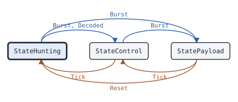

# trunk CapacityPlusFollower

This page covers the trunk CapacityPlusFollower, the state machine that follows the calls of a MOTOTRBO Capacity Plus or Linked Capacity Plus site without transmitting.

## What it does

A [CapacityPlusFollower](https://pkg.go.dev/github.com/USA-RedDragon/dmrgo/v2/trunk#CapacityPlusFollower) follows a Capacity Plus or Linked Capacity Plus site as a scanner does. These sites have no TSCC. Every call starts on the rest channel, and the rest channel moves when a call takes it. The Follower finds the rest channel, moves with it, and follows the calls that its config selects: from the group or private voice grant in the Voice LC Header on the rest channel, or by late entry from the channel activity of a site status. Channel numbers name repeaters: repeater n carries logical slot number (LSN) 2n-1 on timeslot 1 and LSN 2n on timeslot 2. The Follower returns tune requests, and you tune the receiver. It does no I/O. No public spec describes the protocol; the decoding follows recordings of real systems.

## When to use it

Use a CapacityPlusFollower to listen to a Capacity Plus or Linked Capacity Plus site: a scanner, a recorder, or a monitor of site activity. For an ETSI Tier III site with a TSCC, use the [Follower](trunk-follower.md).

To decode the voice of a call, pass the call of the grant to [voice.Receiver.Expect](voice-receiver.md) and feed the bursts of the granted slot to that Receiver, as for a Tier III site.

## Config

Pass a [CapacityPlusConfig](https://pkg.go.dev/github.com/USA-RedDragon/dmrgo/v2/trunk#CapacityPlusConfig) to [NewCapacityPlusFollower](https://pkg.go.dev/github.com/USA-RedDragon/dmrgo/v2/trunk#NewCapacityPlusFollower). A nil config follows every talkgroup on the repeater that the receiver is on. Set a [ChannelPlan](https://pkg.go.dev/github.com/USA-RedDragon/dmrgo/v2/trunk#ChannelPlan) with the frequencies of the repeaters, so the Follower can hunt and tune. Set Individual to follow private calls too. Set NoFollow for a receiver that cannot tune.

<!-- dmrgo:config pkg=trunk type=CapacityPlusConfig -->
| Field | Type | Default | Description |
|---|---|---|---|
| `Plan` | `*ChannelPlan` | zero value | Plan, when set, maps the repeaters of the site to frequencies: channel number n is repeater n, which carries LSN 2n-1 on timeslot 1 and LSN 2n on timeslot 2. The Follower copies it and hunts over the repeaters that it names, in number order. Without a plan the Follower hunts nothing, and the consumer keeps the receiver on one repeater. |
| `Talkgroups` | `[32]uint32` | zero value | Talkgroups holds the first TalkgroupsLen talkgroups to follow. TalkgroupsLen 0 follows every talkgroup. |
| `TalkgroupsLen` | `int` | zero value | TalkgroupsLen is the number of entries of Talkgroups in use. |
| `Individual` | `bool` | zero value | Individual follows private calls too: private voice grants, and the radio entries of a site status, which can also be data. |
| `NoFollow` | `bool` | zero value | NoFollow reports calls with OutputGrant but never leaves the rest channel, for a receiver that cannot tune. |
| `NoSignal` | `time.Duration` | not machine-readable; see the description | NoSignal is the time without a valid Capacity Plus PDU on the rest channel after which the Follower hunts again, and the time it stays on each repeater while it hunts. 0 means CapacityPlusNoSignalDefault, and a negative value turns the timer off. |
| `Inactive` | `time.Duration` | not machine-readable; see the description | Inactive is the time without a burst of the call after which the Follower returns to the rest channel. 0 means constants.TVInactiveDefault, and a negative value turns the timer off. |
| `Hangtime` | `time.Duration` | not machine-readable; see the description | Hangtime is the time after a Terminator with LC in which the Follower waits for more voice. 0 means constants.TVHangtimeDefault, and a negative value turns the timer off. |
| `Scratch` | `*layer2.Burst` | `&layer2.Burst{}` | Scratch, when set, is the Burst that the Follower decodes into. Nil means the Follower makes its own. |
<!-- /dmrgo:config -->

## States and transitions

[State](https://pkg.go.dev/github.com/USA-RedDragon/dmrgo/v2/trunk#CapacityPlusFollower.State) returns the current state. The type is the [State](https://pkg.go.dev/github.com/USA-RedDragon/dmrgo/v2/trunk#State) of the Tier III Follower, with the rest channel in place of the TSCC.

<!-- dmrgo:states pkg=trunk type=CapacityPlusFollower -->
States of [`CapacityPlusFollower`](https://pkg.go.dev/github.com/USA-RedDragon/dmrgo/v2/trunk#CapacityPlusFollower), from [`CapacityPlusFollower.State`](https://pkg.go.dev/github.com/USA-RedDragon/dmrgo/v2/trunk#CapacityPlusFollower.State):

| State | Meaning | Seen in tests |
|---|---|---|
| [`StateHunting`](https://pkg.go.dev/github.com/USA-RedDragon/dmrgo/v2/trunk#StateHunting) | StateHunting looks for a TSCC. | yes, first state |
| [`StateControl`](https://pkg.go.dev/github.com/USA-RedDragon/dmrgo/v2/trunk#StateControl) | StateControl is on a confirmed TSCC. | yes |
| [`StatePayload`](https://pkg.go.dev/github.com/USA-RedDragon/dmrgo/v2/trunk#StatePayload) | StatePayload follows a call on a payload channel. | yes |

Transitions seen in tests:

| From | Method call | To |
|---|---|---|
| StateHunting | `Burst`, `Decoded` | StateControl |
| StateHunting | `Burst` | StatePayload |
| StateControl | `Tick` | StateHunting |
| StateControl | `Burst` | StatePayload |
| StatePayload | `Reset` | StateHunting |
| StatePayload | `Tick` | StateControl |


<!-- /dmrgo:states -->

The Follower starts by hunting. With a plan, the first Tick or Burst requests the first repeater, and the Follower moves to the next repeater in number order when no valid Capacity Plus PDU comes within the no-signal time. A rest channel beacon or site status moves it to the rest channel, and it reports the site. When the site announces a new rest channel, the Follower moves with it. A voice grant or the activity of a site status for a selected call moves it to the payload slot of the call. The hang time after a Terminator with LC, the inactive time, or a lost signal returns it to the rest channel, or to the hunt when no rest channel is known. On the rest channel, the no-signal time without a valid PDU starts the hunt again.

## Inputs and outputs

Inputs:

- [Burst](https://pkg.go.dev/github.com/USA-RedDragon/dmrgo/v2/trunk#CapacityPlusFollower.Burst) takes a raw burst, its [layer2.Hint](https://pkg.go.dev/github.com/USA-RedDragon/dmrgo/v2/layer2#Hint), and the CACH field before it in transmit order. Hint.Slot, or the TDMA channel of the CACH, gives the timeslot of the burst.
- [Decoded](https://pkg.go.dev/github.com/USA-RedDragon/dmrgo/v2/trunk#CapacityPlusFollower.Decoded) takes a burst that you decoded already.
- [Lost](https://pkg.go.dev/github.com/USA-RedDragon/dmrgo/v2/trunk#CapacityPlusFollower.Lost) reports that the receiver lost the signal.
- [Tick](https://pkg.go.dev/github.com/USA-RedDragon/dmrgo/v2/trunk#CapacityPlusFollower.Tick) runs the timers. Call it at the time [Deadline](https://pkg.go.dev/github.com/USA-RedDragon/dmrgo/v2/trunk#CapacityPlusFollower.Deadline) returns.
- [Reset](https://pkg.go.dev/github.com/USA-RedDragon/dmrgo/v2/trunk#CapacityPlusFollower.Reset) clears the site and the call and starts the hunt again.

Outputs are [Output](https://pkg.go.dev/github.com/USA-RedDragon/dmrgo/v2/trunk#Output) values of the same kinds as for the Tier III Follower: tune requests, the site, the loss of the rest channel, grants and the end of a followed call. A tune request and a [Grant](https://pkg.go.dev/github.com/USA-RedDragon/dmrgo/v2/trunk#Grant) name the repeater in Channel and the timeslot of the LSN in Slot. A grant from a site status has the site status opcode and LateEntry set; one from a Voice LC Header has opcode 0.

The accessors [RestLSN](https://pkg.go.dev/github.com/USA-RedDragon/dmrgo/v2/trunk#CapacityPlusFollower.RestLSN), [SiteNumber](https://pkg.go.dev/github.com/USA-RedDragon/dmrgo/v2/trunk#CapacityPlusFollower.SiteNumber) and [Call](https://pkg.go.dev/github.com/USA-RedDragon/dmrgo/v2/trunk#CapacityPlusFollower.Call) return the rest channel, the Linked Capacity Plus site number and the followed call. Give each method a slice with capacity <!-- dmrgo:const pkg=trunk name=MaxOutputs -->`10`<!-- /dmrgo:const -->.

## Timers

- No-signal time: the time without a valid Capacity Plus PDU on the rest channel after which the Follower hunts again, and the time it stays on each repeater while it hunts. The default is <!-- dmrgo:const pkg=trunk name=CapacityPlusNoSignalDefault -->`5s`<!-- /dmrgo:const -->, more than twice the beacon period of an idle rest channel.
- Inactive time: the time without a burst of the call after which the Follower returns to the rest channel. The default is <!-- dmrgo:const pkg=constants name=TVInactiveDefault -->`5s`<!-- /dmrgo:const -->.
- Hang time: the time after a Terminator with LC in which the Follower waits for more voice. The default is <!-- dmrgo:const pkg=constants name=TVHangtimeDefault -->`4s`<!-- /dmrgo:const -->.

A negative value in the config turns that timer off.

## Worked example

This example reads the rest channel beacons of a Linked Capacity Plus site from a recording: the time, the CACH and the burst of each line. The Follower reports the site with its rest LSN, holds the site number from the beacons, and hunts again one no-signal time after the last beacon.

<!-- dmrgo:code file=v2/trunk/example_test.go symbol=ExampleCapacityPlusFollower -->
```go
func ExampleCapacityPlusFollower() {
	file, err := os.ReadFile("testdata/capplus_lcp_beacon.txt")
	if err != nil {
		fmt.Println(err)
		return
	}
	f, err := trunk.NewCapacityPlusFollower(nil)
	if err != nil {
		fmt.Println(err)
		return
	}
	out := make([]trunk.Output, 0, trunk.MaxOutputs)
	var now time.Duration
	for line := range strings.Lines(string(file)) {
		cols := strings.Fields(line)
		if len(cols) != 3 || strings.HasPrefix(cols[0], "#") {
			continue
		}
		ms, _ := strconv.ParseFloat(cols[0], 64)
		cach, _ := hex.DecodeString(cols[1])
		raw, _ := hex.DecodeString(cols[2])
		if len(cach) != 3 || len(raw) != 33 {
			continue
		}
		now = time.Duration(ms * float64(time.Millisecond))
		out = f.Burst(now, (*layer2.RawBurst)(raw), layer2.Hint{}, (*[3]byte)(cach), out[:0])
		for _, o := range out {
			lsn, _ := f.RestLSN()
			fmt.Println(o.Kind, "rest LSN", lsn, f.State())
		}
	}
	site, _ := f.SiteNumber()
	fmt.Println("site", site)
	at, _ := f.Deadline()
	for _, o := range f.Tick(at, out[:0]) {
		fmt.Println(o.Kind, "after", at-now, f.State())
	}
}
```
<!-- /dmrgo:code -->

Output:

<!-- dmrgo:output test=trunk.ExampleCapacityPlusFollower -->
```text
Site rest LSN 6 Control
site 3
Lost after 5s Hunting
```
<!-- /dmrgo:output -->

## Errors

The event methods return no errors. NewCapacityPlusFollower returns a configuration error for a talkgroup list out of range.

<!-- dmrgo:errors pkg=trunk type=CapacityPlusFollower -->
The doc comments of [`CapacityPlusFollower`](https://pkg.go.dev/github.com/USA-RedDragon/dmrgo/v2/trunk#CapacityPlusFollower) and its methods name no error.
<!-- /dmrgo:errors -->

## Related machines and guides

Machines:

- [trunk Follower](trunk-follower.md): the same job for ETSI Tier III sites.
- [voice Receiver](voice-receiver.md): decodes the voice of a followed call.

Guides:

- Build and decode trunking messages
- Follow calls on both slots of a bit stream
- Receive with an SDR or an FM radio
