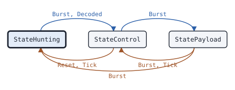

# trunk Follower

This page covers the trunk Follower, the state machine that follows the calls of a DMR Tier III trunked site without transmitting.

## What it does

A [Follower](https://pkg.go.dev/github.com/USA-RedDragon/dmrgo/v2/trunk#Follower) works as a trunking scanner. It hunts for a TSCC, the control channel of the site, over a hunt list. It reads the site parameters, broadcasts and grants of the TSCC, and follows the grants of the calls that its config selects to their payload channels. It returns to the TSCC on P_CLEAR, after the hang time, or when the payload channel goes quiet. It builds the channel plan from the CG_AP blocks of grants and from C_BCAST Chan_Freq, so it can give the frequencies of a channel. The Follower owns no radio: it returns tune requests, and you tune the receiver. It does no I/O. (ETSI TS 102 361-4 clauses 6.3 and 6.6)

## When to use it

Use a Follower to listen to a Tier III site: a scanner, a recorder, or a monitor of site activity. Use an [MS](trunk-ms.md) when you must also register and make calls. For a MOTOTRBO Capacity Plus or Linked Capacity Plus site, which has no TSCC, use the [CapacityPlusFollower](trunk-capacityplusfollower.md).

Trunked voice can start without a Voice LC Header. To decode the voice of a grant, pass the call of the grant to [voice.Receiver.Expect](voice-receiver.md) and feed the bursts of the granted slot to that Receiver.

## Config

Pass a [FollowerConfig](https://pkg.go.dev/github.com/USA-RedDragon/dmrgo/v2/trunk#FollowerConfig) to [NewFollower](https://pkg.go.dev/github.com/USA-RedDragon/dmrgo/v2/trunk#NewFollower). A nil config follows the first TSCC found and every talkgroup, with the receiver on one channel. Set a [HuntList](https://pkg.go.dev/github.com/USA-RedDragon/dmrgo/v2/trunk#HuntList) so the Follower can search, and a [ChannelPlan](https://pkg.go.dev/github.com/USA-RedDragon/dmrgo/v2/trunk#ChannelPlan) when you know the frequencies of the site. Set the talkgroups to limit the calls it follows. Set NoFollow for a receiver that cannot tune, such as the replay of a recording.

<!-- dmrgo:config pkg=trunk type=FollowerConfig -->
| Field | Type | Default | Description |
|---|---|---|---|
| `SysCode` | `*pdu.SysCode` | zero value | SysCode, when set, is the system to follow: a TSCC with another MODEL, NET or SITE is skipped. Nil follows the first TSCC found. |
| `Hunt` | `*HuntList` | zero value | Hunt, when set, is the hunt list. The Follower copies it, requests each channel in turn with OutputTune until it finds a TSCC, and adds and withdraws channels on an Ann_WD_TSCC broadcast. With a nil or empty Hunt the consumer keeps the receiver on one TSCC, which is then channel CHNULL. |
| `Plan` | `*ChannelPlan` | zero value | Plan, when set, is the channel plan to start from. The Follower copies it and adds the channels that CG_AP and Chan_Freq announce. |
| `Talkgroups` | `[32]uint32` | zero value | Talkgroups holds the first TalkgroupsLen 24-bit talkgroups to follow. TalkgroupsLen 0 follows every talkgroup. |
| `TalkgroupsLen` | `int` | zero value | TalkgroupsLen is the number of entries of Talkgroups in use. |
| `Individual` | `bool` | zero value | Individual follows individual voice calls too. |
| `Data` | `bool` | zero value | Data follows packet data grants too. |
| `NoFollow` | `bool` | zero value | NoFollow reports grants with OutputGrant but never leaves the TSCC, for a receiver that cannot tune, such as the replay of a recording. |
| `NoSignal` | `time.Duration` | `constants.TNoSignalDefault` (5s) | NoSignal is T_Nosig, the time without a TSCC burst after which the Follower hunts again, and the time it stays on each hunt list channel. 0 means constants.TNoSignalDefault, and a negative value turns the timer off (ETSI TS 102 361-4 Table A.1). |
| `Inactive` | `time.Duration` | `constants.TVInactiveDefault` (5s) | Inactive is TV_Inactive, the time without a burst on the payload channel after which the Follower returns to the TSCC. 0 means constants.TVInactiveDefault, and a negative value turns the timer off. |
| `Hangtime` | `time.Duration` | `constants.TVHangtimeDefault` (4s) | Hangtime is the time after a Terminator with LC in which the Follower waits on the payload channel for more voice. 0 means constants.TVHangtimeDefault, and a negative value turns the timer off. |
| `SysErrors` | `int` | `constants.NSysErrDefault` (2) | SysErrors is NSYSerr, the number of C_SYScodes from another system after which the Follower leaves the TSCC. 0 means constants.NSysErrDefault; a negative value is an error. |
| `AcceptRAS` | `bool` | zero value | AcceptRAS takes a CSBK whose CRC fails as valid when its BPTC needed no correction and its BPTC reserved bit R(2) flags RAS. The CRC of a Motorola Capacity Max system with RAS is a MAC with the key of the system, which the Follower cannot check. |
| `Scratch` | `*layer2.Burst` | `layer2.NewBurst()` | Scratch, when set, is the Burst that the Follower decodes into, as for voice.ReceiverConfig.Scratch. Nil means the Follower makes its own. |
<!-- /dmrgo:config -->

## States and transitions

[State](https://pkg.go.dev/github.com/USA-RedDragon/dmrgo/v2/trunk#Follower.State) returns the current state. The Follower and the MS share the [State](https://pkg.go.dev/github.com/USA-RedDragon/dmrgo/v2/trunk#State) type.

<!-- dmrgo:states pkg=trunk type=Follower -->
States of [`Follower`](https://pkg.go.dev/github.com/USA-RedDragon/dmrgo/v2/trunk#Follower), from [`Follower.State`](https://pkg.go.dev/github.com/USA-RedDragon/dmrgo/v2/trunk#Follower.State):

| State | Meaning | Seen in tests |
|---|---|---|
| [`StateHunting`](https://pkg.go.dev/github.com/USA-RedDragon/dmrgo/v2/trunk#StateHunting) | StateHunting looks for a TSCC. | yes, first state |
| [`StateControl`](https://pkg.go.dev/github.com/USA-RedDragon/dmrgo/v2/trunk#StateControl) | StateControl is on a confirmed TSCC. | yes |
| [`StatePayload`](https://pkg.go.dev/github.com/USA-RedDragon/dmrgo/v2/trunk#StatePayload) | StatePayload follows a call on a payload channel. | yes |

Transitions seen in tests:

| From | Method call | To |
|---|---|---|
| StateHunting | `Burst`, `Decoded` | StateControl |
| StateControl | `Reset`, `Tick` | StateHunting |
| StateControl | `Burst` | StatePayload |
| StatePayload | `Burst` | StateHunting |
| StatePayload | `Burst`, `Tick` | StateControl |


<!-- /dmrgo:states -->

The Follower starts by hunting. With a hunt list, the first Tick or Burst requests the first channel, and the Follower moves on to the next channel when no TSCC comes within T_Nosig. A TSCC of the selected system moves it to the control channel, and it reports the site. On the control channel, a grant of a call that the config selects moves it to the payload channel. P_CLEAR, the hang time after a Terminator with LC, the inactive time, or a lost signal returns it to the control channel. On the control channel, T_Nosig without a TSCC burst, or NSYSerr C_SYScodes of another system, ends the TSCC and the Follower hunts again. An Ann_WD_TSCC broadcast adds or withdraws hunt list channels. (ETSI TS 102 361-4 clauses 6.3 and 6.6)

## Inputs and outputs

Inputs:

- [Burst](https://pkg.go.dev/github.com/USA-RedDragon/dmrgo/v2/trunk#Follower.Burst) takes a raw burst, its [layer2.Hint](https://pkg.go.dev/github.com/USA-RedDragon/dmrgo/v2/layer2#Hint), and the CACH field before it when you have it. Set Hint.Slot when the transport has it: on a payload channel only the bursts of the granted slot count.
- [Decoded](https://pkg.go.dev/github.com/USA-RedDragon/dmrgo/v2/trunk#Follower.Decoded) takes a burst that you decoded already, for a monitor that feeds one burst to several machines.
- [Lost](https://pkg.go.dev/github.com/USA-RedDragon/dmrgo/v2/trunk#Follower.Lost) reports that the receiver lost the signal.
- [Tick](https://pkg.go.dev/github.com/USA-RedDragon/dmrgo/v2/trunk#Follower.Tick) runs the timers. Call it at the time [Deadline](https://pkg.go.dev/github.com/USA-RedDragon/dmrgo/v2/trunk#Follower.Deadline) returns.
- [Reset](https://pkg.go.dev/github.com/USA-RedDragon/dmrgo/v2/trunk#Follower.Reset) starts the hunt again. It keeps the config, the channel plan and the hunt list.

Outputs are [Output](https://pkg.go.dev/github.com/USA-RedDragon/dmrgo/v2/trunk#Output) values with an [OutputKind](https://pkg.go.dev/github.com/USA-RedDragon/dmrgo/v2/trunk#OutputKind). A Follower returns tune requests with the channel number and slot and, when the plan has them, the frequencies; the site; the loss of the TSCC; each grant, whether it follows it or not; the end of a followed call; and UDT deliveries. Lost and call end outputs carry a [Reason](https://pkg.go.dev/github.com/USA-RedDragon/dmrgo/v2/trunk#Reason).

The accessors return what the Follower holds: [Site](https://pkg.go.dev/github.com/USA-RedDragon/dmrgo/v2/trunk#Follower.Site), [Plan](https://pkg.go.dev/github.com/USA-RedDragon/dmrgo/v2/trunk#Follower.Plan), [Lookup](https://pkg.go.dev/github.com/USA-RedDragon/dmrgo/v2/trunk#Follower.Lookup), [Hunt](https://pkg.go.dev/github.com/USA-RedDragon/dmrgo/v2/trunk#Follower.Hunt), [Call](https://pkg.go.dev/github.com/USA-RedDragon/dmrgo/v2/trunk#Follower.Call) and [UDT](https://pkg.go.dev/github.com/USA-RedDragon/dmrgo/v2/trunk#Follower.UDT).

Give each method a slice with capacity <!-- dmrgo:const pkg=trunk name=MaxOutputs -->`10`<!-- /dmrgo:const --> so that it does not allocate.

## Timers

- T_Nosig: the time without a TSCC burst after which the Follower hunts again, and the time it stays on each hunt list channel. The default is <!-- dmrgo:const pkg=constants name=TNoSignalDefault -->`5s`<!-- /dmrgo:const -->. (ETSI TS 102 361-4 Table A.1)
- TV_Inactive: the time without a burst on the payload channel after which the Follower returns to the TSCC. The default is <!-- dmrgo:const pkg=constants name=TVInactiveDefault -->`5s`<!-- /dmrgo:const -->. (ETSI TS 102 361-4 Table A.1)
- Hang time: the time after a Terminator with LC in which the Follower waits on the payload channel for more voice. The default is <!-- dmrgo:const pkg=constants name=TVHangtimeDefault -->`4s`<!-- /dmrgo:const -->. (ETSI TS 102 361-4 Table A.1)

The count NSYSerr of C_SYScodes of another system has the default <!-- dmrgo:const pkg=constants name=NSysErrDefault -->`2`<!-- /dmrgo:const -->. A negative timer value in the config turns that timer off.

## Worked example

This example builds a C_ALOHA and a talkgroup voice grant with a channel plan rule, and feeds them to a Follower. The Follower reports the site, the grant, and a tune request with the receive frequency of the payload channel.

<!-- dmrgo:code file=v2/trunk/example_test.go symbol=ExampleFollower -->
```go
func ExampleFollower() {
	var plan trunk.ChannelPlan
	_ = plan.AddRule(trunk.ChannelRule{First: 1, Last: 200, RXHz: 451_000_000, StepHz: 12_500})
	f, _ := trunk.NewFollower(&trunk.FollowerConfig{Plan: &plan})
	out := make([]trunk.Output, 0, trunk.MaxOutputs)

	code, _ := pdu.SysCode{Model: pdu.NetworkModelSmall, Net: 1, Site: 2}.Pack()
	alohaCSBK := pdu.CSBK{LastBlock: true}
	_ = alohaCSBK.SetAloha(pdu.AlohaPDU{SysIdentCode: code})
	grantCSBK := pdu.CSBK{LastBlock: true}
	_ = grantCSBK.SetTalkgroupVoiceGrant(pdu.TalkgroupVoiceGrantPDU{PhysicalChannel: 17, LogicalChannel: true, TargetAddress: 9, SourceAddress: 3120001})
	aloha, _ := layer2.BuildBurst(&alohaCSBK, 1, layer2.SyncSourceBS)
	grant, _ := layer2.BuildBurst(&grantCSBK, 1, layer2.SyncSourceBS)

	now := time.Duration(0)
	for _, raw := range []layer2.RawBurst{aloha, grant} {
		out = f.Burst(now, &raw, layer2.Hint{}, nil, out[:0])
		for _, o := range out {
			switch o.Kind {
			case trunk.OutputSite:
				s := f.Site()
				fmt.Println("site", s.SysCode.Net, s.SysCode.Site)
			case trunk.OutputGrant:
				fmt.Println("grant to talkgroup", o.Grant.Target, "from", o.Grant.Source)
			case trunk.OutputTune:
				fmt.Println("tune to channel", o.Tune.Channel, o.Tune.Slot, o.Tune.RXHz, "Hz")
			default:
			}
		}
		now += 30 * time.Millisecond
	}
}
```
<!-- /dmrgo:code -->

Output:

<!-- dmrgo:output test=trunk.ExampleFollower -->
```text
site 1 2
grant to talkgroup 9 from 3120001
tune to channel 17 TS2 451200000 Hz
```
<!-- /dmrgo:output -->

## Errors

The event methods return no errors. NewFollower returns a configuration error for a talkgroup list out of range, a talkgroup over 24 bits, a negative NSYSerr, or a system code whose fields do not fit. The ChannelPlan and HuntList methods return errors for a channel number out of range and a full table.

<!-- dmrgo:errors pkg=trunk type=Follower -->
The doc comments of [`Follower`](https://pkg.go.dev/github.com/USA-RedDragon/dmrgo/v2/trunk#Follower) and its methods name no error.
<!-- /dmrgo:errors -->

## Related machines and guides

Machines:

- [trunk MS](trunk-ms.md): follows a TSCC as a Follower does, and also registers and makes calls.
- [trunk TSCC](trunk-tscc.md): the control channel that a Follower follows.
- [trunk CapacityPlusFollower](trunk-capacityplusfollower.md): the same job for Capacity Plus sites.
- [voice Receiver](voice-receiver.md): decodes the voice of a followed call.

Guides:

- Build and decode trunking messages
- Follow calls on both slots of a bit stream
- Receive with an SDR or an FM radio
