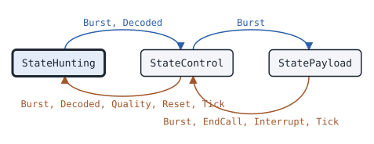

# trunk MS

This page covers the trunk MS, the state machine of a DMR Tier III mobile station that registers on a trunked site and makes calls.

## What it does

An [MS](https://pkg.go.dev/github.com/USA-RedDragon/dmrgo/v2/trunk#MS) is a Tier III radio. It hunts for and follows a TSCC as a [Follower](trunk-follower.md) does. It also registers and de-registers, makes voice and packet data calls by random access, answers C_AHOY and P_AHOY, follows C_MOVE and P_PROTECT, and ends its own calls with P_MAINT. It sends its random access requests in the inbound slot that the AT bit of the CACH shows as free, with a random backoff. It also takes part in the UDT services: short data, polling, call diversion and DGNA, and full-duplex and Ambient Listening Service calls. The MS returns the bursts to send with their Due times and does no I/O. You send the voice of a granted call with a [voice Transmitter](voice-transmitter.md) with the MS SYNC. (ETSI TS 102 361-4 clauses 6.2 to 6.6, 6.6.2.6 and 6.6.4 to 6.6.11)

## When to use it

Use an MS to build a Tier III radio, a dispatcher console on a radio link, a test tool for a trunked site, or a simulator that runs MSs against a [TSCC](trunk-tscc.md). When you only listen, use a Follower: it never transmits.

## Config

Pass an [MSConfig](https://pkg.go.dev/github.com/USA-RedDragon/dmrgo/v2/trunk#MSConfig) to [NewMS](https://pkg.go.dev/github.com/USA-RedDragon/dmrgo/v2/trunk#NewMS). The individual address is required, so a nil config returns an error. Set the talkgroups whose calls the MS follows. The system code, hunt list and channel plan work as in the Follower. Set a different Seed for each MS of a simulation, so that their random access backoffs differ. Set Auth to authenticate the TSCC before a stun, revive or kill.

<!-- dmrgo:config pkg=trunk type=MSConfig -->
| Field | Type | Default | Description |
|---|---|---|---|
| `Address` | `uint32` | zero value | Address is the 24-bit individual address of the MS, 1 to 0xFFFCDF. |
| `Talkgroups` | `[32]uint32` | zero value | Talkgroups holds the first TalkgroupsLen 24-bit talkgroups whose calls the MS follows and whose radio checks it answers. Its own calls and the individual calls to it are always followed. |
| `TalkgroupsLen` | `int` | zero value | TalkgroupsLen is the number of entries of Talkgroups in use. |
| `SysCode` | `*pdu.SysCode` | zero value | SysCode, when set, is the system to use, as in FollowerConfig. |
| `Hunt` | `*HuntList` | zero value | Hunt, when set, is the hunt list, as in FollowerConfig. |
| `Plan` | `*ChannelPlan` | zero value | Plan, when set, is the channel plan to start from. |
| `Slot` | `enums.Slot` | `f.cach.TACT.Slot()` or `enums.Slot1` (1) or `m.slot` | Slot is the TDMA channel of the TSCC on which the MS makes random access. SlotUnknown means enums.Slot1. |
| `Seed` | `uint64` | zero value | Seed seeds the random choice of the backoff frames. Two MSs with the same seed make the same choices; 0 is a valid seed. |
| `NoRegistration` | `bool` | zero value | NoRegistration keeps the MS from registering when the TSCC requests it with Reg. |
| `RandomTimeout` | `time.Duration` | not machine-readable; see the description | RandomTimeout is TRand_TC, the longest time of a random access. 0 means constants.TRandTCDefault, and a negative value turns the timer off. (ETSI TS 102 361-4 clause 6.2.1.1.7) |
| `CallTimeout` | `time.Duration` | not machine-readable; see the description | CallTimeout is TP_Timer, the longest wait for the grant of a service that needs a payload channel. 0 means constants.TPTimerDefault, and a negative value turns the timer off. |
| `RegTimeout` | `time.Duration` | not machine-readable; see the description | RegTimeout is TNP_Timer, the longest wait for the answer to a registration after an intermediate acknowledgement. 0 means constants.TNPTimerDefault, and a negative value turns the timer off. |
| `Pending` | `time.Duration` | `constants.TPendingDefault` (5s) | Pending is T_Pending, the time a called MS waits for the grant after it accepted a C_AHOY. 0 means constants.TPendingDefault. |
| `Dereg` | `time.Duration` | `constants.TDeregDefault` (500ms) | Dereg is T_Dereg, the longest wait for the answer to a de-registration. 0 means constants.TDeregDefault. |
| `DeniedLife` | `time.Duration` | not machine-readable; see the description | DeniedLife is T_DENREG, how long a Reg_Denied keeps the MS off a SYS_AREA. 0 means constants.TDenRegDefault, and a negative value keeps the entry until Reset. |
| `DMRLA` | `int` | `constants.DMRLADefault` (1) | DMRLA is the number of most significant SITE bits in the SYS_AREA of the registration and denied records. 0 means constants.DMRLADefault. |
| `MinLevelHunt` | `*int` | zero value | MinLevelHunt, when set, is the signal level below which the MS does not confirm a TSCC, as L_Lower_SHort, in the unit of the levels that the consumer passes to Quality. |
| `MinLevelIdle` | `*int` | zero value | MinLevelIdle, when set, is the signal level below which the MS leaves a confirmed TSCC, in the unit of MinLevelHunt. |
| `MaxBERPermille` | `int` | `DefaultMaxBERPermille` (50) | MaxBERPermille is the bit error rate of the TSCC above which the MS leaves it. 0 means DefaultMaxBERPermille, and a negative value turns the check off. |
| `AcceptRAS` | `bool` | zero value | AcceptRAS is as in FollowerConfig. |
| `NoSignal` | `time.Duration` | `constants.TNoSignalDefault` (5s) | NoSignal is T_Nosig, as in FollowerConfig. |
| `Inactive` | `time.Duration` | `constants.TVInactiveDefault` (5s) | Inactive is TV_Inactive, as in FollowerConfig. |
| `Hangtime` | `time.Duration` | `constants.TVHangtimeDefault` (4s) | Hangtime is the payload hang time, as in FollowerConfig. |
| `Scratch` | `*layer2.Burst` | `layer2.NewBurst()` | Scratch is the decode Burst, as in FollowerConfig. |
| `NoDuplex` | `bool` | zero value | NoDuplex refuses full-duplex calls to the MS with MS_Duplex_Not_Supported. |
| `Ambient` | `bool` | zero value | Ambient accepts Ambient Listening Service calls to the MS. Without it the MS refuses them with MSNot_Supported. |
| `Auth` | `Authenticator` | zero value | Auth, when set, makes the MS authenticate the TSCC before a stun or revive, and lets it accept a kill, which is always authenticated. Without it the MS refuses a kill as not supported. The MS keeps Auth and does not copy what it points to, such as a *trunkauth.Key or a *trunkauth.Keys and its Entries. Do not change it while the MS uses it. (ETSI TS 102 361-4 clauses 6.4.9.2 and 6.4.10) |
| `NoStun` | `bool` | zero value | NoStun makes the MS refuse a stun or revive as not supported. |
| `NoKill` | `bool` | zero value | NoKill makes the MS refuse a kill as not supported. |
| `Stunned` | `bool` | zero value | Stunned starts the MS stunned, for an MS that a TSCC stunned before. |
| `Killed` | `bool` | zero value | Killed starts the MS killed, for an MS that a TSCC killed before. |
| `PowerSave` | `uint8` | zero value | PowerSave is the PowerSave_RQ of the registrations of the MS, 0 to 7: the MS requests to be awake for one power save frame in 2^PowerSave. 0 requests no power save. (ETSI TS 102 361-4 clause 6.4.7) |
| `Awake` | `time.Duration` | `constants.TAwakeDefault` (1s) | Awake is T_Awake, the time the MS stays awake after a PDU for it in power save. 0 means constants.TAwakeDefault. |
<!-- /dmrgo:config -->

## States and transitions

[State](https://pkg.go.dev/github.com/USA-RedDragon/dmrgo/v2/trunk#MS.State) returns the channel state of the MS. It is the [State](https://pkg.go.dev/github.com/USA-RedDragon/dmrgo/v2/trunk#State) type of the Follower.

<!-- dmrgo:states pkg=trunk type=MS -->
States of [`MS`](https://pkg.go.dev/github.com/USA-RedDragon/dmrgo/v2/trunk#MS), from [`MS.State`](https://pkg.go.dev/github.com/USA-RedDragon/dmrgo/v2/trunk#MS.State):

| State | Meaning | Seen in tests |
|---|---|---|
| [`StateHunting`](https://pkg.go.dev/github.com/USA-RedDragon/dmrgo/v2/trunk#StateHunting) | StateHunting looks for a TSCC. | yes, first state |
| [`StateControl`](https://pkg.go.dev/github.com/USA-RedDragon/dmrgo/v2/trunk#StateControl) | StateControl is on a confirmed TSCC. | yes |
| [`StatePayload`](https://pkg.go.dev/github.com/USA-RedDragon/dmrgo/v2/trunk#StatePayload) | StatePayload follows a call on a payload channel. | yes |

Transitions seen in tests:

| From | Method call | To |
|---|---|---|
| StateHunting | `Burst`, `Decoded` | StateControl |
| StateControl | `Burst`, `Decoded`, `Quality`, `Reset`, `Tick` | StateHunting |
| StateControl | `Burst` | StatePayload |
| StatePayload | `Burst`, `EndCall`, `Interrupt`, `Tick` | StateControl |


<!-- /dmrgo:states -->

The channel states move as for the Follower: hunting, then the confirmed TSCC, then the payload channel of a call, then back to the TSCC. The MS follows its own calls and the individual calls to it, in addition to its talkgroups. It also leaves a TSCC whose signal level falls below MinLevelIdle, as [Quality](https://pkg.go.dev/github.com/USA-RedDragon/dmrgo/v2/trunk#MS.Quality) reports it, or whose bit error rate is too high. (ETSI TS 102 361-4 clauses 6.3.2.3 and 6.3.3.1)

On the TSCC, a request runs beside the channel state. [Busy](https://pkg.go.dev/github.com/USA-RedDragon/dmrgo/v2/trunk#MS.Busy) reports whether a registration, de-registration or call request runs. The MS registers when the TSCC requests registration, unless NoRegistration is set. [Registered](https://pkg.go.dev/github.com/USA-RedDragon/dmrgo/v2/trunk#MS.Registered) reports whether it holds a registration for the TSCC that it is on. A call request ends with a grant and a tune request, or with a refusal. [Off](https://pkg.go.dev/github.com/USA-RedDragon/dmrgo/v2/trunk#MS.Off), [Stunned](https://pkg.go.dev/github.com/USA-RedDragon/dmrgo/v2/trunk#MS.Stunned), [Killed](https://pkg.go.dev/github.com/USA-RedDragon/dmrgo/v2/trunk#MS.Killed) and [Asleep](https://pkg.go.dev/github.com/USA-RedDragon/dmrgo/v2/trunk#MS.Asleep) report the other conditions of the MS. These have no state type, so the table above does not show them.

## Inputs and outputs

Inputs from the channel:

- [Burst](https://pkg.go.dev/github.com/USA-RedDragon/dmrgo/v2/trunk#MS.Burst) and [Decoded](https://pkg.go.dev/github.com/USA-RedDragon/dmrgo/v2/trunk#MS.Decoded) take each outbound burst, its [layer2.Hint](https://pkg.go.dev/github.com/USA-RedDragon/dmrgo/v2/layer2#Hint), and the CACH field before it. Pass the time at the start of the burst. Set Hint.Slot, because the MS counts TDMA frames by the bursts of its slot. Random access needs the CACH for its AT bit.
- [Lost](https://pkg.go.dev/github.com/USA-RedDragon/dmrgo/v2/trunk#MS.Lost) reports that the receiver lost the signal, and [Quality](https://pkg.go.dev/github.com/USA-RedDragon/dmrgo/v2/trunk#MS.Quality) gives the signal level of the TSCC.
- [Tick](https://pkg.go.dev/github.com/USA-RedDragon/dmrgo/v2/trunk#MS.Tick) runs the timers. Call it at the time [Deadline](https://pkg.go.dev/github.com/USA-RedDragon/dmrgo/v2/trunk#MS.Deadline) returns.

Inputs from the user:

- [Call](https://pkg.go.dev/github.com/USA-RedDragon/dmrgo/v2/trunk#MS.Call) and [CallData](https://pkg.go.dev/github.com/USA-RedDragon/dmrgo/v2/trunk#MS.CallData) request a voice or packet data call. [CallDuplex](https://pkg.go.dev/github.com/USA-RedDragon/dmrgo/v2/trunk#MS.CallDuplex), [CallDuplexData](https://pkg.go.dev/github.com/USA-RedDragon/dmrgo/v2/trunk#MS.CallDuplexData) and [CallAmbient](https://pkg.go.dev/github.com/USA-RedDragon/dmrgo/v2/trunk#MS.CallAmbient) request full-duplex and Ambient Listening Service calls.
- [Cancel](https://pkg.go.dev/github.com/USA-RedDragon/dmrgo/v2/trunk#MS.Cancel) stops the running request, and [EndCall](https://pkg.go.dev/github.com/USA-RedDragon/dmrgo/v2/trunk#MS.EndCall) ends the own call on the payload channel.
- [PowerOff](https://pkg.go.dev/github.com/USA-RedDragon/dmrgo/v2/trunk#MS.PowerOff) de-registers the MS before it is switched off.
- [AuthResponse](https://pkg.go.dev/github.com/USA-RedDragon/dmrgo/v2/trunk#MS.AuthResponse) answers an authentication challenge of the TSCC.
- The services: [SendStatus](https://pkg.go.dev/github.com/USA-RedDragon/dmrgo/v2/trunk#MS.SendStatus), [PollStatus](https://pkg.go.dev/github.com/USA-RedDragon/dmrgo/v2/trunk#MS.PollStatus), [Interrupt](https://pkg.go.dev/github.com/USA-RedDragon/dmrgo/v2/trunk#MS.Interrupt), [AdviseIP](https://pkg.go.dev/github.com/USA-RedDragon/dmrgo/v2/trunk#MS.AdviseIP), [SendShortData](https://pkg.go.dev/github.com/USA-RedDragon/dmrgo/v2/trunk#MS.SendShortData), [PollShortData](https://pkg.go.dev/github.com/USA-RedDragon/dmrgo/v2/trunk#MS.PollShortData), [Divert](https://pkg.go.dev/github.com/USA-RedDragon/dmrgo/v2/trunk#MS.Divert) and [AssignGroups](https://pkg.go.dev/github.com/USA-RedDragon/dmrgo/v2/trunk#MS.AssignGroups).
- [Reset](https://pkg.go.dev/github.com/USA-RedDragon/dmrgo/v2/trunk#MS.Reset) clears the site, the registration and any request. It keeps a stun or kill.

Outputs are [Output](https://pkg.go.dev/github.com/USA-RedDragon/dmrgo/v2/trunk#Output) values with an [OutputKind](https://pkg.go.dev/github.com/USA-RedDragon/dmrgo/v2/trunk#OutputKind). In addition to the outputs of a Follower, an MS returns bursts to send in a slot at a Due time, the registration, refusals with a [Reason](https://pkg.go.dev/github.com/USA-RedDragon/dmrgo/v2/trunk#Reason) and the C_NACKD reason, C_AHOY calls, and the results of the services. Send each burst at its Due time. Give each method a slice with capacity <!-- dmrgo:const pkg=trunk name=MaxOutputs -->`10`<!-- /dmrgo:const -->.

## Timers

- TRand_TC, the longest time of a random access: <!-- dmrgo:const pkg=constants name=TRandTCDefault -->`10s`<!-- /dmrgo:const --> by default. (ETSI TS 102 361-4 clause 6.2.1.1.7)
- TP_Timer, the longest wait for the grant of a call: <!-- dmrgo:const pkg=constants name=TPTimerDefault -->`10s`<!-- /dmrgo:const --> by default. (ETSI TS 102 361-4 Table A.1)
- TNP_Timer, the longest wait for the answer to a registration after an intermediate acknowledgement: <!-- dmrgo:const pkg=constants name=TNPTimerDefault -->`5s`<!-- /dmrgo:const --> by default. (ETSI TS 102 361-4 Table A.1)
- T_Pending, the wait of a called MS for the grant after it accepted a C_AHOY: <!-- dmrgo:const pkg=constants name=TPendingDefault -->`5s`<!-- /dmrgo:const --> by default.
- T_Dereg, the longest wait for the answer to a de-registration: <!-- dmrgo:const pkg=constants name=TDeregDefault -->`500ms`<!-- /dmrgo:const --> by default. (ETSI TS 102 361-4 clause 6.4.6)
- T_DENREG, how long a Reg_Denied keeps the MS off a site area: <!-- dmrgo:const pkg=constants name=TDenRegDefault -->`1m0s`<!-- /dmrgo:const --> by default.
- T_Awake, the time the MS stays awake after a PDU in power save: <!-- dmrgo:const pkg=constants name=TAwakeDefault -->`1s`<!-- /dmrgo:const --> by default. (ETSI TS 102 361-4 clause 6.4.7)
- T_Nosig, TV_Inactive and the payload hang time, as for the [Follower](trunk-follower.md#timers).

The MS leaves a TSCC whose bit error rate is above <!-- dmrgo:const pkg=trunk name=DefaultMaxBERPermille -->`50`<!-- /dmrgo:const --> parts per thousand by default. The spec leaves this threshold to the manufacturer. (ETSI TS 102 361-4 clause 6.3.2.3)

## Worked example

This example runs an MS against a TSCC with one payload channel. The MS registers, makes a talkgroup call, follows the grant to the payload channel, and ends the call with P_MAINT.

<!-- dmrgo:code file=v2/trunk/example_test.go symbol=ExampleMS -->
```go
func ExampleMS() {
	s := newServiceSite(&trunk.TSCCConfig{}, &trunk.MSConfig{Address: 3120001, Seed: 1})
	s.onMS = func(_ int, o *trunk.Output) {
		switch o.Kind {
		case trunk.OutputRegistered:
			fmt.Println(o.Kind)
		case trunk.OutputCallEnd:
			fmt.Println(o.Kind, o.Reason)
		case trunk.OutputGrant:
			fmt.Println(o.Kind, "talkgroup", o.Grant.Target, "from", o.Grant.Source)
		case trunk.OutputTune:
			fmt.Println(o.Kind, "channel", o.Tune.Channel, o.Tune.Slot)
		default:
		}
	}
	s.run(3 * time.Second)
	fmt.Println(s.ms[0].State(), "registered", s.ms[0].Registered())
	if err := s.ms[0].Call(s.now, true, 9, layer3.VoiceServiceOptions{}); err != nil {
		fmt.Println(err)
		return
	}
	s.run(time.Second)
	fmt.Println(s.ms[0].State())
	s.take(0, s.ms[0].EndCall(s.now, s.mout[:0]))
	s.run(time.Second)
	fmt.Println(s.ms[0].State())
}
```
<!-- /dmrgo:code -->

The helper carries the bursts between the machines. Each 30 ms it gives the TSCC the inbound bursts that are due, ticks the TSCC and the MS, and gives each MS the outbound bursts of its channel:

<!-- dmrgo:code file=v2/trunk/example_services_test.go symbol=serviceSite.run -->
```go
func (s *serviceSite) run(d time.Duration) {
	for end := s.now + d; s.now < end; s.now += 30 * time.Millisecond {
		keep := s.air[:0]
		for _, b := range s.air {
			if b.due > s.now {
				keep = append(keep, b)
				continue
			}
			s.tout = s.tscc.Inbound(s.now, b.ch, &b.raw, layer2.Hint{Slot: b.slot}, s.tout[:0])
			s.tsccOut()
		}
		s.air = keep
		s.tout = s.tscc.Tick(s.now, s.tout[:0])
		bursts := append([]trunk.TSCCOutput(nil), s.tout...)
		s.tsccOut()
		for i, m := range s.ms {
			s.mout = m.Tick(s.now, s.mout[:0])
			s.take(i, s.mout)
		}
		for _, b := range bursts {
			if b.Kind != trunk.TSCCBurst {
				continue
			}
			for i, m := range s.ms {
				if s.ch[i] == b.Channel {
					s.mout = m.Burst(s.now, &b.Burst, layer2.Hint{Slot: b.Slot}, &b.CACH, s.mout[:0])
					s.take(i, s.mout)
				}
			}
		}
	}
}
```
<!-- /dmrgo:code -->

Output:

<!-- dmrgo:output test=trunk.ExampleMS -->
```text
Registered
Control registered true
Grant talkgroup 9 from 3120001
Tune channel 10 TS1
Payload
CallEnd Maintenance
Tune channel 0 Unknown
Control
```
<!-- /dmrgo:output -->

The last tune request has channel number 0 because the example has no hunt list: the TSCC is then channel CHNULL.

## Errors

Call, CallData and the other requests return an error when the MS is not on a confirmed TSCC, while another request runs, when the TSCC requires a registration that the MS does not hold, when the TSCC stunned the MS, and for a target or options out of range. NewMS returns a configuration error for an address out of range, a slot other than unknown, 1 or 2, and the errors of NewFollower. Match the errors with errors.Is.

<!-- dmrgo:errors pkg=trunk type=MS -->
| Error | Returned by | Meaning |
|---|---|---|
| [`dmrgo.ConfigError`](https://pkg.go.dev/github.com/USA-RedDragon/dmrgo/v2#ConfigError) | `MS.Call`, `MS.Divert`, `MS.SendStatus`, `MS.SetStatus` | ConfigError is the error of a constructor, and of a machine method that takes a config, option or argument field, for a field with a value out of range. |
| [`trunk.ErrBusy`](https://pkg.go.dev/github.com/USA-RedDragon/dmrgo/v2/trunk#ErrBusy) | `MS.AdviseIP`, `MS.Call`, `MS.Interrupt` | ErrBusy is returned by MS.Call while a registration or call request runs. |
| [`trunk.ErrNoCall`](https://pkg.go.dev/github.com/USA-RedDragon/dmrgo/v2/trunk#ErrNoCall) | `MS.Interrupt` | ErrNoCall is returned by MS.Interrupt when the MS is not on the payload channel of a voice call, and by TSCC.Interrupt for a slot without a call. |
| [`trunk.ErrNotOnControl`](https://pkg.go.dev/github.com/USA-RedDragon/dmrgo/v2/trunk#ErrNotOnControl) | `MS.AdviseIP`, `MS.Call` | ErrNotOnControl is returned by MS.Call when the MS is not on a confirmed TSCC. |
| [`trunk.ErrNotRegistered`](https://pkg.go.dev/github.com/USA-RedDragon/dmrgo/v2/trunk#ErrNotRegistered) | `MS.Call` | ErrNotRegistered is returned by MS.Call and MS.CallData when the TSCC requests a registration that the MS does not hold. |
| [`trunk.ErrStunned`](https://pkg.go.dev/github.com/USA-RedDragon/dmrgo/v2/trunk#ErrStunned) | `MS.Interrupt`, `MS.SendStatus` | ErrStunned is returned for a user service of an MS that the TSCC stunned. |
| [`trunk.ErrUDTFormat`](https://pkg.go.dev/github.com/USA-RedDragon/dmrgo/v2/trunk#ErrUDTFormat) | `MS.AssignGroups`, `MS.SetSupplementary` | ErrUDTFormat is returned for appended data in another UDT Format than the method reads or writes, or in a Format over 15. |
| [`trunk.ErrUDTLength`](https://pkg.go.dev/github.com/USA-RedDragon/dmrgo/v2/trunk#ErrUDTLength) | `MS.PollShortData`, `MS.SendShortData`, `MS.SetSupplementary` | ErrUDTLength is returned for data that does not fit in 1 to 4 appended blocks, for blocks whose size does not match the format, and for a PadNibble over 31. |
<!-- /dmrgo:errors -->

## Related machines and guides

Machines:

- [trunk TSCC](trunk-tscc.md): the site controller that an MS registers on.
- [trunk Follower](trunk-follower.md): follows a site without transmitting.
- [voice Transmitter](voice-transmitter.md): sends the voice of a granted call.
- [voice Receiver](voice-receiver.md): decodes the voice of a call that the MS follows.
- data Sender (docs/machines/data-sender.md): sends the data of a granted packet data call.

Guides:

- Build and decode trunking messages
- Send SMS and confirmed data with retries
