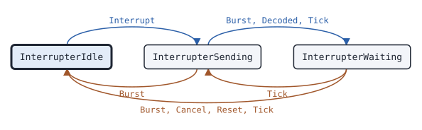

# voice Interrupter

This page covers the voice Interrupter, the state machine of a radio that interrupts the voice call of another radio on the reverse channel.

## What it does

An [Interrupter](https://pkg.go.dev/github.com/USA-RedDragon/dmrgo/v2/voice#Interrupter) ends the voice call of another radio. It sends a Tier 2 reverse channel (RC) command, Cease Transmission Request or Cease Transmission Command, in standalone RC bursts on the reverse channel of the call. It then waits for the Terminator with LC that ends the call. When the terminator does not come in time, it tries again, up to the configured number of retries, and then reports a failure. The caller sends the RC bursts and feeds the bursts of the call back to the Interrupter. The Interrupter does no I/O. (ETSI TS 102 361-2 clauses 6.3.3, 6.3.4 and 6.3.5)

## When to use it

Use an Interrupter in a radio or a dispatcher that must take the channel from a talking radio: a party to the call that needs the channel, or an emergency call. A Cease Transmission Command always ends the call at the transmitter. A Cease Transmission Request ends it only when the transmitter accepts interrupts. On the other side, a [Transmitter](voice-transmitter.md) takes the command with ReverseChannel.

## Config

Pass an [InterrupterConfig](https://pkg.go.dev/github.com/USA-RedDragon/dmrgo/v2/voice#InterrupterConfig) to [NewInterrupter](https://pkg.go.dev/github.com/USA-RedDragon/dmrgo/v2/voice#NewInterrupter). The Slot must be set, so a nil config returns an error. Set the color code of the system. Change Wait, Retries and Repeats only when your system plan gives other values.

<!-- dmrgo:config pkg=voice type=InterrupterConfig -->
| Field | Type | Default | Description |
|---|---|---|---|
| `ColorCode` | `enums.ColorCode` | zero value | ColorCode is the color code of the EMB of the standalone RC bursts. The EMB also has PI set, as an RC for the other logical channel. (ETSI TS 102 361-1 clause 6.4.2 and Table 9.19, ETSI TS 102 361-2 clause 6.3.5) |
| `Slot` | `enums.Slot` | zero value | Slot is the TDMA slot of the machine, which it puts in the Hint of each burst it sends. It must be Slot1 or Slot2. |
| `Wait` | `time.Duration` | `constants.TRCTimer` (600ms) | Wait is T_RCtimer, the wait for the Terminator with LC after each try. 0 means constants.TRCTimer (600 ms), and a negative value waits until the terminator or Cancel. (ETSI TS 102 361-2 clause A.1) |
| `Retries` | `int` | `1` | Retries is the number of tries after the first. 0 means 1, the one automatic retry of Motorola Transmit Interrupt (MOTOTRBO System Planner 2.3.2), a negative value means none, and it is at most MaxRetries. (ETSI TS 102 361-2 clause 6.3.5) |
| `Repeats` | `int` | not machine-readable; see the description | Repeats is the number of standalone RC bursts of each try, 60 ms apart. 0 means 1; at most MaxRepeats. (ETSI TS 102 361-2 clause 6.3.5) |
| `Lead` | `time.Duration` | not machine-readable; see the description | Lead makes Tick emit a burst this long before its Due time, so that an RF FIFO can be filled ahead. 0 means at Due; it must not be negative. T_RCtimer counts from the Due times. |
| `Scratch` | `*layer2.Burst` | `layer2.NewBurst()` | Scratch, when set, is the Burst that Burst decodes into. Machines that run on one goroutine can share one. Nil means the Interrupter makes its own. (ETSI TS 102 361-2 clause 6.3.5) |
<!-- /dmrgo:config -->

## States and transitions

[State](https://pkg.go.dev/github.com/USA-RedDragon/dmrgo/v2/voice#Interrupter.State) returns the current state.

<!-- dmrgo:states pkg=voice type=InterrupterState -->
States of [`Interrupter`](https://pkg.go.dev/github.com/USA-RedDragon/dmrgo/v2/voice#Interrupter), from [`Interrupter.State`](https://pkg.go.dev/github.com/USA-RedDragon/dmrgo/v2/voice#Interrupter.State):

| State | Meaning | Seen in tests |
|---|---|---|
| [`InterrupterIdle`](https://pkg.go.dev/github.com/USA-RedDragon/dmrgo/v2/voice#InterrupterIdle) | InterrupterIdle runs no interrupt request. (ETSI TS 102 361-2 clause 6.3.5) | yes, first state |
| [`InterrupterSending`](https://pkg.go.dev/github.com/USA-RedDragon/dmrgo/v2/voice#InterrupterSending) | InterrupterSending sends the standalone RC bursts of a try. (ETSI TS 102 361-2 clause 6.3.5) | yes |
| [`InterrupterWaiting`](https://pkg.go.dev/github.com/USA-RedDragon/dmrgo/v2/voice#InterrupterWaiting) | InterrupterWaiting waits T_RCtimer for the Terminator with LC. (ETSI TS 102 361-2 clause 6.3.5) | yes |

Transitions seen in tests:

| From | Method call | To |
|---|---|---|
| InterrupterIdle | `Interrupt` | InterrupterSending |
| InterrupterSending | `Burst` | InterrupterIdle |
| InterrupterSending | `Burst`, `Decoded`, `Tick` | InterrupterWaiting |
| InterrupterWaiting | `Burst`, `Cancel`, `Reset`, `Tick` | InterrupterIdle |
| InterrupterWaiting | `Tick` | InterrupterSending |


<!-- /dmrgo:states -->

[Interrupt](https://pkg.go.dev/github.com/USA-RedDragon/dmrgo/v2/voice#Interrupter.Interrupt) starts a try: the Interrupter sends the standalone RC bursts of the try, 60 ms apart, and then waits for the terminator. A Terminator with LC of the call, after the first RC burst went out, ends the request as a success. When the wait runs out, the Interrupter starts the next try, or ends the request as failed after the last try. [Cancel](https://pkg.go.dev/github.com/USA-RedDragon/dmrgo/v2/voice#Interrupter.Cancel) ends the request at any time. (ETSI TS 102 361-2 clause 6.3.5)

## Inputs and outputs

Inputs:

- [Interrupt](https://pkg.go.dev/github.com/USA-RedDragon/dmrgo/v2/voice#Interrupter.Interrupt) starts a request with an [enums.RCCommand](https://pkg.go.dev/github.com/USA-RedDragon/dmrgo/v2/enums#RCCommand).
- [Burst](https://pkg.go.dev/github.com/USA-RedDragon/dmrgo/v2/voice#Interrupter.Burst) and [Decoded](https://pkg.go.dev/github.com/USA-RedDragon/dmrgo/v2/voice#Interrupter.Decoded) take the bursts of the call, raw or decoded. Both also run the timers.
- [Lost](https://pkg.go.dev/github.com/USA-RedDragon/dmrgo/v2/voice#Interrupter.Lost) takes a transport event without a burst and runs the timers.
- [Tick](https://pkg.go.dev/github.com/USA-RedDragon/dmrgo/v2/voice#Interrupter.Tick) runs the timers. Call it at the time [Deadline](https://pkg.go.dev/github.com/USA-RedDragon/dmrgo/v2/voice#Interrupter.Deadline) returns.
- [Cancel](https://pkg.go.dev/github.com/USA-RedDragon/dmrgo/v2/voice#Interrupter.Cancel) and [Reset](https://pkg.go.dev/github.com/USA-RedDragon/dmrgo/v2/voice#Interrupter.Reset) end the request. Cancel appends an output, and Reset does not.

The outputs are [Output](https://pkg.go.dev/github.com/USA-RedDragon/dmrgo/v2/voice#Output) values, the same type that a Transmitter returns. An RC burst to send has a Due time and a Hint of kind reverse channel. The end of the request is one of three [OutputKind](https://pkg.go.dev/github.com/USA-RedDragon/dmrgo/v2/voice#OutputKind) values: interrupted, failed or canceled. The RC bursts carry no addresses, so the Call of each output is zero. Give each method a slice with capacity <!-- dmrgo:const pkg=voice name=MaxOutputs -->`2`<!-- /dmrgo:const -->.

## Timers

- Repeat period: the RC bursts of one try go out 60 ms apart.
- T_RCtimer, the wait for the terminator after each try: the default is <!-- dmrgo:const pkg=constants name=TRCTimer -->`600ms`<!-- /dmrgo:const -->. InterrupterConfig.Wait changes it, and a negative value waits until the terminator or Cancel. It counts from the Due times, not from the Lead. (ETSI TS 102 361-2 clause A.1)
- Lead: Tick returns each RC burst this long before its Due time.

The number of tries is at most <!-- dmrgo:const pkg=voice name=MaxRetries -->`255`<!-- /dmrgo:const --> retries after the first, and the RC bursts of one try are at most <!-- dmrgo:const pkg=voice name=MaxRepeats -->`8`<!-- /dmrgo:const -->.

## Worked example

This example runs a Transmitter and an Interrupter on one slot. The Interrupter sends a Cease Transmission Command, the Transmitter takes it from the reverse channel and ends its call, and the Interrupter sees the Terminator with LC.

<!-- dmrgo:code file=v2/voice/access_example_test.go symbol=ExampleInterrupter -->
```go
func ExampleInterrupter() {
	tx, err := voice.NewTransmitter(&voice.TransmitterConfig{Slot: enums.Slot1, Silence: vocoder.AMBESilenceSlot(), Source: layer2.SyncSourceDirectTS1})
	if err != nil {
		fmt.Println(err)
		return
	}
	in, err := voice.NewInterrupter(&voice.InterrupterConfig{Slot: enums.Slot1})
	if err != nil {
		fmt.Println(err)
		return
	}
	_ = tx.Start(0, voice.Call{Group: true, Target: 9, Source: 3120001}, nil)
	_ = in.Interrupt(90*time.Millisecond, enums.RCCeaseTransmissionCommand)
	out := make([]voice.Output, 0, voice.MaxOutputs)
	var b layer2.Burst
	for now := time.Duration(0); now < time.Second; now += 30 * time.Millisecond {
		for _, o := range in.Tick(now, out[:0]) {
			if b.DecodeFromBytes(o.Burst) == nil {
				fmt.Println(b.ReverseChannel.RCCommand, tx.ReverseChannel(b.ReverseChannel))
			}
		}
		for _, o := range tx.Tick(now, out[:0]) {
			if o.Kind == voice.OutputEnded {
				fmt.Println(o.Kind, o.Reason)
				continue
			}
			for _, r := range in.Burst(now, &o.Burst, layer2.Hint{}, nil) {
				fmt.Println(r.Kind, r.Due)
			}
		}
	}
}
```
<!-- /dmrgo:code -->

Output:

<!-- dmrgo:output test=voice.ExampleInterrupter -->
```text
Cease Transmission Command true
Interrupted 420ms
Ended Interrupted
```
<!-- /dmrgo:output -->

## Errors

Interrupt returns an error while a request runs, and a configuration error for a command other than the two cease commands. NewInterrupter returns a configuration error for a field out of range.

<!-- dmrgo:errors pkg=voice type=Interrupter -->
| Error | Returned by | Meaning |
|---|---|---|
| [`dmrgo.ConfigError`](https://pkg.go.dev/github.com/USA-RedDragon/dmrgo/v2#ConfigError) | `Interrupter.Interrupt` | ConfigError is the error of a constructor, and of a machine method that takes a config, option or argument field, for a field with a value out of range. |
| [`voice.ErrInterruptBusy`](https://pkg.go.dev/github.com/USA-RedDragon/dmrgo/v2/voice#ErrInterruptBusy) | `Interrupter.Interrupt` | ErrInterruptBusy is returned by Interrupter.Interrupt while a request runs. |
<!-- /dmrgo:errors -->

## Related machines and guides

Machines:

- [voice Transmitter](voice-transmitter.md): the radio that takes the RC command and ends its call.
- [voice Receiver](voice-receiver.md): follows the call that you interrupt.

Guides:

- Rewrite and relay a voice call
