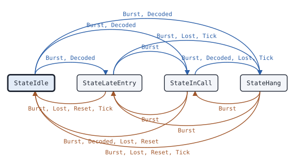

# voice Receiver

This page covers the voice Receiver, the state machine that turns the bursts of one logical channel into voice call events.

## What it does

A [Receiver](https://pkg.go.dev/github.com/USA-RedDragon/dmrgo/v2/voice#Receiver) takes the bursts of one DMR logical channel, one slot of one repeater or one network stream, and returns events: the start of a call and where its identity came from, each voice burst with its place in the superframe and the FEC result of each vocoder frame, embedded LC data such as GPS and talker alias, and the end of the call with its reason. It gets the call from the Voice LC Header, or on late entry from the embedded LC of bursts B to E. It places each voice burst in the superframe from the best evidence it has: the transport position, the voice SYNC of burst A, the transport sequence number, the EMB, and last the time since the burst before. A burst without a SYNC that the transport does not mark as voice must pass a sync check, so noise does not start or extend a call. It does no I/O: each method takes the time now and appends events to a slice that the caller owns. (ETSI TS 102 361-1 clause 5.1.2 and Annex G, ETSI TS 102 361-2 clause 5.2)

## When to use it

Use a Receiver when you need the voice calls on a channel: a scanner or monitor, a hotspot or bridge that forwards calls, a recorder, or a transcoder that decodes the voice. Use one Receiver for each logical channel. A two-slot bit stream needs two. A network stream with jitter and reordering goes through a [Jitter](voice-jitter.md) first. To send a call again, feed the events to a [Transmitter](voice-transmitter.md) with Relay.

The Receiver does not check whether a call is for your radio. Filter on the call target yourself.

## Config

Pass a [ReceiverConfig](https://pkg.go.dev/github.com/USA-RedDragon/dmrgo/v2/voice#ReceiverConfig) to [NewReceiver](https://pkg.go.dev/github.com/USA-RedDragon/dmrgo/v2/voice#NewReceiver). A nil config gives the defaults. Set the color code when the source carries more than one color code, or when you want the Receiver to drop bursts of other systems. Share one Scratch burst between Receivers that run on one goroutine to save memory.

<!-- dmrgo:config pkg=voice type=ReceiverConfig -->
| Field | Type | Default | Description |
|---|---|---|---|
| `ColorCode` | `*enums.ColorCode` | zero value | ColorCode, when set, drops bursts with another color code, except a voice burst of a call that the transport does not place whose EMB is within 5 bits of a codeword of ColorCode, which goes to the sync check of the package doc. Burst A carries no color code, so it does not start a late entry. Nil accepts every color code. |
| `Lost` | `time.Duration` | `DefaultLost` (1s) | Lost is the time without a burst after which a call ends with EndLost. 0 means DefaultLost, and a negative value turns the timer off. |
| `Hang` | `time.Duration` | `constants.TCallHang` (3s) | Hang is the call hang time, in which a call to the same target continues the session. 0 means constants.TCallHang (3 s), and a negative value turns session tracking off. A broadcast call and a call to constants.AllMSID have no hang time (ETSI TS 102 361-2 clause 5.3.2.3.2). |
| `Scratch` | `*layer2.Burst` | `layer2.NewBurst()` | Scratch, when set, is the Burst that Burst decodes into. Receivers that run on one goroutine can share one, because a Receiver is done with it when its method returns. Make it with layer2.NewBurst, so that no decode allocates. Nil means the Receiver makes its own. |
<!-- /dmrgo:config -->

## States and transitions

[State](https://pkg.go.dev/github.com/USA-RedDragon/dmrgo/v2/voice#Receiver.State) returns the current state.

<!-- dmrgo:states pkg=voice type=State -->
States of [`Receiver`](https://pkg.go.dev/github.com/USA-RedDragon/dmrgo/v2/voice#Receiver), from [`Receiver.State`](https://pkg.go.dev/github.com/USA-RedDragon/dmrgo/v2/voice#Receiver.State):

| State | Meaning | Seen in tests |
|---|---|---|
| [`StateIdle`](https://pkg.go.dev/github.com/USA-RedDragon/dmrgo/v2/voice#StateIdle) | StateIdle has no call and no session. | yes, first state |
| [`StateLateEntry`](https://pkg.go.dev/github.com/USA-RedDragon/dmrgo/v2/voice#StateLateEntry) | StateLateEntry has voice whose LC is not known yet. | yes |
| [`StateInCall`](https://pkg.go.dev/github.com/USA-RedDragon/dmrgo/v2/voice#StateInCall) | StateInCall has a call. | yes |
| [`StateHang`](https://pkg.go.dev/github.com/USA-RedDragon/dmrgo/v2/voice#StateHang) | StateHang is the call hang time after a call, in which a new call to the same target continues the session. | yes |

Transitions seen in tests:

| From | Method call | To |
|---|---|---|
| StateIdle | `Burst`, `Decoded` | StateLateEntry |
| StateIdle | `Burst`, `Decoded` | StateInCall |
| StateIdle | `Burst`, `Decoded` | StateHang |
| StateLateEntry | `Burst`, `Lost`, `Reset`, `Tick` | StateIdle |
| StateLateEntry | `Burst` | StateInCall |
| StateLateEntry | `Burst`, `Lost`, `Tick` | StateHang |
| StateInCall | `Burst`, `Decoded`, `Lost`, `Reset` | StateIdle |
| StateInCall | `Burst` | StateLateEntry |
| StateInCall | `Burst`, `Decoded`, `Lost`, `Tick` | StateHang |
| StateHang | `Burst`, `Lost`, `Reset`, `Tick` | StateIdle |
| StateHang | `Burst` | StateLateEntry |
| StateHang | `Burst` | StateInCall |


<!-- /dmrgo:states -->

The Receiver starts with no call. A Voice LC Header, or a call that [Expect](https://pkg.go.dev/github.com/USA-RedDragon/dmrgo/v2/voice#Receiver.Expect) gave, starts a call at once. Voice without a known LC moves the Receiver to late entry, and the first embedded LC that decodes starts the call. The call ends on a Terminator with LC, a data or idle burst, a transport end flag, the loss of the signal, the sync check, or a time without bursts. After a call to an individual radio or a talkgroup, the Receiver holds the call hang time. A new call to the same target in that time continues the session; the end of the hang time ends the session. A broadcast call and a call to all radios have no hang time, so the Receiver goes straight back to no call. (ETSI TS 102 361-2 clause 5.3.2.3.2)

## Inputs and outputs

Inputs:

- [Burst](https://pkg.go.dev/github.com/USA-RedDragon/dmrgo/v2/voice#Receiver.Burst) takes a raw burst and a [layer2.Hint](https://pkg.go.dev/github.com/USA-RedDragon/dmrgo/v2/layer2#Hint) from the transport, decodes the burst, and runs it. A nil burst applies only the Hint, so a transport frame that reports a lost signal still ends the call.
- [Decoded](https://pkg.go.dev/github.com/USA-RedDragon/dmrgo/v2/voice#Receiver.Decoded) takes a burst that you decoded already. Use it when one burst goes to several machines, so it is decoded once.
- [Lost](https://pkg.go.dev/github.com/USA-RedDragon/dmrgo/v2/voice#Receiver.Lost) reports a transport loss of signal without a burst, such as MMDVM TAG_LOST.
- [Tick](https://pkg.go.dev/github.com/USA-RedDragon/dmrgo/v2/voice#Receiver.Tick) runs the timers. Call it at the time [Deadline](https://pkg.go.dev/github.com/USA-RedDragon/dmrgo/v2/voice#Receiver.Deadline) returns.
- [Expect](https://pkg.go.dev/github.com/USA-RedDragon/dmrgo/v2/voice#Receiver.Expect) gives the call of voice that comes without an LC, such as after a trunked grant.
- [Reset](https://pkg.go.dev/github.com/USA-RedDragon/dmrgo/v2/voice#Receiver.Reset) drops the call and the session without events.

Outputs are [Event](https://pkg.go.dev/github.com/USA-RedDragon/dmrgo/v2/voice#Event) values, appended to the slice you pass. The [EventKind](https://pkg.go.dev/github.com/USA-RedDragon/dmrgo/v2/voice#EventKind) gives the kind. Each event carries the [Call](https://pkg.go.dev/github.com/USA-RedDragon/dmrgo/v2/voice#Call), whose [Origin](https://pkg.go.dev/github.com/USA-RedDragon/dmrgo/v2/voice#Origin) gives where the identity came from. A voice event carries the burst, its position, the [FrameQuality](https://pkg.go.dev/github.com/USA-RedDragon/dmrgo/v2/voice#FrameQuality) of each vocoder slot, and the number of bursts lost before it. The call end carries the [EndReason](https://pkg.go.dev/github.com/USA-RedDragon/dmrgo/v2/voice#EndReason) and the [Stats](https://pkg.go.dev/github.com/USA-RedDragon/dmrgo/v2/voice#Stats) of the call.

Give each method a slice with capacity <!-- dmrgo:const pkg=voice name=MaxEvents -->`16`<!-- /dmrgo:const -->. Such a slice never grows, and after NewReceiver no method allocates.

## Timers

The Receiver has two timers. Both run on the clock of the now values that you pass.

- Lost: the time without a burst after which a call ends. The default is <!-- dmrgo:const pkg=voice name=DefaultLost -->`1s`<!-- /dmrgo:const -->. ReceiverConfig.Lost changes it, and a negative value turns it off.
- Hang: the call hang time after a call. The default is <!-- dmrgo:const pkg=constants name=TCallHang -->`3s`<!-- /dmrgo:const -->. ReceiverConfig.Hang changes it, and a negative value turns session tracking off. (ETSI TS 102 361-2 clause 5.3.2.3.2)

The sync check also holds a doubtful burst for a short time while it waits for more evidence. The package doc of [voice](https://pkg.go.dev/github.com/USA-RedDragon/dmrgo/v2/voice) gives the limits. Tick drops held bursts that wait too long.

Call Tick when Deadline is due. A Tick before Deadline does nothing, so a caller that ticks on a fixed period also works.

## Worked example

This example reads a recorded call from a file of 33-byte bursts, 60 ms apart, and prints the call start, the call end and the end of the session.

<!-- dmrgo:code file=v2/voice/example_test.go symbol=ExampleReceiver -->
```go
func ExampleReceiver() {
	data, err := os.ReadFile("../layer2/testdata/parrot_kerchunk.bin")
	if err != nil {
		fmt.Println(err)
		return
	}
	rx, err := voice.NewReceiver(nil)
	if err != nil {
		fmt.Println(err)
		return
	}
	events := make([]voice.Event, 0, voice.MaxEvents)
	var now time.Duration
	voiceBursts := 0
	for off := 0; off+33 <= len(data); off += 33 {
		raw := layer2.RawBurst(data[off : off+33])
		now += 60 * time.Millisecond
		events = rx.Burst(now, &raw, layer2.Hint{}, events[:0])
		for _, e := range events {
			switch e.Kind {
			case voice.EventCallStart:
				fmt.Printf("call from %d to %d (%v)\n", e.Call.Source, e.Call.Target, e.Call.Origin)
			case voice.EventVoice:
				voiceBursts++
			case voice.EventCallEnd:
				fmt.Printf("end: %v after %v, %d voice bursts\n", e.Reason, e.Stats.Duration, voiceBursts)
			default:
			}
		}
	}
	if at, ok := rx.Deadline(); ok {
		for _, e := range rx.Tick(at, events[:0]) {
			fmt.Println(e.Kind, "at", at)
		}
	}
}
```
<!-- /dmrgo:code -->

Output:

<!-- dmrgo:output test=voice.ExampleReceiver -->
```text
call from 3191868 to 9990 (Header)
end: Terminator after 840ms, 13 voice bursts
SessionEnd at 3.9s
```
<!-- /dmrgo:output -->

The session ends one hang time after the terminator, at the time that Deadline returned.

A monitor that feeds one burst to the voice Receiver, the data Receiver and the CSBK Preambles machine decodes the burst once and calls Decoded on each:

<!-- dmrgo:output test=voice.ExampleReceiver_Decoded -->
```text
voice: call from 3191868 to 9990
voice: end, Terminator
```
<!-- /dmrgo:output -->

## Errors

The event methods return no errors. A burst that does not decode, or has another color code, is dropped, and its Hint still applies. NewReceiver returns a configuration error for a field out of range.

<!-- dmrgo:errors pkg=voice type=Receiver -->
The doc comments of [`Receiver`](https://pkg.go.dev/github.com/USA-RedDragon/dmrgo/v2/voice#Receiver) and its methods name no error.
<!-- /dmrgo:errors -->

## Related machines and guides

Machines:

- [voice Jitter](voice-jitter.md): put a network stream in order before the Receiver.
- [voice Transmitter](voice-transmitter.md): send the received call again with Relay.
- [voice Interrupter](voice-interrupter.md): interrupt the call that the Receiver follows.
- [trunk Follower](trunk-follower.md): follow a trunked system and get the grants that Expect takes.
- data Receiver and csbk Preambles (docs/machines/data-receiver.md and docs/machines/csbk-preambles.md): the other machines of one channel.
- bs Repeater (docs/machines/bs-repeater.md): a repeater that uses a Receiver for each slot.

Guides:

- Follow calls on both slots of a bit stream
- Rewrite and relay a voice call
- Transcode voice: AMBE+2 FEC, Codec2, DVSI
- Receive with an SDR or an FM radio
