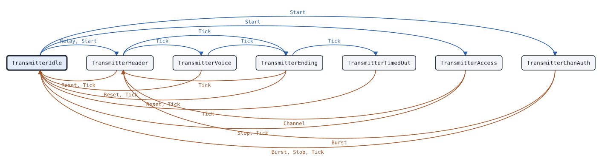

# voice Transmitter

This page covers the voice Transmitter, the state machine that makes the bursts of one voice call on one logical channel.

## What it does

A [Transmitter](https://pkg.go.dev/github.com/USA-RedDragon/dmrgo/v2/voice#Transmitter) makes the bursts of one voice transmission, one burst per Tick, 60 ms apart. It works in two modes. In source mode, [Start](https://pkg.go.dev/github.com/USA-RedDragon/dmrgo/v2/voice#Transmitter.Start) begins a call and you queue its vocoder frames. In relay mode, [Relay](https://pkg.go.dev/github.com/USA-RedDragon/dmrgo/v2/voice#Transmitter.Relay) takes the events of a [Receiver](voice-receiver.md) and sends the call again with the local color code and SYNC. A call has Voice LC Headers, an optional PI Header, superframes of voice bursts A to F with the embedded LC, and Terminators with LC. A source call follows the channel access policy: a polite call waits for an idle channel. A call that starts in the hang time of a repeater can first send the channel authorization and wait for the repeater to repeat it. A Tier 2 reverse channel cease command ends the call. The transmit timeout ends a call that runs too long. (ETSI TS 102 361-1 clause 5.2, ETSI TS 102 361-2 clauses 5.1.1.6, 6.1 and 6.3)

## When to use it

Use a Transmitter when you send voice: a radio or a hotspot that keys up with frames from a vocoder, a bridge or repeater that sends a received call again, or a test tool that makes reference bursts. Use one Transmitter for each logical channel. To regenerate a call that a Receiver decoded, use Relay: the Transmitter corrects the AMBE+2 FEC, fills lost bursts, and sends the embedded LC again.

## Config

Pass a [TransmitterConfig](https://pkg.go.dev/github.com/USA-RedDragon/dmrgo/v2/voice#TransmitterConfig) to [NewTransmitter](https://pkg.go.dev/github.com/USA-RedDragon/dmrgo/v2/voice#NewTransmitter). The Slot must be set, so a nil config returns an error. Set Source to the SYNC source of your side: a repeater outbound or a radio. A radio that transmits on air sets Access, and ChanAuth when it starts calls in hang time. A sender that fills an RF FIFO ahead of air time sets Lead.

<!-- dmrgo:config pkg=voice type=TransmitterConfig -->
| Field | Type | Default | Description |
|---|---|---|---|
| `ColorCode` | `enums.ColorCode` | zero value | ColorCode is the color code of the slot types and EMBs. |
| `Slot` | `enums.Slot` | zero value | Slot is the TDMA slot of the machine, which it puts in the Hint of each burst it sends. It must be Slot1 or Slot2. |
| `Source` | `layer2.SyncSource` | zero value | Source selects the SYNC patterns: layer2.SyncSourceBS, the zero value, for a repeater outbound, layer2.SyncSourceMS for a radio. |
| `Silence` | `[9]byte` | zero value | Silence is the 72-bit slot that fills a burst when no voice is queued, and pads the last superframe, packed as layer2.RawBurst.VoiceSlots returns it. The zero value means vocoder.AMBESilenceSlot(). A Codec2 caller sets its own. A relayed call with a FID other than enums.FIDStandardized and enums.FIDMotorola, such as a Codec2 call, repeats its last vocoder slot in place of Silence once it has one, as MMDVMHost does, because the silence of one codec is noise to another. |
| `Headers` | `int` | `1` | Headers is the number of Voice LC Headers before burst A. 0 means 1, as ETSI TS 102 361-1 clause 5.1.2.2 gives; at most MaxHeaders. MMDVMHost sends 3 as a duplex repeater. Transmitter.Relay sends one header for a call that the Receiver joined late, one whose Call.Origin is not OriginHeader, so that its voice is not held back. |
| `Terminators` | `int` | `1` | Terminators is the number of Terminators with LC at the end of a call. 0 means 1; at most MaxTerminators. |
| `Timeout` | `time.Duration` | `constants.TTO` (3m0s) | Timeout is the transmit timeout T_TO. 0 means constants.TTO (180 s), and a negative value turns it off (ETSI TS 102 361-2 clause 6.1). |
| `Queue` | `int` | `layer2.VoiceSlotsPerBurst * (max(t.headers, 1) + 2)` | Queue is the number of vocoder slots buffered. 0 means Headers+2 bursts, DefaultQueue for 0 or 1 Headers; at most MaxQueue. It must hold Headers+1 bursts. |
| `Lead` | `time.Duration` | not machine-readable; see the description | Lead makes Tick emit a burst this long before its Due time, so that an RF FIFO can be filled ahead. 0 means at Due; it must not be negative. |
| `Access` | `enums.Access` | zero value | Access is the channel access policy of Start. A polite call waits up to IdleSearch for Channel to report an idle channel and ends with EndDenied when it does not; an impolite call starts at once. Relay ignores it. The zero value is polite to own color code. (ETSI TS 102 361-1 clauses 5.2.1.6 and 5.2.2) |
| `IdleSearch` | `time.Duration` | `DefaultIdleSearch` (540ms) | IdleSearch is T_IdleSrch, the wait for an idle channel before a polite call. 0 means DefaultIdleSearch, and a negative value denies the call at once. (ETSI TS 102 361-1 clause 5.2.2.2.5) |
| `Interruptible` | `bool` | zero value | Interruptible makes Interrupt end the call on a Cease Transmission Request. A Cease Transmission Command ends it whatever this field holds. (ETSI TS 102 361-2 clauses 6.3.3 and 6.3.4) |
| `ChanAuth` | `time.Duration` | not machine-readable; see the description | ChanAuth is T_MS_ChanAuth, the wait for the BS to repeat the ChanAuth PDU of a call that starts in hang time, CallOptions.HangTime. 0 means no channel authorization; constants.TMSChanAuth and constants.TMSChanAuthMultiSite are the recommended values. (ETSI TS 102 361-2 clause 5.1.1.6.2) |
| `HoldoffMax` | `time.Duration` | `DefaultHoldoffMax` (1s) | HoldoffMax is the upper end of the random holdoff before a new channel authorization try. 0 means DefaultHoldoffMax, and a negative value means no holdoff. (ETSI TS 102 361-2 clause 5.1.1.6.2) |
| `Seed` | `uint64` | zero value | Seed seeds the generator of the random holdoff, so that the same inputs give the same outputs. (ETSI TS 102 361-2 clause 5.1.1.6.2) |
| `Scratch` | `*layer2.Burst` | not machine-readable; see the description | Scratch, when set, is the Burst that Burst decodes into. Machines that run on one goroutine can share one. Nil means the Transmitter makes its own when ChanAuth is set. (ETSI TS 102 361-2 clause 5.1.1.6.2) |
<!-- /dmrgo:config -->

Each call can also take [CallOptions](https://pkg.go.dev/github.com/USA-RedDragon/dmrgo/v2/voice#CallOptions) in Start: a PI Header, a talker alias, GPS, and the flags for a call in progress or in hang time.

## States and transitions

[State](https://pkg.go.dev/github.com/USA-RedDragon/dmrgo/v2/voice#Transmitter.State) returns the current state.

<!-- dmrgo:states pkg=voice type=TransmitterState -->
States of [`Transmitter`](https://pkg.go.dev/github.com/USA-RedDragon/dmrgo/v2/voice#Transmitter), from [`Transmitter.State`](https://pkg.go.dev/github.com/USA-RedDragon/dmrgo/v2/voice#Transmitter.State):

| State | Meaning | Seen in tests |
|---|---|---|
| [`TransmitterIdle`](https://pkg.go.dev/github.com/USA-RedDragon/dmrgo/v2/voice#TransmitterIdle) | TransmitterIdle sends nothing. | yes, first state |
| [`TransmitterHeader`](https://pkg.go.dev/github.com/USA-RedDragon/dmrgo/v2/voice#TransmitterHeader) | TransmitterHeader sends the Voice LC Headers and the PI Header. | yes |
| [`TransmitterVoice`](https://pkg.go.dev/github.com/USA-RedDragon/dmrgo/v2/voice#TransmitterVoice) | TransmitterVoice sends voice bursts. | yes |
| [`TransmitterEnding`](https://pkg.go.dev/github.com/USA-RedDragon/dmrgo/v2/voice#TransmitterEnding) | TransmitterEnding pads the last superframe and sends the terminators. | yes |
| [`TransmitterTimedOut`](https://pkg.go.dev/github.com/USA-RedDragon/dmrgo/v2/voice#TransmitterTimedOut) | TransmitterTimedOut has ended the call after T_TO and waits for Stop, the release of the PTT (ETSI TS 102 361-2 clause 6.1). | yes |
| [`TransmitterAccess`](https://pkg.go.dev/github.com/USA-RedDragon/dmrgo/v2/voice#TransmitterAccess) | TransmitterAccess waits for Channel to report an idle channel before a polite call (ETSI TS 102 361-1 clause 5.2.2). | yes |
| [`TransmitterChanAuth`](https://pkg.go.dev/github.com/USA-RedDragon/dmrgo/v2/voice#TransmitterChanAuth) | TransmitterChanAuth sends the ChanAuth PDU of a call in hang time and waits T_MS_ChanAuth for the BS to repeat it (ETSI TS 102 361-2 clause 5.1.1.6.2). | yes |

Transitions seen in tests:

| From | Method call | To |
|---|---|---|
| TransmitterIdle | `Relay`, `Start` | TransmitterHeader |
| TransmitterIdle | `Start` | TransmitterAccess |
| TransmitterIdle | `Start` | TransmitterChanAuth |
| TransmitterHeader | `Reset`, `Tick` | TransmitterIdle |
| TransmitterHeader | `Tick` | TransmitterVoice |
| TransmitterHeader | `Tick` | TransmitterEnding |
| TransmitterVoice | `Reset`, `Tick` | TransmitterIdle |
| TransmitterVoice | `Tick` | TransmitterEnding |
| TransmitterEnding | `Reset`, `Tick` | TransmitterIdle |
| TransmitterEnding | `Tick` | TransmitterHeader |
| TransmitterEnding | `Tick` | TransmitterTimedOut |
| TransmitterTimedOut | `Tick` | TransmitterIdle |
| TransmitterAccess | `Stop`, `Tick` | TransmitterIdle |
| TransmitterAccess | `Channel` | TransmitterHeader |
| TransmitterChanAuth | `Burst`, `Stop`, `Tick` | TransmitterIdle |
| TransmitterChanAuth | `Burst` | TransmitterHeader |


<!-- /dmrgo:states -->

Start moves an idle Transmitter to the headers. A polite call on a busy channel first waits for [Channel](https://pkg.go.dev/github.com/USA-RedDragon/dmrgo/v2/voice#Transmitter.Channel) to report an idle channel; when the idle search time runs out, the call ends as denied. A call with CallOptions.HangTime and a ChanAuth time first sends the channel authorization. The repeater then repeats it, or a Voice LC Header with another source denies the call, or no outbound burst comes and the call ends so that you can wake the repeater and start again. After the headers the Transmitter sends voice. [Stop](https://pkg.go.dev/github.com/USA-RedDragon/dmrgo/v2/voice#Transmitter.Stop) sends the queued voice, pads the superframe to burst F with silence, and sends the terminators. After the transmit timeout the Transmitter sends the terminators and then waits for Stop, the release of the PTT. (ETSI TS 102 361-1 clause 5.2.2, ETSI TS 102 361-2 clauses 5.1.1.6.2 and 6.1)

## Inputs and outputs

Inputs in source mode:

- [Start](https://pkg.go.dev/github.com/USA-RedDragon/dmrgo/v2/voice#Transmitter.Start) begins a call with a [Call](https://pkg.go.dev/github.com/USA-RedDragon/dmrgo/v2/voice#Call) and optional CallOptions.
- [Frame](https://pkg.go.dev/github.com/USA-RedDragon/dmrgo/v2/voice#Transmitter.Frame) and [Frames](https://pkg.go.dev/github.com/USA-RedDragon/dmrgo/v2/voice#Transmitter.Frames) queue AMBE+2 frames. [VocoderSlot](https://pkg.go.dev/github.com/USA-RedDragon/dmrgo/v2/voice#Transmitter.VocoderSlot) and [VocoderSlots](https://pkg.go.dev/github.com/USA-RedDragon/dmrgo/v2/voice#Transmitter.VocoderSlots) queue 72-bit slots of any codec. [Room](https://pkg.go.dev/github.com/USA-RedDragon/dmrgo/v2/voice#Transmitter.Room) returns the free space in the queue.
- [Stop](https://pkg.go.dev/github.com/USA-RedDragon/dmrgo/v2/voice#Transmitter.Stop) ends the call.
- [Channel](https://pkg.go.dev/github.com/USA-RedDragon/dmrgo/v2/voice#Transmitter.Channel) reports whether the channel is busy, for polite access.
- [Burst](https://pkg.go.dev/github.com/USA-RedDragon/dmrgo/v2/voice#Transmitter.Burst), [Decoded](https://pkg.go.dev/github.com/USA-RedDragon/dmrgo/v2/voice#Transmitter.Decoded) and [Lost](https://pkg.go.dev/github.com/USA-RedDragon/dmrgo/v2/voice#Transmitter.Lost) take the outbound bursts of the repeater during the channel authorization.
- [ReverseChannel](https://pkg.go.dev/github.com/USA-RedDragon/dmrgo/v2/voice#Transmitter.ReverseChannel) takes a Tier 2 RC command from the reverse channel and returns whether it ends the call.

Input in relay mode:

- [Relay](https://pkg.go.dev/github.com/USA-RedDragon/dmrgo/v2/voice#Transmitter.Relay) takes each [Event](https://pkg.go.dev/github.com/USA-RedDragon/dmrgo/v2/voice#Event) of a Receiver. [Dropped](https://pkg.go.dev/github.com/USA-RedDragon/dmrgo/v2/voice#Transmitter.Dropped) returns the relayed voice bursts that did not fit.

Both modes:

- [Tick](https://pkg.go.dev/github.com/USA-RedDragon/dmrgo/v2/voice#Transmitter.Tick) appends the next [Output](https://pkg.go.dev/github.com/USA-RedDragon/dmrgo/v2/voice#Output). Call it at the time [Deadline](https://pkg.go.dev/github.com/USA-RedDragon/dmrgo/v2/voice#Transmitter.Deadline) returns. A late caller calls Tick until Deadline is in the future, because each Tick returns at most one burst.
- [Reset](https://pkg.go.dev/github.com/USA-RedDragon/dmrgo/v2/voice#Transmitter.Reset) ends the transmission without an output.

Each Output has an [OutputKind](https://pkg.go.dev/github.com/USA-RedDragon/dmrgo/v2/voice#OutputKind): a burst to send, with its Due time on air and a [layer2.Hint](https://pkg.go.dev/github.com/USA-RedDragon/dmrgo/v2/layer2#Hint) for the transport, or the end of the transmission with its [EndReason](https://pkg.go.dev/github.com/USA-RedDragon/dmrgo/v2/voice#EndReason). The end comes in the same Tick as the last terminator. Give each method a slice with capacity <!-- dmrgo:const pkg=voice name=MaxOutputs -->`2`<!-- /dmrgo:const --> so that it does not allocate.

## Timers

- Burst period: one burst every 60 ms from the Due time of the first burst.
- Transmit timeout T_TO: the default is <!-- dmrgo:const pkg=constants name=TTO -->`3m0s`<!-- /dmrgo:const -->. TransmitterConfig.Timeout changes it, and a negative value turns it off. (ETSI TS 102 361-2 clause 6.1)
- Idle search T_IdleSrch, the wait for an idle channel before a polite call: the default is <!-- dmrgo:const pkg=voice name=DefaultIdleSearch -->`540ms`<!-- /dmrgo:const -->. (ETSI TS 102 361-1 clause 5.2.2.2.5)
- Channel authorization T_MS_ChanAuth: off by default. The recommended values are <!-- dmrgo:const pkg=constants name=TMSChanAuth -->`180ms`<!-- /dmrgo:const --> and <!-- dmrgo:const pkg=constants name=TMSChanAuthMultiSite -->`360ms`<!-- /dmrgo:const --> for multi-site systems. (ETSI TS 102 361-2 clause 5.1.1.6.2)
- Random holdoff before a new channel authorization try: up to <!-- dmrgo:const pkg=voice name=DefaultHoldoffMax -->`1s`<!-- /dmrgo:const --> by default. TransmitterConfig.Seed seeds the generator, so the same inputs give the same outputs. (ETSI TS 102 361-2 clause 5.1.1.6.2)
- Lead: Tick returns each burst this long before its Due time.

## Worked example

This example sends a short call as its source. It queues two bursts of silence frames, stops at once, and ticks until the Transmitter has nothing more to send.

<!-- dmrgo:code file=v2/voice/example_test.go symbol=ExampleTransmitter -->
```go
func ExampleTransmitter() {
	tx, err := voice.NewTransmitter(&voice.TransmitterConfig{Slot: enums.Slot1, ColorCode: 1, Source: layer2.SyncSourceMS})
	if err != nil {
		fmt.Println(err)
		return
	}
	if err := tx.Start(0, voice.Call{Group: true, Target: 9, Source: 3120001}, nil); err != nil {
		fmt.Println(err)
		return
	}
	silence := vocoder.AMBESilenceSlot()
	if err := tx.VocoderSlots(silence, silence, silence, silence, silence, silence); err != nil {
		fmt.Println(err)
		return
	}
	tx.Stop(0)
	out := make([]voice.Output, 0, voice.MaxOutputs)
	for {
		at, ok := tx.Deadline()
		if !ok {
			break
		}
		for _, o := range tx.Tick(at, out[:0]) {
			switch {
			case o.Kind == voice.OutputEnded:
				fmt.Println(o.Due, o.Kind, o.Reason)
			case o.Hint.Kind == layer2.KindVoice:
				fmt.Println(o.Due, "voice", o.Hint.VoiceBurst, "fill", o.Fill)
			default:
				fmt.Println(o.Due, o.Hint.DataType)
			}
		}
	}
}
```
<!-- /dmrgo:code -->

Output:

<!-- dmrgo:output test=voice.ExampleTransmitter -->
```text
0s Voice LC Header
60ms voice A fill false
120ms voice B fill false
180ms voice C fill true
240ms voice D fill true
300ms voice E fill true
360ms voice F fill true
420ms Terminator With LC
420ms Ended Terminator
```
<!-- /dmrgo:output -->

The two queued bursts go out as voice. The rest of the superframe is silence, marked as fill, and the Terminator with LC follows.

The next example shows polite access. The call waits while the channel is busy and starts when it becomes idle. A second call is denied when the channel stays busy for the idle search time.

<!-- dmrgo:code file=v2/voice/access_example_test.go symbol=ExampleTransmitter_Channel -->
```go
func ExampleTransmitter_Channel() {
	tx, err := voice.NewTransmitter(&voice.TransmitterConfig{Slot: enums.Slot1, Silence: vocoder.AMBESilenceSlot(), Access: enums.AccessPoliteOwnCC})
	if err != nil {
		fmt.Println(err)
		return
	}
	tx.Channel(0, true)
	if err := tx.Start(0, voice.Call{Group: true, Target: 9, Source: 3120001}, nil); err != nil {
		fmt.Println(err)
		return
	}
	fmt.Println(tx.State())
	tx.Channel(200*time.Millisecond, false)
	tx.Stop(200 * time.Millisecond)
	out := make([]voice.Output, 0, voice.MaxOutputs)
	for {
		at, ok := tx.Deadline()
		if !ok {
			break
		}
		for _, o := range tx.Tick(at, out[:0]) {
			if o.Kind == voice.OutputEnded {
				fmt.Println(o.Kind, o.Reason, o.Due)
			}
		}
	}
	tx.Channel(time.Second, true)
	_ = tx.Start(time.Second, voice.Call{Group: true, Target: 9, Source: 3120001}, nil)
	at, _ := tx.Deadline()
	for _, o := range tx.Tick(at, out[:0]) {
		fmt.Println(o.Kind, o.Reason, o.Due)
	}
}
```
<!-- /dmrgo:code -->

<!-- dmrgo:output test=voice.ExampleTransmitter_Channel -->
```text
Access
Ended Terminator 260ms
Ended Denied 1.54s
```
<!-- /dmrgo:output -->

## Errors

Start and Relay return an error while a call runs, and a configuration error when the call does not make an LC. The queue methods return an error when the queue is full, when no call takes voice, and after the transmit timeout. NewTransmitter returns a configuration error for a field out of range. Match the errors with errors.Is or errors.As.

<!-- dmrgo:errors pkg=voice type=Transmitter -->
| Error | Returned by | Meaning |
|---|---|---|
| [`dmrgo.ConfigError`](https://pkg.go.dev/github.com/USA-RedDragon/dmrgo/v2#ConfigError) | `Transmitter.Start` | ConfigError is the error of a constructor, and of a machine method that takes a config, option or argument field, for a field with a value out of range. |
| [`dmrgo.ErrNilArgument`](https://pkg.go.dev/github.com/USA-RedDragon/dmrgo/v2#ErrNilArgument) | `Transmitter.Relay` | ErrNilArgument is returned by a function or method of the library that returns an error when a pointer, func or interface argument it needs is nil. |
| [`voice.ErrBusy`](https://pkg.go.dev/github.com/USA-RedDragon/dmrgo/v2/voice#ErrBusy) | `Transmitter.Relay`, `Transmitter.Start` | ErrBusy is returned by Start, and by Relay for an EventCallStart, while a transmission runs. |
| [`voice.ErrNotActive`](https://pkg.go.dev/github.com/USA-RedDragon/dmrgo/v2/voice#ErrNotActive) | `Transmitter.Frame` | ErrNotActive is returned for voice when no call takes it: before Start or after Stop. |
| [`voice.ErrQueueFull`](https://pkg.go.dev/github.com/USA-RedDragon/dmrgo/v2/voice#ErrQueueFull) | `Transmitter.Frame` | ErrQueueFull is returned when the queue of vocoder slots is full. |
| [`voice.ErrTimedOut`](https://pkg.go.dev/github.com/USA-RedDragon/dmrgo/v2/voice#ErrTimedOut) | `Transmitter.Frame` | ErrTimedOut is returned for voice after the transmit timeout T_TO, until Stop (ETSI TS 102 361-2 clause 6.1). |
<!-- /dmrgo:errors -->

## Related machines and guides

Machines:

- [voice Receiver](voice-receiver.md): the source of the events that Relay takes.
- [voice Interrupter](voice-interrupter.md): sends the RC command that ReverseChannel takes.
- [voice Jitter](voice-jitter.md): set its Lead to the Lead of the Transmitter that relays its packets.
- bs Repeater (docs/machines/bs-repeater.md): runs a Transmitter in relay mode for each slot.
- csbk Wakeup (docs/machines/csbk-wakeup.md): wakes a repeater after a call ends with no outbound bursts.

Guides:

- Rewrite and relay a voice call
- Transcode voice: AMBE+2 FEC, Codec2, DVSI
- Transmit within a region's limits
