# Receiver

<!-- rfparams:rx-intro:begin -->
Package rf recovers DMR bursts from the I/Q samples of a software radio and from the output of an FM discriminator: 4FSK detection, SYNC search and slot timing, soft-decision decoding of each FEC field, and the superframe position of voice bursts. It also turns bursts back into I/Q samples and into the deviation signal of an FM radio.
<!-- rfparams:rx-intro:end -->

[v2/cmd/dmrrf](../v2/cmd/dmrrf/README.md) decodes DMR from I/Q or discriminator audio in the file formats of common software radios, and writes test transmissions in the same formats.

## Features

<!-- rfparams:rx-features:begin -->
- `Receiver`: Receiver recovers DMR bursts from a stream of I/Q samples.
- `AudioReceiver`: AudioReceiver recovers DMR bursts from the output of an FM discriminator, as the radio chips of hotspots and MMDVM modems give it: real samples in any units, with any gain and DC offset, which the receiver measures itself.
- `Monitor`: Monitor follows the TDMA channels of the bursts of one Receiver or AudioReceiver, as a scanner does.
- Tiers:
  - `TierDefault`: TierDefault is the zero value: Tier1 for NewReceiver and NewAudioReceiver, and Tier0 for Init and for the constructors under TinyGo.
  - `Tier0`: Tier0 slices the output of an FM discriminator and its matched filter.
  - `Tier1`: Tier1 adds to Tier0 the soft decoders: a BPTC(196,96) block whose check fails by ordered statistics, C0 and C1 of each voice frame by soft ML, the embedded LC of each superframe over its four fragments and the earlier superframes of the call, and LookbackSlots slots before the first lock decoded again.
  - `Tier2`: Tier2 adds to the soft decoders of Tier1 the detection again of the bursts with a trellis over three symbols that carries the carrier phase with each survivor, from the SYNC or EMB of the burst, within a compute budget per slot: on I/Q from the samples at 24 kHz, on audio from the carrier phase that it sums from the discriminator samples.
  - `Tier3`: Tier3 detects the bursts of Tier2 again by log-MAP over a window of three symbols with one of 52 carrier phases in the trellis state and no compute budget, and detects each voice burst once more with the bits that its FEC fixed.
- I/Q formats:
  - `IQFormatDefault`: IQFormatDefault is the zero value: IQFormatCS16.
  - `IQFormatCU8`: IQFormatCU8 is unsigned 8-bit, as rtl_sdr writes it.
  - `IQFormatCS8`: IQFormatCS8 is signed 8-bit, as hackrf_transfer writes it.
  - `IQFormatCS16`: IQFormatCS16 is signed 16-bit little-endian, as PlutoSDR, LimeSDR, USRP and the radio chips give it.
  - `IQFormatCF32`: IQFormatCF32 is little-endian float32, as GNU Radio gives it, with full scale at 1.
<!-- rfparams:rx-features:end -->

## Key specifications

<!-- rxbench:specs:begin -->
### Sensitivity

Eb/N0 in dB at which the tier recovers 90% of the frames exactly. C/N in 12.5 kHz is 1.1 dB lower. Lower is better.

| Tier | Voice | Rate 1/2 | Rate 3/4 | CSBK | Embedded LC |
|:---|---:|---:|---:|---:|---:|
| 4FSK floor | -1.0 | -3.1 | 0.1 | -4.0 | < -6.9 |
| Audio tier 0 | 9.6 | 6.3 | 8.2 | 6.2 | 9.3 |
| Audio tier 1 | 8.2 | 6.3 | 7.6 | 5.2 | 6.4 |
| Audio tier 2 | 4.9 | 4.3 | 6.1 | 3.6 | 4.4 |
| Audio tier 3 | 4.2 | 3.5 | 5.7 | 3.0 | 4.0 |
| Low-rate I/Q tier 0 | 10.3 | 6.3 | 8.2 | 6.2 | 9.6 |
| I/Q tier 0 | 9.3 | 5.3 | 7.6 | 5.2 | 9.0 |
| I/Q tier 1 | 8.0 | 5.3 | 6.7 | 3.7 | 4.9 |
| I/Q tier 2 | 4.8 | 4.3 | 5.4 | 3.2 | 3.9 |
| I/Q tier 3 | 2.5 | 1.8 | 4.8 | 1.2 | 2.2 |

### Operating characteristics

| Tier | Input | Rate (kHz) | Carrier offset (kHz) | Clock error (ppm) | Late entry, C/N 8 dB (ms) | Late entry, C/N 20 dB (ms) | CPU, C/N 6 dB (ms/s) | CPU, worst (ms/s) | RAM (KiB) |
|:---|:---|---:|---:|---:|---:|---:|---:|---:|---:|
| Audio tier 0 | FM audio | 9.6 | -4.5 to 4 | ±2,000 | 52 | 60 | 0.32 | 0.49 | 1.9 |
| Audio tier 1 | FM audio | 9.6 | -4.5 to 4 | ±2,000 | 52 | 45 | 0.96 | 3.0 | 53 |
| Audio tier 2 | FM audio | 9.6 | ±4.5 | ±2,000 | 52 | 45 | 7.4 | 12 | 316 |
| Audio tier 3 | FM audio | 9.6 | ±4.5 | ±2,000 | 47 | 45 | 54 | 133 | 912 |
| Low-rate I/Q tier 0 | I/Q | 9.6 | ±2 | ±2,000 | 52 | 59 | 0.42 | 0.48 | 2.1 |
| I/Q tier 0 | I/Q | 48 | ±6 | ±2,000 | 53 | 53 | 1.6 | 2.0 | 24 |
| I/Q tier 1 | I/Q | 48 | ±6 | ±2,000 | 48 | 44 | 2.1 | 4.4 | 168 |
| I/Q tier 2 | I/Q | 48 | ±6 | ±2,000 | 48 | 44 | 9.3 | 11 | 464 |
| I/Q tier 3 | I/Q | 48 | ±6 | ±2,000 | 47 | 44 | 103 | 131 | 2,131 |

- Carrier offset and clock error: the range with at least 90% of the voice frames at C/N 15.0 dB, over 8 noise draws. "At least" marks a range that reaches the ends of the grid.
- Late entry: median time from a random start in a call to the end of the first exact burst. A count gives the runs that found one within 1500 ms.
- CPU per second of signal on an AMD Ryzen 9 7950X 16-Core Processor, worst over C/N 0 to 40 dB. RAM is the state of the receiver. No tier allocates after it starts.

### Adjacent channel selectivity

| Tier | Wanted C/N (dB) | Channel below (dB) | Channel above (dB) |
|:---|---:|---:|---:|
| I/Q tier 0 | 11.0 | 88 | 88 |
| I/Q tier 1 | 11.0 | 104 | 102 |
| I/Q tier 2 | 7.0 | 104 | 100 |
| I/Q tier 3 | 7.0 | 86 | 86 |

- EN 300 113 V2.2.1 clause 8.6: an A-M3 signal (FM, 400 Hz tone, 1.5 kHz deviation) 12.5 kHz above or below the wanted signal, which sits 3 dB above the sensitivity limit. The value is the highest A-M3 level over the wanted signal, in steps of 2 dB, at which the bit error rate over 4 noise draws stays at or under 0.01. The standard asks for 60 dB.

### Tier 0 on a Cortex-M4F

| Tier | Rate (kHz) | CPU (MHz) | RAM with stack (B) | Flash (KB) |
|:---|---:|---:|---:|---:|
| Audio tier 0 | 9.6 | 6.6 | 2,636 | 55.2 |
| Audio tier 0, `PreEmphasis` | 9.6 | 7.1 | 2,692 | 55.3 |
| Low-rate I/Q tier 0 | 9.6 | 8.3 | 3,008 | 55.2 |
| I/Q tier 0 | 48 | 110.5 | 36,640 | 340.6 |

Built with TinyGo 0.44.0 `-opt z -gc=none` and run in QEMU (`mps2-an386`, Cortex-M4F) by `cmd/mcubench`. CPU is the most, over the test signals, of the cycles that the receiver takes per second of signal. RAM is the static data of the program less the bench, with the most stack. Flash is the code and constant data of the whole program. The I/Q row at 48 kHz is the receiver of `NewReceiver`, built with `-gc=leaking`, and its RAM also holds the heap that `NewReceiver` takes; the receiver allocates nothing after it starts, and its bursts match those of the Go compiler with `Burst.Seconds` to the microsecond.

### Higher tiers on a Cortex-M7

| Tier | Rate (kHz) | CPU (MHz) | RAM with heap and stack (B) | Flash (KB) |
|:---|---:|---:|---:|---:|
| Audio tier 1 | 9.6 | 62.0 | 57,328 | 280.7 |
| Audio tier 2 | 9.6 | 657.4 | 344,432 | 280.7 |

Built with TinyGo 0.44.0 `-opt z -gc=leaking` for a Cortex-M7 with an FPv5-D16 FPU and run in QEMU (`mps2-an500`) by `cmd/mcubench`. The receiver is the one of `NewAudioReceiver`, and each run gives the bursts of the receiver of the Go compiler, with `Burst.Seconds` to the microsecond, as the math package of TinyGo differs from the assembly of gc in the last bit of some results. CPU is the most, over the test signals, of the cycles that the receiver takes per second of signal, by the cycle model of the Cortex-M4F rows. RAM is the static data of the program less the bench, the heap that `NewAudioReceiver` takes, and the most stack. The receiver allocates nothing after it starts. Flash is the code and constant data of the whole program.

<!-- rxbench:specs:end -->

## Absolute limits and operating conditions

<!-- rfparams:rx-limits:begin -->
| Field | Rule |
|-------|------|
| `RxConfig.Tier` | Tier selects the detection. The zero value TierDefault is Tier1 for NewReceiver, and Tier0 for Init and for NewReceiver under TinyGo. Under TinyGo too, NewReceiver takes every tier. |
| `RxConfig.Rate` | Rate is the sample rate of the I/Q, in Hz. 0 means 2400000. Tier0 to Tier3 take a Rate from 48000 to 1e9, and Tier0 and Tier1 also one from 24000, which runs their receiver with a complex front end in place of the FM discriminator, with about 2 KB of state for Tier0. Tier0 also takes 9600 and 12000, for I/Q that a radio chip filtered to the channel, with about 1.4 KB of state; Init sets up only these. |
| `RxConfig.Format` | Format is the layout of the I/Q samples. 0 means IQFormatCS16. |
| `RxConfig.OffsetHz` | OffsetHz is the frequency of the carrier relative to the center of the I/Q, in Hz, when the oscillator of the radio is known to be off, as for an RTL-SDR without ppm correction (rtl_fm -p): the offset that OffsetHz of a Receiver reported for that radio. The receiver tunes there before it searches 6.25 kHz around it for the carrier. It must be under 24000 in size, or under Rate/2 for a Rate under 48000. 0 means a centered carrier. |
| `RxConfig.OnBursts` | OnBursts, when not nil, selects stream mode: Write and Flush hand the bursts to it. Each call carries the bursts that are ready at the same point of the stream, in storage of the receiver that is valid only during the call: usually one, and after a late lock the LookbackSlots bursts decoded again. A slot comes out at most once: the replay after a relock skips each slot that an earlier lock already gave. When nil, the receiver is in append mode, for AppendBursts and AppendFlush. |
| `RxConfig.LookbackSlots` | LookbackSlots is the number of 30 ms slots before the first SYNC it locks to that the receiver keeps and decodes: 0 means 4 for Tier1, 8 for Tier2, and 16 for Tier3, and at most MaxLookbackSlots. Tier0 keeps none, and loses the start of a stream that it enters late. |
| `RxConfig.OnShortLC` | OnShortLC, when not nil, receives each Short LC that the CACH of the bursts carries and that passes its CRC-8, in stream and in append mode, in storage of the receiver that is valid only during the call: usually one. The receiver calls it as it outputs the burst of the last fragment, before that burst reaches OnBursts or the slice of AppendBursts. It decodes the fragments of the Decoded CACH as layer2.ShortLCAssembler does, and from Tier1 up decodes those that fail again from their soft values. Tier0 gives the hard decode only. Init takes no OnShortLC and returns a *dmrgo.ConfigError for it. |
| `AudioRxConfig.Tier` | Tier is Tier0, Tier1, Tier2 or Tier3. The zero value TierDefault is Tier1 for NewAudioReceiver, Tier0 for it under TinyGo, and Tier0 for Init, which does not allocate the stages of the higher tiers. Under TinyGo too, NewAudioReceiver takes every tier and allocates its stages once, and a program that calls only Init links none of them. Tier2 detects the bursts again coherently, on the carrier phase that it rebuilds from the samples, at about 5 times the CPU time of Tier1. Tier3 detects the bursts of Tier2 again over 52 carrier phases with no compute budget and makes four passes over each data burst, at about 10 times the CPU time of Tier2, 935 KB and the delay of Tier2. |
| `AudioRxConfig.Rate` | Rate is the sample rate of the discriminator samples, in Hz, from 8000 to 1000000, and for Tier0 to 48000. 0 means 48000. The receiver runs at 48000, as sound cards sample, 24000, as MMDVM modems sample, 12000 or 9600: at Rate when it is one of them, else at the lowest of them at or above Rate, or 48000 above 48000, through a resampler. Tier0 resamples in fixed point with a table in flash. A lower rate costs less: the receiver halves 48 kHz and then 24 kHz with a half-band filter before its matched filter, which runs at 12 kHz or 9.6 kHz. |
| `AudioRxConfig.Bits` | Bits is the resolution of the converter, from 8 to 16. 0 means 16. Each sample holds one code of Bits bits in its low bits. |
| `AudioRxConfig.Unsigned` | Unsigned selects offset binary codes, from 0 to 1<<Bits-1, in place of two's complement codes. |
| `AudioRxConfig.OnBursts` | OnBursts, when not nil, selects stream mode: Write and Flush hand the bursts to it. Each call carries the bursts that are ready at the same point of the stream, in storage of the receiver that is valid only during the call: usually one, and after a late lock the bursts of the slots before the lock, decoded again. A slot comes out at most once: the replay after a relock skips each slot that an earlier lock already gave. When nil, the receiver is in append mode, for AppendBursts and AppendFlush. |
| `AudioRxConfig.PreEmphasis` | PreEmphasis, when not nil, states that the radio de-emphasizes its discriminator output from 300 Hz to 3 kHz, as the speaker and accessory outputs of FM radios do, so that the receiver inverts it with the filter that it holds before it detects the bursts: a RxPreEmphasis of this receiver alone, set up by Init or NewRxPreEmphasis. Nil is a flat discriminator output, as the radio chips of hotspots and MMDVM modems give it. Every Tier and Rate takes it. A RxPreEmphasis that is not set up gives a *dmrgo.ConfigError. |
| `AudioRxConfig.OnShortLC` | OnShortLC, when not nil, receives each Short LC that the CACH of the bursts carries and that passes its CRC-8, in stream and in append mode, in storage of the receiver that is valid only during the call: usually one. The receiver calls it as it outputs the burst of the last fragment, before that burst reaches OnBursts or the slice of AppendBursts. It decodes the fragments of the Decoded CACH as layer2.ShortLCAssembler does, and from Tier1 up decodes those that fail again from their soft values. Tier0 gives the hard decode only. Init takes no OnShortLC and returns a *dmrgo.ConfigError for it. |

Probes of the constructors: `AudioRxConfig.Bits` from 8 to 16 is accepted, and `RxConfig.OffsetHz` up to 24 kHz in size at a `Rate` of 48 kHz. A field out of range gets a `*dmrgo.ConfigError` with one of these values of `Field`: `AudioRxConfig.Bits`, `AudioRxConfig.OnBursts`, `AudioRxConfig.OnShortLC`, `AudioRxConfig.PreEmphasis`, `AudioRxConfig.Rate`, `AudioRxConfig.Tier`, `RxConfig.Format`, `RxConfig.LookbackSlots`, `RxConfig.OffsetHz`, `RxConfig.OnBursts`, `RxConfig.OnShortLC`, `RxConfig.Rate`, `RxConfig.Tier`.
<!-- rfparams:rx-limits:end -->

### Sample rates

<!-- rxbench:limits:begin -->
| Tier | I/Q rate (kHz) | Audio rate (kHz) |
|:---|---:|---:|
| Tier 0 | 9.6, 12, 24 to 1,000,000 | 8 to 48 |
| Tier 1 | 24 to 1,000,000 | 8 to 1,000 |
| Tier 2 | 48 to 1,000,000 | 8 to 1,000 |
| Tier 3 | 48 to 1,000,000 | 8 to 1,000 |

The constructors accept the rates of each span and refuse the other probe rates: 9,599, 9,600, 9,601, 11,999, 12,000, 12,001, 23,999, 24,000, 47,999, 48,000, 96,000, 250,000, 2,400,000, 20,000,000, 1,000,000,000, 1,000,000,001 Hz for I/Q and 7,999, 8,000, 9,600, 11,025, 12,000, 22,050, 24,000, 44,100, 48,000, 48,001, 96,000, 1,000,000, 1,000,001 Hz for audio.

<!-- rxbench:limits:end -->

## Typical performance characteristics

<!-- rxbench:begin -->
### Error rate

Error rate against Eb/N0 of each tier, with the 4FSK floor dashed. Points with no errors are left out.

#### FM discriminator audio

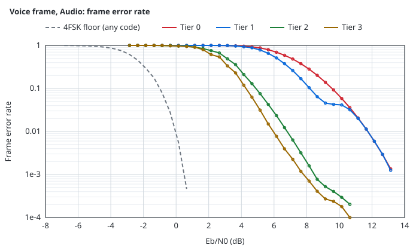
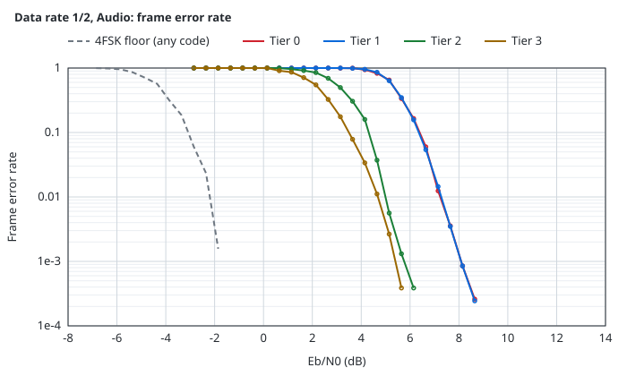
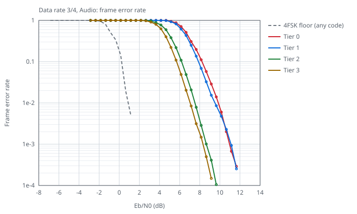
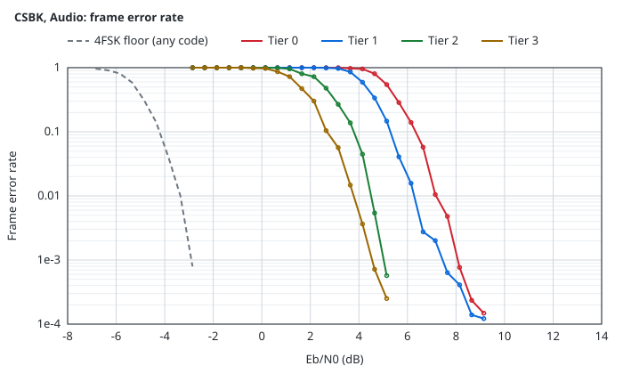
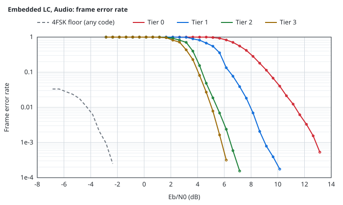
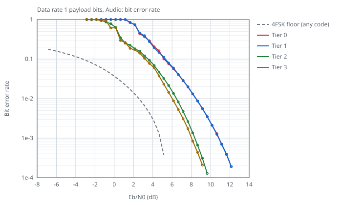

#### I/Q at 9.6 kHz

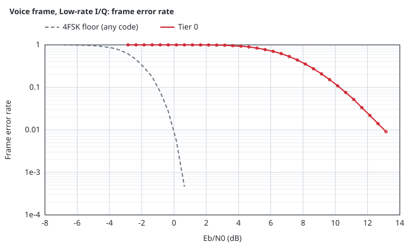
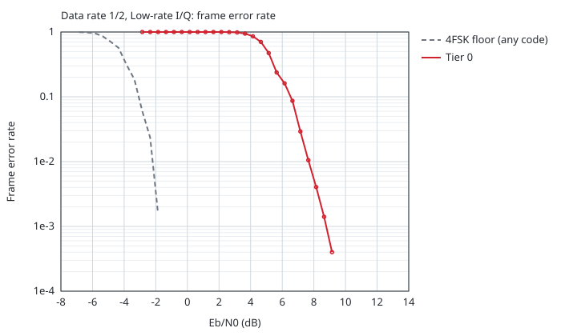
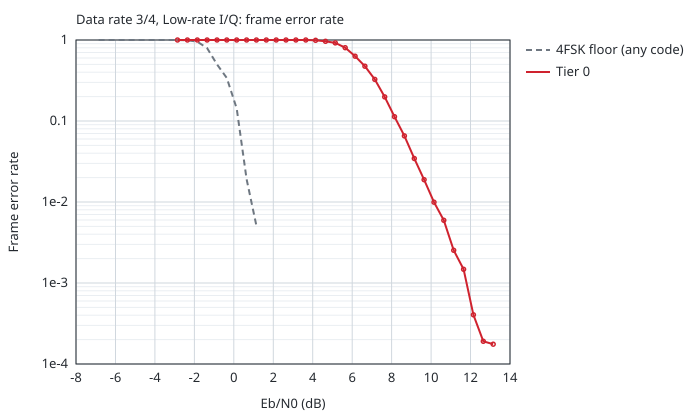
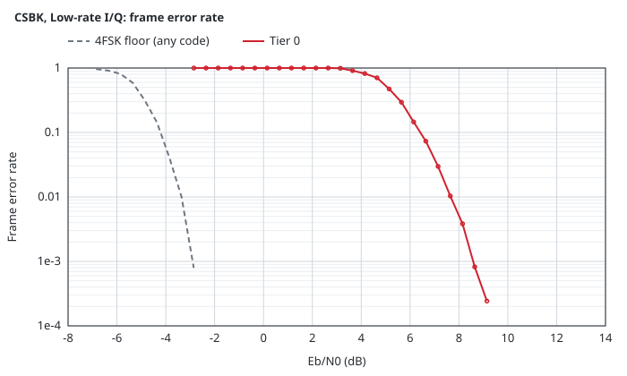
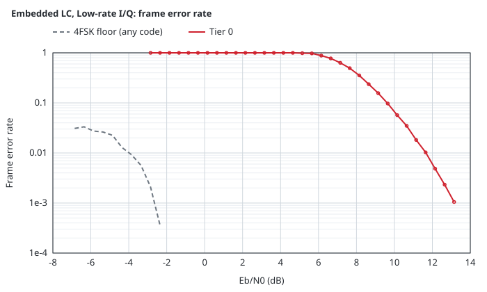
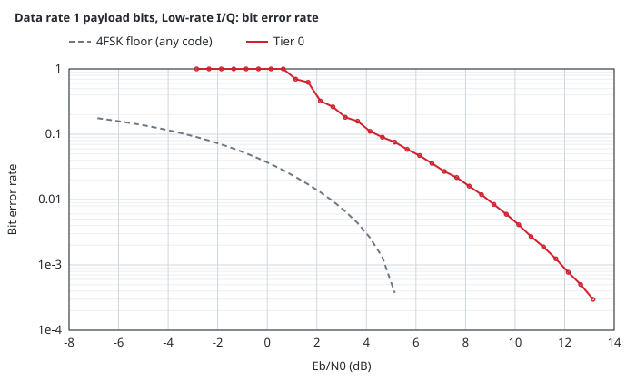

#### I/Q

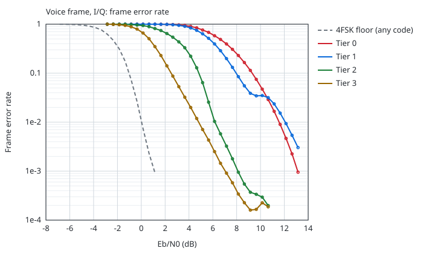
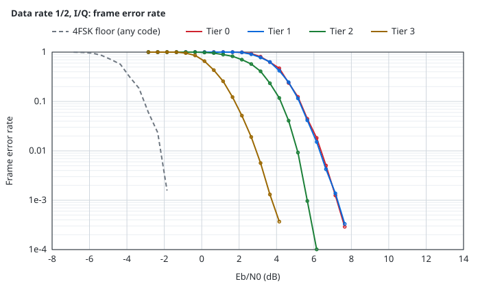
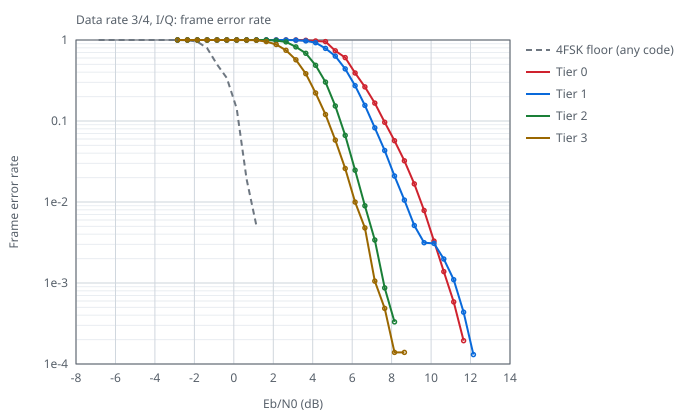
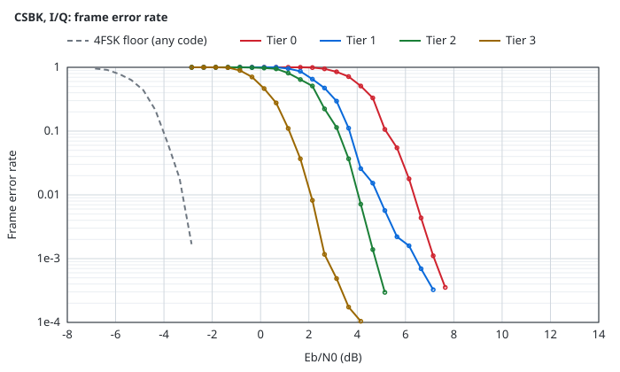
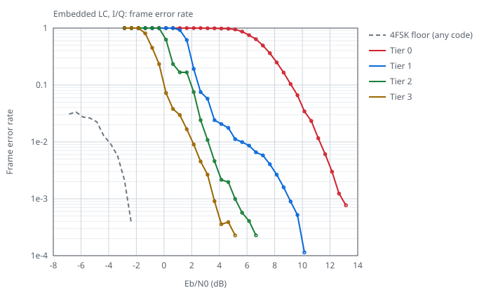
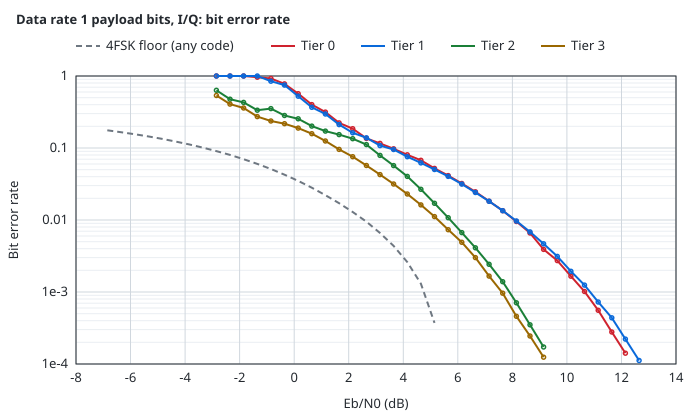

### Eye diagrams

On a clean signal, the symbol centers of every tier fall on `Burst.Seconds` plus whole symbols, within the search step of 0.01 symbol (2.1 µs).

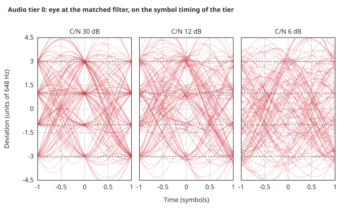
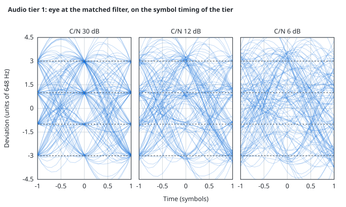
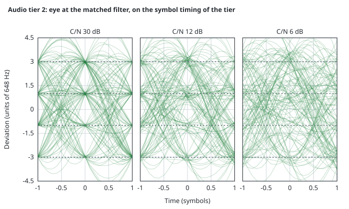
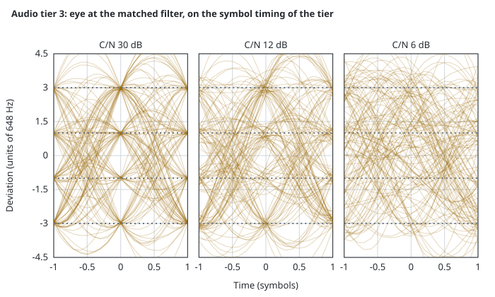
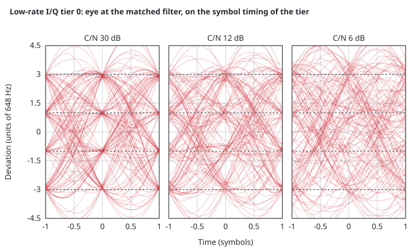
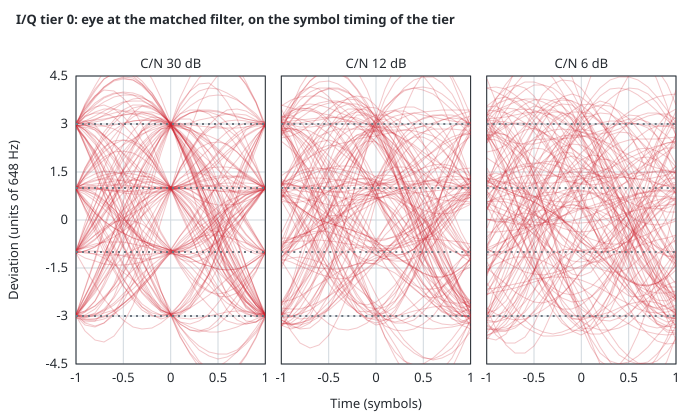

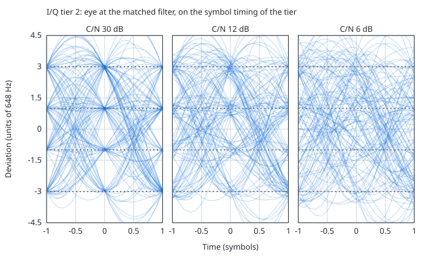
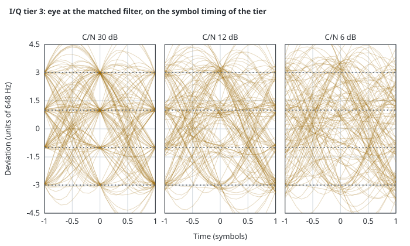

### Carrier offset

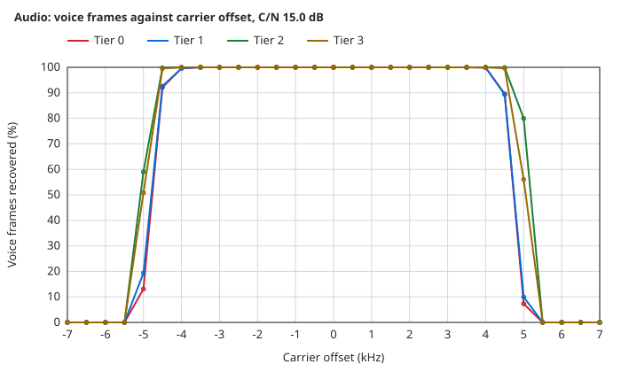
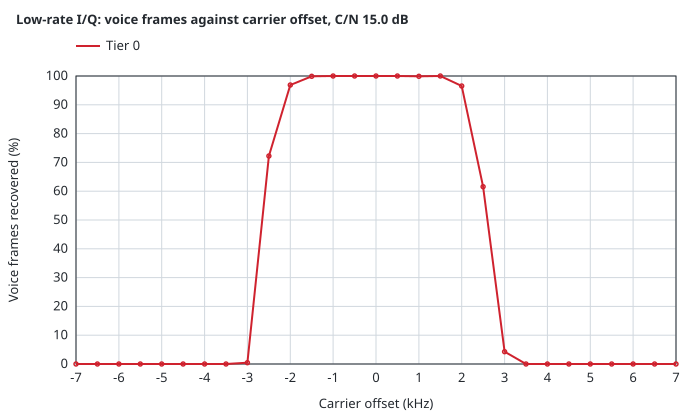
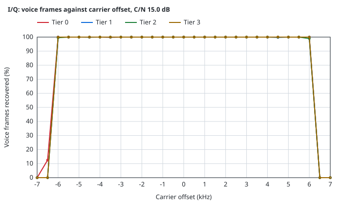

### Sample clock error

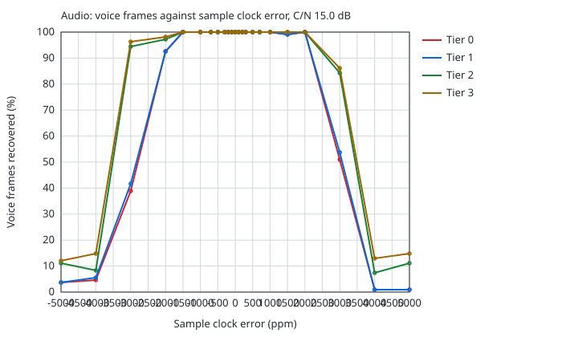
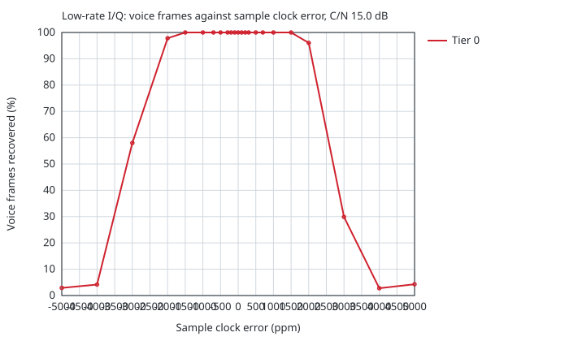
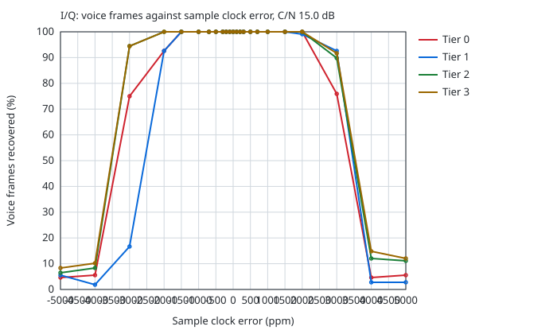

### Late entry

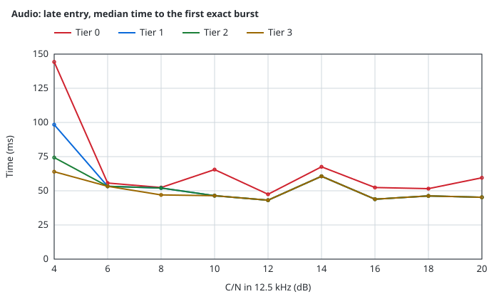
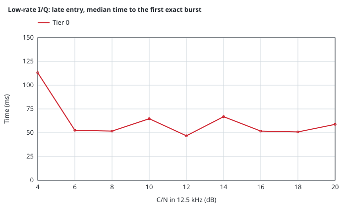
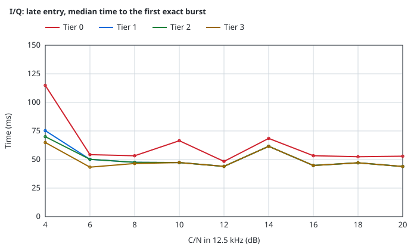

### CPU

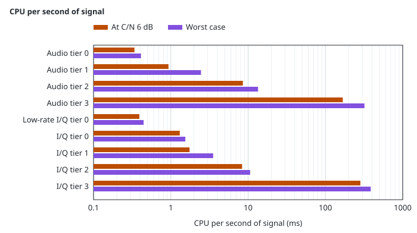

False bursts on noise

Bursts that each tier reports from noise only, with no signal, for each input. The bound is the one-sided 95% upper bound on the rate.

| Tier | Input | Noise | False bursts | Per hour | 95% upper bound per hour |
|------|-------|-------|--------------|----------|--------------------------|
| Audio tier 0 | a9600 | 1.0 h | 0 | 0.00 | 3.00 |
| Audio tier 0 | a12000 | 1.0 h | 0 | 0.00 | 3.00 |
| Audio tier 0 | a24000 | 1.0 h | 0 | 0.00 | 3.00 |
| Audio tier 0 | a48000 | 1.0 h | 0 | 0.00 | 3.00 |
| Audio tier 1 | a9600 | 1.0 h | 0 | 0.00 | 3.00 |
| Audio tier 1 | a12000 | 1.0 h | 0 | 0.00 | 3.00 |
| Audio tier 1 | a24000 | 1.0 h | 0 | 0.00 | 3.00 |
| Audio tier 1 | a48000 | 1.0 h | 0 | 0.00 | 3.00 |
| Audio tier 2 | a9600 | 1.0 h | 0 | 0.00 | 3.00 |
| Audio tier 2 | a12000 | 1.0 h | 0 | 0.00 | 3.00 |
| Audio tier 2 | a24000 | 1.0 h | 0 | 0.00 | 3.00 |
| Audio tier 2 | a48000 | 1.0 h | 0 | 0.00 | 3.00 |
| Audio tier 3 | a9600 | 1.0 h | 0 | 0.00 | 3.00 |
| Audio tier 3 | a12000 | 1.0 h | 0 | 0.00 | 3.00 |
| Audio tier 3 | a24000 | 1.0 h | 0 | 0.00 | 3.00 |
| Audio tier 3 | a48000 | 1.0 h | 0 | 0.00 | 3.00 |
| Low-rate I/Q tier 0 | cu8-9600 | 1.0 h | 0 | 0.00 | 3.00 |
| I/Q tier 0 | cu8-48k | 1.0 h | 0 | 0.00 | 3.00 |
| I/Q tier 0 | cs16-48k | 1.0 h | 0 | 0.00 | 3.00 |
| I/Q tier 0 | cu8-2048k | 1.0 h | 0 | 0.00 | 3.00 |
| I/Q tier 0 | cs16-2048k | 1.0 h | 0 | 0.00 | 3.00 |
| I/Q tier 1 | cu8-48k | 1.0 h | 0 | 0.00 | 3.00 |
| I/Q tier 1 | cs16-48k | 1.0 h | 0 | 0.00 | 3.00 |
| I/Q tier 1 | cu8-2048k | 1.0 h | 0 | 0.00 | 3.00 |
| I/Q tier 1 | cs16-2048k | 1.0 h | 0 | 0.00 | 3.00 |
| I/Q tier 2 | cu8-48k | 1.0 h | 0 | 0.00 | 3.00 |
| I/Q tier 2 | cs16-48k | 1.0 h | 0 | 0.00 | 3.00 |
| I/Q tier 2 | cu8-2048k | 1.0 h | 0 | 0.00 | 3.00 |
| I/Q tier 2 | cs16-2048k | 1.0 h | 0 | 0.00 | 3.00 |
| I/Q tier 3 | cu8-48k | 1.0 h | 0 | 0.00 | 3.00 |
| I/Q tier 3 | cs16-48k | 1.0 h | 0 | 0.00 | 3.00 |
| I/Q tier 3 | cu8-2048k | 1.0 h | 0 | 0.00 | 3.00 |
| I/Q tier 3 | cs16-2048k | 1.0 h | 0 | 0.00 | 3.00 |

### Sensitivity per payload type

Eb/N0 in dB for 90% of the frames recovered exactly. [The floors](#the-floors) defines each floor.

| Payload | 4FSK floor | DMR floor | Code cost | Code-aware |
|:---|---:|---:|---:|---:|
| Voice frame (AMBE+2, 49 bits) | -1.0 | at least 1.4 | 2.4 to 2.9 | 1.9 |
| Voice frame, protected bits (C0 and C1) | -5.4 | at least -5.0 | 0.4 to 4.7 | -0.7 |
| Data block, rate 1/2 | -3.1 | - | at most 3.4 | 0.3 |
| Data block, rate 3/4 | 0.1 | at least 0.8 | 0.7 to 4.3 | 4.5 |
| Data block, rate 1 | 6.0 | 7.2 | 1.2 | 7.3 |
| CSBK | -4.0 | - | at most 4.5 | 0.5 |
| Voice LC header and terminator | -5.3 | - | at most 5.7 | 0.4 |
| Data header | -4.2 | - | at most 4.5 | 0.4 |
| Embedded LC | < -6.9 | - | - | -1.6 |
| EMB | < -6.9 | < -6.9 | - | -3.4 |
| Slot type | < -6.9 | < -6.9 | - | -2.7 |
| SYNC detection | < -6.9 | < -6.9 | - | < -6.9 |

| Payload | Audio tier 0 | Audio tier 1 | Audio tier 2 | Audio tier 3 | Low-rate I/Q tier 0 | I/Q tier 0 | I/Q tier 1 | I/Q tier 2 | I/Q tier 3 |
|:---|---:|---:|---:|---:|---:|---:|---:|---:|---:|
| Voice frame (AMBE+2, 49 bits) | 9.6 | 8.2 | 4.9 | 4.2 | 10.3 | 9.3 | 8.0 | 4.8 | 2.5 |
| Voice frame, protected bits (C0 and C1) | 5.8 | 5.2 | 3.8 | 3.3 | 5.1 | 4.5 | 3.7 | 3.1 | 1.6 |
| Data block, rate 1/2 | 6.3 | 6.3 | 4.3 | 3.5 | 6.3 | 5.3 | 5.3 | 4.3 | 1.8 |
| Data block, rate 3/4 | 8.2 | 7.6 | 6.1 | 5.7 | 8.2 | 7.6 | 6.7 | 5.4 | 4.8 |
| Data block, rate 1 | 11.3 | 11.3 | 8.2 | 8.0 | 12.4 | 11.1 | 11.4 | 7.8 | 7.6 |
| CSBK | 6.2 | 5.2 | 3.6 | 3.0 | 6.2 | 5.2 | 3.7 | 3.2 | 1.2 |
| Voice LC header and terminator | 6.3 | 5.5 | 3.9 | 3.4 | 6.6 | 5.5 | 3.8 | 3.1 | 1.6 |
| Data header | 6.1 | 5.1 | 3.8 | 3.0 | 6.2 | 5.4 | 3.7 | 3.2 | 1.1 |
| Embedded LC | 9.3 | 6.4 | 4.4 | 4.0 | 9.6 | 9.0 | 4.9 | 3.9 | 2.2 |
| EMB | 3.3 | 3.3 | 1.7 | 1.4 | 2.3 | 1.9 | 1.5 | 0.9 | -0.5 |
| Slot type | 3.7 | 3.6 | 1.2 | 1.5 | 2.8 | 2.2 | 2.0 | 0.9 | -0.8 |
| SYNC detection | 3.2 | 3.2 | 0.8 | 0.5 | 2.2 | 1.5 | 1.4 | -1.4 | -1.7 |

### Real recordings

Voice frames recovered exactly from captures of a Motorola XPR 8400 repeater with an RTL-SDR.

| Recording | C/N (dB) | Frames | I/Q tier 0 | I/Q tier 1 | I/Q tier 2 | I/Q tier 3 |
|:---|---:|---:|---:|---:|---:|---:|
| MS voice relayed, HackRF on the uplink | 9.3 | 2013 | 1478 | 1563 | 1828 | 1865 |
| Late entry voice relayed, HackRF on the uplink | 11.1 | 1890 | 1471 | 1507 | 1621 | 1632 |
| Voice with PI header relayed, HackRF on the uplink | 17.3 | 1818 | 1818 | 1818 | 1818 | 1818 |
| Mixed voice and data, network to air, run 1 | 9.7 | 144 | 114 | 118 | 122 | 126 |
| Mixed voice and data, network to air, run 2 | 10.6 | 144 | 117 | 120 | 125 | 126 |
| Voice, network to air | 10.0 | 90 | 87 | 87 | 90 | 90 |
| Voice, network to air | 11.6 | 90 | 84 | 82 | 90 | 90 |
| Gain sweep, RTL gain 0 dB | 9.9 | 51 | 39 | 45 | 48 | 48 |
| Gain sweep, RTL gain 9.7 dB | 7.3 | 51 | 36 | 42 | 48 | 48 |
| Gain sweep, RTL gain 19.7 dB | 10.4 | 51 | 51 | 50 | 51 | 51 |
| Gain sweep, RTL gain 29.7 dB | 11.2 | 51 | 42 | 48 | 48 | 48 |

<!-- rxbench:end -->

### Short LC

Eb/N0 in dB for 90% of the Short LCs right, and the Short LCs that pass the CRC-8 with wrong bits.

<!-- shortlc:begin -->
| Tier | Input | Hard decode (dB) | `OnShortLC` (dB) | Wrong, hard decode | Wrong, `OnShortLC` | On noise, hard decode (1/h) | On noise, `OnShortLC` (1/h) |
|:---|:---|---:|---:|---:|---:|---:|---:|
| Audio tier 0 | FM audio | 7.6 | 7.6 | 0 of 2,850 | 0 of 2,850 | 0.0 | 0.0 |
| Audio tier 1 | FM audio | 7.6 | 6.9 | 0 of 2,849 | 0 of 3,397 | 0.0 | 0.0 |
| Audio tier 2 | FM audio | 7.5 | 6.8 | 0 of 2,977 | 0 of 3,535 | 0.0 | 0.0 |
| Audio tier 3 | FM audio | 5.1 | 4.3 | 0 of 3,017 | 1 of 3,577 | 0.0 | 0.0 |
| Low-rate I/Q tier 0 | I/Q | 7.9 | 7.9 | 0 of 5,888 | 0 of 5,888 | 0.0 | 0.0 |
| I/Q tier 0 | I/Q | 7.2 | 7.2 | 0 of 3,851 | 0 of 3,851 | 0.0 | 0.0 |
| I/Q tier 1 | I/Q | 7.1 | 5.8 | 0 of 3,852 | 0 of 4,725 | 0.0 | 0.0 |
| I/Q tier 2 | I/Q | 7.0 | 5.9 | 0 of 3,534 | 0 of 4,302 | 0.0 | 0.0 |
| I/Q tier 3 | I/Q | 4.2 | 2.9 | 0 of 3,968 | 0 of 4,743 | 0.0 | 0.0 |

- Hard decode and `OnShortLC` are the Eb/N0 at which 90% of the Short LCs of the sweep stream are right, from 4 streams per point. Hard decode is `layer2.ShortLCAssembler` on the `Decoded` CACH of the bursts.
- Wrong counts the Short LCs that pass the CRC-8 with other bits than the stream sent, of all that pass. On noise gives the Short LCs that the receivers report on white Gaussian noise alone.

The Motorola XPR 8400 idle capture (`motorola-xpr8400-idle-424075000-2048k.cu8`) with noise added to its CU8 codes. Short LCs, hard decode / `OnShortLC` (of them soft):

| Noise sigma | I/Q tier 0 | I/Q tier 1 | I/Q tier 2 | I/Q tier 3 |
|:---|---:|---:|---:|---:|
| 0 | 46 / 46 (0) | 46 / 46 (0) | 46 / 46 (0) | 46 / 46 (0) |
| 16 | 19 / 19 (0) | 19 / 35 (16) | 24 / 36 (12) | 44 / 46 (2) |
| 20 | 0 / 0 (0) | 1 / 7 (6) | 0 / 6 (6) | 25 / 37 (12) |
| 24 | 0 / 0 (0) | 0 / 1 (1) | 0 / 1 (1) | 5 / 12 (7) |

<!-- shortlc:end -->

### De-emphasized audio

Frames recovered exactly, 4 streams per point, C/N in 12.5 kHz. The radio de-emphasizes its audio from 300 Hz to 3 kHz.

| Tier | Rate | C/N | Voice, flat | Voice, de-emphasized | Voice, de-emphasized with `PreEmphasis` | Rate 3/4, flat | Rate 3/4, de-emphasized | Rate 3/4, de-emphasized with `PreEmphasis` |
|------|------|-----|------|------|------|------|------|------|
| 0 | 9.6 kHz | 6 dB | 214/432 | 0/432 | 193/432 | 18/24 | 0/24 | 17/24 |
| 0 | 9.6 kHz | 8 dB | 369/432 | 0/432 | 351/432 | 21/24 | 0/24 | 20/24 |
| 0 | 9.6 kHz | 10 dB | 426/432 | 0/432 | 415/432 | 24/24 | 0/24 | 24/24 |
| 1 | 9.6 kHz | 6 dB | 324/432 | 0/432 | 307/432 | 19/24 | 0/24 | 18/24 |
| 1 | 9.6 kHz | 8 dB | 413/432 | 0/432 | 411/432 | 23/24 | 0/24 | 23/24 |
| 1 | 9.6 kHz | 10 dB | 426/432 | 0/432 | 416/432 | 24/24 | 0/24 | 24/24 |
| 2 | 9.6 kHz | 6 dB | 428/432 | 0/432 | 420/432 | 23/24 | 0/24 | 22/24 |
| 2 | 9.6 kHz | 8 dB | 430/432 | 0/432 | 430/432 | 24/24 | 0/24 | 24/24 |
| 2 | 9.6 kHz | 10 dB | 432/432 | 0/432 | 429/432 | 24/24 | 0/24 | 24/24 |
| 3 | 9.6 kHz | 6 dB | 428/432 | 0/432 | 420/432 | 23/24 | 0/24 | 22/24 |
| 3 | 9.6 kHz | 8 dB | 430/432 | 0/432 | 430/432 | 24/24 | 0/24 | 24/24 |
| 3 | 9.6 kHz | 10 dB | 432/432 | 0/432 | 429/432 | 24/24 | 0/24 | 24/24 |
| 0 | 48 kHz | 6 dB | 228/432 | 0/432 | 226/432 | 18/24 | 0/24 | 19/24 |
| 0 | 48 kHz | 8 dB | 366/432 | 0/432 | 366/432 | 21/24 | 0/24 | 21/24 |
| 0 | 48 kHz | 10 dB | 425/432 | 0/432 | 425/432 | 24/24 | 0/24 | 24/24 |
| 1 | 48 kHz | 6 dB | 320/432 | 0/432 | 313/432 | 19/24 | 0/24 | 18/24 |
| 1 | 48 kHz | 8 dB | 409/432 | 0/432 | 409/432 | 23/24 | 0/24 | 23/24 |
| 1 | 48 kHz | 10 dB | 425/432 | 0/432 | 425/432 | 24/24 | 0/24 | 24/24 |
| 2 | 48 kHz | 6 dB | 429/432 | 0/432 | 427/432 | 23/24 | 0/24 | 23/24 |
| 2 | 48 kHz | 8 dB | 431/432 | 0/432 | 431/432 | 24/24 | 0/24 | 24/24 |
| 2 | 48 kHz | 10 dB | 432/432 | 0/432 | 432/432 | 24/24 | 0/24 | 24/24 |
| 3 | 48 kHz | 6 dB | 429/432 | 0/432 | 427/432 | 23/24 | 0/24 | 23/24 |
| 3 | 48 kHz | 8 dB | 431/432 | 0/432 | 431/432 | 24/24 | 0/24 | 24/24 |
| 3 | 48 kHz | 10 dB | 432/432 | 0/432 | 432/432 | 24/24 | 0/24 | 24/24 |

## Application information

### Choosing a tier

Pick the lowest tier whose sensitivity in [Key specifications](#key-specifications) meets the link budget, on the hardware that runs it.

### Wiring to a radio

- Audio tiers take FM discriminator audio of either polarity. The discriminator output or flat data port of a radio is the best input.
- The speaker and accessory outputs de-emphasize the audio: set `AudioRxConfig.PreEmphasis` to a `RxPreEmphasis`, one for each receiver, from `Init` or `NewRxPreEmphasis`.
- I/Q tiers take the samples of a software radio. Low-rate I/Q tier 0 takes I/Q at 9.6 or 12 kHz that a radio chip filtered to the channel, with the carrier less than 2.5 kHz from the center.
- When the oscillator of a software radio is off, set `RxConfig.OffsetHz` to its known offset.

### Levels and calibration

Keep the audio of the strongest signal and the CU8 and CS8 samples from clipping. These methods give what the receiver measured:

<!-- rfparams:rx-levels:begin -->
- `AudioReceiver.Level`: Level returns the outer level of the last locked stream: the code of a run of symbol +3 (1944 Hz) less the DC code.
- `AudioReceiver.Offset`: Offset returns the DC code of the last locked stream: the code of the carrier, from its offset and the offset of the converter.
- `Receiver.OffsetHz`: OffsetHz returns the carrier offset of the last stream that ended, in Hz. Tier2 and Tier3 return the carrier of their coherent fit, which also follows the stream in progress.
- `Receiver.DeviationHz`: DeviationHz returns the outer deviation of the last locked stream, in Hz. Every tier reads it from the sync symbol levels and divides out the response of its channel filter and discriminator at the carrier offset from the tuned frequency. For a clean 1944 Hz signal the reading is 1 to 1.5% low and within 3% at every offset. The lookup uses the carrier offset of the samples of each sync fit, so a retune after a fit does not change it. A sync fit made before the timing settles can move the reading by a few percent more. At a Rate of 9600 the reading is up to 3% low, by the sub-sample phase of the bursts, and it does not include the channel filter of the radio chip.
<!-- rfparams:rx-levels:end -->

### Short LC

Set `OnShortLC` of the config to receive the Short LCs of the CACH. From tier 1 up, the receiver decodes a Short LC that fails again from its soft values and sets `ShortLC.Soft`. Tier 0 gives the hard decode only, and `Init` takes no `OnShortLC`.

## Comparison with other receivers

<!-- extcmp:begin -->
The tiers and other receivers decode the same noisy signals. Each cell is the Eb/N0 in dB at which the receiver recovers 90% of the frames exactly. Lower is better. [Other receivers](#other-receivers) gives the method.

### BS outbound, both slots, carrier 1400 Hz off

| Receiver | Voice | Voice C0 C1 | Rate 1/2 | Rate 3/4 | Rate 1 | CSBK | LC header | Data header | Embedded LC | EMB | Slot type | CPU, C/N 6 dB (ms/s) |
|:---|---:|---:|---:|---:|---:|---:|---:|---:|---:|---:|---:|---:|
| Audio tier 0 | 9.6 | 6.0 | 6.6 | 8.2 | 11.6 | 6.5 | 6.7 | 6.6 | 9.6 | 4.4 | 4.8 | - |
| Audio tier 1 | 8.3 | 5.3 | 6.6 | 8.0 | 11.6 | 5.4 | 5.8 | 5.4 | 5.8 | 4.1 | 4.5 | - |
| Audio tier 2 | 5.0 | 4.0 | 4.4 | 6.2 | 8.5 | 3.9 | 4.1 | 4.0 | 3.8 | 2.3 | 2.2 | - |
| Low-rate I/Q tier 0 | 10.3 | 5.5 | 6.7 | 8.2 | 12.7 | 6.6 | 6.6 | 6.9 | 9.7 | 4.0 | 4.4 | - |
| I/Q tier 0 | 9.4 | 4.8 | 5.7 | 7.6 | 11.3 | 5.5 | 5.9 | 5.9 | 9.3 | 3.3 | 3.8 | - |
| I/Q tier 1 | 8.0 | 3.9 | 5.5 | 7.1 | 11.4 | 3.9 | 4.1 | 4.0 | 4.1 | 3.0 | 3.2 | - |
| I/Q tier 2 | 4.7 | 3.1 | 4.2 | 5.4 | 8.0 | 3.1 | 3.1 | 3.3 | 3.0 | < 1.1 | 1.3 | - |
| dsd-fme | > 21.1 | > 21.1 | > 21.1 | > 21.1 | > 21.1 | > 21.1 | > 21.1 | > 21.1 | > 21.1 | - | - | 30 |

### MS bursts, one slot, carrier 1400 Hz off

| Receiver | Voice | Voice C0 C1 | Rate 1/2 | Rate 3/4 | Rate 1 | CSBK | LC header | Data header | Embedded LC | EMB | Slot type | CPU, C/N 6 dB (ms/s) |
|:---|---:|---:|---:|---:|---:|---:|---:|---:|---:|---:|---:|---:|
| Audio tier 0 | 9.7 | 6.1 | 6.5 | 8.7 | 11.6 | 6.5 | 7.1 | 6.4 | 9.6 | 5.8 | 4.7 | - |
| Audio tier 1 | 9.7 | 5.9 | 6.5 | 8.6 | 11.6 | 5.4 | 6.1 | 5.1 | 6.1 | 5.7 | 4.6 | - |
| Audio tier 2 | 5.9 | 5.4 | 4.1 | 6.4 | 8.5 | 3.9 | 5.9 | 3.9 | 5.7 | 5.3 | 3.6 | - |
| Low-rate I/Q tier 0 | 10.4 | 6.1 | 6.5 | 8.7 | 12.6 | 6.6 | 10.8 | 6.3 | 9.8 | 5.7 | 4.1 | - |
| I/Q tier 0 | 9.6 | 5.5 | 5.5 | 8.0 | 11.3 | 5.7 | 8.4 | 5.4 | 9.7 | 5.0 | 3.5 | - |
| I/Q tier 1 | 9.1 | 4.9 | 5.4 | 7.4 | 11.4 | 3.8 | 5.5 | 3.8 | 5.1 | 4.7 | 3.1 | - |
| I/Q tier 2 | 4.9 | 4.2 | 2.9 | 5.5 | 7.8 | 2.3 | 5.2 | 2.4 | 4.7 | 4.0 | < 1.1 | - |
| dsd-fme | > 21.1 | > 21.1 | > 21.1 | > 21.1 | > 21.1 | > 21.1 | > 21.1 | > 21.1 | > 21.1 | - | - | 28 |
| MMDVM firmware | > 21.1 | 10.0 | 10.5 | > 21.1 | 11.4 | 10.3 | 10.4 | 10.3 | 10.1 | 10.0 | 10.3 | 1.5 |
| MMDVM firmware, end of burst fixed | 9.9 | 9.0 | 10.0 | 10.1 | 11.4 | 9.8 | 9.9 | 9.7 | 9.5 | 9.0 | 9.8 | 1.5 |

### BS outbound, both slots, carrier 0 Hz off

| Receiver | Voice | Voice C0 C1 | Rate 1/2 | Rate 3/4 | Rate 1 | CSBK | LC header | Data header | Embedded LC | EMB | Slot type | CPU, C/N 6 dB (ms/s) |
|:---|---:|---:|---:|---:|---:|---:|---:|---:|---:|---:|---:|---:|
| Audio tier 0 | 9.6 | 5.8 | 6.2 | 8.3 | 11.4 | 6.1 | 6.2 | 6.4 | 9.7 | 4.1 | 4.4 | - |
| Audio tier 1 | 8.2 | 5.0 | 6.2 | 7.9 | 11.4 | 5.0 | 5.3 | 5.1 | 5.1 | 4.0 | 4.1 | - |
| Audio tier 2 | 5.0 | 3.8 | 4.2 | 6.3 | 8.3 | 3.8 | 4.0 | 3.9 | 3.7 | 2.4 | 2.4 | - |
| Low-rate I/Q tier 0 | 9.7 | 5.0 | 6.1 | 8.0 | 11.5 | 6.0 | 6.0 | 6.1 | 9.6 | 3.4 | 3.7 | - |
| I/Q tier 0 | 9.3 | 4.8 | 5.6 | 7.9 | 11.4 | 5.4 | 5.6 | 5.7 | 9.3 | 3.1 | 3.3 | - |
| I/Q tier 1 | 8.0 | 3.9 | 5.4 | 7.1 | 11.5 | 3.9 | 4.0 | 3.9 | 4.1 | 2.9 | 3.0 | - |
| I/Q tier 2 | 4.7 | 3.1 | 4.2 | 5.5 | 7.9 | 3.1 | 3.1 | 3.3 | 3.0 | < 1.1 | 1.3 | - |
| dsd-fme | 20.5 | 9.6 | 12.9 | 15.3 | > 21.1 | 11.3 | 11.7 | 15.6 | 19.0 | - | - | 37 |

### MS bursts, one slot, carrier 0 Hz off

| Receiver | Voice | Voice C0 C1 | Rate 1/2 | Rate 3/4 | Rate 1 | CSBK | LC header | Data header | Embedded LC | EMB | Slot type | CPU, C/N 6 dB (ms/s) |
|:---|---:|---:|---:|---:|---:|---:|---:|---:|---:|---:|---:|---:|
| Audio tier 0 | 9.7 | 6.1 | 6.1 | 8.4 | 11.6 | 6.1 | 7.0 | 6.1 | 9.6 | 5.8 | 4.4 | - |
| Audio tier 1 | 9.7 | 5.9 | 6.1 | 8.2 | 11.6 | 4.9 | 6.0 | 5.0 | 6.1 | 5.7 | 4.2 | - |
| Audio tier 2 | 6.0 | 4.6 | 3.9 | 6.5 | 8.5 | 3.3 | 5.1 | 3.5 | 4.8 | 4.0 | 2.3 | - |
| Low-rate I/Q tier 0 | 9.8 | 5.7 | 6.1 | 8.4 | 11.7 | 6.0 | 7.1 | 6.0 | 9.8 | 5.1 | 3.9 | - |
| I/Q tier 0 | 9.5 | 5.2 | 5.5 | 7.9 | 11.1 | 5.4 | 6.2 | 5.5 | 9.3 | 4.8 | 3.3 | - |
| I/Q tier 1 | 9.1 | 4.7 | 5.3 | 7.5 | 11.4 | 3.8 | 4.9 | 3.8 | 4.9 | 4.5 | 3.0 | - |
| I/Q tier 2 | 4.1 | 3.0 | 2.9 | 5.4 | 7.9 | 2.3 | 3.4 | 2.4 | 3.1 | 2.5 | < 1.1 | - |
| dsd-fme | 16.6 | 8.9 | 11.1 | 14.6 | 18.0 | 11.3 | > 21.1 | 11.3 | 14.8 | - | - | 35 |
| MMDVM firmware | > 21.1 | 10.0 | 10.4 | > 21.1 | 11.4 | 10.4 | 10.2 | 10.2 | 10.1 | 10.0 | 10.3 | 1.5 |
| MMDVM firmware, end of burst fixed | 10.0 | 9.1 | 10.0 | 10.1 | 11.4 | 10.0 | 9.8 | 9.8 | 9.7 | 9.1 | 9.9 | 1.5 |

### Cells won and lost

A cell is one payload of one stream at one C/N. On each seed the tier and the other receiver decode the same signal, and the difference of their exact frames is taken. The tier wins the cell when the mean difference over the seeds is more than two standard errors above 0, and is behind when it is more than two standard errors below 0. The cells between are ties, which count as lost. Cells where both recover every frame, or both none, are left out.

| Tier | dsd-fme: won, tied, behind | MMDVM firmware: won, tied, behind | MMDVM firmware, end of burst fixed: won, tied, behind |
|---|---|---|---|
| Audio tier 0 | 618, 32, 0 | 227, 35, 0 | 180, 46, 3 |
| Audio tier 1 | 639, 32, 0 | 239, 31, 0 | 196, 39, 2 |
| Audio tier 2 | 694, 28, 0 | 273, 25, 0 | 236, 27, 0 |
| Low-rate I/Q tier 0 | 637, 35, 0 | 230, 47, 17 | 179, 54, 35 |
| I/Q tier 0 | 654, 35, 0 | 246, 37, 1 | 201, 44, 7 |
| I/Q tier 1 | 679, 33, 0 | 264, 32, 0 | 221, 36, 8 |
| I/Q tier 2 | 707, 23, 0 | 284, 19, 0 | 247, 21, 0 |

Cells where a tier is behind

Frames recovered by the tier against the other receiver, and the mean difference a seed with its standard error.

- Audio tier 0 against MMDVM firmware, end of burst fixed:
  - MS bursts, one slot, carrier 1400 Hz off, Embedded LC, C/N 9.0 dB: 1093 against 1113 of 1152, -0.104 ± 0.042 a seed
  - MS bursts, one slot, carrier 1400 Hz off, Voice, C/N 11.0 dB: 20607 against 20647 of 20736, -0.208 ± 0.061 a seed
  - MS bursts, one slot, carrier 1400 Hz off, Voice, C/N 12.0 dB: 20708 against 20722 of 20736, -0.073 ± 0.028 a seed
- Audio tier 1 against MMDVM firmware, end of burst fixed:
  - MS bursts, one slot, carrier 1400 Hz off, Voice, C/N 11.0 dB: 20605 against 20647 of 20736, -0.219 ± 0.060 a seed
  - MS bursts, one slot, carrier 1400 Hz off, Voice, C/N 12.0 dB: 20708 against 20722 of 20736, -0.073 ± 0.028 a seed
- Low-rate I/Q tier 0 against MMDVM firmware:
  - MS bursts, one slot, carrier 1400 Hz off, Rate 1, C/N 9.0 dB: 196 against 233 of 384, -0.193 ± 0.062 a seed
  - MS bursts, one slot, carrier 1400 Hz off, Rate 1, C/N 10.0 dB: 281 against 335 of 384, -0.281 ± 0.048 a seed
  - MS bursts, one slot, carrier 1400 Hz off, LC header, C/N 10.0 dB: 353 against 371 of 384, -0.094 ± 0.032 a seed
  - MS bursts, one slot, carrier 1400 Hz off, Rate 1, C/N 11.0 dB: 337 against 370 of 384, -0.172 ± 0.035 a seed
  - MS bursts, one slot, carrier 1400 Hz off, LC header, C/N 11.0 dB: 366 against 379 of 384, -0.068 ± 0.025 a seed
  - MS bursts, one slot, carrier 1400 Hz off, Rate 1, C/N 12.0 dB: 358 against 381 of 384, -0.120 ± 0.027 a seed
  - MS bursts, one slot, carrier 1400 Hz off, LC header, C/N 12.0 dB: 372 against 383 of 384, -0.057 ± 0.018 a seed
  - MS bursts, one slot, carrier 1400 Hz off, Slot type, C/N 12.0 dB: 5364 against 5372 of 5376, -0.042 ± 0.019 a seed
  - MS bursts, one slot, carrier 1400 Hz off, Rate 1, C/N 13.0 dB: 376 against 384 of 384, -0.042 ± 0.014 a seed
  - MS bursts, one slot, carrier 1400 Hz off, LC header, C/N 13.0 dB: 374 against 384 of 384, -0.052 ± 0.016 a seed
  - MS bursts, one slot, carrier 1400 Hz off, Slot type, C/N 13.0 dB: 5366 against 5375 of 5376, -0.047 ± 0.017 a seed
  - MS bursts, one slot, carrier 1400 Hz off, Rate 1, C/N 14.0 dB: 380 against 384 of 384, -0.021 ± 0.010 a seed
  - MS bursts, one slot, carrier 1400 Hz off, LC header, C/N 14.0 dB: 377 against 384 of 384, -0.036 ± 0.014 a seed
  - MS bursts, one slot, carrier 1400 Hz off, Slot type, C/N 14.0 dB: 5369 against 5376 of 5376, -0.036 ± 0.014 a seed
  - MS bursts, one slot, carrier 1400 Hz off, LC header, C/N 15.0 dB: 378 against 384 of 384, -0.031 ± 0.013 a seed
  - MS bursts, one slot, carrier 1400 Hz off, Slot type, C/N 15.0 dB: 5370 against 5376 of 5376, -0.031 ± 0.013 a seed
  - MS bursts, one slot, carrier 0 Hz off, Rate 1, C/N 11.0 dB: 364 against 374 of 384, -0.052 ± 0.024 a seed
- Low-rate I/Q tier 0 against MMDVM firmware, end of burst fixed:
  - MS bursts, one slot, carrier 1400 Hz off, Embedded LC, C/N 8.0 dB: 961 against 999 of 1152, -0.198 ± 0.095 a seed
  - MS bursts, one slot, carrier 1400 Hz off, Voice, C/N 9.0 dB: 18383 against 19228 of 20736, -4.401 ± 0.301 a seed
  - MS bursts, one slot, carrier 1400 Hz off, Rate 1, C/N 9.0 dB: 196 against 249 of 384, -0.276 ± 0.059 a seed
  - MS bursts, one slot, carrier 1400 Hz off, LC header, C/N 9.0 dB: 330 against 355 of 384, -0.130 ± 0.039 a seed
  - MS bursts, one slot, carrier 1400 Hz off, Embedded LC, C/N 9.0 dB: 1071 against 1113 of 1152, -0.219 ± 0.048 a seed
  - MS bursts, one slot, carrier 1400 Hz off, Voice, C/N 10.0 dB: 19651 against 20321 of 20736, -3.490 ± 0.195 a seed
  - MS bursts, one slot, carrier 1400 Hz off, Rate 1, C/N 10.0 dB: 281 against 335 of 384, -0.281 ± 0.048 a seed
  - MS bursts, one slot, carrier 1400 Hz off, LC header, C/N 10.0 dB: 353 against 371 of 384, -0.094 ± 0.032 a seed
  - MS bursts, one slot, carrier 1400 Hz off, Voice, C/N 11.0 dB: 20268 against 20647 of 20736, -1.974 ± 0.116 a seed
  - MS bursts, one slot, carrier 1400 Hz off, Rate 1, C/N 11.0 dB: 337 against 370 of 384, -0.172 ± 0.035 a seed
  - MS bursts, one slot, carrier 1400 Hz off, LC header, C/N 11.0 dB: 366 against 379 of 384, -0.068 ± 0.025 a seed
  - MS bursts, one slot, carrier 1400 Hz off, Voice, C/N 12.0 dB: 20547 against 20722 of 20736, -0.911 ± 0.069 a seed
  - MS bursts, one slot, carrier 1400 Hz off, Rate 1, C/N 12.0 dB: 358 against 381 of 384, -0.120 ± 0.027 a seed
  - MS bursts, one slot, carrier 1400 Hz off, LC header, C/N 12.0 dB: 372 against 383 of 384, -0.057 ± 0.018 a seed
  - MS bursts, one slot, carrier 1400 Hz off, Slot type, C/N 12.0 dB: 5364 against 5372 of 5376, -0.042 ± 0.019 a seed
  - MS bursts, one slot, carrier 1400 Hz off, Voice, C/N 13.0 dB: 20659 against 20733 of 20736, -0.385 ± 0.042 a seed
  - MS bursts, one slot, carrier 1400 Hz off, Rate 1, C/N 13.0 dB: 376 against 384 of 384, -0.042 ± 0.014 a seed
  - MS bursts, one slot, carrier 1400 Hz off, LC header, C/N 13.0 dB: 374 against 384 of 384, -0.052 ± 0.016 a seed
  - MS bursts, one slot, carrier 1400 Hz off, Slot type, C/N 13.0 dB: 5366 against 5375 of 5376, -0.047 ± 0.017 a seed
  - MS bursts, one slot, carrier 1400 Hz off, Voice, C/N 14.0 dB: 20694 against 20736 of 20736, -0.219 ± 0.033 a seed
  - MS bursts, one slot, carrier 1400 Hz off, Rate 1, C/N 14.0 dB: 380 against 384 of 384, -0.021 ± 0.010 a seed
  - MS bursts, one slot, carrier 1400 Hz off, LC header, C/N 14.0 dB: 377 against 384 of 384, -0.036 ± 0.014 a seed
  - MS bursts, one slot, carrier 1400 Hz off, Slot type, C/N 14.0 dB: 5369 against 5376 of 5376, -0.036 ± 0.014 a seed
  - MS bursts, one slot, carrier 1400 Hz off, Voice, C/N 15.0 dB: 20713 against 20736 of 20736, -0.120 ± 0.025 a seed
  - MS bursts, one slot, carrier 1400 Hz off, LC header, C/N 15.0 dB: 378 against 384 of 384, -0.031 ± 0.013 a seed
  - MS bursts, one slot, carrier 1400 Hz off, Slot type, C/N 15.0 dB: 5370 against 5376 of 5376, -0.031 ± 0.013 a seed
  - MS bursts, one slot, carrier 1400 Hz off, Voice, C/N 16.0 dB: 20725 against 20736 of 20736, -0.057 ± 0.017 a seed
  - MS bursts, one slot, carrier 1400 Hz off, Voice, C/N 17.0 dB: 20731 against 20736 of 20736, -0.026 ± 0.012 a seed
  - MS bursts, one slot, carrier 0 Hz off, Embedded LC, C/N 9.0 dB: 1076 against 1099 of 1152, -0.120 ± 0.055 a seed
  - MS bursts, one slot, carrier 0 Hz off, Embedded LC, C/N 10.0 dB: 1126 against 1138 of 1152, -0.062 ± 0.029 a seed
  - MS bursts, one slot, carrier 0 Hz off, Voice, C/N 11.0 dB: 20548 against 20606 of 20736, -0.302 ± 0.073 a seed
  - MS bursts, one slot, carrier 0 Hz off, Rate 1, C/N 11.0 dB: 364 against 374 of 384, -0.052 ± 0.024 a seed
  - MS bursts, one slot, carrier 0 Hz off, Voice, C/N 12.0 dB: 20673 against 20713 of 20736, -0.208 ± 0.047 a seed
  - MS bursts, one slot, carrier 0 Hz off, Voice, C/N 13.0 dB: 20720 against 20736 of 20736, -0.083 ± 0.020 a seed
  - MS bursts, one slot, carrier 0 Hz off, Voice, C/N 14.0 dB: 20732 against 20736 of 20736, -0.021 ± 0.010 a seed
- I/Q tier 0 against MMDVM firmware:
  - MS bursts, one slot, carrier 1400 Hz off, Embedded LC, C/N 10.0 dB: 1126 against 1139 of 1152, -0.068 ± 0.026 a seed
- I/Q tier 0 against MMDVM firmware, end of burst fixed:
  - MS bursts, one slot, carrier 1400 Hz off, Embedded LC, C/N 9.0 dB: 1083 against 1113 of 1152, -0.156 ± 0.045 a seed
  - MS bursts, one slot, carrier 1400 Hz off, Voice, C/N 10.0 dB: 20250 against 20321 of 20736, -0.370 ± 0.133 a seed
  - MS bursts, one slot, carrier 1400 Hz off, Embedded LC, C/N 10.0 dB: 1126 against 1139 of 1152, -0.068 ± 0.026 a seed
  - MS bursts, one slot, carrier 1400 Hz off, Voice, C/N 11.0 dB: 20583 against 20647 of 20736, -0.333 ± 0.066 a seed
  - MS bursts, one slot, carrier 1400 Hz off, Voice, C/N 12.0 dB: 20687 against 20722 of 20736, -0.182 ± 0.035 a seed
  - MS bursts, one slot, carrier 1400 Hz off, Voice, C/N 13.0 dB: 20723 against 20733 of 20736, -0.052 ± 0.018 a seed
  - MS bursts, one slot, carrier 0 Hz off, Voice, C/N 13.0 dB: 20730 against 20736 of 20736, -0.031 ± 0.013 a seed
- I/Q tier 1 against MMDVM firmware, end of burst fixed:
  - MS bursts, one slot, carrier 1400 Hz off, Voice, C/N 10.0 dB: 20263 against 20321 of 20736, -0.302 ± 0.147 a seed
  - MS bursts, one slot, carrier 1400 Hz off, Voice, C/N 11.0 dB: 20542 against 20647 of 20736, -0.547 ± 0.077 a seed
  - MS bursts, one slot, carrier 1400 Hz off, Voice, C/N 12.0 dB: 20667 against 20722 of 20736, -0.286 ± 0.044 a seed
  - MS bursts, one slot, carrier 1400 Hz off, Voice, C/N 13.0 dB: 20713 against 20733 of 20736, -0.104 ± 0.024 a seed
  - MS bursts, one slot, carrier 1400 Hz off, Voice, C/N 14.0 dB: 20729 against 20736 of 20736, -0.036 ± 0.014 a seed
  - MS bursts, one slot, carrier 0 Hz off, Voice, C/N 11.0 dB: 20576 against 20606 of 20736, -0.156 ± 0.077 a seed
  - MS bursts, one slot, carrier 0 Hz off, Voice, C/N 12.0 dB: 20680 against 20713 of 20736, -0.172 ± 0.040 a seed
  - MS bursts, one slot, carrier 0 Hz off, Voice, C/N 13.0 dB: 20724 against 20736 of 20736, -0.062 ± 0.018 a seed

<!-- extcmp:end -->

## Measurement conditions

### The sweep

<!-- rfparams:rx-sweep:begin -->
- The test stream is a BS outbound stream: a voice call on one slot and data, CSBKs and headers on the other.
- White Gaussian noise is added at each C/N in 12.5 kHz. Eb/N0 is C/N plus 1.1 dB.
- The audio tiers get the audio of an FM discriminator at 9.6 kHz. The sweep makes it from the same noisy signal with the IF filter of a 12.5 kHz radio, so their Eb/N0 is that of the signal at the antenna.
- The I/Q tiers get the noisy samples at 48 kHz. Low-rate I/Q tier 0 gets them at 9.6 kHz, through the decimation filter of a radio chip: a 255-tap Kaiser-windowed sinc with its -6 dB point at 4.32 kHz.
<!-- rfparams:rx-sweep:end -->
- Each point runs more streams for each payload until it has 20 errors, enough frames to show 20 errors at an error rate of 1e-4 (the bottom of the graphs), or enough frames that the one-sided 95% upper bound of its error rate is under 1e-4. A payload stops after two points in a row under 1e-4. The 90% point is a linear interpolation between C/N points.
- CPU is the CPU time of the receiver alone to receive one second of signal, on one goroutine locked to its thread, as the median of five runs. Before and after each run the test times a reference: audio tier 2 on two superframes at C/N 6 dB. It scales the run by 14.95 ms over the mean reference time, the reference time on the test machine (an AMD Ryzen 9 7950X) with no other load. Load on the machine slows the reference and the receiver alike, so the scaled time moves by less than 1 ms per second where the raw time moves by 8 ms. The discriminator model of the sweep is outside the timed part. The test measures it at C/N 0, 2, 4, 6, 8, 12, 20 and 40 dB on one noise seed. The worst case is the highest of these. RAM is what the receiver keeps in stream mode, with `OnBursts` set. For audio tier 0 that is the size of `rf.AudioReceiver`, and for low-rate I/Q tier 0 the size of the `rf.Receiver` of a TinyGo build: their whole state, which `Init` can place in static memory. For the other tiers it is the heap after `NewReceiver` or `NewAudioReceiver`.
- False bursts: the full run also gives each tier noise with no signal on each of its inputs, for `DMRRF_RXBENCH_NOISE_HOURS` hours (1 by default), and counts the bursts that the tier reports. The bound is the one-sided 95% upper bound on the rate, from the Poisson distribution: 3.0 divided by the hours when no burst comes.
- The data is in `v2/rf/testdata/rxbench.json`. `TestRxBench` in `v2/rf` writes it with `DMRRF_RXBENCH=full`. `DMRRF_RXBENCH=cpu` measures only the CPU again.

### The eye, offset, clock and late entry tests

<!-- rfparams:rx-eye:begin -->
Each eye diagram shows the receiver input after the DMR matched filter (root raised cosine, roll-off 0.2), at 48 kHz, folded on `Burst.Seconds` of each burst that the tier recovered. The dotted lines are the four symbol levels.
<!-- rfparams:rx-eye:end -->

- The eye diagrams use the sweep stream with no carrier offset at three C/N. The tier receives the noisy signal, and the test folds the output of the DMR matched filter on `Burst.Seconds` of each burst that the tier gives. The audio tiers fold the audio of the discriminator, and the I/Q tiers the discriminator of the I/Q, at 48 kHz.
- The offset test moves the carrier of the stream over the span of its graph. The clock test resamples the noisy I/Q to a sample clock that is off by each error of its graph, and scores each burst at its drifted time. The audio tiers get the audio of the discriminator of that signal.
- The late entry test starts the input at a random point of the call, and runs several inputs at each C/N.
- The rate probe calls the constructors with each rate of the probe and each tier.
- The data is in `v2/rf/testdata/rxsheet.json`. `TestRxSheet` in `v2/rf` writes it with `DMRRF_RXSHEET=1`.

### The floors

Both floors give a genie receiver the timing, the carrier, the noise level and every transmitted bit outside the payload. It also gets the side information that the tiers use: the color code for the EMB and slot type, and the embedded LC of the earlier superframes of the call.

- 4FSK floor (any code): the converse bound of Verdu and Han on the information density of the payload symbols. No code of that size on those symbols, and no decoder, can do better. For the rate 1 payload bits it is Fano's inequality on the same densities.
- DMR floor (ETSI codes): maximum likelihood decoding of the DMR code of the payload.
  - For the EMB, the slot type, the SYNC and the rate 1 payload, the test covers all values.
  - For the voice frame and the rate 3/4 block, a search finds the values, so the floor is a lower bound ("at least").
  - For the BPTC payloads and the embedded LC it is not computed. Maximum likelihood over 2^72 to 2^96 values is out of reach.
- Code cost: the DMR floor less the 4FSK floor. Where the DMR floor is a lower bound, the cost is a range up to the code-aware receiver.
- Code-aware: the genie receiver detects the payload bits exactly, bit by bit, and decodes them with the decoders of the coherent tiers. It is a receiver, not a bound.

The floors use the same streams and noise seeds as the tiers. Their generator is `v2/rf/floor_gen_test.go`, and the code-aware receiver is `v2/rf/floor_aware_test.go`.

### The graphs

- The graphs show the frame error rate per payload, and the bit error rate of the rate 1 payload bits.
- A rate 1 block that a tier misses counts all of its bits as wrong.
- Points with no errors are left out.
- The graphs leave out the DMR floor. For codes with 2^49 to 2^96 values, the phase memory of 4FSK keeps the searches from bounding it.

### The recordings

The real recordings are captures of a Motorola XPR 8400 repeater with an RTL-SDR. The score is the number of voice frames recovered exactly, in order. The data is in `v2/rf/testdata/rxbench_recordings.json`, and its generator is `v2/rf/recordings_test.go`.

- The truth is the AMBE+2 frames that went to the repeater: the IPSC voice packets that the repeater relayed for the HackRF uplink captures, and the packets that the bridge injected for the network to air captures.
- Each tier streams the whole capture. The score is the longest common subsequence of the received frames and the truth, so a frame counts only when it is exact and in order.
- A gain sweep capture is a 1 s slice of one call. Its score is against the whole call, and its frame count is the span of the call that the tiers received, at least the 51 frames of 1 s.
- C/N is in 12.5 kHz. The noise density comes from the carrier-off blocks of the capture, or from 40 to 60 kHz off the carrier when the capture has less than 0.2 s with no carrier.

### Other receivers

<!-- extcmp:methods:begin -->
- Receivers: dsd-fme (commit 587181f4), MMDVM firmware (commit 046e1df1), MMDVM firmware, end of burst fixed (commit 046e1df1).
- Each point decodes 192 noise seeds at each C/N from 0 to 20 dB in steps of 1 dB. Every receiver gets the same seeds.
- The FM audio comes from the discriminator model of the sweep with a 95-tap IF filter: a Kaiser-windowed sinc with its -6 dB point at 6 kHz and at least 84 dB of attenuation from 7.5 kHz, as the IF of a 12.5 kHz radio. The audio tiers get it at 9.6 kHz, dsd-fme at 48 kHz and the MMDVM firmware at 24 kHz, with the DC offset of the carrier and no other.
- dsd-fme decodes from `-fs -i - -o null -Z`. Its voice frames come from its AMBE+2 printout and its data blocks from one print line added after its FEC, which changes no decision. A frame counts when it equals the next frame of the truth in order. The MMDVM firmware is its DMO receiver (`DMRDMORX.cpp`) on the host with the 0.2 RRC filter of `IO.cpp`, and its burst bits go through the FEC of dmrgo. The tiers and the MMDVM firmware count a frame only at its own slot.
- The MMDVM DMO receiver takes each burst one sample before its last symbol arrives. `DMRDMORX.cpp` sets the end at `m_endPtr = m_dataPtr + DMR_SLOT_TYPE_LENGTH_SAMPLES / 2U + DMR_INFO_LENGTH_SAMPLES / 2U - 1U` (lines 327 and 358), 269 samples after the last SYNC symbol, but the last symbol of the burst is 270 samples after it, and `samplesToBits` reads it from `m_endPtr + DMO_BUFFER_LENGTH_SAMPLES - DMR_FRAME_LENGTH_SAMPLES + DMR_RADIO_SYMBOL_LENGTH + 1U` (line 126) on, which reaches the sample of 60 ms before. So the last two bits of every burst are random, and its voice and rate 3/4 cells do not reach 90% at any C/N. The second MMDVM row drops the `- 1U` and the `+ 1U`. Only MS bursts carry the SYNC patterns that the MMDVM DMO receiver looks for.
- On a Cortex-M4F the MMDVM DMO receiver with its RRC filter (`arm_fir_fast_q15` of CMSIS-DSP in blocks of 2 samples, as `IO.cpp` runs it), built with arm-none-eabi-gcc 13.2 -Os and run in QEMU mps2-an386, Cortex-M4 on the MS stream at C/N 6.0 and 40.0 dB, needs up to 19.3 MHz by the cycle model of the Tier 0 numbers, 6,256 B of RAM (5,820 B of receiver state, 140 B of filter state and 296 B of stack) and 10,798 B of flash.

<!-- extcmp:methods:end -->

### De-emphasized audio and Short LC

- The sweep job field `radio: "deemph"` gives the audio tiers the audio of a radio that de-emphasizes it from 300 Hz to 3 kHz, and `pre_emphasis: true` sets up a `RxPreEmphasis`.
- The filter runs at 9.6, 12 or 24 kHz, the rate of the receiver after its half-band filters. With the de-emphasis it is flat within 0.1 dB to 2.4 kHz at 24 kHz, 0.4 dB at 12 kHz and 0.7 dB at 9.6 kHz. A first-order filter cannot follow the 3 kHz corner so close to the Nyquist rate of 9.6 kHz, so at 9.6 kHz the tiers get most of the loss back but not all of it.
- `TestShortLCBench` in `v2/rf` writes `v2/rf/testdata/rxbench_shortlc.json` with `DMRRF_SLCBENCH` set to the path of the capture.

[Receiver design notes](rx-notes.md) records how the carrier hunt, the deviation reading and the Tier 0 costs were checked.

### Generating this page

`go run -C cmd/rxbench . -update-readme` runs the sweep, which takes hours, then the tests of the eye diagrams, offset, clock and late entry, and writes the tables and graphs of this page. `-update-readme -sheet` runs only the second set, in minutes, and `-update-readme -no-sweep` only renders the committed data. `-check-readme` fails when the page or a graph differs from the data in `v2/rf/testdata`. `DMRGO_DOCPARAMS=write go test ./rf -run TestDocParams` in v2 writes the facts, limits and test parameters of this page from the code, and fails without the variable when they differ. `go run -C cmd/mcubench . -update` measures the Cortex-M4F numbers.
