# Receiver

Package `rf` receives DMR from FM discriminator audio, from the I/Q samples of a software radio, or from I/Q at 9.6 or 12 kHz that a radio chip filtered to the channel. Its tiers trade CPU and RAM for sensitivity, from a microcontroller to a PC. [v2/cmd/dmrrf](../../v2/cmd/dmrrf/README.md) decodes DMR from I/Q or discriminator audio in the file formats of common software radios, and writes test transmissions in the same formats.

<!-- rxbench:begin -->
| Tier | Input | Voice | Data rate 1/2 | CSBK | Data rate 3/4 | CPU at C/N 6 dB | Worst-case CPU | RAM |
|------|-------|-------|---------------|------|---------------|-----------------|----------------|-----|
| Best possible (4FSK floor) | - | -1.0 dB | -3.0 dB | -4.1 dB | 0.3 dB | - | - | - |
| Audio tier 0 | FM audio, 9.6 kHz, core | 9.6 dB | 6.4 dB | 6.3 dB | 8.2 dB | 0.38 ms | 0.48 ms | 1,552 B |
| Audio tier 1 | FM audio, 9.6 kHz, soft decoding, noise prediction | 8.2 dB | 6.4 dB | 5.3 dB | 7.9 dB | 1.1 ms | 2.7 ms | 50 KiB |
| Audio tier 2 | FM audio, 9.6 kHz, coherent detection | 5.0 dB | 4.4 dB | 3.9 dB | 6.3 dB | 9.5 ms | 15 ms | 550 KiB |
| Audio tier 3 | FM audio, 9.6 kHz, coherent detection, data passes | 5.0 dB | 3.9 dB | 3.2 dB | 6.3 dB | 19 ms | 38 ms | 1.2 MiB |
| Low-rate I/Q tier 0 | I/Q, 9.6 kHz, discriminator core | 10.3 dB | 6.5 dB | 6.4 dB | 8.2 dB | 0.42 ms | 0.57 ms | 1,528 B |
| I/Q tier 0 | I/Q, discriminator core | 9.4 dB | 5.5 dB | 5.4 dB | 7.7 dB | 1.6 ms | 1.8 ms | 18 KiB |
| I/Q tier 1 | I/Q, soft decoding, noise prediction | 8.0 dB | 5.4 dB | 3.7 dB | 7.1 dB | 1.8 ms | 3.7 ms | 108 KiB |
| I/Q tier 2 | I/Q, coherent detection | 4.9 dB | 4.4 dB | 3.2 dB | 5.5 dB | 7.4 ms | 9.7 ms | 565 KiB |
| I/Q tier 3 | I/Q, phase trellis with Tier 2 beside it | 2.6 dB | 1.8 dB | 1.7 dB | 4.9 dB | 516 ms | 643 ms | 35.6 MiB |

- Each cell is the Eb/N0 at which the tier recovers 90% of the frames. Lower is better. C/N in 12.5 kHz is 1.2 dB lower.
- CPU is per second of signal, measured on an AMD Ryzen 9 7950X 16-Core Processor. Worst-case CPU is the highest over C/N 0 to 40 dB. RAM is the state of the receiver. On a Cortex-M4F, audio tier 0 needs 2,232 B of RAM with its stack and up to 4.9 MHz, built with TinyGo -opt z, and low-rate I/Q tier 0 2,248 B and up to 5.0 MHz. Both are over the 2 KB line: the detection of standalone RC bursts adds 40 B of stack, 320 B of flash and up to 0.03 MHz on an MS stream, and the MS bursts of both TDMA slots, each with its own timing and levels, add 88 B of RAM, 1,504 B of flash and up to 0.85 MHz on an MS stream, which raises the worst case of low-rate I/Q tier 0 from 4.6 to 4.8 MHz. These costs are accepted. The burst-edge gain hold, the CACH replay, the clock rate tracking, the I/Q gain cap and the lookback replay checks add 88 B of RAM, 1,272 B of flash and up to 3.4% of the cycles of a locked stream, and this cost is accepted too. No tier allocates after it starts.
- Audio tiers take FM discriminator audio, as from a radio. They also take inverted audio. I/Q tiers take samples at 48 kHz from a software radio, and low-rate I/Q tier 0 takes I/Q at 9.6 kHz that a radio chip filtered to the channel. Its carrier must be less than 2.5 kHz from the center: the 9.6 kHz I/Q holds 4.8 kHz on each side, and at 2.5 kHz off 9.8 dB of the signal power, at 4 kHz 3.7 dB, falls outside the channel filter of the chip, so the bursts are not exact at any C/N.
- [The sweep](#the-sweep) gives the method and [The floors](#the-floors) the bounds.

Sensitivity per payload type

Eb/N0 in dB for 90% recovery. [The floors](#the-floors) defines each floor.

| Payload | 4FSK floor | DMR floor | Code cost | Code-aware |
|---------|------------|-----------|-----------|------------|
| Voice frame (AMBE+2, 49 bits) | -1.0 dB | at least 1.3 dB | 2.3 to 2.9 | 1.9 dB |
| Voice frame, protected bits (C0 and C1) | -5.3 dB | at least -4.9 dB | 0.4 to 4.6 | -0.7 dB |
| Data block, rate 1/2 | -3.0 dB | - | at most 3.5 | 0.5 dB |
| Data block, rate 3/4 | 0.3 dB | at least 1.3 dB | 0.9 to 4.3 | 4.6 dB |
| Data block, rate 1 | 5.3 dB | 6.5 dB | 1.2 | 6.6 dB |
| CSBK | -4.1 dB | - | at most 4.5 | 0.3 dB |
| Voice LC header and terminator | -4.3 dB | - | at most 5.0 | 0.7 dB |
| Data header | -3.9 dB | - | at most 4.4 | 0.5 dB |
| Embedded LC | < -6.9 dB | - | - | -2.0 dB |
| EMB | < -6.9 dB | < -6.9 dB | - | -3.4 dB |
| Slot type | < -6.9 dB | < -6.9 dB | - | -2.5 dB |
| SYNC detection | < -6.9 dB | < -6.9 dB | - | < -6.9 dB |

| Payload | Audio tier 0 | Audio tier 1 | Audio tier 2 | Audio tier 3 | Low-rate I/Q tier 0 | I/Q tier 0 | I/Q tier 1 | I/Q tier 2 | I/Q tier 3 |
|---------|------|------|------|------|------|------|------|------|------|
| Voice frame (AMBE+2, 49 bits) | 9.6 dB | 8.2 dB | 5.0 dB | 5.0 dB | 10.3 dB | 9.4 dB | 8.0 dB | 4.9 dB | 2.6 dB |
| Voice frame, protected bits (C0 and C1) | 5.9 dB | 5.2 dB | 4.0 dB | 3.8 dB | 5.4 dB | 4.6 dB | 3.7 dB | 3.1 dB | 1.6 dB |
| Data block, rate 1/2 | 6.4 dB | 6.4 dB | 4.4 dB | 3.9 dB | 6.5 dB | 5.5 dB | 5.4 dB | 4.4 dB | 1.8 dB |
| Data block, rate 3/4 | 8.2 dB | 7.9 dB | 6.3 dB | 6.3 dB | 8.2 dB | 7.7 dB | 7.1 dB | 5.5 dB | 4.9 dB |
| Data block, rate 1 | 11.3 dB | 11.3 dB | 8.3 dB | 8.3 dB | 12.4 dB | 11.2 dB | 11.4 dB | 7.9 dB | 7.7 dB |
| CSBK | 6.3 dB | 5.3 dB | 3.9 dB | 3.2 dB | 6.4 dB | 5.4 dB | 3.7 dB | 3.2 dB | 1.7 dB |
| Voice LC header and terminator | 6.4 dB | 5.5 dB | 4.4 dB | 3.6 dB | 6.4 dB | 6.3 dB | 4.1 dB | 3.5 dB | 1.8 dB |
| Data header | 6.4 dB | 5.3 dB | 4.1 dB | 3.3 dB | 6.4 dB | 5.5 dB | 3.8 dB | 3.4 dB | 1.9 dB |
| Embedded LC | 9.5 dB | 4.4 dB | 2.6 dB | 2.3 dB | 9.6 dB | 9.3 dB | 2.6 dB | 2.1 dB | 0.4 dB |
| EMB | 3.9 dB | 3.8 dB | 2.2 dB | 1.9 dB | 2.7 dB | 2.4 dB | 1.9 dB | 1.2 dB | -0.1 dB |
| Slot type | 4.0 dB | 4.1 dB | 2.0 dB | 2.0 dB | 3.1 dB | 2.7 dB | 2.6 dB | 1.0 dB | -0.4 dB |
| SYNC detection | 3.7 dB | 3.6 dB | 1.1 dB | 1.1 dB | 2.6 dB | 2.2 dB | 2.0 dB | -0.6 dB | < -0.9 dB |

Real recordings

Voice frames recovered exactly from captures of a Motorola XPR 8400 repeater with an RTL-SDR.

| Recording | C/N | Frames | I/Q tier 0 | I/Q tier 1 | I/Q tier 2 | I/Q tier 3 |
|-----------|-----|--------|------|------|------|------|
| MS voice relayed, HackRF on the uplink | 9.3 dB | 2013 | 1470 | 1519 | 1821 | 1861 |
| Late entry voice relayed, HackRF on the uplink | 11.1 dB | 1890 | 1467 | 1501 | 1618 | 1630 |
| Voice with PI header relayed, HackRF on the uplink | 17.3 dB | 1818 | 1818 | 1818 | 1818 | 1818 |
| Mixed voice and data, network to air, run 1 | 9.7 dB | 144 | 114 | 117 | 122 | 123 |
| Mixed voice and data, network to air, run 2 | 10.6 dB | 144 | 118 | 121 | 125 | 125 |
| Voice, network to air | 10.0 dB | 90 | 88 | 90 | 90 | 90 |
| Voice, network to air | 11.6 dB | 90 | 84 | 84 | 90 | 90 |
| Gain sweep, RTL gain 0 dB | 9.9 dB | 51 | 42 | 46 | 50 | 50 |
| Gain sweep, RTL gain 9.7 dB | 7.3 dB | 54 | 31 | 41 | 44 | 49 |
| Gain sweep, RTL gain 19.7 dB | 10.4 dB | 51 | 50 | 51 | 51 | 51 |
| Gain sweep, RTL gain 29.7 dB | 11.2 dB | 54 | 44 | 49 | 50 | 50 |

Error rate graphs

Error rate against Eb/N0 for each tier, with the 4FSK floor dashed. Points with no errors are left out.

#### FM discriminator audio

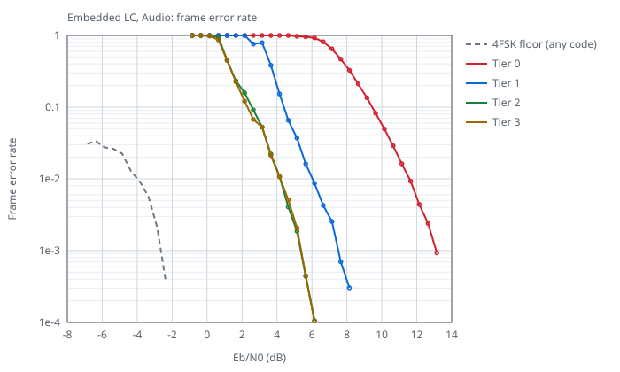

#### I/Q at 9.6 kHz


#### I/Q

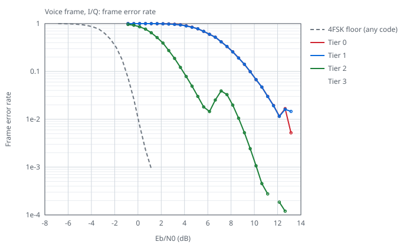
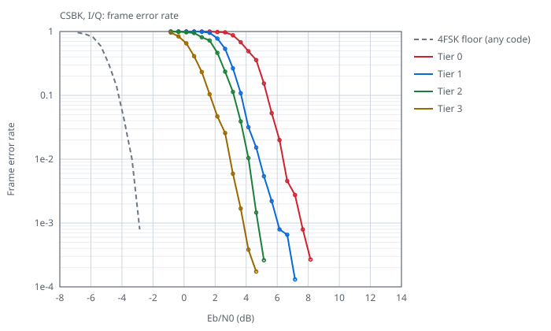
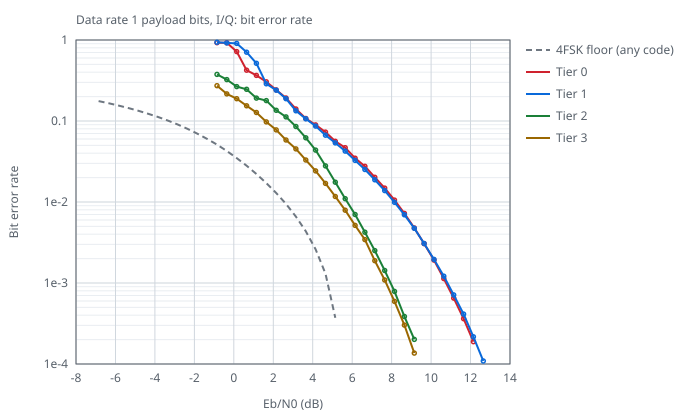

<!-- rxbench:end -->

`go run -C cmd/rxbench . -update-readme` runs the sweep and writes the tables and graphs above. `-check-readme` fails when they differ from the sweep data in `v2/rf/testdata`.

## The sweep

- The test stream is a BS outbound stream: a voice call on one slot and data, CSBKs and headers on the other.
- White Gaussian noise is added at each C/N in 12.5 kHz. Eb/N0 is C/N plus 1.2 dB.
- The audio tiers get the audio of an FM discriminator at 9.6 kHz. The sweep makes it from the same noisy signal with the IF filter of a 12.5 kHz radio, so their Eb/N0 is that of the signal at the antenna.
- The I/Q tiers get the noisy samples at 48 kHz. Low-rate I/Q tier 0 gets them at 9.6 kHz, through the decimation filter of a radio chip: a 255-tap Kaiser-windowed sinc with its -6 dB point at 4.32 kHz.
- Each point runs more streams for each payload until it has 20 errors or enough frames to show 20 errors at an error rate of 1e-4, the bottom of the graphs. A payload stops after two points in a row under 1e-4. The 90% point is a linear interpolation between C/N points.
- CPU is the wall time of the receiver alone to receive one second of signal, on one goroutine, as the minimum of three runs. The discriminator model of the sweep is outside the timed part. The test measures it at C/N 0, 2, 4, 6, 8, 12, 20 and 40 dB on one noise seed. The worst case is the highest of these. RAM is what the receiver keeps in stream mode, with `OnBursts` set. For audio tier 0 that is the size of `rf.AudioReceiver`, and for low-rate I/Q tier 0 the size of the `rf.Receiver` of a TinyGo build: their whole state, which `Init` can place in static memory. For the other tiers it is the heap after `NewReceiver` or `NewAudioReceiver`.
- The data is in `v2/rf/testdata/rxbench.json`. `TestRxBench` in `v2/rf` writes it with `DMRRF_RXBENCH=full`. `DMRRF_RXBENCH=cpu` measures only the CPU again.

## De-emphasized audio

The speaker and accessory outputs of an FM radio de-emphasize the discriminator audio from 300 Hz to 3 kHz. That tilts the 4FSK levels by up to 20 dB, and no audio tier decodes it. `AudioRxConfig.PreEmphasis` takes a `RxPreEmphasis`, the receive twin of the transmit `PreEmphasis`: a first-order filter that inverts the de-emphasis before the receiver detects the bursts. Set one up with `Init` in memory of the caller, or with `NewRxPreEmphasis`, one for each receiver. Nil is a flat discriminator output, as the radio chips of hotspots and MMDVM modems give it, and the receiver is then the same, bit for bit, as without the field. Every tier and rate takes it. A program that sets up no `RxPreEmphasis` links none of its filter; on the Cortex-M4F the receiver then needs 136 B more flash than before the field, and the same RAM and MHz.

The sweep job field `radio: "deemph"` gives the audio tiers the audio of a radio that de-emphasizes it from 300 Hz to 3 kHz, and `pre_emphasis: true` sets up a `RxPreEmphasis`. Frames recovered exactly, 4 streams per point, C/N in 12.5 kHz:

| Tier | Rate | C/N | Voice, flat | Voice, de-emphasized | Voice, de-emphasized with `PreEmphasis` | Rate 3/4, flat | Rate 3/4, de-emphasized | Rate 3/4, de-emphasized with `PreEmphasis` |
|------|------|-----|------|------|------|------|------|------|
| 0 | 9.6 kHz | 6 dB | 214/432 | 0/432 | 193/432 | 18/24 | 0/24 | 17/24 |
| 0 | 9.6 kHz | 8 dB | 369/432 | 0/432 | 351/432 | 21/24 | 0/24 | 20/24 |
| 0 | 9.6 kHz | 10 dB | 426/432 | 0/432 | 415/432 | 24/24 | 0/24 | 24/24 |
| 1 | 9.6 kHz | 6 dB | 324/432 | 0/432 | 307/432 | 19/24 | 0/24 | 18/24 |
| 1 | 9.6 kHz | 8 dB | 413/432 | 0/432 | 411/432 | 23/24 | 0/24 | 23/24 |
| 1 | 9.6 kHz | 10 dB | 426/432 | 0/432 | 416/432 | 24/24 | 0/24 | 24/24 |
| 2 | 9.6 kHz | 6 dB | 428/432 | 0/432 | 420/432 | 23/24 | 0/24 | 22/24 |
| 2 | 9.6 kHz | 8 dB | 430/432 | 0/432 | 430/432 | 24/24 | 0/24 | 24/24 |
| 2 | 9.6 kHz | 10 dB | 432/432 | 0/432 | 429/432 | 24/24 | 0/24 | 24/24 |
| 3 | 9.6 kHz | 6 dB | 428/432 | 0/432 | 420/432 | 23/24 | 0/24 | 22/24 |
| 3 | 9.6 kHz | 8 dB | 430/432 | 0/432 | 430/432 | 24/24 | 0/24 | 24/24 |
| 3 | 9.6 kHz | 10 dB | 432/432 | 0/432 | 429/432 | 24/24 | 0/24 | 24/24 |
| 0 | 48 kHz | 6 dB | 228/432 | 0/432 | 226/432 | 18/24 | 0/24 | 19/24 |
| 0 | 48 kHz | 8 dB | 366/432 | 0/432 | 366/432 | 21/24 | 0/24 | 21/24 |
| 0 | 48 kHz | 10 dB | 425/432 | 0/432 | 425/432 | 24/24 | 0/24 | 24/24 |
| 1 | 48 kHz | 6 dB | 320/432 | 0/432 | 313/432 | 19/24 | 0/24 | 18/24 |
| 1 | 48 kHz | 8 dB | 409/432 | 0/432 | 409/432 | 23/24 | 0/24 | 23/24 |
| 1 | 48 kHz | 10 dB | 425/432 | 0/432 | 425/432 | 24/24 | 0/24 | 24/24 |
| 2 | 48 kHz | 6 dB | 429/432 | 0/432 | 427/432 | 23/24 | 0/24 | 23/24 |
| 2 | 48 kHz | 8 dB | 431/432 | 0/432 | 431/432 | 24/24 | 0/24 | 24/24 |
| 2 | 48 kHz | 10 dB | 432/432 | 0/432 | 432/432 | 24/24 | 0/24 | 24/24 |
| 3 | 48 kHz | 6 dB | 429/432 | 0/432 | 427/432 | 23/24 | 0/24 | 23/24 |
| 3 | 48 kHz | 8 dB | 431/432 | 0/432 | 431/432 | 24/24 | 0/24 | 24/24 |
| 3 | 48 kHz | 10 dB | 432/432 | 0/432 | 432/432 | 24/24 | 0/24 | 24/24 |

- The filter runs at 9.6, 12 or 24 kHz, the rate of the receiver after its half-band filters. With the de-emphasis it is flat within 0.1 dB to 2.4 kHz at 24 kHz, 0.4 dB at 12 kHz and 0.7 dB at 9.6 kHz. A first-order filter cannot follow the 3 kHz corner so close to the Nyquist rate of 9.6 kHz, so at 9.6 kHz the tiers get most of the loss back but not all of it.
- On a Cortex-M4F at 9.6 kHz, audio tier 0 with `PreEmphasis` needs up to 5.3 MHz, 0.46 MHz more than without it, and 2,200 B of RAM with its stack, 56 B more, built with TinyGo -opt z. Its code is 220 B of flash. This Tier 0 cost with the option on, 5.24 MHz and 2,200 B, is accepted. The option is off by default.

## Short LC

The CACH of BS-sourced bursts carries the Short LC in four fragments. `OnShortLC` of `RxConfig` and `AudioRxConfig` receives each Short LC that passes its CRC-8, with the stream, slot and time of the burst of the last fragment. The receiver decodes the fragments of the `Decoded` CACH as `layer2.ShortLCAssembler` does. From tier 1 up, when that decode fails, it decodes the Short LC again from the soft values of the four fragments, and sets `ShortLC.Soft`. It accepts a soft decode only when the decode flips few bits and its soft cost is low. I/Q tier 3 takes a lower soft cost limit than the other tiers, because at the limit of the other tiers its soft decodes pass the CRC-8 with wrong bits more often than its hard decodes do. Tier 0 gives the hard decode only, and `Init` and TinyGo builds take no `OnShortLC`. The bursts, `FixedCACH` and `layer2.ShortLCAssembler` are the same with it and without it.

<!-- shortlc:begin -->
| Tier | Input | Hard decode | `OnShortLC` | Wrong, hard decode | Wrong, `OnShortLC` | On noise, hard decode | On noise, `OnShortLC` |
|------|-------|-------------|-------------|--------------------|--------------------|-----------------------|-----------------------|
| Audio tier 0 | FM audio, 9.6 kHz, core | 7.6 dB | 7.6 dB | 0 of 3,249 | 0 of 3,249 | 0.0 per hour | 0.0 per hour |
| Audio tier 1 | FM audio, 9.6 kHz, soft decoding, noise prediction | 7.6 dB | 6.5 dB | 0 of 2,880 | 0 of 3,623 | 0.0 per hour | 0.0 per hour |
| Audio tier 2 | FM audio, 9.6 kHz, coherent detection | 7.4 dB | 6.3 dB | 2 of 2,634 | 2 of 3,374 | 0.0 per hour | 0.0 per hour |
| Audio tier 3 | FM audio, 9.6 kHz, coherent detection, data passes | 7.4 dB | 6.3 dB | 3 of 2,635 | 3 of 3,375 | 0.0 per hour | 0.0 per hour |
| Low-rate I/Q tier 0 | I/Q, 9.6 kHz, discriminator core | 7.8 dB | 7.8 dB | 2 of 5,980 | 2 of 5,980 | 0.0 per hour | 0.0 per hour |
| I/Q tier 0 | I/Q, discriminator core | 7.1 dB | 7.1 dB | 4 of 5,698 | 4 of 5,698 | 0.0 per hour | 0.0 per hour |
| I/Q tier 1 | I/Q, soft decoding, noise prediction | 7.0 dB | 5.2 dB | 4 of 3,914 | 4 of 5,034 | 0.0 per hour | 0.0 per hour |
| I/Q tier 2 | I/Q, coherent detection | 7.1 dB | 5.3 dB | 7 of 3,195 | 7 of 4,279 | 0.0 per hour | 0.0 per hour |
| I/Q tier 3 | I/Q, phase trellis with Tier 2 beside it | 4.2 dB | 2.8 dB | 0 of 4,417 | 0 of 5,195 | 0.0 per hour | 0.0 per hour |

- Hard decode and `OnShortLC` are the Eb/N0 at which 90% of the Short LCs of the sweep stream are right, from 4 streams per point. Hard decode is `layer2.ShortLCAssembler` on the `Decoded` CACH of the bursts.
- Wrong counts the Short LCs that pass the CRC-8 with other bits than the stream sent, of all that pass. On noise gives the Short LCs that the receivers report on white Gaussian noise alone.

The Motorola XPR 8400 idle capture (`motorola-xpr8400-idle-424075000-2048k.cu8`) with noise added to its CU8 codes. Short LCs, hard decode / `OnShortLC` (of them soft):

| Noise sigma | I/Q tier 0 | I/Q tier 1 | I/Q tier 2 | I/Q tier 3 |
|-------------|------|------|------|------|
| 0 | 46 / 46 (0) | 46 / 46 (0) | 46 / 46 (0) | 46 / 46 (0) |
| 16 | 18 / 18 (0) | 18 / 37 (19) | 21 / 42 (21) | 45 / 46 (1) |
| 20 | 0 / 0 (0) | 1 / 10 (9) | 2 / 6 (4) | 23 / 38 (15) |
| 24 | 0 / 0 (0) | 1 / 1 (0) | 1 / 1 (0) | 4 / 13 (9) |

<!-- shortlc:end -->

`TestShortLCBench` in `v2/rf` writes `v2/rf/testdata/rxbench_shortlc.json` with `DMRRF_SLCBENCH` set to the path of the capture, and `go run -C cmd/rxbench . -update-readme -no-sweep` writes the tables.

## A carrier off the tuned frequency

I/Q tier 0 runs at 12 kHz. A carrier more than 2.5 kHz off is outside its AFC range and partly outside its channel filter, so the receiver must retune before it can lock. When the input power rises, the spectrum hunt estimates the carrier from the next three FFT frames, about 8 ms, and retunes. Tier 0 keeps no samples to decode again, so the symbols before the retune are lost, and at 4 kHz the first burst comes out with its first symbols wrong.

The AFC of I/Q tiers 0 to 2 takes the angle of the lag-1 product of the channel filter output. This is not an unbiased frequency estimate: for a carrier off the oscillator, the filter passes less of the far side of the FM spectrum, so the estimate reads closer to the oscillator. With no noise, before the lock, it reads a carrier 1400 Hz off as about 740 Hz at Tier 0, 1040 Hz at Tier 1 and 830 Hz at Tier 2. Noise in the filter moves it a further 80 to 100 Hz toward the oscillator at 6 dB C/N. The spectrum hunt corrects this: before the lock it also retunes to an estimate from 12 or more FFT frames, about 32 ms, that is 300 Hz or more from the oscillator. That estimate weights each bin by its power over the noise floor, so the filter shape does not bias it. Its spread comes from the symbols of the burst: about 130 Hz over 32 ms and 260 Hz over 8 ms. After the lock, the AFC tunes to the frequency offset of the discriminator when the lag-1 estimate agrees with it within 300 Hz or within half the offset, since the lag-1 estimate reads short of the offset. Tiers 1 and 2 do not use the fast estimate after a power rise, so after a noise lead they can lock with the oscillator at the old frequency, and the locked AFC then follows a carrier 1.4 kHz off within 200 ms.

An I/Q DC offset, as of an RTL-SDR, puts a spur at 0 Hz. The DC block of the front end removes it after about 0.1 s, and until then it pulled the spectrum estimate toward 0 Hz. The hunt takes the three bins around 0 Hz as at most the interpolation of their neighbors, so a spur, which only adds power there, does not move the estimate.

A carrier exactly on the tuned frequency with no modulation, as a CW lead, and a DC offset are the same signal: both are a constant complex value c added to the noise, x[n] = c + w[n]. Any estimator sees only x, so while the CW alone is present from the first sample, no receiver can tell how much of c is offset and how much is carrier. The DC block takes all of it as offset. When the modulation starts, the old mean stays in the DC estimate as a tone at the carrier until the estimate follows. On the matrix row with a 500 ms CW lead at 0 Hz, the leftover was 107 of 126 LSB after 20 ms, 47 after 50 ms and 23 at the lock, 120 ms after the CW ended. It cost the first burst and read the deviation 4 to 5% low. The DC block now starts its estimate again when a mean that held more than half of the power turns into a constant envelope whose phase moves away from it: that is a carrier that started its modulation, while a DC offset under a signal leaves the envelope varying. On that row the leftover falls to 4 LSB within 10 ms, and each tier finds the first burst, with 1 bit wrong.

On the XPR 8400 capture (`v2/cmd/dmrrf/testdata/xpr8400_gain_sweep.cu8`), the carrier is about +1.4 kHz: 1364 Hz is the power centroid and 1440 Hz the mirror center of its spectrum. The oscillator of each tier at the lock:

| Tier | Before | Now |
|------|--------|-----|
| 0 | 422 Hz, still 422 Hz 200 ms later | 1373 Hz |
| 1 | 658 Hz, 1340 Hz 200 ms later | 1373 Hz |
| 2 | 512 Hz, 1318 Hz 200 ms later | 1373 Hz |
| 3 | 1187 Hz | 1373 Hz |

- Over 64 start points Tier 0 now decodes 1608 of 3072 frames exact, and 1655 before. With the oscillator held fixed, it decodes 1561 at 422 Hz, 1602 at 1373 Hz and 1594 to 1637 from 800 to 1800 Hz, so Tier 0 has no offset bias. The 1655 came from the path of the oscillator before this change, 0 Hz for 60 ms and then 422 Hz, which beats every fixed frequency on this 1 s capture. On synthetic I/Q, Tier 0 with the oscillator held fixed decodes the most frames at the carrier.
- On 300 synthetic streams with a carrier 1.4 kHz off and a DC spur, each decoded by the receiver before and after the change with the same noise, Tier 0 decodes 8016 of 10800 frames exact, before 7395, at 7 dB C/N in 12.5 kHz. At 10 dB it decodes 10619, before 10344. The 64 start points of the capture share one second of samples, so they are not independent; the 300 streams are.
- `TestIQLockOffsetXPR8400` and `TestIQLockOffsetDCSpur` in `v2/rf` check the oscillator of each tier at and after the lock.

First burst after a noise lead, I/Q tier 0 at 2.048 Msps, 30 starts per offset (3 sequences, 5 noise leads, 2 noise seeds), C/N 47 dB in 12.5 kHz:

| Offset | Found, before | Found | Raw bits exact, before | Raw bits exact |
|--------|---------------|-------|------------------------|----------------|
| +1.5 kHz | 30/30 | 30/30 | 30/30 | 30/30 |
| -1.5 kHz | 30/30 | 30/30 | 30/30 | 30/30 |
| +2.5 kHz | 30/30 | 30/30 | 30/30 | 30/30 |
| -2.5 kHz | 30/30 | 30/30 | 18/30 | 18/30 |
| +3 kHz | 30/30 | 30/30 | 27/30 | 24/30 |
| -3 kHz | 30/30 | 30/30 | 30/30 | 30/30 |
| +4 kHz | 30/30 | 30/30 | 0/30 | 0/30 |
| -4 kHz | 30/30 | 30/30 | 0/30 | 0/30 |

- Before is the receiver without the small-offset retune and the DC spur handling of this section. The noise leads are 0.2, 0.2131, 0.2517, 0.3011 and 0.3377 s.
- At +3 kHz the retune from 32 ms of spectrum moves the oscillator again during the first burst in 3 more of the 30 starts.
- On 1,200 s of noise at 48 kHz, 600 s steady and 600 s with 2x steps of the noise power every 0.3 s, Tier 0 retuned 0 times, before and now.
- `TestRxTier0FirstBurstAtOffset` in `v2/rf` checks that the first burst is found at 2.5, 3 and 4 kHz.

## The deviation reading

`Receiver.DeviationHz` gives the outer deviation of the last locked stream. The spec value is 1944 Hz. Tier 3 reads it from the fitted modulation index. The lower tiers read it from the sync symbol levels. Two parts of the receiver make those levels low:

- The discriminator measures the phase step over one sample, so it averages the frequency over that sample. At 12 kHz this takes 2.6% off the levels, at 24 kHz 0.9%.
- The channel filter cuts the edges of the FM spectrum. On the tuned frequency this takes 2.3 to 3.2% more off the levels, and more when the carrier is off the tuned frequency.

The receiver divides the reading by the response of its own filter and discriminator at the carrier offset from the tuned frequency. `go generate` derives the response, `devGainIQ` and `devGainLow` in `v2/rf/tables_gen.go`: it sends a spec signal through the same filters and fits the sync levels at the best strobe time.

Clean signal, 3 bursts, I/Q at 48 kHz and 2.048 Msps, reading as a fraction of 1944 Hz:

| Input | Before | Now |
|-------|--------|-----|
| I/Q tiers 0 to 2, on the tuned frequency | 0.935 to 0.947 | 0.986 to 0.992 |
| I/Q tiers 0 to 2, 700 Hz to 4 kHz off | 0.923 to 0.952 | 0.971 to 1.022 |
| I/Q tier 3 | 1.000 | 1.000 |
| Low-rate I/Q tier 0, 9.6 kHz | 0.937 | 0.975 to 0.994 |
| Low-rate I/Q tier 0, 12 kHz | 0.969 | 0.991 to 0.994 |

- About 1% stays below tier 3: the strobe and the level steps of the core.
- At 9.6 kHz the reading follows the sub-sample phase of the bursts, the same sawtooth as the burst time.
- The table holds the response for a carrier up to 2.75 kHz from the tuned frequency at tiers 0 and 1, and 3.5 kHz at tier 2. Further off, the filter distorts the signal and the receiver uses the response at that limit.
- The levels keep most of the first sync fit of a stream. A first fit made before the timing settles can read high, 2.5% in a measured tier 0 case 1.5 kHz off. Each sync fit keeps the carrier offset of its samples, and the receiver looks the response up at the average of those offsets, so an AFC retune after a fit does not change its correction. `TestDeviationAfterRetune` checks this with a retune of 1.4 kHz.
- Low-rate I/Q comes from the channel filter of a radio chip. The reading does not include that filter, so it reads low when the filter cuts the signal.
- `TestIQDeviationReading` in `v2/rf` checks the reading within 3% at tiers 0 to 3 and 12 kHz, and within 4% at 9.6 kHz. The scenario matrix checks 0.95 to 1.03 at the I/Q tiers below tier 3 and 0.90 to 1.03 at 9.6 kHz.

## The floors

Both floors give a genie receiver the timing, the carrier, the noise level and every transmitted bit outside the payload. It also gets the side information that the tiers use: the color code for the EMB and slot type, and the embedded LC of the earlier superframes of the call.

- 4FSK floor (any code): the converse bound of Verdu and Han on the information density of the payload symbols. No code of that size on those symbols, and no decoder, can do better. For the rate 1 payload bits it is Fano's inequality on the same densities.
- DMR floor (ETSI codes): maximum likelihood decoding of the DMR code of the payload.
  - For the EMB, the slot type, the SYNC and the rate 1 payload, the test covers all values.
  - For the voice frame and the rate 3/4 block, a search finds the values, so the floor is a lower bound ("at least").
  - For the BPTC payloads and the embedded LC it is not computed. Maximum likelihood over 2^72 to 2^96 values is out of reach.
- Code cost: the DMR floor less the 4FSK floor. Where the DMR floor is a lower bound, the cost is a range up to the code-aware receiver.
- Code-aware: the genie receiver detects the payload bits exactly, bit by bit, and decodes them with the decoders of the coherent tiers. It is a receiver, not a bound.

The floors use the same streams and noise seeds as the tiers. Their generator is `v2/rf/floor_gen_test.go`, and the code-aware receiver is `v2/rf/floor_aware_test.go`.

## The graphs

- The graphs show the frame error rate per payload, and the bit error rate of the rate 1 payload bits.
- A rate 1 block that a tier misses counts all of its bits as wrong.
- Points with no errors are left out.
- The graphs leave out the DMR floor. For codes with 2^49 to 2^96 values, the phase memory of 4FSK keeps the searches from bounding it.

## The recordings

The real recordings are captures of a Motorola XPR 8400 repeater with an RTL-SDR. The score is the number of voice frames recovered exactly, in order. The data is in `v2/rf/testdata/rxbench_recordings.json`, and its generator is `v2/rf/recordings_test.go`.

- The truth is the AMBE+2 frames that went to the repeater: the IPSC voice packets that the repeater relayed for the HackRF uplink captures, and the packets that the bridge injected for the network to air captures.
- Each tier streams the whole capture. The score is the longest common subsequence of the received frames and the truth, so a frame counts only when it is exact and in order.
- A gain sweep capture is a 1 s slice of one call. Its score is against the whole call, and its frame count is the span of the call that the tiers received, at least the 51 frames of 1 s.
- C/N is in 12.5 kHz. The noise density comes from the carrier-off blocks of the capture, or from 40 to 60 kHz off the carrier when the capture has less than 0.2 s with no carrier.
