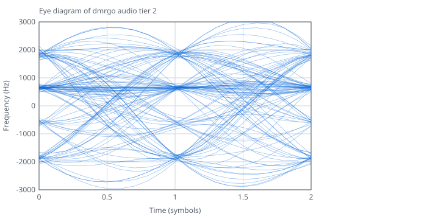
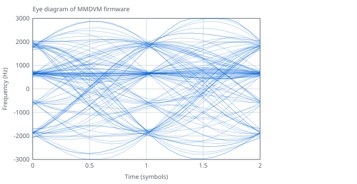

# Transmitter

<!-- rfparams:tx-intro:begin -->
Package rf recovers DMR bursts from the I/Q samples of a software radio and from the output of an FM discriminator: 4FSK detection, SYNC search and slot timing, soft-decision decoding of each FEC field, and the superframe position of voice bursts. It also turns bursts back into I/Q samples and into the deviation signal of an FM radio.

The transmit side mirrors it. NewTransmitter makes a Transmitter from a TxConfig and NewAudioTransmitter an AudioTransmitter from an AudioTxConfig, with the same Tier, Rate, Format, Bits and Unsigned fields, Init for Tier0 in memory of the caller, and the same modes: OnSamples set for Write and Flush, nil for AppendSamples and AppendFlush. A transmitter takes bursts and gives samples. Its Region, Service and Power state the regulatory limits that the signal must keep, and a setup that no measurement shows to keep them with margin gets a *RegionError: the library makes no claim that a station complies, only that a setup it accepts does not make its signal the cause of a failure of the limits it measured.
<!-- rfparams:tx-intro:end -->

## Features

<!-- rfparams:tx-features:begin -->
- `Transmitter`: Transmitter turns DMR bursts into I/Q samples for a software radio: 4FSK on a carrier, with the power ramps of TDMA bursts. It reads the bits of each Burst from Decoded, with its CACH when HasCACH, and places it on the 30 ms slot grid by Stream and Slot. A BS-sourced burst keeps the carrier up into the next slot; any other burst is an MS burst, with the power ramps in its guard time. A gap of one slot within a Stream is an idle slot with the carrier down, as an MS on one TDMA channel sends. A new Stream, or a gap of more than one slot, keys down, and the next burst keys up at once: the time between transmissions is the caller's. The transmitter ignores Seconds, Distance, Sync and Voice. Make it with NewTransmitter, or set it up with Init in memory of the caller. A Transmitter is not safe for concurrent use, and it must not be copied after Init or NewTransmitter.
- `AudioTransmitter`: AudioTransmitter turns DMR bursts into the deviation signal that drives the modulator input of an FM radio, as the radio chips of hotspots and MMDVM modems take it: codes of a converter, with the CACH of BS-sourced bursts and the guard time of MS bursts as a Transmitter places them. Active is the push-to-talk of the radio. Make it with NewAudioTransmitter, or set it up with Init in memory of the caller. An AudioTransmitter is not safe for concurrent use, and it must not be copied after Init or NewAudioTransmitter.
- `PreEmphasis`: A PreEmphasis is the Tier0 modulator of an AudioTransmitter for a radio that pre-emphasizes its modulator input from 300 Hz to 3 kHz, which AudioTxConfig.PreEmphasis takes. The zero PreEmphasis is not set up: Init sets it up in memory of the caller, such as a package variable, and NewPreEmphasis allocates one. A program that sets up none links none of its code or tables. It holds the state of the modulator, so each AudioTransmitter takes a PreEmphasis of its own.
- `RegionError`: RegionError is the error of a transmitter setup that the Region, Service and Power do not allow, or that no measurement shows to keep their limits. Each such error has one static RegionError, so a call that fails does not allocate. Match it with errors.As.
- `ErrBurstOrder`: ErrBurstOrder is the error of Write on a transmitter for a burst whose Slot does not increase within its Stream.
- `ErrBurstService`: ErrBurstService is the error of Write on a transmitter of the license-free service for a BS-sourced burst: the service allows no base station or repeater.
- `ErrTxTimeout`: ErrTxTimeout is the error of Write on a transmitter of the license-free service for a burst that would carry one transmission past 179 s. The transmitter keys down, and returns ErrTxTimeout for the rest of the Stream; a new Stream starts a new transmission.
<!-- rfparams:tx-features:end -->

## Key specifications

<!-- txsheet:begin -->

| Parameter | Tier 0, Audio 16-bit | Tier 0, I/Q 16-bit | Tier 1, Audio 16-bit | Tier 1, I/Q 16-bit | Tier 2, Audio 16-bit | Tier 2, I/Q 16-bit |
| --- | ---: | ---: | ---: | ---: | ---: | ---: |
| Sample rate | 48 kHz | 96 kHz | 48 kHz | 2.4 MHz | 48 kHz | 2.4 MHz |
| FSK error, hold converter or I/Q | 0.14% | 0.12% | 0.18% | 0.11% | 0.18% | 0.11% |
| FSK error, ideal converter | 0.11% | - | 0.12% | - | 0.12% | - |
| Deviation error, TS 102 361-1 pattern | 0.9% | 1.2% | 0.1% | 0.1% | 0.1% | 0.4% |
| Least margin, World, land mobile, 1 W | +4.2 dB | +5.0 dB | +4.2 dB | +4.8 dB | +4.2 dB | +5.0 dB |
| Least margin, World, amateur, 1 W | +5.7 dB | +5.0 dB | +7.1 dB | +4.8 dB | +7.1 dB | +5.0 dB |
| Least margin, US, land mobile, 1 W | +15.4 dB | +13.9 dB | +15.4 dB | +14.6 dB | +15.4 dB | +14.7 dB |
| Least margin, US, amateur, 1 W | +14.2 dB | +49.4 dB | +14.3 dB | +42.7 dB | +14.3 dB | +42.8 dB |
| Least margin, CEPT, land mobile, 1 W | +4.2 dB | +5.0 dB | +4.2 dB | +4.8 dB | +4.2 dB | +5.0 dB |
| Least margin, CEPT, amateur, 1 W | +26.8 dB | - | +26.9 dB | +61.6 dB | +26.9 dB | +61.6 dB |
| Least margin, China, land mobile, 1 W | +5.7 dB | +5.0 dB | +7.1 dB | +4.8 dB | +7.1 dB | +5.0 dB |
| Least margin, Japan, land mobile, 1 W | +19.3 dB | +22.2 dB | +24.8 dB | +26.1 dB | +24.8 dB | +26.1 dB |

- FSK error is the RMS error of the symbol deviations after the receive filter, as a percent of the deviation of symbol +3, over a random stream. A hold converter keeps each code until the next sample; an ideal converter interpolates it with no images. I/Q has no converter model.
- Deviation error is the error of the peak deviation of the ETSI test pattern from 2749 Hz. TS 102 361-1 clause 10.2.2.3 sets a limit of 10%.
- Each margin is the least margin in dB over the limits of the region and service at 1 W, with no input low pass. A setup needs at least 3 dB on each limit. [Measured margins](#measured-margins) gives each limit and power class.

| Tier 0 transmitter | Cortex-M4F CPU | RAM with stack | Flash |
| --- | ---: | ---: | ---: |
| I/Q at 96 kHz, CS16 | 4.8 MHz | 968 B | 33.9 KB |
| Audio at 48 kHz, 12-bit | 3.7 MHz | 724 B | 31.0 KB |
| Audio at 24 kHz, 12-bit | 3.6 MHz | 764 B | 30.8 KB |

Built with TinyGo 0.43.0 `-opt z -gc=none` and run in QEMU (`mps2-an386`, Cortex-M4F) by `cmd/mcubench`, with BS-sourced bursts on every slot. CPU counts the cycles of the `rf` and `fsktx` code and of the bench loop per second of signal. RAM is the `Transmitter` or `AudioTransmitter` and the most stack under it. Flash is the code and constant data of the whole program.

<!-- txsheet:end -->

## Absolute limits and operating conditions

### Formats and rates

<!-- rfparams:tx-formats:begin -->
| Tier | I/Q rates | Audio rates |
| --- | --- | --- |
| Tier 0 | 96 kHz | 24 and 48 kHz |
| Tier 1, Tier 2 | 48 kHz to 20 MHz, 2.4 MHz by default | 8 kHz to 96 kHz, 48 kHz by default |

Under 62.5 kHz, I/Q puts the image of the main lobe within two channels of the carrier, and the limits do not accept it. Tier 1 and Tier 2 make audio at 8000, 11025, 16000, 22050, 32000, 44100, 48000 and 96000 Hz, among other rates. The deviation of a run of symbol +3 is 1944 Hz.

| Field | Rule |
|-------|------|
| `TxConfig.Tier` | Tier selects the modulator: Tier0, Tier1 or Tier2. The zero value TierDefault is Tier1 for NewTransmitter, and Tier0 for Init and under TinyGo. Tier3 has no modulator of its own yet and gives a *dmrgo.ConfigError. |
| `TxConfig.Rate` | Rate is the sample rate of the I/Q, in Hz. 0 means 2400000. Tier1 and Tier2 make any Rate from 48000 to 20000000, and Tier0 makes 96000. Under 62500 the image of the main lobe falls within two channels of the carrier, where no limit can count on a filter of the radio, so it gives a *RegionError. |
| `TxConfig.Format` | Format is the layout of the I/Q samples. 0 means IQFormatCS16. IQFormatCF32 values lie on the grid of IQFormatCS16. |
| `TxConfig.OffsetHz` | OffsetHz is the frequency of the carrier relative to the center of the I/Q, in Hz, under Rate/4 in size. Tier0 rounds it to whole Hz. |
| `TxConfig.OnSamples` | OnSamples, when not nil, selects stream mode: Write and Flush hand the samples to it in chunks of at most MaxOutput(0) samples, in storage of the transmitter that is valid only during the call. When nil, the transmitter is in append mode, for AppendSamples and AppendFlush. |
| `TxConfig.Region` | Region is the regulatory region whose limits the signal keeps. |
| `TxConfig.Service` | Service is the radio service of the station. ServiceUnknown keeps the limits of the land mobile and amateur services at once. A station of the license-free service must state it. |
| `TxConfig.Power` | Power is the most power of the station, in dBm, from 1 to 63. 0 means the highest legal power of the Service in the Region. |
| `AudioTxConfig.Tier` | Tier selects the modulator: Tier0, Tier1 or Tier2. The zero value TierDefault is Tier1 for NewAudioTransmitter, and Tier0 for Init and under TinyGo. Tier3 has no modulator of its own yet and gives a *dmrgo.ConfigError. |
| `AudioTxConfig.Rate` | Rate is the sample rate of the converter, in Hz. 0 means 48000. Tier0 makes 24000 and 48000. Tier1 and Tier2 make any rate from 8000 whose ratio to 4800 has a numerator of at most 1024 in lowest terms, such as 8000, 22050 or 44100, and the limits are measured to 96000. |
| `AudioTxConfig.Bits` | Bits is the resolution of the converter, from 8 to 16. 0 means 16. Each sample holds one code of Bits bits in its low bits. |
| `AudioTxConfig.Unsigned` | Unsigned selects offset binary codes, from 0 to 1<<Bits-1, in place of two's complement codes. |
| `AudioTxConfig.OnSamples` | OnSamples, when not nil, selects stream mode: Write and Flush hand the samples to it in chunks of at most MaxOutput(0) samples, in storage of the transmitter that is valid only during the call. When nil, the transmitter is in append mode, for AppendSamples and AppendFlush. |
| `AudioTxConfig.Level` | Level is the code of a run of symbol +3, 1944 Hz of deviation, less the center, from 1 to 16000. 0 means the most that fits in Bits with Offset over every run of symbols. The limits are measured at about half of full scale, 1040 codes at 12 bits. Under 16 bits, Tier1 and Tier2 at 24000 Hz and above reach 2.12 times Level, so there they are measured at the most that fits Bits at Offset 0, 965 to 981 codes at 12 bits. A Level under the measured level gives a *RegionError. |
| `AudioTxConfig.Offset` | Offset is added to the center code, 0 or 1<<(Bits-1) when Unsigned. |
| `AudioTxConfig.PreEmphasis` | PreEmphasis, when not nil, states that the radio pre-emphasizes its modulator input from 300 Hz to 3 kHz, so that the transmitter inverts it with the modulator that it holds: a PreEmphasis of this transmitter alone, set up by Init or NewPreEmphasis. Nil is a radio with no pre-emphasis. Only Tier0 at Rate 48000 takes it, and only in the regions, services and powers where the limits keep their margin with it; elsewhere it gives a *RegionError. |
| `AudioTxConfig.InputLowpassHz` | InputLowpassHz states the cutoff in Hz of a low pass of at least two poles that the radio puts before its modulator input; 0 means none, a converter that drives the modulator with no filter. The limits are measured with a two-pole Butterworth low pass at 8000, 5000 and 3000 Hz, and a stated cutoff takes the next looser of these, so 6000 counts as 8000 and a cutoff above 8000 as none. A low pass lowers the least Rate that keeps the limits. A negative cutoff gives a *dmrgo.ConfigError. |
| `AudioTxConfig.Region` | Region is the regulatory region whose limits the signal keeps. |
| `AudioTxConfig.Service` | Service is the radio service of the station, as in TxConfig. |
| `AudioTxConfig.Power` | Power is the most power of the station in dBm, as in TxConfig. |
<!-- rfparams:tx-formats:end -->

### Limits

<!-- rfparams:tx-limits:begin -->
- `TxConfig`: TxConfig sets up a Transmitter. The zero TxConfig is the strictest setup: every region, every licensed service and the highest legal power of each, so that what it makes keeps the limits wherever it is accepted.
- `AudioTxConfig`: AudioTxConfig sets up an AudioTransmitter. The zero AudioTxConfig is the strictest setup, as the zero TxConfig is.

| `Region` | Name | Limits |
| --- | --- | --- |
| `RegionWorld` | World | RegionWorld keeps the limits of every other region at once, the strictest of each. |
| `RegionUS` | US | RegionUS keeps 47 CFR 90.210 Emission Mask D for land mobile and 47 CFR 97.307 for amateur. It does not cover the 800 MHz bands of Mask H or the 90.691 EA mask. |
| `RegionCEPT` | CEPT | RegionCEPT keeps ETSI EN 300 113 for land mobile and ERC/REC 74-01 for amateur. |
| `RegionChina` | China | RegionChina keeps the land mobile limits of the 2025 MIIT notice. |
| `RegionJapan` | Japan | RegionJapan keeps the land mobile limits of the Radio Equipment Regulations. |

| `Service` | Meaning |
| --- | --- |
| `ServiceUnknown` | ServiceUnknown is a service that the caller did not state. |
| `ServiceAmateur` | ServiceAmateur is the amateur or amateur-satellite service. |
| `ServiceLandMobile` | ServiceLandMobile is a licensed land mobile service, such as private, business or public safety PMR. |
| `ServiceLicenseFree` | ServiceLicenseFree is a licence-exempt service, such as PMR446. |

- `Power` is the most power of the station in dBm, from 1 to 63. 0 is the highest legal power of the service in the region. The limits use the power classes 1 W (up to 30 dBm), 10 W (40 dBm), 100 W (50 dBm) and 1000 W (60 dBm).

Each `RegionError` has one of these values of `Field`, after the name of the config, and `Reason`:

| Field | `Reason` |
| --- | --- |
| `Rate` | no measurement keeps the limits at this rate |
| `Power` | the limits above 60 dBm are not measured |
| `Power` | above the highest legal power of the service in the region |
| `Service` | the region has no license-free DMR service |
| `Service` | the limits of the license-free service are not measured |
| `Service` | the amateur limits of the region are not measured |
| `Region` | the signal is not measured 10 dB under the spurious domain limits |
| `PreEmphasis` | with pre-emphasis only Tier0 at 48000 Hz keeps the limits, and not in every region, service and power |
| `Level` | under the level that the limits are measured at for Bits |
| `Region` | unknown region |
| `Service` | unknown service |
| `PreEmphasis` | the limits with pre-emphasis are not measured |

A field out of range gets a `*dmrgo.ConfigError` with one of these values of `Field`: `AudioTxConfig.Bits`, `AudioTxConfig.Format`, `AudioTxConfig.InputLowpassHz`, `AudioTxConfig.Level`, `AudioTxConfig.Offset`, `AudioTxConfig.OffsetHz`, `AudioTxConfig.OnSamples`, `AudioTxConfig.Power`, `AudioTxConfig.PreEmphasis`, `AudioTxConfig.Rate`, `AudioTxConfig.Tier`, `TxConfig.Bits`, `TxConfig.Format`, `TxConfig.InputLowpassHz`, `TxConfig.Level`, `TxConfig.Offset`, `TxConfig.OffsetHz`, `TxConfig.OnSamples`, `TxConfig.Power`, `TxConfig.PreEmphasis`, `TxConfig.Rate`, `TxConfig.Tier`.
<!-- rfparams:tx-limits:end -->

### Levels

The limits are measured at these values of `Level`, by the bits of the converter.

<!-- txsheet:levels:begin -->

| Bits | Tier 0 level | Tier 1 and Tier 2 level at 48 kHz | Tier 1 and Tier 2 peak at that level |
| ---: | ---: | ---: | ---: |
| 8 | 65 codes | 59 codes | 2.15 times the level |
| 10 | 260 codes | 240 codes | 2.12 times the level |
| 12 | 1040 codes | 966 codes | 2.12 times the level |
| 16 | 15000 codes | 15000 codes | 2.12 times the level |

<!-- txsheet:levels:end -->

## Typical performance characteristics

<!-- txsheet:graphs:begin -->

### Spectrum

The peak power in 100 Hz against the offset from the carrier, relative to the reference power of FCC Mask D, with Mask D for 1 W and 100 W. Audio goes through the hold converter and an FM modulator.

### Adjacent channel power

The power that the receiver filter of EN 300 113 Annex C passes, against the offset of the filter from the carrier, relative to the total power. The dashed lines are the limit of EN 300 113 in the adjacent and alternate channels.

### Margins

The margin to each limit in dB at 1 W, the worst over the measured points, from `testdata/txmargins.json`.

### Eye diagrams

The deviation after the root raised cosine receive filter of the FSK error measurement, at 48 kHz, on the symbol timing that the measurement fits. Audio goes through an ideal converter, which interpolates the codes with no images, and through a hold converter, which keeps each code until the next sample.

### FSK error

The FSK error of each tier and output.

<!-- txsheet:graphs:end -->

## Application information

### Bursts and keying

<!-- rfparams:tx-keying:begin -->
- `Transmitter.Write`: Write turns the bursts x into samples in stream mode and hands them to OnSamples. It returns len(x) and nil, dmrgo.ErrNilReceiver for a nil t, ErrNotSetUp before Init or NewTransmitter, a *dmrgo.ConfigError for OnSamples in append mode, and for a burst that it does not accept the count of bursts before it with ErrBurstOrder, ErrBurstService or ErrTxTimeout.
- `Transmitter.Active`: Active reports whether the stream is inside a transmission: from the key-up of its first burst to the key-down after its last. The carrier ramps down in each idle slot within it.
- `AudioTransmitter.Active`: Active reports whether the stream is inside a transmission: from the key-up of its first burst to the key-down after its last, the time that the radio must be keyed.
<!-- rfparams:tx-keying:end -->

### Calibration of level, offset and deviation

- An audio transmitter makes codes, and the radio turns them into deviation. Set the gain of the radio so that a run of symbol +3 gives the deviation of [Formats and rates](#formats-and-rates). A service monitor, or a software radio with `Receiver.DeviationHz`, measures it.
- When the modulator input of the radio has a DC offset, set `Offset` to the code that gives no deviation.
- Keep `Level` at or above the measured level of [Levels](#levels), and turn down the gain of the radio to get the deviation.
- For I/Q, set the gain of the software radio for the power of the station, and state that power in `Power`.

### Input low pass

<!-- txsheet:lowpass:begin -->
`AudioTxConfig.InputLowpassHz` states the cutoff of a low pass of at least two poles that the radio puts before its modulator input. 0 is none: the converter drives the modulator with no filter. The limits are measured with a two-pole Butterworth low pass at 8000, 5000 and 3000 Hz, and a stated cutoff takes the next looser of these. Thus 6000 Hz counts as 8000 Hz, and a cutoff above 8000 Hz counts as none. A low pass lowers the least rate that keeps the limits. A negative cutoff gets a `*dmrgo.ConfigError`.
<!-- txsheet:lowpass:end -->

### Pre-emphasis

<!-- txsheet:preemph:begin -->
The microphone input of an FM radio usually pre-emphasizes the audio, with a zero near 300 Hz and a pole near 3000 Hz, as the limits model it. A DMR signal through it has the wrong pulse shape and spreads into the adjacent channel. Use the flat modulator input of the radio (its data port) when it has one. When it does not, set `AudioTxConfig.PreEmphasis` to a `PreEmphasis`: the transmitter then shapes its output so that the pre-emphasis of the radio gives the right signal. It is opt-in: nil is a radio with no pre-emphasis. Set one up with `Init` in memory of the caller, or with `NewPreEmphasis`, one for each transmitter. Only Tier 0 at 48 kHz takes it, and only where its limits are measured to keep their margin: the Tier 0 table of [Least sample rate](#least-sample-rate) gives these setups. Elsewhere it gets a `RegionError`. A program that sets up no `PreEmphasis` links none of its code or tables.
<!-- txsheet:preemph:end -->

### Choosing a tier

[Key specifications](#key-specifications) and [Measured margins](#measured-margins) give the error and the margins of each tier, and [Formats and rates](#formats-and-rates) the rates that each tier makes.

### Wiring to a radio

- Drive the flat modulator input of the radio when it has one, and state any low pass of the radio in `InputLowpassHz`.
- With the microphone input, set `PreEmphasis` and state the low pass of the microphone path in `InputLowpassHz`.
- Key the radio with `Active`.
- Feed I/Q to a software radio at the stated `Rate` and `Format`.

## Comparison notes

### Audio correction on a flat radio

The `Corr` correction of Tier 1 and Tier 2 audio is fitted through the radio model of the audio optimizer: a hold converter and a two-pole low pass at 8 kHz. Applied as fitted, it drives the band from 9 to 12.5 kHz too hard by 1/h, where h is the response of that model (-8.7 dB at 12 kHz), and on a radio with a flat response there the content lands on the steep part of Emission Mask D. That was the cause of the 2.3 dB loss of Mask D on the ideal radio model against the external transmitters in the comparison of October 2026. The band pass of `Corr` now scales the correction by 2h/(1+h), which leaves the same error on a flat radio as on the hold radio. `TestCorrFlatRadio` in `v2/internal/fsktx` measures the Mask D margin from 5.625 to 12.5 kHz on both radios with and without `Corr`, and fails unless `Corr` raises it by at least 0.5 dB on each.

### Transmitter pairs

<!-- txpairs:begin -->

Two pairs of cells of the comparison of the transmit tiers with external transmitters (October 2026) took each half of the bar from a different transmitter. The external captures of that comparison are gone, so `TestTxPairs` compares Tier 1 audio with a stand-in for the GNU Radio transmitter: a plain root raised cosine of 16 symbols each side, through the same measurements, with 16-bit audio and a hold converter.

| Cell | Tier 1 | Root raised cosine |
| --- | ---: | ---: |
| Adjacent channel power at 48 kHz, dBc | -67.79 | -58.81 |
| Deviation error at 48 kHz, % | 0.2629 | 0.3975 |
| Eye error at 96 kHz | 0.00959 | 0.01038 |
| Eye error at 48 kHz, 10 Hz AC-coupled radio | 0.24560 | 0.24363 |
| The same, without the fit of gain and offset | 0.35335 | 0.35283 |
| Mean eye error, 10 Hz AC-coupled radio, 64 random streams | 0.29107 | 0.29122 |

- Adjacent channel power against deviation error: Tier 1 is lower on both cells at once.
- AC-coupled eye against the 96 kHz eye: Tier 1 has the lower 96 kHz eye. On the test stream, without the fit of gain and offset, the AC-coupled eye error is the wander of the data through the 10 Hz high pass and differs by 0.00052 between the two; with the fit, the rest is the intersymbol error of the one symbol where the wander peaks. Over 64 random streams of the same length, each sent by both, the paired difference of Tier 1 less the root raised cosine is -0.00015 with a standard error of 0.00018, and they win 33 and 31 streams: a tie within two standard errors, so the one-stream cell is an artifact of one symbol pattern.

`go test ./internal/fsktx -run TestTxPairs -update-txpairs` in v2 measures them into `v2/internal/fsktx/testdata/txpairs.json` and writes this block, and `DMRGO_LONG=1` measures them again.

<!-- txpairs:end -->

<!-- txdoc:begin -->

## Least sample rate

Each cell gives the least sample rate in kHz for the power classes 1 W, 10 W, 100 W and 1000 W, in that order. A dash is a setup that no rate of the grid keeps. `TestMinRatesGenerated` measures the grid, and these tables come from its output, `minrate_gen.go` in `v2/internal/fsktx`. Tier 0 makes audio at 24 and 48 kHz and I/Q at 96 kHz only, and audio with pre-emphasis at 48 kHz only.

### Tier 0

| Input | World, land mobile | World, amateur | US, land mobile | US, amateur | CEPT, land mobile | CEPT, amateur | China, land mobile | Japan, land mobile |
| --- | --- | --- | --- | --- | --- | --- | --- | --- |
| Audio 8-bit | 48 / - / - / - | 48 / 48 / - / - | 24 / 48 / - / - | 48 / 48 / - / - | 48 / - / - / - | 24 / 24 / 48 / - | 48 / 48 / 48 / 48 | 24 / 24 / 24 / 24 |
| Audio 8-bit, 8000 Hz low pass | 48 / 48 / 48 / 48 | 48 / 48 / 48 / 48 | 24 / 24 / 24 / 24 | 24 / 24 / 24 / 24 | 24 / 24 / 24 / 24 | 24 / 24 / 24 / 24 | 48 / 48 / 48 / 48 | 24 / 24 / 24 / 24 |
| Audio 8-bit, 5000 Hz low pass | 24 / 24 / 24 / 24 | 24 / 24 / 24 / 24 | 24 / 24 / 24 / 24 | 24 / 24 / 24 / 24 | 24 / 24 / 24 / 24 | 24 / 24 / 24 / 24 | 24 / 24 / 24 / 24 | 24 / 24 / 24 / 24 |
| Audio 8-bit, 3000 Hz low pass | 24 / 24 / 24 / 24 | 24 / 24 / 24 / 24 | 24 / 24 / 24 / 24 | 24 / 24 / 24 / 24 | 24 / 24 / 24 / 24 | 24 / 24 / 24 / 24 | 24 / 24 / 24 / 24 | 24 / 24 / 24 / 24 |
| Audio 10-bit | 48 / - / - / - | 48 / 48 / - / - | 24 / 48 / - / - | 48 / 48 / - / - | 48 / - / - / - | 24 / 24 / 48 / - | 48 / 48 / 48 / 48 | 24 / 24 / 24 / 24 |
| Audio 10-bit, 8000 Hz low pass | 48 / 48 / 48 / 48 | 48 / 48 / 48 / 48 | 24 / 24 / 24 / 24 | 24 / 24 / 24 / 24 | 24 / 24 / 24 / 24 | 24 / 24 / 24 / 24 | 48 / 48 / 48 / 48 | 24 / 24 / 24 / 24 |
| Audio 10-bit, 5000 Hz low pass | 24 / 24 / 24 / 24 | 24 / 24 / 24 / 24 | 24 / 24 / 24 / 24 | 24 / 24 / 24 / 24 | 24 / 24 / 24 / 24 | 24 / 24 / 24 / 24 | 24 / 24 / 24 / 24 | 24 / 24 / 24 / 24 |
| Audio 10-bit, 3000 Hz low pass | 24 / 24 / 24 / 24 | 24 / 24 / 24 / 24 | 24 / 24 / 24 / 24 | 24 / 24 / 24 / 24 | 24 / 24 / 24 / 24 | 24 / 24 / 24 / 24 | 24 / 24 / 24 / 24 | 24 / 24 / 24 / 24 |
| Audio 12-bit | 48 / - / - / - | 48 / 48 / - / - | 24 / 48 / - / - | 48 / 48 / - / - | 48 / - / - / - | 24 / 24 / 48 / - | 48 / 48 / 48 / 48 | 24 / 24 / 24 / 24 |
| Audio 12-bit, 8000 Hz low pass | 48 / 48 / 48 / 48 | 48 / 48 / 48 / 48 | 24 / 24 / 24 / 24 | 24 / 24 / 24 / 24 | 24 / 24 / 24 / 24 | 24 / 24 / 24 / 24 | 48 / 48 / 48 / 48 | 24 / 24 / 24 / 24 |
| Audio 12-bit, 5000 Hz low pass | 24 / 24 / 24 / 24 | 24 / 24 / 24 / 24 | 24 / 24 / 24 / 24 | 24 / 24 / 24 / 24 | 24 / 24 / 24 / 24 | 24 / 24 / 24 / 24 | 24 / 24 / 24 / 24 | 24 / 24 / 24 / 24 |
| Audio 12-bit, 3000 Hz low pass | 24 / 24 / 24 / 24 | 24 / 24 / 24 / 24 | 24 / 24 / 24 / 24 | 24 / 24 / 24 / 24 | 24 / 24 / 24 / 24 | 24 / 24 / 24 / 24 | 24 / 24 / 24 / 24 | 24 / 24 / 24 / 24 |
| Audio 16-bit | 48 / - / - / - | 48 / 48 / - / - | 24 / 48 / - / - | 48 / 48 / - / - | 48 / - / - / - | 24 / 24 / 48 / - | 48 / 48 / 48 / 48 | 24 / 24 / 24 / 24 |
| Audio 16-bit, 8000 Hz low pass | 48 / 48 / 48 / 48 | 48 / 48 / 48 / 48 | 24 / 24 / 24 / 24 | 24 / 24 / 24 / 24 | 24 / 24 / 24 / 24 | 24 / 24 / 24 / 24 | 48 / 48 / 48 / 48 | 24 / 24 / 24 / 24 |
| Audio 16-bit, 5000 Hz low pass | 24 / 24 / 24 / 24 | 24 / 24 / 24 / 24 | 24 / 24 / 24 / 24 | 24 / 24 / 24 / 24 | 24 / 24 / 24 / 24 | 24 / 24 / 24 / 24 | 24 / 24 / 24 / 24 | 24 / 24 / 24 / 24 |
| Audio 16-bit, 3000 Hz low pass | 24 / 24 / 24 / 24 | 24 / 24 / 24 / 24 | 24 / 24 / 24 / 24 | 24 / 24 / 24 / 24 | 24 / 24 / 24 / 24 | 24 / 24 / 24 / 24 | 24 / 24 / 24 / 24 | 24 / 24 / 24 / 24 |
| I/Q 16-bit | 96 / 96 / 96 / 96 | 96 / 96 / 96 / 96 | 96 / 96 / 96 / 96 | 96 / 96 / 96 / 96 | 96 / 96 / 96 / 96 | 96 / 96 / 96 / 96 | 96 / 96 / 96 / 96 | 96 / 96 / 96 / 96 |
| I/Q 8-bit | - / - / - / - | - / - / - / - | - / - / - / - | 96 / - / - / - | - / - / - / - | 96 / 96 / 96 / 96 | - / - / - / - | 96 / 96 / 96 / 96 |
| Audio 8-bit, pre-emphasis | - / - / - / - | - / - / - / - | - / - / - / - | 48 / - / - / - | - / - / - / - | 48 / 48 / - / - | - / - / - / - | - / - / - / - |
| Audio 8-bit, pre-emphasis, 8000 Hz low pass | - / - / - / - | - / - / - / - | - / - / - / - | 48 / 48 / 48 / 48 | - / - / - / - | 48 / 48 / 48 / 48 | - / - / - / - | - / - / - / - |
| Audio 8-bit, pre-emphasis, 5000 Hz low pass | - / - / - / - | - / - / - / - | 48 / 48 / 48 / 48 | 48 / 48 / 48 / 48 | - / - / - / - | 48 / 48 / 48 / 48 | - / - / - / - | 48 / 48 / 48 / 48 |
| Audio 8-bit, pre-emphasis, 3000 Hz low pass | - / - / - / - | - / - / - / - | 48 / 48 / 48 / 48 | 48 / 48 / 48 / 48 | - / - / - / - | 48 / 48 / 48 / 48 | - / - / - / - | 48 / 48 / 48 / 48 |
| Audio 10-bit, pre-emphasis | - / - / - / - | - / - / - / - | - / - / - / - | 48 / - / - / - | - / - / - / - | 48 / 48 / - / - | - / - / - / - | 48 / 48 / 48 / 48 |
| Audio 10-bit, pre-emphasis, 8000 Hz low pass | - / - / - / - | - / - / - / - | 48 / 48 / 48 / 48 | 48 / 48 / 48 / 48 | - / - / - / - | 48 / 48 / 48 / 48 | - / - / - / - | 48 / 48 / 48 / 48 |
| Audio 10-bit, pre-emphasis, 5000 Hz low pass | 48 / 48 / 48 / 48 | 48 / 48 / 48 / 48 | 48 / 48 / 48 / 48 | 48 / 48 / 48 / 48 | 48 / 48 / 48 / 48 | 48 / 48 / 48 / 48 | 48 / 48 / 48 / 48 | 48 / 48 / 48 / 48 |
| Audio 10-bit, pre-emphasis, 3000 Hz low pass | 48 / 48 / 48 / 48 | 48 / 48 / 48 / 48 | 48 / 48 / 48 / 48 | 48 / 48 / 48 / 48 | 48 / 48 / 48 / 48 | 48 / 48 / 48 / 48 | 48 / 48 / 48 / 48 | 48 / 48 / 48 / 48 |
| Audio 12-bit, pre-emphasis | - / - / - / - | 48 / - / - / - | 48 / - / - / - | 48 / - / - / - | - / - / - / - | 48 / 48 / - / - | 48 / 48 / 48 / 48 | 48 / 48 / 48 / 48 |
| Audio 12-bit, pre-emphasis, 8000 Hz low pass | 48 / 48 / 48 / 48 | 48 / 48 / 48 / 48 | 48 / 48 / 48 / 48 | 48 / 48 / 48 / 48 | 48 / 48 / 48 / 48 | 48 / 48 / 48 / 48 | 48 / 48 / 48 / 48 | 48 / 48 / 48 / 48 |
| Audio 12-bit, pre-emphasis, 5000 Hz low pass | 48 / 48 / 48 / 48 | 48 / 48 / 48 / 48 | 48 / 48 / 48 / 48 | 48 / 48 / 48 / 48 | 48 / 48 / 48 / 48 | 48 / 48 / 48 / 48 | 48 / 48 / 48 / 48 | 48 / 48 / 48 / 48 |
| Audio 12-bit, pre-emphasis, 3000 Hz low pass | 48 / 48 / 48 / 48 | 48 / 48 / 48 / 48 | 48 / 48 / 48 / 48 | 48 / 48 / 48 / 48 | 48 / 48 / 48 / 48 | 48 / 48 / 48 / 48 | 48 / 48 / 48 / 48 | 48 / 48 / 48 / 48 |
| Audio 16-bit, pre-emphasis | - / - / - / - | 48 / - / - / - | 48 / - / - / - | 48 / - / - / - | - / - / - / - | 48 / 48 / - / - | 48 / 48 / 48 / 48 | 48 / 48 / 48 / 48 |
| Audio 16-bit, pre-emphasis, 8000 Hz low pass | 48 / 48 / 48 / 48 | 48 / 48 / 48 / 48 | 48 / 48 / 48 / 48 | 48 / 48 / 48 / 48 | 48 / 48 / 48 / 48 | 48 / 48 / 48 / 48 | 48 / 48 / 48 / 48 | 48 / 48 / 48 / 48 |
| Audio 16-bit, pre-emphasis, 5000 Hz low pass | 48 / 48 / 48 / 48 | 48 / 48 / 48 / 48 | 48 / 48 / 48 / 48 | 48 / 48 / 48 / 48 | 48 / 48 / 48 / 48 | 48 / 48 / 48 / 48 | 48 / 48 / 48 / 48 | 48 / 48 / 48 / 48 |
| Audio 16-bit, pre-emphasis, 3000 Hz low pass | 48 / 48 / 48 / 48 | 48 / 48 / 48 / 48 | 48 / 48 / 48 / 48 | 48 / 48 / 48 / 48 | 48 / 48 / 48 / 48 | 48 / 48 / 48 / 48 | 48 / 48 / 48 / 48 | 48 / 48 / 48 / 48 |

### Tier 1

| Input | World, land mobile | World, amateur | US, land mobile | US, amateur | CEPT, land mobile | CEPT, amateur | China, land mobile | Japan, land mobile |
| --- | --- | --- | --- | --- | --- | --- | --- | --- |
| Audio 8-bit | 96 / - / - / - | 96 / 96 / - / - | 48 / 48 / - / - | 25.5 / 45 / - / - | 96 / - / - / - | 8 / 8 / 38.5 / - | 96 / 96 / 96 / 96 | 19 / 19 / 19 / 19 |
| Audio 8-bit, 8000 Hz low pass | 28 / 28 / 28 / 28 | 28 / 28 / 28 / 28 | 18 / 18 / 26.5 / 26.5 | 8 / 8 / 8 / 8 | 26 / 26 / 26 / 26 | 8 / 8 / 8 / 8 | 28 / 28 / 28 / 28 | 17 / 17 / 17 / 17 |
| Audio 8-bit, 5000 Hz low pass | 24 / 24 / 24 / 24 | 24 / 24 / 24 / 24 | 16.5 / 16.5 / 19.5 / 19.5 | 8 / 8 / 8 / 8 | 24 / 24 / 24 / 24 | 8 / 8 / 8 / 8 | 24 / 24 / 24 / 24 | 14.5 / 14.5 / 14.5 / 14.5 |
| Audio 8-bit, 3000 Hz low pass | 24 / 24 / 24 / 24 | 24 / 24 / 24 / 24 | 15 / 15 / 15.5 / 15.5 | 8 / 8 / 8 / 8 | 24 / 24 / 24 / 24 | 8 / 8 / 8 / 8 | 24 / 24 / 24 / 24 | 8 / 8 / 8 / 8 |
| Audio 10-bit | 45.5 / - / - / - | 34.5 / 45 / 96 / - | 22.5 / 40 / - / - | 25.5 / 45 / 96 / 96 | 45.5 / - / - / - | 8 / 8 / 38.5 / - | 34.5 / 34.5 / 34.5 / 34.5 | 19 / 19 / 19 / 19 |
| Audio 10-bit, 8000 Hz low pass | 28 / 28 / 28 / 28 | 28 / 28 / 28 / 28 | 18 / 18 / 24 / 24 | 8 / 8 / 8 / 8 | 24 / 24 / 24 / 24 | 8 / 8 / 8 / 8 | 28 / 28 / 28 / 28 | 17 / 17 / 17 / 17 |
| Audio 10-bit, 5000 Hz low pass | 24 / 24 / 24 / 24 | 24 / 24 / 24 / 24 | 16.5 / 16.5 / 19.5 / 19.5 | 8 / 8 / 8 / 8 | 24 / 24 / 24 / 24 | 8 / 8 / 8 / 8 | 24 / 24 / 24 / 24 | 14.5 / 14.5 / 14.5 / 14.5 |
| Audio 10-bit, 3000 Hz low pass | 24 / 24 / 24 / 24 | 24 / 24 / 24 / 24 | 15 / 15 / 15.5 / 15.5 | 8 / 8 / 8 / 8 | 24 / 24 / 24 / 24 | 8 / 8 / 8 / 8 | 24 / 24 / 24 / 24 | 8 / 8 / 8 / 8 |
| Audio 12-bit | 45.5 / - / - / - | 34.5 / 45 / 96 / - | 22.5 / 40 / - / - | 25.5 / 45 / 96 / 96 | 45.5 / - / - / - | 8 / 8 / 38.5 / - | 34.5 / 34.5 / 34.5 / 34.5 | 19 / 19 / 19 / 19 |
| Audio 12-bit, 8000 Hz low pass | 28 / 28 / 28 / 28 | 28 / 28 / 28 / 28 | 18 / 18 / 24 / 24 | 8 / 8 / 8 / 8 | 24 / 24 / 24 / 24 | 8 / 8 / 8 / 8 | 28 / 28 / 28 / 28 | 17 / 17 / 17 / 17 |
| Audio 12-bit, 5000 Hz low pass | 24 / 24 / 24 / 24 | 24 / 24 / 24 / 24 | 16.5 / 16.5 / 19.5 / 19.5 | 8 / 8 / 8 / 8 | 24 / 24 / 24 / 24 | 8 / 8 / 8 / 8 | 24 / 24 / 24 / 24 | 14.5 / 14.5 / 14.5 / 14.5 |
| Audio 12-bit, 3000 Hz low pass | 24 / 24 / 24 / 24 | 24 / 24 / 24 / 24 | 15 / 15 / 15.5 / 15.5 | 8 / 8 / 8 / 8 | 24 / 24 / 24 / 24 | 8 / 8 / 8 / 8 | 24 / 24 / 24 / 24 | 8 / 8 / 8 / 8 |
| Audio 16-bit | 45.5 / - / - / - | 34.5 / 45 / 96 / - | 22.5 / 40 / - / - | 25.5 / 45 / 96 / 96 | 45.5 / - / - / - | 8 / 8 / 38.5 / - | 34.5 / 34.5 / 34.5 / 34.5 | 19 / 19 / 19 / 19 |
| Audio 16-bit, 8000 Hz low pass | 28 / 28 / 28 / 28 | 28 / 28 / 28 / 28 | 18 / 18 / 24 / 24 | 8 / 8 / 8 / 8 | 24 / 24 / 24 / 24 | 8 / 8 / 8 / 8 | 28 / 28 / 28 / 28 | 17 / 17 / 17 / 17 |
| Audio 16-bit, 5000 Hz low pass | 24 / 24 / 24 / 24 | 24 / 24 / 24 / 24 | 16.5 / 16.5 / 19.5 / 19.5 | 8 / 8 / 8 / 8 | 24 / 24 / 24 / 24 | 8 / 8 / 8 / 8 | 24 / 24 / 24 / 24 | 14.5 / 14.5 / 14.5 / 14.5 |
| Audio 16-bit, 3000 Hz low pass | 24 / 24 / 24 / 24 | 24 / 24 / 24 / 24 | 15 / 15 / 15.5 / 15.5 | 8 / 8 / 8 / 8 | 24 / 24 / 24 / 24 | 8 / 8 / 8 / 8 | 24 / 24 / 24 / 24 | 8 / 8 / 8 / 8 |
| I/Q 16-bit | 62.5 / 62.5 / 62.5 / 210.224 | 62.5 / 62.5 / 62.5 / 62.5 | 62.5 / 62.5 / 62.5 / 62.5 | 62.5 / 62.5 / 62.5 / 62.5 | 62.5 / 62.5 / 62.5 / 210.224 | 62.5 / 62.5 / 62.5 / 62.5 | 62.5 / 62.5 / 62.5 / 62.5 | 62.5 / 62.5 / 62.5 / 62.5 |
| I/Q 8-bit | - / - / - / - | 6000 / 6000 / - / - | 176.777 / - / - / - | 62.5 / 1024 / - / - | - / - / - / - | 62.5 / 500 / - / - | 6000 / 6000 / 6000 / 6000 | 62.5 / 62.5 / 62.5 / 62.5 |

### Tier 2

| Input | World, land mobile | World, amateur | US, land mobile | US, amateur | CEPT, land mobile | CEPT, amateur | China, land mobile | Japan, land mobile |
| --- | --- | --- | --- | --- | --- | --- | --- | --- |
| Audio 8-bit | 96 / - / - / - | 96 / 96 / - / - | 48 / 48 / - / - | 25.5 / 45 / - / - | 96 / - / - / - | 8 / 8 / 38.5 / - | 96 / 96 / 96 / 96 | 19 / 19 / 19 / 19 |
| Audio 8-bit, 8000 Hz low pass | 28 / 28 / 28 / 28 | 28 / 28 / 28 / 28 | 18 / 18 / 26.5 / 26.5 | 8 / 8 / 8 / 8 | 26 / 26 / 26 / 26 | 8 / 8 / 8 / 8 | 28 / 28 / 28 / 28 | 17 / 17 / 17 / 17 |
| Audio 8-bit, 5000 Hz low pass | 24 / 24 / 24 / 24 | 24 / 24 / 24 / 24 | 16.5 / 16.5 / 19.5 / 19.5 | 8 / 8 / 8 / 8 | 24 / 24 / 24 / 24 | 8 / 8 / 8 / 8 | 24 / 24 / 24 / 24 | 14.5 / 14.5 / 14.5 / 14.5 |
| Audio 8-bit, 3000 Hz low pass | 24 / 24 / 24 / 24 | 24 / 24 / 24 / 24 | 15 / 15 / 15.5 / 15.5 | 8 / 8 / 8 / 8 | 24 / 24 / 24 / 24 | 8 / 8 / 8 / 8 | 24 / 24 / 24 / 24 | 8 / 8 / 8 / 8 |
| Audio 10-bit | 45.5 / - / - / - | 34.5 / 45 / 96 / - | 22 / 40 / - / - | 25.5 / 45 / 96 / 96 | 45.5 / - / - / - | 8 / 8 / 38.5 / - | 34.5 / 34.5 / 34.5 / 34.5 | 19 / 19 / 19 / 19 |
| Audio 10-bit, 8000 Hz low pass | 28 / 28 / 28 / 28 | 28 / 28 / 28 / 28 | 18 / 18 / 24 / 24 | 8 / 8 / 8 / 8 | 24 / 24 / 24 / 24 | 8 / 8 / 8 / 8 | 28 / 28 / 28 / 28 | 17 / 17 / 17 / 17 |
| Audio 10-bit, 5000 Hz low pass | 24 / 24 / 24 / 24 | 24 / 24 / 24 / 24 | 16.5 / 16.5 / 19.5 / 19.5 | 8 / 8 / 8 / 8 | 24 / 24 / 24 / 24 | 8 / 8 / 8 / 8 | 24 / 24 / 24 / 24 | 14.5 / 14.5 / 14.5 / 14.5 |
| Audio 10-bit, 3000 Hz low pass | 24 / 24 / 24 / 24 | 24 / 24 / 24 / 24 | 15 / 15 / 15.5 / 15.5 | 8 / 8 / 8 / 8 | 24 / 24 / 24 / 24 | 8 / 8 / 8 / 8 | 24 / 24 / 24 / 24 | 8 / 8 / 8 / 8 |
| Audio 12-bit | 45.5 / - / - / - | 34.5 / 45 / 96 / - | 22.5 / 40 / - / - | 25.5 / 45 / 96 / 96 | 45.5 / - / - / - | 8 / 8 / 38.5 / - | 34.5 / 34.5 / 34.5 / 34.5 | 19 / 19 / 19 / 19 |
| Audio 12-bit, 8000 Hz low pass | 28 / 28 / 28 / 28 | 28 / 28 / 28 / 28 | 18 / 18 / 24 / 24 | 8 / 8 / 8 / 8 | 24 / 24 / 24 / 24 | 8 / 8 / 8 / 8 | 28 / 28 / 28 / 28 | 17 / 17 / 17 / 17 |
| Audio 12-bit, 5000 Hz low pass | 24 / 24 / 24 / 24 | 24 / 24 / 24 / 24 | 16.5 / 16.5 / 19.5 / 19.5 | 8 / 8 / 8 / 8 | 24 / 24 / 24 / 24 | 8 / 8 / 8 / 8 | 24 / 24 / 24 / 24 | 14.5 / 14.5 / 14.5 / 14.5 |
| Audio 12-bit, 3000 Hz low pass | 24 / 24 / 24 / 24 | 24 / 24 / 24 / 24 | 15 / 15 / 15.5 / 15.5 | 8 / 8 / 8 / 8 | 24 / 24 / 24 / 24 | 8 / 8 / 8 / 8 | 24 / 24 / 24 / 24 | 8 / 8 / 8 / 8 |
| Audio 16-bit | 45.5 / - / - / - | 34.5 / 45 / 96 / - | 22.5 / 40 / - / - | 25.5 / 45 / 96 / 96 | 45.5 / - / - / - | 8 / 8 / 38.5 / - | 34.5 / 34.5 / 34.5 / 34.5 | 19 / 19 / 19 / 19 |
| Audio 16-bit, 8000 Hz low pass | 28 / 28 / 28 / 28 | 28 / 28 / 28 / 28 | 18 / 18 / 24 / 24 | 8 / 8 / 8 / 8 | 24 / 24 / 24 / 24 | 8 / 8 / 8 / 8 | 28 / 28 / 28 / 28 | 17 / 17 / 17 / 17 |
| Audio 16-bit, 5000 Hz low pass | 24 / 24 / 24 / 24 | 24 / 24 / 24 / 24 | 16.5 / 16.5 / 19.5 / 19.5 | 8 / 8 / 8 / 8 | 24 / 24 / 24 / 24 | 8 / 8 / 8 / 8 | 24 / 24 / 24 / 24 | 14.5 / 14.5 / 14.5 / 14.5 |
| Audio 16-bit, 3000 Hz low pass | 24 / 24 / 24 / 24 | 24 / 24 / 24 / 24 | 15 / 15 / 15.5 / 15.5 | 8 / 8 / 8 / 8 | 24 / 24 / 24 / 24 | 8 / 8 / 8 / 8 | 24 / 24 / 24 / 24 | 8 / 8 / 8 / 8 |
| I/Q 16-bit | 62.5 / 62.5 / 62.5 / 210.224 | 62.5 / 62.5 / 62.5 / 62.5 | 62.5 / 62.5 / 62.5 / 62.5 | 62.5 / 62.5 / 62.5 / 62.5 | 62.5 / 62.5 / 62.5 / 210.224 | 62.5 / 62.5 / 62.5 / 62.5 | 62.5 / 62.5 / 62.5 / 62.5 | 62.5 / 62.5 / 62.5 / 62.5 |
| I/Q 8-bit | - / - / - / - | - / - / - / - | 176.777 / - / - / - | 62.5 / 1024 / - / - | - / - / - / - | 62.5 / 500 / - / - | - / - / - / - | 62.5 / 62.5 / 62.5 / 62.5 |

## Measured margins

Each cell is the margin of the signal to the limit, the worst over the measured points. A limit that changes with power has one value for each power class, 1 W, 10 W, 100 W and 1000 W, in that order. A positive value is inside the limit. A setup is accepted only with at least 3 dB on each limit in dB, except -0.01 dB on the power slope, and at least 0 on the others. Audio is at 48 kHz, I/Q at 96 kHz for Tier 0 and at 2.4 MHz for Tier 1 and Tier 2, with no input low pass. A dash is a limit that does not apply to the input. `go test ./internal/fsktx -run TestTxDoc -update-txdoc` in v2 measures them into `v2/internal/fsktx/testdata/txmargins.json` and writes these tables.

### Tier 0 margins

| Limit | Audio 8-bit | Audio 10-bit | Audio 12-bit | Audio 16-bit | I/Q 16-bit | I/Q 8-bit | Audio 8-bit, pre-emphasis | Audio 10-bit, pre-emphasis | Audio 12-bit, pre-emphasis | Audio 16-bit, pre-emphasis |
| --- | ---: | ---: | ---: | ---: | ---: | ---: | ---: | ---: | ---: | ---: |
| Deviation error, % under the 10% limit (TS 102 361-1 10.2.2.3) | +9.1 | +9.1 | +9.1 | +9.1 | +8.8 | +8.9 | +7.5 | +7.8 | +7.7 | +7.7 |
| Adjacent channel power, dB (EN 300 113 7.4) | +3.5 | +5.5 | +5.7 | +5.7 | +5.0 | -0.8 | -13.1 | -1.8 | +3.8 | +4.7 |
| Alternate channel power, dB (EN 300 113 7.4) | +22.9 | +28.9 | +29.7 | +29.8 | +29.9 | +0.4 | +3.4 | +14.8 | +24.3 | +27.0 |
| Transient adjacent channel power, dB (EN 300 113 7.9) | - | - | - | - | +27.0 | +12.2 | - | - | - | - |
| Transient alternate channel power, dB (China) | - | - | - | - | +22.2 | -1.2 | - | - | - | - |
| Attack time t_p, ms over 0.1 ms (EN 300 113 7.9) | - | - | - | - | +0.3 | +0.3 | - | - | - | - |
| Release time t_d, ms over 0.1 ms (EN 300 113 7.9) | - | - | - | - | +0.3 | +0.3 | - | - | - | - |
| Transient power slope, dB (EN 300 113 7.9) | - | - | - | - | -0.0 | -0.0 | - | - | - | - |
| Transient frequency error, kHz (EN 300 113 7.9) | - | - | - | - | +6.2 | +6.2 | - | - | - | - |
| Spurious emissions, dB (EN 300 113 7.5) | +4.1 / -5.9 / -15.9 / -25.9 | +4.2 / -5.8 / -15.8 / -25.8 | +4.2 / -5.8 / -15.8 / -25.9 | +4.2 / -5.8 / -15.8 / -25.8 | - | - | -2.8 / -12.8 / -22.8 / -32.8 | -2.6 / -12.6 / -22.6 / -32.6 | -2.6 / -12.6 / -22.6 / -32.6 | -2.6 / -12.6 / -22.6 / -32.6 |
| Emission Mask D, dB (47 CFR 90.210(d)) | +8.5 / +6.3 / -3.7 / -3.7 | +12.9 / +6.2 / -3.8 / -3.8 | +15.6 / +6.2 / -3.8 / -3.8 | +15.4 / +6.2 / -3.8 / -3.8 | +13.9 / +13.9 / +13.9 / +13.9 | +0.8 / +0.8 / -1.4 / -1.4 | -11.5 / -11.5 / -12.4 / -12.4 | +0.3 / +0.3 / -9.5 / -9.5 | +9.4 / +0.4 / -9.6 / -9.6 | +10.4 / +0.4 / -9.6 / -9.6 |
| Amateur spurious emissions, dB (47 CFR 97.307(e)) | +14.2 / +4.2 / +0.2 / +0.2 | +14.2 / +4.2 / +0.2 / +0.2 | +14.2 / +4.2 / +0.2 / +0.2 | +14.2 / +4.2 / +0.2 / +0.2 | +49.4 / +39.4 / +35.4 / +35.4 | +8.9 / -1.1 / -5.1 / -5.1 | +6.6 / -3.4 / -7.4 / -7.4 | +7.8 / -2.2 / -6.2 / -6.2 | +7.8 / -2.2 / -6.1 / -6.1 | +7.8 / -2.2 / -6.1 / -6.1 |
| Amateur spurious emissions, dB (ERC/REC 74-01) | +26.8 / +16.8 / +6.8 / -0.2 | +26.8 / +16.8 / +6.8 / -0.2 | +26.8 / +16.8 / +6.8 / -0.2 | +26.8 / +16.8 / +6.8 / -0.2 | - | - | +19.9 / +9.9 / -0.1 / -7.1 | +20.4 / +10.4 / +0.4 / -6.6 | +20.4 / +10.4 / +0.4 / -6.6 | +20.4 / +10.4 / +0.4 / -6.6 |
| Alternate channel power, dB (China) | +13.0 | +25.4 | +35.6 | +39.7 | +35.3 | -9.6 | -6.6 | +4.8 | +15.0 | +19.2 |
| Occupied bandwidth, kHz under 8.5 kHz (China) | +0.8 | +0.8 | +0.8 | +0.8 | +0.8 | +0.8 | +0.8 | +0.8 | +0.8 | +0.8 |
| Adjacent channel power, dB (Japan) | +13.9 | +18.5 | +19.3 | +19.3 | +22.2 | +8.4 | -4.5 | +7.2 | +16.0 | +18.0 |
| Occupied bandwidth, kHz under 11.5 kHz (Japan) | +3.8 | +3.8 | +3.8 | +3.8 | +3.8 | +3.8 | +3.8 | +3.8 | +3.8 | +3.8 |

### Tier 1 margins

| Limit | Audio 8-bit | Audio 10-bit | Audio 12-bit | Audio 16-bit | I/Q 16-bit | I/Q 8-bit |
| --- | ---: | ---: | ---: | ---: | ---: | ---: |
| Deviation error, % under the 10% limit (TS 102 361-1 10.2.2.3) | +9.2 | +9.7 | +9.9 | +9.9 | +9.9 | +9.9 |
| Adjacent channel power, dB (EN 300 113 7.4) | +2.6 | +6.7 | +7.1 | +7.1 | +4.8 | +4.2 |
| Alternate channel power, dB (EN 300 113 7.4) | +24.5 | +29.3 | +29.9 | +30.0 | +30.0 | +12.4 |
| Transient adjacent channel power, dB (EN 300 113 7.9) | - | - | - | - | +26.9 | +15.2 |
| Transient alternate channel power, dB (China) | - | - | - | - | +27.0 | +4.5 |
| Attack time t_p, ms over 0.1 ms (EN 300 113 7.9) | - | - | - | - | +0.3 | +0.3 |
| Release time t_d, ms over 0.1 ms (EN 300 113 7.9) | - | - | - | - | +0.3 | +0.3 |
| Transient power slope, dB (EN 300 113 7.9) | - | - | - | - | -0.0 | -0.0 |
| Transient frequency error, kHz (EN 300 113 7.9) | - | - | - | - | +6.2 | +6.2 |
| Spurious emissions, dB (EN 300 113 7.5) | +4.2 / -5.8 / -15.8 / -25.8 | +4.2 / -5.8 / -15.8 / -25.8 | +4.2 / -5.8 / -15.8 / -25.8 | +4.2 / -5.8 / -15.8 / -25.8 | +38.6 / +28.6 / +18.6 / +8.6 | -4.4 / -14.4 / -24.4 / -34.4 |
| Emission Mask D, dB (47 CFR 90.210(d)) | +4.8 / +4.8 / -3.7 / -3.7 | +13.5 / +6.3 / -3.7 / -3.7 | +14.8 / +6.3 / -3.7 / -3.7 | +15.4 / +6.3 / -3.7 / -3.7 | +14.6 / +14.6 / +14.6 / +14.6 | +11.7 / +1.6 / -8.3 / -8.3 |
| Amateur spurious emissions, dB (47 CFR 97.307(e)) | +14.2 / +4.2 / +0.3 / +0.3 | +14.3 / +4.3 / +0.3 / +0.3 | +14.3 / +4.3 / +0.3 / +0.3 | +14.3 / +4.3 / +0.3 / +0.3 | +42.7 / +32.7 / +28.8 / +28.8 | +15.6 / +5.6 / +1.6 / +1.6 |
| Amateur spurious emissions, dB (ERC/REC 74-01) | +26.9 / +16.9 / +6.9 / -0.1 | +26.9 / +16.9 / +6.9 / -0.1 | +26.9 / +16.9 / +6.9 / -0.1 | +26.9 / +16.9 / +6.9 / -0.1 | +61.6 / +51.6 / +41.6 / +34.6 | +18.6 / +8.6 / -1.4 / -8.4 |
| Alternate channel power, dB (China) | +16.8 | +28.6 | +39.2 | +43.6 | +49.0 | +2.4 |
| Occupied bandwidth, kHz under 8.5 kHz (China) | +0.8 | +0.8 | +0.8 | +0.8 | +0.7 | +0.7 |
| Adjacent channel power, dB (Japan) | +11.3 | +21.2 | +24.4 | +24.8 | +26.1 | +19.9 |
| Occupied bandwidth, kHz under 11.5 kHz (Japan) | +3.8 | +3.8 | +3.8 | +3.8 | +3.7 | +3.7 |

### Tier 2 margins

| Limit | Audio 8-bit | Audio 10-bit | Audio 12-bit | Audio 16-bit | I/Q 16-bit | I/Q 8-bit |
| --- | ---: | ---: | ---: | ---: | ---: | ---: |
| Deviation error, % under the 10% limit (TS 102 361-1 10.2.2.3) | +9.2 | +9.8 | +9.9 | +9.9 | +9.6 | +9.6 |
| Adjacent channel power, dB (EN 300 113 7.4) | +2.6 | +6.7 | +7.1 | +7.1 | +5.0 | +4.4 |
| Alternate channel power, dB (EN 300 113 7.4) | +24.5 | +29.3 | +29.9 | +30.0 | +30.0 | +12.2 |
| Transient adjacent channel power, dB (EN 300 113 7.9) | - | - | - | - | +26.9 | +15.2 |
| Transient alternate channel power, dB (China) | - | - | - | - | +27.0 | +4.5 |
| Attack time t_p, ms over 0.1 ms (EN 300 113 7.9) | - | - | - | - | +0.3 | +0.3 |
| Release time t_d, ms over 0.1 ms (EN 300 113 7.9) | - | - | - | - | +0.3 | +0.3 |
| Transient power slope, dB (EN 300 113 7.9) | - | - | - | - | -0.0 | -0.0 |
| Transient frequency error, kHz (EN 300 113 7.9) | - | - | - | - | +6.2 | +6.2 |
| Spurious emissions, dB (EN 300 113 7.5) | +4.2 / -5.8 / -15.8 / -25.8 | +4.2 / -5.8 / -15.8 / -25.8 | +4.2 / -5.8 / -15.8 / -25.8 | +4.2 / -5.8 / -15.8 / -25.8 | +38.6 / +28.6 / +18.6 / +8.6 | -4.3 / -14.3 / -24.3 / -34.3 |
| Emission Mask D, dB (47 CFR 90.210(d)) | +4.8 / +4.8 / -3.7 / -3.7 | +13.5 / +6.3 / -3.7 / -3.7 | +14.8 / +6.3 / -3.7 / -3.7 | +15.4 / +6.3 / -3.7 / -3.7 | +14.7 / +14.7 / +14.7 / +14.7 | +11.7 / +1.7 / -8.3 / -8.3 |
| Amateur spurious emissions, dB (47 CFR 97.307(e)) | +14.2 / +4.2 / +0.3 / +0.3 | +14.3 / +4.3 / +0.3 / +0.3 | +14.3 / +4.3 / +0.3 / +0.3 | +14.3 / +4.3 / +0.3 / +0.3 | +42.8 / +32.8 / +28.8 / +28.8 | +15.7 / +5.7 / +1.7 / +1.7 |
| Amateur spurious emissions, dB (ERC/REC 74-01) | +26.9 / +16.9 / +6.9 / -0.1 | +26.9 / +16.9 / +6.9 / -0.1 | +26.9 / +16.9 / +6.9 / -0.1 | +26.9 / +16.9 / +6.9 / -0.1 | +61.6 / +51.6 / +41.6 / +34.6 | +18.7 / +8.7 / -1.3 / -8.3 |
| Alternate channel power, dB (China) | +16.8 | +28.6 | +39.2 | +43.6 | +49.0 | +2.2 |
| Occupied bandwidth, kHz under 8.5 kHz (China) | +0.8 | +0.8 | +0.8 | +0.8 | +0.7 | +0.7 |
| Adjacent channel power, dB (Japan) | +11.3 | +21.2 | +24.4 | +24.8 | +26.1 | +19.8 |
| Occupied bandwidth, kHz under 11.5 kHz (Japan) | +3.8 | +3.8 | +3.8 | +3.8 | +3.7 | +3.7 |

<!-- txdoc:end -->

<!-- txcmp:begin -->

## Other transmitters

The audio tiers and the DMR DMO modulator of the MMDVM firmware (commit 046e1df1, `DMRDMOTX.cpp` on the host) make the same BS-sourced symbol stream at 24 kHz into a 12-bit converter. The tiers run at a Level of 960 codes, and the MMDVM firmware at a DMRTXLevel of 50, which gives 249 codes for a run of symbol +3. Each output goes through the same radio: a sample-and-hold converter, an 8 kHz two-pole low pass and an FM modulator set to 1944 Hz for a run of +3.

| Transmitter | Adjacent channel | Alternate channel | Mask D margin | FSK error | Deviation error | ETSI pattern deviation error | Voice at I/Q receiver | Data at I/Q receiver | Voice at FM receiver | Data at FM receiver |
| --- | --- | --- | --- | --- | --- | --- | --- | --- | --- | --- |
| dmrgo audio tier 0 | -64.9 dBc | -70.1 dBc | 16.1 dB | 0.16% | -0.24% | -0.88% | 6.1 dB | 4.7 dB | 9.5 dB | 6.4 dB |
| dmrgo audio tier 1 | -67.6 dBc | -70.0 dBc | 15.1 dB | 0.34% | -0.49% | -0.18% | 6.2 dB | 4.7 dB | 9.5 dB | 6.4 dB |
| dmrgo audio tier 2 | -67.6 dBc | -70.0 dBc | 15.1 dB | 0.34% | -0.49% | -0.18% | 6.2 dB | 4.7 dB | 9.5 dB | 6.4 dB |
| MMDVM firmware | -58.6 dBc | -70.0 dBc | 13.9 dB | 1.29% | 0.33% | -1.82% | 6.1 dB | 4.7 dB | 9.5 dB | 6.4 dB |

- Adjacent and alternate channel power is the power within 4.25 kHz of 12.5 and 25 kHz off, relative to the carrier, the larger side (EN 300 113 clause 7.4). Lower is better.
- The Mask D margin is the least margin of the peak spectrum to FCC Emission Mask D in 100 Hz. Higher is better.
- FSK error and deviation error compare the symbol-center frequencies with 1944 and 648 Hz (TS 102 361-1 clause 10.2). The ETSI pattern is the +3 +3 -3 -3 test pattern of clause 10.2.2.3.
- The receiver columns give the Eb/N0 at which a reference receiver recovers 90% of the voice frames and rate 1/2 blocks of the stream, over 64 noise seeds a point: the I/Q receiver is rf Tier 2 at 48 kHz, the FM receiver is rf Tier 0 on the 9.6 kHz audio of a discriminator. Lower is better.

Eye diagrams

The frequency of the FM signal after a 2.4 kHz low pass, two symbols wide, over 120 symbol pairs.

`DMRGO_MMDVMTX=<mmdvmtx> go test ./internal/fsktx -run TestTxCompare -update-txcmp` in v2 measures them into `v2/internal/fsktx/testdata/txcmp.json` and writes this block and its graphs.

<!-- txcmp:end -->

## Generating this page

`go test ./internal/fsktx -run TestTxDoc -update-txdoc` in v2 measures the margins into `v2/internal/fsktx/testdata/txmargins.json` and the spectra, eye diagrams and FSK error into `v2/internal/fsktx/testdata/txsheet.json`, and writes the tables and graphs of this page. Without `-update-txdoc` the tests fail when the page or a graph differs from the data. `DMRGO_DOCPARAMS=write go test ./rf -run TestDocParams` in v2 writes the formats, rates and limits of this page from the code of `rf`. `go run -C cmd/mcubench . -update` measures the Tier 0 cost into `v2/internal/fsktx/testdata/tier0cost.json`.
