# Transmitter

<!-- rfparams:tx-intro:begin -->
Package rf recovers DMR bursts from the I/Q samples of a software radio and from the output of an FM discriminator: 4FSK detection, SYNC search and slot timing, soft-decision decoding of each FEC field, and the superframe position of voice bursts. It also turns bursts back into I/Q samples and into the deviation signal of an FM radio.

The transmit side mirrors it. NewTransmitter makes a Transmitter from a TxConfig and NewAudioTransmitter an AudioTransmitter from an AudioTxConfig, with the same Tier, Rate, Format, Bits and Unsigned fields, Init for Tier0 in memory of the caller, and the same modes: OnSamples set for Write and Flush, nil for AppendSamples and AppendFlush. A transmitter takes bursts and gives samples. Its Region, Service and Power state the regulatory limits that the signal must keep, and a setup that no measurement shows to keep them with margin gets a *RegionError: the library makes no claim that a station complies, only that a setup it accepts does not make its signal the cause of a failure of the limits it measured.
<!-- rfparams:tx-intro:end -->

## Features

<!-- rfparams:tx-features:begin -->
- `Transmitter`: Transmitter turns DMR bursts into I/Q samples for a software radio: 4FSK on a carrier, with the power ramps of TDMA bursts.
- `AudioTransmitter`: AudioTransmitter turns DMR bursts into the deviation signal that drives the modulator input of an FM radio, as the radio chips of hotspots and MMDVM modems take it: codes of a converter, with the CACH of BS-sourced bursts and the guard time of MS bursts as a Transmitter places them.
- `PreEmphasis`: A PreEmphasis is the Tier0 modulator of an AudioTransmitter for a radio that pre-emphasizes its modulator input from 300 Hz to 3 kHz, which AudioTxConfig.PreEmphasis takes.
- `RegionError`: RegionError is the error of a transmitter setup that the Region, Service and Power do not allow, or that no measurement shows to keep their limits.
- `ErrBurstOrder`: ErrBurstOrder is the error of Write on a transmitter for a burst whose Slot does not increase within its Stream.
<!-- rfparams:tx-features:end -->

## Key specifications

<!-- txsheet:begin -->

### Signal quality

| Tier | Output | Rate (kHz) | FSK error, hold (%) | FSK error, ideal (%) | Deviation error (%) |
|:---|:---|---:|---:|---:|---:|
| Audio tier 0 | 16-bit | 48 | 0.10 | 0.14 | 0.1 |
| Audio tier 1 | 16-bit | 48 | 0.05 | 0.05 | 0.1 |
| Audio tier 2 | 16-bit | 48 | 0.05 | 0.05 | 0.1 |
| I/Q tier 0 | 16-bit | 96 | 0.04 | - | 0.4 |
| I/Q tier 1 | 16-bit | 2,400 | 0.01 | - | 0.0 |
| I/Q tier 2 | 16-bit | 2,400 | 0.01 | - | 0.0 |

- FSK error: RMS error of the symbol deviations after the receive filter, as a percent of the deviation of symbol +3. Hold: a converter that keeps each code until the next sample, or I/Q. Ideal: a converter with no images.
- Deviation error: error of the peak deviation of the TS 102 361-1 test pattern from 2749 Hz. The limit is 10%.

### Margin over the need at 1 W

Least margin in dB to the limits of each region and service at 1 W (30 dBm), less the margin that a setup needs: 10 dB on a spurious domain limit and 3 dB on the others. A setup is accepted from 0. Higher is better.

| Tier | Output | World, land mobile | World, amateur | US, land mobile | US, amateur | CEPT, land mobile | CEPT, amateur | China, land mobile | China, amateur | Japan, land mobile | Japan, amateur |
|:---|:---|---:|---:|---:|---:|---:|---:|---:|---:|---:|---:|
| Audio tier 0 | 16-bit | -27.0 | +4.2 | +10.0 | +4.2 | -9.6 | +16.8 | -27.0 | +7.4 | +4.4 | +7.4 |
| Audio tier 1 | 16-bit | -26.9 | +4.3 | +10.1 | +4.3 | -9.6 | +16.9 | -26.9 | +7.5 | +4.5 | +7.5 |
| Audio tier 2 | 16-bit | -26.9 | +4.3 | +10.1 | +4.3 | -9.6 | +16.9 | -26.9 | +7.5 | +4.5 | +7.5 |
| I/Q tier 0 | 16-bit | +2.0 | +40.3 | +11.0 | +40.3 | +2.0 | - | +2.0 | +45.6 | +19.2 | +45.6 |
| I/Q tier 1 | 16-bit | +1.4 | +32.7 | +12.0 | +32.7 | +2.5 | +52.0 | +1.4 | +35.8 | +23.0 | +35.8 |
| I/Q tier 2 | 16-bit | +1.4 | +32.7 | +12.0 | +32.7 | +2.5 | +52.0 | +1.4 | +35.8 | +23.0 | +35.8 |

### Tier 0 on a Cortex-M4F

| Tier | Rate (kHz) | CPU (MHz) | RAM with stack (B) | Flash (KB) |
|:---|---:|---:|---:|---:|
| Audio tier 0, 12-bit | 48 | 3.7 | 700 | 28.3 |
| Audio tier 0, 12-bit | 24 | 3.6 | 740 | 28.1 |
| I/Q tier 0, CS16 | 96 | 4.8 | 944 | 33.6 |

Built with TinyGo 0.44.0 `-opt z -gc=none` and run in QEMU (`mps2-an386`, Cortex-M4F) by `cmd/mcubench`, with BS-sourced bursts on every slot. CPU counts the cycles of the `rf` and `fsktx` code and of the bench loop per second of signal. RAM is the `Transmitter` or `AudioTransmitter` and the most stack under it. Flash is the code and constant data of the whole program.

<!-- txsheet:end -->

## Absolute limits and operating conditions

### Formats and rates

<!-- rfparams:tx-formats:begin -->
| Tier | I/Q rate (kHz) | Audio rate (kHz) |
|:---|---:|---:|
| Tier 0 | 96 | 24 and 48 |
| Tier 1, Tier 2 | 48 to 20,000, 2,400 by default | 8 to 96, 48 by default |

Under 62.5 kHz, I/Q puts the image of the main lobe within two channels of the carrier, and the limits do not accept it. Tier 1 and Tier 2 make audio at 8000, 11025, 16000, 22050, 32000, 44100, 48000 and 96000 Hz, among other rates. The deviation of a run of symbol +3 is 1944 Hz.

| Field | Rule |
|-------|------|
| `TxConfig.Tier` | Tier selects the modulator: Tier0, Tier1 or Tier2. The zero value TierDefault is Tier1 for NewTransmitter, and Tier0 for Init and under TinyGo. Tier3 has no modulator of its own yet and gives a *dmrgo.ConfigError. |
| `TxConfig.Rate` | Rate is the sample rate of the I/Q, in Hz. 0 means 2400000. Tier1 and Tier2 make any Rate from 48000 to 20000000, and Tier0 makes 96000. Under 62500 the image of the main lobe falls within two channels of the carrier, where no limit can count on a filter of the radio, so it gives a *RegionError. |
| `TxConfig.Format` | Format is the layout of the I/Q samples. 0 means IQFormatCS16. IQFormatCF32 values lie on the grid of IQFormatCS16. |
| `TxConfig.OffsetHz` | OffsetHz is the frequency of the carrier relative to the center of the I/Q, in Hz, under Rate/4 in size. Tier0 rounds it to whole Hz. |
| `TxConfig.OnSamples` | OnSamples, when not nil, selects stream mode: Write and Flush hand the samples to it in chunks of at most MaxOutput(0) samples, in storage of the transmitter that is valid only during the call. When nil, the transmitter is in append mode, for AppendSamples and AppendFlush. |
| `TxConfig.Region` | Region is the regulatory region whose limits the signal keeps. |
| `TxConfig.Service` | Service is the radio service of the station. ServiceUnknown keeps the limits of the land mobile and amateur services at once. The transmitter refuses ServiceLicenseFree. |
| `TxConfig.Power` | Power is the most power of the station, in dBm, from 1 to 63. 0 means the highest legal power of the Service in the Region. The limits are kept at the next of the breakpoints 27, 30, 40, 44, 47, 50, 54, 57, 60 and 62 dBm at or above it. |
| `AudioTxConfig.Tier` | Tier selects the modulator: Tier0, Tier1 or Tier2. The zero value TierDefault is Tier1 for NewAudioTransmitter, and Tier0 for Init and under TinyGo. Tier3 has no modulator of its own yet and gives a *dmrgo.ConfigError. |
| `AudioTxConfig.Rate` | Rate is the sample rate of the converter, in Hz. 0 means 48000. Tier0 makes 24000 and 48000. Tier1 and Tier2 make any rate from 8000 whose ratio to 4800 has a numerator of at most 1024 in lowest terms, such as 8000, 22050 or 44100, and the limits are measured to 96000. |
| `AudioTxConfig.Bits` | Bits is the resolution of the converter, from 8 to 16. 0 means 16. Each sample holds one code of Bits bits in its low bits. |
| `AudioTxConfig.Unsigned` | Unsigned selects offset binary codes, from 0 to 1<<Bits-1, in place of two's complement codes. |
| `AudioTxConfig.OnSamples` | OnSamples, when not nil, selects stream mode: Write and Flush hand the samples to it in chunks of at most MaxOutput(0) samples, in storage of the transmitter that is valid only during the call. When nil, the transmitter is in append mode, for AppendSamples and AppendFlush. |
| `AudioTxConfig.Level` | Level is the code of a run of symbol +3, 1944 Hz of deviation, less the center, from 1 to 16000. 0 means the most that fits in Bits with Offset over every run of symbols. The limits are measured at about half of full scale, 1040 codes at 12 bits. Under 16 bits, Tier1 and Tier2 at 24000 Hz and above reach 2.12 times Level, so there they are measured at the most that fits Bits at Offset 0, 969 to 984 codes at 12 bits. A Level under the measured level gives a *RegionError. |
| `AudioTxConfig.Offset` | Offset is added to the center code, 0 or 1<<(Bits-1) when Unsigned. |
| `AudioTxConfig.PreEmphasis` | PreEmphasis, when not nil, states that the radio pre-emphasizes its modulator input from 300 Hz to 3 kHz, so that the transmitter inverts it with the modulator that it holds: a PreEmphasis of this transmitter alone, set up by Init or NewPreEmphasis. Nil is a radio with no pre-emphasis. Only Tier0 at Rate 48000 takes it, and only in the regions, services and powers where the limits keep their margin with it; elsewhere it gives a *RegionError. |
| `AudioTxConfig.InputLowpassHz` | InputLowpassHz states the cutoff in Hz of a low pass of at least two poles that the radio puts before its modulator input; 0 means none, a converter that drives the modulator with no filter. The limits are measured with a two-pole Butterworth low pass at 8000, 5000 and 3000 Hz, and a stated cutoff takes the next looser of these, so 6000 counts as 8000 and a cutoff above 8000 as none. A low pass lowers the least Rate that keeps the limits. A negative cutoff gives a *dmrgo.ConfigError. |
| `AudioTxConfig.Region` | Region is the regulatory region whose limits the signal keeps. |
| `AudioTxConfig.Service` | Service is the radio service of the station, as in TxConfig. |
| `AudioTxConfig.Power` | Power is the most power of the station in dBm, as in TxConfig. |
| `AudioTxConfig.InputHighpassHz` | InputHighpassHz states the corner in Hz of the AC coupling, a first-order high pass, that the radio puts before its modulator input; 0 means none stated, and the signal is the same as without the field. Tier1 and Tier2 then add back the low frequencies that the high pass takes away, as far as the room of the converter above the peak at Level allows, and a zero Level takes the level that the limits are measured at, which leaves that room at 16 bits and none at fewer. A corner over 20 Hz, a negative one, or a corner at Tier0 gives a *dmrgo.ConfigError. |
<!-- rfparams:tx-formats:end -->

### Regions, services and power

<!-- rfparams:tx-limits:begin -->
- `TxConfig`: TxConfig sets up a Transmitter. The zero TxConfig is the strictest setup: every region, every licensed service and the highest legal power of each, so that what it makes keeps the limits wherever it is accepted.
- `AudioTxConfig`: AudioTxConfig sets up an AudioTransmitter. The zero AudioTxConfig is the strictest setup, as the zero TxConfig is.

| `Region` | Name | Limits |
| --- | --- | --- |
| `RegionWorld` | World | RegionWorld keeps the limits of every other region at once, the strictest of each. |
| `RegionUS` | US | RegionUS keeps 47 CFR 90.210 Emission Masks D and H and the 47 CFR 90.691 EA mask at once for land mobile, and 47 CFR 97.307 for amateur. |
| `RegionCEPT` | CEPT | RegionCEPT keeps ETSI EN 300 113 for land mobile and ERC/REC 74-01 for amateur. |
| `RegionChina` | China | RegionChina keeps the 2025 MIIT notice for land mobile and the Radio Frequency Allocation Regulations for amateur. |
| `RegionJapan` | Japan | RegionJapan keeps the Radio Equipment Regulations for land mobile and amateur. An amateur station takes up to 1.2 kW: Japan licenses at most 1 kW, and Article 14 lets an amateur transmitter emit 20% over its licensed power. |

| `Service` | Meaning |
| --- | --- |
| `ServiceUnknown` | ServiceUnknown is a service that the caller did not state. |
| `ServiceAmateur` | ServiceAmateur is the amateur or amateur-satellite service. |
| `ServiceLandMobile` | ServiceLandMobile is a licensed land mobile service, such as private, business or public safety PMR. |
| `ServiceLicenseFree` | ServiceLicenseFree is a licence-exempt service. The rf transmitters support no license-free service and refuse it. |

- `Power` is the most power of the station in dBm, from 1 to 63. 0 is the highest legal power of the service in the region. The limits use the power classes 0.5 W (up to 27 dBm), 1 W (30 dBm), 10 W (40 dBm), 25 W (44 dBm), 50 W (47 dBm), 100 W (50 dBm), 251 W (54 dBm), 501 W (57 dBm), 1000 W (60 dBm) and 1585 W (62 dBm).

Highest legal power, the `Power` of 0, in dBm:

| `Region` | Land mobile | Amateur |
| --- | ---: | ---: |
| `RegionUS` | 60 | 62 |
| `RegionCEPT` | 60 | 62 |
| `RegionChina` | 44 | 43 |
| `RegionJapan` | 60 | 61 |

Each `RegionError` has one of these values of `Field`, after the name of the config, and `Reason`:

| Field | `Reason` |
| --- | --- |
| `Rate` | no measurement keeps the limits at this rate |
| `Power` | above the highest legal power of the service in the region |
| `Service` | the transmitter supports no license-free service |
| `Region` | the signal is not measured 10 dB under the spurious domain limits |
| `PreEmphasis` | with pre-emphasis only Tier0 at 48000 Hz keeps the limits, and not in every region, service and power |
| `Level` | under the level that the limits are measured at for Bits |
| `Region` | unknown region |
| `Service` | unknown service |
| `PreEmphasis` | the limits with pre-emphasis are not measured |

A field out of range gets a `*dmrgo.ConfigError` with one of these values of `Field`: `AudioTxConfig.Bits`, `AudioTxConfig.InputHighpassHz`, `AudioTxConfig.InputLowpassHz`, `AudioTxConfig.Level`, `AudioTxConfig.Offset`, `AudioTxConfig.OnSamples`, `AudioTxConfig.Power`, `AudioTxConfig.PreEmphasis`, `AudioTxConfig.Rate`, `AudioTxConfig.Tier`, `TxConfig.Format`, `TxConfig.OffsetHz`, `TxConfig.OnSamples`, `TxConfig.Power`, `TxConfig.Rate`, `TxConfig.Tier`.
<!-- rfparams:tx-limits:end -->

### Levels

The limits are measured at these values of `Level`, by the bits of the converter.

<!-- txsheet:levels:begin -->

| Bits | Tier 0 level (codes) | Tier 1 and 2 level at 48 kHz (codes) | Tier 1 and 2 peak (times the level) |
|:---|---:|---:|---:|
| 8 | 65 | 59 | 2.13 |
| 10 | 260 | 242 | 2.11 |
| 12 | 1040 | 972 | 2.11 |
| 16 | 15000 | 15000 | 2.10 |

<!-- txsheet:levels:end -->

<!-- txdoc:begin -->

### Least sample rate

Least sample rate in kHz at the power breakpoints 27, 30, 40, 44, 47, 50, 54, 57, 60 and 62 dBm, in that order. A power takes the next breakpoint at or above it. A dash is a setup that no rate of the grid keeps.

Tier 0

| Input | World, land mobile | World, amateur | US, land mobile | US, amateur | CEPT, land mobile | CEPT, amateur | China, land mobile | China, amateur | Japan, land mobile | Japan, amateur |
|:---|---:|---:|---:|---:|---:|---:|---:|---:|---:|---:|
| Audio 8-bit | - / - / - / - / - / - / - / - / - / - | 48 / 48 / - / - / - / - / - / - / - / - | 48 / 48 / 48 / - / - / - / - / - / - / - | 48 / 48 / - / - / - / - / - / - / - / - | - / - / - / - / - / - / - / - / - / - | 24 / 24 / 48 / 48 / - / - / - / - / - / - | - / - / - / - / - / - / - / - / - / - | 24 / 24 / - / - / - / - / - / - / - / - | 24 / 24 / - / - / - / - / - / - / - / - | 24 / 24 / - / - / - / - / - / - / - / - |
| Audio 8-bit, 8000 Hz low pass | 48 / 48 / - / - / - / - / - / - / - / - | 24 / 24 / 24 / 48 / 48 / 48 / 48 / 48 / 48 / 48 | 24 / 24 / 24 / 24 / 24 / 24 / 24 / 24 / 24 / 24 | 24 / 24 / 24 / 48 / 48 / 48 / 48 / 48 / 48 / 48 | 24 / 24 / 24 / 24 / 24 / 24 / - / - / - / - | 24 / 24 / 24 / 24 / 24 / 24 / 24 / 24 / 24 / 24 | 48 / 48 / - / - / - / - / - / - / - / - | 24 / 24 / 24 / 24 / 24 / 24 / 24 / 24 / 24 / 24 | 24 / 24 / 24 / 24 / 24 / 24 / 24 / 24 / 24 / 24 | 24 / 24 / 24 / 24 / 24 / 24 / 24 / 24 / 24 / 24 |
| Audio 8-bit, 5000 Hz low pass | 24 / 24 / 48 / - / - / - / - / - / - / - | 24 / 24 / 24 / 24 / 24 / 24 / 24 / 24 / 24 / 24 | 24 / 24 / 24 / 24 / 24 / 24 / 24 / 24 / 24 / 24 | 24 / 24 / 24 / 24 / 24 / 24 / 24 / 24 / 24 / 24 | 24 / 24 / 24 / 24 / 24 / 24 / 24 / 24 / 48 / - | 24 / 24 / 24 / 24 / 24 / 24 / 24 / 24 / 24 / 24 | 24 / 24 / 48 / - / - / - / - / - / - / - | 24 / 24 / 24 / 24 / 24 / 24 / 24 / 24 / 24 / 24 | 24 / 24 / 24 / 24 / 24 / 24 / 24 / 24 / 24 / 24 | 24 / 24 / 24 / 24 / 24 / 24 / 24 / 24 / 24 / 24 |
| Audio 8-bit, 3000 Hz low pass | 24 / 24 / 24 / 24 / 48 / - / - / - / - / - | 24 / 24 / 24 / 24 / 24 / 24 / 24 / 24 / 24 / 24 | 24 / 24 / 24 / 24 / 24 / 24 / 24 / 24 / 24 / 24 | 24 / 24 / 24 / 24 / 24 / 24 / 24 / 24 / 24 / 24 | 24 / 24 / 24 / 24 / 24 / 24 / 24 / 24 / 24 / 24 | 24 / 24 / 24 / 24 / 24 / 24 / 24 / 24 / 24 / 24 | 24 / 24 / 24 / 24 / 48 / - / - / - / - / - | 24 / 24 / 24 / 24 / 24 / 24 / 24 / 24 / 24 / 24 | 24 / 24 / 24 / 24 / 24 / 24 / 24 / 24 / 24 / 24 | 24 / 24 / 24 / 24 / 24 / 24 / 24 / 24 / 24 / 24 |
| Audio 10-bit | - / - / - / - / - / - / - / - / - / - | 48 / 48 / - / - / - / - / - / - / - / - | 48 / 48 / 48 / - / - / - / - / - / - / - | 48 / 48 / - / - / - / - / - / - / - / - | - / - / - / - / - / - / - / - / - / - | 24 / 24 / 48 / 48 / - / - / - / - / - / - | - / - / - / - / - / - / - / - / - / - | 24 / 24 / - / - / - / - / - / - / - / - | 24 / 24 / - / - / - / - / - / - / - / - | 24 / 24 / - / - / - / - / - / - / - / - |
| Audio 10-bit, 8000 Hz low pass | 48 / 48 / - / - / - / - / - / - / - / - | 24 / 24 / 24 / 48 / 48 / 48 / 48 / 48 / 48 / 48 | 24 / 24 / 24 / 24 / 24 / 24 / 24 / 24 / 24 / 24 | 24 / 24 / 24 / 48 / 48 / 48 / 48 / 48 / 48 / 48 | 24 / 24 / 24 / 24 / 24 / 24 / - / - / - / - | 24 / 24 / 24 / 24 / 24 / 24 / 24 / 24 / 24 / 24 | 48 / 48 / - / - / - / - / - / - / - / - | 24 / 24 / 24 / 24 / 24 / 24 / 24 / 24 / 24 / 24 | 24 / 24 / 24 / 24 / 24 / 24 / 24 / 24 / 24 / 24 | 24 / 24 / 24 / 24 / 24 / 24 / 24 / 24 / 24 / 24 |
| Audio 10-bit, 5000 Hz low pass | 24 / 24 / 48 / - / - / - / - / - / - / - | 24 / 24 / 24 / 24 / 24 / 24 / 24 / 24 / 24 / 24 | 24 / 24 / 24 / 24 / 24 / 24 / 24 / 24 / 24 / 24 | 24 / 24 / 24 / 24 / 24 / 24 / 24 / 24 / 24 / 24 | 24 / 24 / 24 / 24 / 24 / 24 / 24 / 24 / 48 / - | 24 / 24 / 24 / 24 / 24 / 24 / 24 / 24 / 24 / 24 | 24 / 24 / 48 / - / - / - / - / - / - / - | 24 / 24 / 24 / 24 / 24 / 24 / 24 / 24 / 24 / 24 | 24 / 24 / 24 / 24 / 24 / 24 / 24 / 24 / 24 / 24 | 24 / 24 / 24 / 24 / 24 / 24 / 24 / 24 / 24 / 24 |
| Audio 10-bit, 3000 Hz low pass | 24 / 24 / 24 / 24 / 48 / - / - / - / - / - | 24 / 24 / 24 / 24 / 24 / 24 / 24 / 24 / 24 / 24 | 24 / 24 / 24 / 24 / 24 / 24 / 24 / 24 / 24 / 24 | 24 / 24 / 24 / 24 / 24 / 24 / 24 / 24 / 24 / 24 | 24 / 24 / 24 / 24 / 24 / 24 / 24 / 24 / 24 / 24 | 24 / 24 / 24 / 24 / 24 / 24 / 24 / 24 / 24 / 24 | 24 / 24 / 24 / 24 / 48 / - / - / - / - / - | 24 / 24 / 24 / 24 / 24 / 24 / 24 / 24 / 24 / 24 | 24 / 24 / 24 / 24 / 24 / 24 / 24 / 24 / 24 / 24 | 24 / 24 / 24 / 24 / 24 / 24 / 24 / 24 / 24 / 24 |
| Audio 12-bit | - / - / - / - / - / - / - / - / - / - | 48 / 48 / - / - / - / - / - / - / - / - | 48 / 48 / 48 / - / - / - / - / - / - / - | 48 / 48 / - / - / - / - / - / - / - / - | - / - / - / - / - / - / - / - / - / - | 24 / 24 / 48 / 48 / - / - / - / - / - / - | - / - / - / - / - / - / - / - / - / - | 24 / 24 / - / - / - / - / - / - / - / - | 24 / 24 / - / - / - / - / - / - / - / - | 24 / 24 / - / - / - / - / - / - / - / - |
| Audio 12-bit, 8000 Hz low pass | 48 / 48 / - / - / - / - / - / - / - / - | 24 / 24 / 24 / 48 / 48 / 48 / 48 / 48 / 48 / 48 | 24 / 24 / 24 / 24 / 24 / 24 / 24 / 24 / 24 / 24 | 24 / 24 / 24 / 48 / 48 / 48 / 48 / 48 / 48 / 48 | 24 / 24 / 24 / 24 / 24 / 24 / - / - / - / - | 24 / 24 / 24 / 24 / 24 / 24 / 24 / 24 / 24 / 24 | 48 / 48 / - / - / - / - / - / - / - / - | 24 / 24 / 24 / 24 / 24 / 24 / 24 / 24 / 24 / 24 | 24 / 24 / 24 / 24 / 24 / 24 / 24 / 24 / 24 / 24 | 24 / 24 / 24 / 24 / 24 / 24 / 24 / 24 / 24 / 24 |
| Audio 12-bit, 5000 Hz low pass | 24 / 24 / 48 / - / - / - / - / - / - / - | 24 / 24 / 24 / 24 / 24 / 24 / 24 / 24 / 24 / 24 | 24 / 24 / 24 / 24 / 24 / 24 / 24 / 24 / 24 / 24 | 24 / 24 / 24 / 24 / 24 / 24 / 24 / 24 / 24 / 24 | 24 / 24 / 24 / 24 / 24 / 24 / 24 / 24 / 48 / - | 24 / 24 / 24 / 24 / 24 / 24 / 24 / 24 / 24 / 24 | 24 / 24 / 48 / - / - / - / - / - / - / - | 24 / 24 / 24 / 24 / 24 / 24 / 24 / 24 / 24 / 24 | 24 / 24 / 24 / 24 / 24 / 24 / 24 / 24 / 24 / 24 | 24 / 24 / 24 / 24 / 24 / 24 / 24 / 24 / 24 / 24 |
| Audio 12-bit, 3000 Hz low pass | 24 / 24 / 24 / 24 / 48 / - / - / - / - / - | 24 / 24 / 24 / 24 / 24 / 24 / 24 / 24 / 24 / 24 | 24 / 24 / 24 / 24 / 24 / 24 / 24 / 24 / 24 / 24 | 24 / 24 / 24 / 24 / 24 / 24 / 24 / 24 / 24 / 24 | 24 / 24 / 24 / 24 / 24 / 24 / 24 / 24 / 24 / 24 | 24 / 24 / 24 / 24 / 24 / 24 / 24 / 24 / 24 / 24 | 24 / 24 / 24 / 24 / 48 / - / - / - / - / - | 24 / 24 / 24 / 24 / 24 / 24 / 24 / 24 / 24 / 24 | 24 / 24 / 24 / 24 / 24 / 24 / 24 / 24 / 24 / 24 | 24 / 24 / 24 / 24 / 24 / 24 / 24 / 24 / 24 / 24 |
| Audio 16-bit | - / - / - / - / - / - / - / - / - / - | 48 / 48 / - / - / - / - / - / - / - / - | 48 / 48 / 48 / - / - / - / - / - / - / - | 48 / 48 / - / - / - / - / - / - / - / - | - / - / - / - / - / - / - / - / - / - | 24 / 24 / 48 / 48 / - / - / - / - / - / - | - / - / - / - / - / - / - / - / - / - | 24 / 24 / - / - / - / - / - / - / - / - | 24 / 24 / - / - / - / - / - / - / - / - | 24 / 24 / - / - / - / - / - / - / - / - |
| Audio 16-bit, 8000 Hz low pass | 48 / 48 / - / - / - / - / - / - / - / - | 24 / 24 / 24 / 48 / 48 / 48 / 48 / 48 / 48 / 48 | 24 / 24 / 24 / 24 / 24 / 24 / 24 / 24 / 24 / 24 | 24 / 24 / 24 / 48 / 48 / 48 / 48 / 48 / 48 / 48 | 24 / 24 / 24 / 24 / 24 / 24 / - / - / - / - | 24 / 24 / 24 / 24 / 24 / 24 / 24 / 24 / 24 / 24 | 48 / 48 / - / - / - / - / - / - / - / - | 24 / 24 / 24 / 24 / 24 / 24 / 24 / 24 / 24 / 24 | 24 / 24 / 24 / 24 / 24 / 24 / 24 / 24 / 24 / 24 | 24 / 24 / 24 / 24 / 24 / 24 / 24 / 24 / 24 / 24 |
| Audio 16-bit, 5000 Hz low pass | 24 / 24 / 48 / - / - / - / - / - / - / - | 24 / 24 / 24 / 24 / 24 / 24 / 24 / 24 / 24 / 24 | 24 / 24 / 24 / 24 / 24 / 24 / 24 / 24 / 24 / 24 | 24 / 24 / 24 / 24 / 24 / 24 / 24 / 24 / 24 / 24 | 24 / 24 / 24 / 24 / 24 / 24 / 24 / 24 / 48 / - | 24 / 24 / 24 / 24 / 24 / 24 / 24 / 24 / 24 / 24 | 24 / 24 / 48 / - / - / - / - / - / - / - | 24 / 24 / 24 / 24 / 24 / 24 / 24 / 24 / 24 / 24 | 24 / 24 / 24 / 24 / 24 / 24 / 24 / 24 / 24 / 24 | 24 / 24 / 24 / 24 / 24 / 24 / 24 / 24 / 24 / 24 |
| Audio 16-bit, 3000 Hz low pass | 24 / 24 / 24 / 24 / 48 / - / - / - / - / - | 24 / 24 / 24 / 24 / 24 / 24 / 24 / 24 / 24 / 24 | 24 / 24 / 24 / 24 / 24 / 24 / 24 / 24 / 24 / 24 | 24 / 24 / 24 / 24 / 24 / 24 / 24 / 24 / 24 / 24 | 24 / 24 / 24 / 24 / 24 / 24 / 24 / 24 / 24 / 24 | 24 / 24 / 24 / 24 / 24 / 24 / 24 / 24 / 24 / 24 | 24 / 24 / 24 / 24 / 48 / - / - / - / - / - | 24 / 24 / 24 / 24 / 24 / 24 / 24 / 24 / 24 / 24 | 24 / 24 / 24 / 24 / 24 / 24 / 24 / 24 / 24 / 24 | 24 / 24 / 24 / 24 / 24 / 24 / 24 / 24 / 24 / 24 |
| I/Q 16-bit | 96 / 96 / 96 / - / - / - / - / - / - / - | 96 / 96 / 96 / 96 / 96 / 96 / 96 / 96 / 96 / 96 | 96 / 96 / 96 / 96 / 96 / 96 / 96 / 96 / 96 / 96 | 96 / 96 / 96 / 96 / 96 / 96 / 96 / 96 / 96 / 96 | 96 / 96 / 96 / 96 / 96 / 96 / 96 / 96 / 96 / - | 96 / 96 / 96 / 96 / 96 / 96 / 96 / 96 / 96 / 96 | 96 / 96 / 96 / - / - / - / - / - / - / - | 96 / 96 / 96 / 96 / 96 / 96 / 96 / 96 / 96 / 96 | 96 / 96 / 96 / 96 / 96 / 96 / 96 / 96 / 96 / 96 | 96 / 96 / 96 / 96 / 96 / 96 / 96 / 96 / 96 / 96 |
| I/Q 8-bit | - / - / - / - / - / - / - / - / - / - | 96 / - / - / - / - / - / - / - / - / - | 96 / 96 / 96 / 96 / 96 / - / - / - / - / - | 96 / - / - / - / - / - / - / - / - / - | - / - / - / - / - / - / - / - / - / - | 96 / 96 / 96 / 96 / 96 / 96 / 96 / 96 / 96 / 96 | - / - / - / - / - / - / - / - / - / - | 96 / 96 / - / - / - / - / - / - / - / - | 96 / 96 / - / - / - / - / - / - / - / - | 96 / 96 / - / - / - / - / - / - / - / - |
| Audio 8-bit, pre-emphasis | - / - / - / - / - / - / - / - / - / - | - / - / - / - / - / - / - / - / - / - | - / - / - / - / - / - / - / - / - / - | - / - / - / - / - / - / - / - / - / - | - / - / - / - / - / - / - / - / - / - | 48 / 48 / 48 / - / - / - / - / - / - / - | - / - / - / - / - / - / - / - / - / - | 48 / 48 / - / - / - / - / - / - / - / - | - / - / - / - / - / - / - / - / - / - | 48 / 48 / - / - / - / - / - / - / - / - |
| Audio 8-bit, pre-emphasis, 8000 Hz low pass | - / - / - / - / - / - / - / - / - / - | 48 / 48 / 48 / 48 / 48 / 48 / 48 / 48 / 48 / 48 | - / - / - / - / - / - / - / - / - / - | 48 / 48 / 48 / 48 / 48 / 48 / 48 / 48 / 48 / 48 | - / - / - / - / - / - / - / - / - / - | 48 / 48 / 48 / 48 / 48 / 48 / 48 / 48 / 48 / 48 | - / - / - / - / - / - / - / - / - / - | 48 / 48 / 48 / 48 / 48 / 48 / 48 / 48 / 48 / 48 | - / - / - / - / - / - / - / - / - / - | 48 / 48 / 48 / 48 / 48 / 48 / 48 / 48 / 48 / 48 |
| Audio 8-bit, pre-emphasis, 5000 Hz low pass | - / - / - / - / - / - / - / - / - / - | 48 / 48 / 48 / 48 / 48 / 48 / 48 / 48 / 48 / 48 | 48 / 48 / 48 / 48 / 48 / 48 / 48 / 48 / 48 / 48 | 48 / 48 / 48 / 48 / 48 / 48 / 48 / 48 / 48 / 48 | - / - / - / - / - / - / - / - / - / - | 48 / 48 / 48 / 48 / 48 / 48 / 48 / 48 / 48 / 48 | - / - / - / - / - / - / - / - / - / - | 48 / 48 / 48 / 48 / 48 / 48 / 48 / 48 / 48 / 48 | 48 / 48 / 48 / 48 / 48 / 48 / 48 / 48 / 48 / 48 | 48 / 48 / 48 / 48 / 48 / 48 / 48 / 48 / 48 / 48 |
| Audio 8-bit, pre-emphasis, 3000 Hz low pass | - / - / - / - / - / - / - / - / - / - | 48 / 48 / 48 / 48 / 48 / 48 / 48 / 48 / 48 / 48 | 48 / 48 / 48 / 48 / 48 / 48 / 48 / 48 / 48 / 48 | 48 / 48 / 48 / 48 / 48 / 48 / 48 / 48 / 48 / 48 | - / - / - / - / - / - / - / - / - / - | 48 / 48 / 48 / 48 / 48 / 48 / 48 / 48 / 48 / 48 | - / - / - / - / - / - / - / - / - / - | 48 / 48 / 48 / 48 / 48 / 48 / 48 / 48 / 48 / 48 | 48 / 48 / 48 / 48 / 48 / 48 / 48 / 48 / 48 / 48 | 48 / 48 / 48 / 48 / 48 / 48 / 48 / 48 / 48 / 48 |
| Audio 10-bit, pre-emphasis | - / - / - / - / - / - / - / - / - / - | 48 / - / - / - / - / - / - / - / - / - | - / - / - / - / - / - / - / - / - / - | 48 / - / - / - / - / - / - / - / - / - | - / - / - / - / - / - / - / - / - / - | 48 / 48 / 48 / - / - / - / - / - / - / - | - / - / - / - / - / - / - / - / - / - | 48 / 48 / - / - / - / - / - / - / - / - | 48 / - / - / - / - / - / - / - / - / - | 48 / 48 / - / - / - / - / - / - / - / - |
| Audio 10-bit, pre-emphasis, 8000 Hz low pass | - / - / - / - / - / - / - / - / - / - | 48 / 48 / 48 / 48 / 48 / 48 / 48 / 48 / 48 / 48 | 48 / 48 / 48 / 48 / 48 / 48 / 48 / 48 / 48 / 48 | 48 / 48 / 48 / 48 / 48 / 48 / 48 / 48 / 48 / 48 | - / - / - / - / - / - / - / - / - / - | 48 / 48 / 48 / 48 / 48 / 48 / 48 / 48 / 48 / 48 | - / - / - / - / - / - / - / - / - / - | 48 / 48 / 48 / 48 / 48 / 48 / 48 / 48 / 48 / 48 | 48 / 48 / 48 / 48 / 48 / 48 / 48 / 48 / 48 / 48 | 48 / 48 / 48 / 48 / 48 / 48 / 48 / 48 / 48 / 48 |
| Audio 10-bit, pre-emphasis, 5000 Hz low pass | 48 / 48 / - / - / - / - / - / - / - / - | 48 / 48 / 48 / 48 / 48 / 48 / 48 / 48 / 48 / 48 | 48 / 48 / 48 / 48 / 48 / 48 / 48 / 48 / 48 / 48 | 48 / 48 / 48 / 48 / 48 / 48 / 48 / 48 / 48 / 48 | 48 / 48 / 48 / 48 / 48 / 48 / - / - / - / - | 48 / 48 / 48 / 48 / 48 / 48 / 48 / 48 / 48 / 48 | 48 / 48 / - / - / - / - / - / - / - / - | 48 / 48 / 48 / 48 / 48 / 48 / 48 / 48 / 48 / 48 | 48 / 48 / 48 / 48 / 48 / 48 / 48 / 48 / 48 / 48 | 48 / 48 / 48 / 48 / 48 / 48 / 48 / 48 / 48 / 48 |
| Audio 10-bit, pre-emphasis, 3000 Hz low pass | 48 / 48 / 48 / 48 / - / - / - / - / - / - | 48 / 48 / 48 / 48 / 48 / 48 / 48 / 48 / 48 / 48 | 48 / 48 / 48 / 48 / 48 / 48 / 48 / 48 / 48 / 48 | 48 / 48 / 48 / 48 / 48 / 48 / 48 / 48 / 48 / 48 | 48 / 48 / 48 / 48 / 48 / 48 / 48 / 48 / 48 / 48 | 48 / 48 / 48 / 48 / 48 / 48 / 48 / 48 / 48 / 48 | 48 / 48 / 48 / 48 / - / - / - / - / - / - | 48 / 48 / 48 / 48 / 48 / 48 / 48 / 48 / 48 / 48 | 48 / 48 / 48 / 48 / 48 / 48 / 48 / 48 / 48 / 48 | 48 / 48 / 48 / 48 / 48 / 48 / 48 / 48 / 48 / 48 |
| Audio 12-bit, pre-emphasis | - / - / - / - / - / - / - / - / - / - | 48 / - / - / - / - / - / - / - / - / - | 48 / 48 / - / - / - / - / - / - / - / - | 48 / - / - / - / - / - / - / - / - / - | - / - / - / - / - / - / - / - / - / - | 48 / 48 / 48 / - / - / - / - / - / - / - | - / - / - / - / - / - / - / - / - / - | 48 / 48 / - / - / - / - / - / - / - / - | 48 / - / - / - / - / - / - / - / - / - | 48 / 48 / - / - / - / - / - / - / - / - |
| Audio 12-bit, pre-emphasis, 8000 Hz low pass | 48 / - / - / - / - / - / - / - / - / - | 48 / 48 / 48 / 48 / 48 / 48 / 48 / 48 / 48 / 48 | 48 / 48 / 48 / 48 / 48 / 48 / 48 / 48 / 48 / 48 | 48 / 48 / 48 / 48 / 48 / 48 / 48 / 48 / 48 / 48 | 48 / 48 / 48 / 48 / - / - / - / - / - / - | 48 / 48 / 48 / 48 / 48 / 48 / 48 / 48 / 48 / 48 | 48 / - / - / - / - / - / - / - / - / - | 48 / 48 / 48 / 48 / 48 / 48 / 48 / 48 / 48 / 48 | 48 / 48 / 48 / 48 / 48 / 48 / 48 / 48 / 48 / 48 | 48 / 48 / 48 / 48 / 48 / 48 / 48 / 48 / 48 / 48 |
| Audio 12-bit, pre-emphasis, 5000 Hz low pass | 48 / 48 / - / - / - / - / - / - / - / - | 48 / 48 / 48 / 48 / 48 / 48 / 48 / 48 / 48 / 48 | 48 / 48 / 48 / 48 / 48 / 48 / 48 / 48 / 48 / 48 | 48 / 48 / 48 / 48 / 48 / 48 / 48 / 48 / 48 / 48 | 48 / 48 / 48 / 48 / 48 / 48 / - / - / - / - | 48 / 48 / 48 / 48 / 48 / 48 / 48 / 48 / 48 / 48 | 48 / 48 / - / - / - / - / - / - / - / - | 48 / 48 / 48 / 48 / 48 / 48 / 48 / 48 / 48 / 48 | 48 / 48 / 48 / 48 / 48 / 48 / 48 / 48 / 48 / 48 | 48 / 48 / 48 / 48 / 48 / 48 / 48 / 48 / 48 / 48 |
| Audio 12-bit, pre-emphasis, 3000 Hz low pass | 48 / 48 / 48 / 48 / - / - / - / - / - / - | 48 / 48 / 48 / 48 / 48 / 48 / 48 / 48 / 48 / 48 | 48 / 48 / 48 / 48 / 48 / 48 / 48 / 48 / 48 / 48 | 48 / 48 / 48 / 48 / 48 / 48 / 48 / 48 / 48 / 48 | 48 / 48 / 48 / 48 / 48 / 48 / 48 / 48 / 48 / 48 | 48 / 48 / 48 / 48 / 48 / 48 / 48 / 48 / 48 / 48 | 48 / 48 / 48 / 48 / - / - / - / - / - / - | 48 / 48 / 48 / 48 / 48 / 48 / 48 / 48 / 48 / 48 | 48 / 48 / 48 / 48 / 48 / 48 / 48 / 48 / 48 / 48 | 48 / 48 / 48 / 48 / 48 / 48 / 48 / 48 / 48 / 48 |
| Audio 16-bit, pre-emphasis | - / - / - / - / - / - / - / - / - / - | 48 / - / - / - / - / - / - / - / - / - | 48 / 48 / - / - / - / - / - / - / - / - | 48 / - / - / - / - / - / - / - / - / - | - / - / - / - / - / - / - / - / - / - | 48 / 48 / 48 / - / - / - / - / - / - / - | - / - / - / - / - / - / - / - / - / - | 48 / 48 / - / - / - / - / - / - / - / - | 48 / - / - / - / - / - / - / - / - / - | 48 / 48 / - / - / - / - / - / - / - / - |
| Audio 16-bit, pre-emphasis, 8000 Hz low pass | 48 / - / - / - / - / - / - / - / - / - | 48 / 48 / 48 / 48 / 48 / 48 / 48 / 48 / 48 / 48 | 48 / 48 / 48 / 48 / 48 / 48 / 48 / 48 / 48 / 48 | 48 / 48 / 48 / 48 / 48 / 48 / 48 / 48 / 48 / 48 | 48 / 48 / 48 / 48 / - / - / - / - / - / - | 48 / 48 / 48 / 48 / 48 / 48 / 48 / 48 / 48 / 48 | 48 / - / - / - / - / - / - / - / - / - | 48 / 48 / 48 / 48 / 48 / 48 / 48 / 48 / 48 / 48 | 48 / 48 / 48 / 48 / 48 / 48 / 48 / 48 / 48 / 48 | 48 / 48 / 48 / 48 / 48 / 48 / 48 / 48 / 48 / 48 |
| Audio 16-bit, pre-emphasis, 5000 Hz low pass | 48 / 48 / - / - / - / - / - / - / - / - | 48 / 48 / 48 / 48 / 48 / 48 / 48 / 48 / 48 / 48 | 48 / 48 / 48 / 48 / 48 / 48 / 48 / 48 / 48 / 48 | 48 / 48 / 48 / 48 / 48 / 48 / 48 / 48 / 48 / 48 | 48 / 48 / 48 / 48 / 48 / 48 / - / - / - / - | 48 / 48 / 48 / 48 / 48 / 48 / 48 / 48 / 48 / 48 | 48 / 48 / - / - / - / - / - / - / - / - | 48 / 48 / 48 / 48 / 48 / 48 / 48 / 48 / 48 / 48 | 48 / 48 / 48 / 48 / 48 / 48 / 48 / 48 / 48 / 48 | 48 / 48 / 48 / 48 / 48 / 48 / 48 / 48 / 48 / 48 |
| Audio 16-bit, pre-emphasis, 3000 Hz low pass | 48 / 48 / 48 / 48 / - / - / - / - / - / - | 48 / 48 / 48 / 48 / 48 / 48 / 48 / 48 / 48 / 48 | 48 / 48 / 48 / 48 / 48 / 48 / 48 / 48 / 48 / 48 | 48 / 48 / 48 / 48 / 48 / 48 / 48 / 48 / 48 / 48 | 48 / 48 / 48 / 48 / 48 / 48 / 48 / 48 / 48 / 48 | 48 / 48 / 48 / 48 / 48 / 48 / 48 / 48 / 48 / 48 | 48 / 48 / 48 / 48 / - / - / - / - / - / - | 48 / 48 / 48 / 48 / 48 / 48 / 48 / 48 / 48 / 48 | 48 / 48 / 48 / 48 / 48 / 48 / 48 / 48 / 48 / 48 | 48 / 48 / 48 / 48 / 48 / 48 / 48 / 48 / 48 / 48 |

Tier 1

| Input | World, land mobile | World, amateur | US, land mobile | US, amateur | CEPT, land mobile | CEPT, amateur | China, land mobile | China, amateur | Japan, land mobile | Japan, amateur |
|:---|---:|---:|---:|---:|---:|---:|---:|---:|---:|---:|
| Audio 8-bit | - / - / - / - / - / - / - / - / - / - | 32 / 38 / - / - / - / - / - / - / - / - | 31 / 31 / - / - / - / - / - / - / - / - | 32 / 38 / - / - / - / - / - / - / - / - | 96 / - / - / - / - / - / - / - / - / - | 8 / 8 / 24.5 / 41 / 96 / - / - / - / - / - | - / - / - / - / - / - / - / - / - / - | 8 / 16.5 / - / - / - / - / - / - / - / - | 19 / 37.5 / - / - / - / - / - / - / - / - | 8 / 16.5 / - / - / - / - / - / - / - / - |
| Audio 8-bit, 8000 Hz low pass | 39 / 43 / - / - / - / - / - / - / - / - | 8 / 8 / 23 / 26.5 / 26.5 / 26.5 / 26.5 / 34.5 / 34.5 / 34.5 | 18 / 18 / 18 / 20 / 21.5 / 23.5 / 23.5 / 23.5 / 23.5 / 23.5 | 8 / 8 / 23 / 26.5 / 26.5 / 26.5 / 26.5 / 26.5 / 26.5 / 26.5 | 26 / 26 / 34.5 / 38.5 / 42 / 46 / 96 / - / - / - | 8 / 8 / 8 / 8 / 8 / 8 / 8 / 8 / 8 / 8 | 39 / 43 / - / - / - / - / - / - / - / - | 8 / 8 / 8 / 8 / 8 / 8 / 8.5 / 34.5 / 34.5 / 34.5 | 17 / 17 / 17 / 17 / 17 / 17 / 17 / 34.5 / 34.5 / 34.5 | 8 / 8 / 8 / 8 / 8 / 8 / 8.5 / 34.5 / 34.5 / 34.5 |
| Audio 8-bit, 5000 Hz low pass | 24 / 34 / 45.5 / - / - / - / - / - / - / - | 8 / 8 / 8 / 8 / 8 / 8 / 8 / 8 / 8 / 8 | 16 / 16 / 16 / 16.5 / 18 / 19 / 19 / 19 / 19 / 19 | 8 / 8 / 8 / 8 / 8 / 8 / 8 / 8 / 8 / 8 | 24 / 24 / 24 / 24 / 33 / 36 / 40 / 43.5 / 47.5 / 96 | 8 / 8 / 8 / 8 / 8 / 8 / 8 / 8 / 8 / 8 | 24 / 34 / 45.5 / - / - / - / - / - / - / - | 8 / 8 / 8 / 8 / 8 / 8 / 8 / 8 / 8 / 8 | 14.5 / 14.5 / 14.5 / 14.5 / 14.5 / 14.5 / 14.5 / 14.5 / 14.5 / 14.5 | 8 / 8 / 8 / 8 / 8 / 8 / 8 / 8 / 8 / 8 |
| Audio 8-bit, 3000 Hz low pass | 24 / 24 / 35 / 39.5 / 43.5 / - / - / - / - / - | 8 / 8 / 8 / 8 / 8 / 8 / 8 / 8 / 8 / 8 | 13 / 13 / 13 / 13 / 13 / 15.5 / 15.5 / 15.5 / 15.5 / 15.5 | 8 / 8 / 8 / 8 / 8 / 8 / 8 / 8 / 8 / 8 | 24 / 24 / 24 / 24 / 24 / 24 / 24 / 34.5 / 37.5 / 39.5 | 8 / 8 / 8 / 8 / 8 / 8 / 8 / 8 / 8 / 8 | 24 / 24 / 35 / 39.5 / 43.5 / - / - / - / - / - | 8 / 8 / 8 / 8 / 8 / 8 / 8 / 8 / 8 / 8 | 8 / 8 / 8 / 8 / 8 / 8 / 8 / 8 / 8 / 8 | 8 / 8 / 8 / 8 / 8 / 8 / 8 / 8 / 8 / 8 |
| Audio 10-bit | - / - / - / - / - / - / - / - / - / - | 32 / 37.5 / 96 / - / - / - / - / - / - / - | 30 / 30 / 48 / - / - / - / - / - / - / - | 32 / 37.5 / 96 / - / - / - / - / - / - / - | 96 / - / - / - / - / - / - / - / - / - | 8 / 8 / 24.5 / 41 / 96 / - / - / - / - / - | - / - / - / - / - / - / - / - / - / - | 8 / 16.5 / 96 / 96 / 96 / - / - / - / - / - | 19 / 37.5 / 96 / 96 / 96 / - / - / - / - / - | 8 / 16.5 / 96 / 96 / 96 / - / - / - / - / - |
| Audio 10-bit, 8000 Hz low pass | 39 / 42.5 / 96 / 96 / - / - / - / - / - / - | 8 / 8 / 23 / 26.5 / 26.5 / 26.5 / 26.5 / 34.5 / 34.5 / 34.5 | 18 / 18 / 18 / 20 / 21.5 / 23.5 / 23.5 / 23.5 / 23.5 / 23.5 | 8 / 8 / 23 / 26.5 / 26.5 / 26.5 / 26.5 / 26.5 / 26.5 / 26.5 | 24 / 24 / 34.5 / 38.5 / 42 / 46 / 96 / 96 / 96 / 96 | 8 / 8 / 8 / 8 / 8 / 8 / 8 / 8 / 8 / 8 | 39 / 42.5 / 96 / 96 / - / - / - / - / - / - | 8 / 8 / 8 / 8 / 8 / 8 / 8.5 / 34.5 / 34.5 / 34.5 | 17 / 17 / 17 / 17 / 17 / 17 / 17 / 34.5 / 34.5 / 34.5 | 8 / 8 / 8 / 8 / 8 / 8 / 8.5 / 34.5 / 34.5 / 34.5 |
| Audio 10-bit, 5000 Hz low pass | 24 / 34 / 45 / 96 / 96 / 96 / - / - / - / - | 8 / 8 / 8 / 8 / 8 / 8 / 8 / 8 / 8 / 8 | 16 / 16 / 16 / 16.5 / 18 / 19 / 19 / 19 / 19 / 19 | 8 / 8 / 8 / 8 / 8 / 8 / 8 / 8 / 8 / 8 | 24 / 24 / 24 / 24 / 33 / 36 / 40 / 43.5 / 47.5 / 96 | 8 / 8 / 8 / 8 / 8 / 8 / 8 / 8 / 8 / 8 | 24 / 34 / 45 / 96 / 96 / 96 / - / - / - / - | 8 / 8 / 8 / 8 / 8 / 8 / 8 / 8 / 8 / 8 | 14.5 / 14.5 / 14.5 / 14.5 / 14.5 / 14.5 / 14.5 / 14.5 / 14.5 / 14.5 | 8 / 8 / 8 / 8 / 8 / 8 / 8 / 8 / 8 / 8 |
| Audio 10-bit, 3000 Hz low pass | 24 / 24 / 35 / 39.5 / 43.5 / 96 / 96 / - / - / - | 8 / 8 / 8 / 8 / 8 / 8 / 8 / 8 / 8 / 8 | 13 / 13 / 13 / 13 / 13 / 15.5 / 15.5 / 15.5 / 15.5 / 15.5 | 8 / 8 / 8 / 8 / 8 / 8 / 8 / 8 / 8 / 8 | 24 / 24 / 24 / 24 / 24 / 24 / 24 / 34.5 / 37.5 / 39.5 | 8 / 8 / 8 / 8 / 8 / 8 / 8 / 8 / 8 / 8 | 24 / 24 / 35 / 39.5 / 43.5 / 96 / 96 / - / - / - | 8 / 8 / 8 / 8 / 8 / 8 / 8 / 8 / 8 / 8 | 8 / 8 / 8 / 8 / 8 / 8 / 8 / 8 / 8 / 8 | 8 / 8 / 8 / 8 / 8 / 8 / 8 / 8 / 8 / 8 |
| Audio 12-bit | - / - / - / - / - / - / - / - / - / - | 32 / 37.5 / 96 / 96 / 96 / - / - / - / - / - | 30 / 30 / 48 / - / - / - / - / - / - / - | 32 / 37.5 / 96 / 96 / 96 / 96 / 96 / 96 / 96 / 96 | 96 / - / - / - / - / - / - / - / - / - | 8 / 8 / 24.5 / 41 / 96 / - / - / - / - / - | - / - / - / - / - / - / - / - / - / - | 8 / 16.5 / 96 / 96 / 96 / - / - / - / - / - | 19 / 37.5 / 96 / 96 / 96 / - / - / - / - / - | 8 / 16.5 / 96 / 96 / 96 / - / - / - / - / - |
| Audio 12-bit, 8000 Hz low pass | 39 / 42.5 / 96 / 96 / 96 / 96 / - / - / - / - | 8 / 8 / 23 / 26.5 / 26.5 / 26.5 / 26.5 / 34.5 / 34.5 / 34.5 | 18 / 18 / 18 / 20 / 21.5 / 23.5 / 23.5 / 23.5 / 23.5 / 23.5 | 8 / 8 / 23 / 26.5 / 26.5 / 26.5 / 26.5 / 26.5 / 26.5 / 26.5 | 24 / 24 / 34.5 / 38.5 / 42 / 46 / 96 / 96 / 96 / 96 | 8 / 8 / 8 / 8 / 8 / 8 / 8 / 8 / 8 / 8 | 39 / 42.5 / 96 / 96 / 96 / 96 / - / - / - / - | 8 / 8 / 8 / 8 / 8 / 8 / 8.5 / 34.5 / 34.5 / 34.5 | 17 / 17 / 17 / 17 / 17 / 17 / 17 / 34.5 / 34.5 / 34.5 | 8 / 8 / 8 / 8 / 8 / 8 / 8.5 / 34.5 / 34.5 / 34.5 |
| Audio 12-bit, 5000 Hz low pass | 24 / 34 / 45 / 96 / 96 / 96 / 96 / - / - / - | 8 / 8 / 8 / 8 / 8 / 8 / 8 / 8 / 8 / 8 | 16 / 16 / 16 / 16.5 / 18 / 19 / 19 / 19 / 19 / 19 | 8 / 8 / 8 / 8 / 8 / 8 / 8 / 8 / 8 / 8 | 24 / 24 / 24 / 24 / 33 / 36 / 40 / 43.5 / 47.5 / 96 | 8 / 8 / 8 / 8 / 8 / 8 / 8 / 8 / 8 / 8 | 24 / 34 / 45 / 96 / 96 / 96 / 96 / - / - / - | 8 / 8 / 8 / 8 / 8 / 8 / 8 / 8 / 8 / 8 | 14.5 / 14.5 / 14.5 / 14.5 / 14.5 / 14.5 / 14.5 / 14.5 / 14.5 / 14.5 | 8 / 8 / 8 / 8 / 8 / 8 / 8 / 8 / 8 / 8 |
| Audio 12-bit, 3000 Hz low pass | 24 / 24 / 35 / 39.5 / 43.5 / 96 / 96 / - / - / - | 8 / 8 / 8 / 8 / 8 / 8 / 8 / 8 / 8 / 8 | 13 / 13 / 13 / 13 / 13 / 15.5 / 15.5 / 15.5 / 15.5 / 15.5 | 8 / 8 / 8 / 8 / 8 / 8 / 8 / 8 / 8 / 8 | 24 / 24 / 24 / 24 / 24 / 24 / 24 / 34.5 / 37.5 / 39.5 | 8 / 8 / 8 / 8 / 8 / 8 / 8 / 8 / 8 / 8 | 24 / 24 / 35 / 39.5 / 43.5 / 96 / 96 / - / - / - | 8 / 8 / 8 / 8 / 8 / 8 / 8 / 8 / 8 / 8 | 8 / 8 / 8 / 8 / 8 / 8 / 8 / 8 / 8 / 8 | 8 / 8 / 8 / 8 / 8 / 8 / 8 / 8 / 8 / 8 |
| Audio 16-bit | - / - / - / - / - / - / - / - / - / - | 32 / 37.5 / 96 / 96 / 96 / - / - / - / - / - | 30 / 30 / 48 / - / - / - / - / - / - / - | 32 / 37.5 / 96 / 96 / 96 / 96 / 96 / 96 / 96 / 96 | 96 / - / - / - / - / - / - / - / - / - | 8 / 8 / 24.5 / 41 / 96 / - / - / - / - / - | - / - / - / - / - / - / - / - / - / - | 8 / 16.5 / 96 / 96 / 96 / - / - / - / - / - | 19 / 37.5 / 96 / 96 / 96 / - / - / - / - / - | 8 / 16.5 / 96 / 96 / 96 / - / - / - / - / - |
| Audio 16-bit, 8000 Hz low pass | 39 / 42.5 / 96 / 96 / 96 / 96 / - / - / - / - | 8 / 8 / 23 / 26.5 / 26.5 / 26.5 / 26.5 / 34.5 / 34.5 / 34.5 | 18 / 18 / 18 / 20 / 21.5 / 23.5 / 23.5 / 23.5 / 23.5 / 23.5 | 8 / 8 / 23 / 26.5 / 26.5 / 26.5 / 26.5 / 26.5 / 26.5 / 26.5 | 24 / 24 / 34.5 / 38.5 / 42 / 46 / 96 / 96 / 96 / 96 | 8 / 8 / 8 / 8 / 8 / 8 / 8 / 8 / 8 / 8 | 39 / 42.5 / 96 / 96 / 96 / 96 / - / - / - / - | 8 / 8 / 8 / 8 / 8 / 8 / 8.5 / 34.5 / 34.5 / 34.5 | 17 / 17 / 17 / 17 / 17 / 17 / 17 / 34.5 / 34.5 / 34.5 | 8 / 8 / 8 / 8 / 8 / 8 / 8.5 / 34.5 / 34.5 / 34.5 |
| Audio 16-bit, 5000 Hz low pass | 24 / 34 / 45 / 96 / 96 / 96 / 96 / - / - / - | 8 / 8 / 8 / 8 / 8 / 8 / 8 / 8 / 8 / 8 | 16 / 16 / 16 / 16.5 / 18 / 19 / 19 / 19 / 19 / 19 | 8 / 8 / 8 / 8 / 8 / 8 / 8 / 8 / 8 / 8 | 24 / 24 / 24 / 24 / 33 / 36 / 40 / 43.5 / 47.5 / 96 | 8 / 8 / 8 / 8 / 8 / 8 / 8 / 8 / 8 / 8 | 24 / 34 / 45 / 96 / 96 / 96 / 96 / - / - / - | 8 / 8 / 8 / 8 / 8 / 8 / 8 / 8 / 8 / 8 | 14.5 / 14.5 / 14.5 / 14.5 / 14.5 / 14.5 / 14.5 / 14.5 / 14.5 / 14.5 | 8 / 8 / 8 / 8 / 8 / 8 / 8 / 8 / 8 / 8 |
| Audio 16-bit, 3000 Hz low pass | 24 / 24 / 35 / 39.5 / 43.5 / 96 / 96 / - / - / - | 8 / 8 / 8 / 8 / 8 / 8 / 8 / 8 / 8 / 8 | 13 / 13 / 13 / 13 / 13 / 15.5 / 15.5 / 15.5 / 15.5 / 15.5 | 8 / 8 / 8 / 8 / 8 / 8 / 8 / 8 / 8 / 8 | 24 / 24 / 24 / 24 / 24 / 24 / 24 / 34.5 / 37.5 / 39.5 | 8 / 8 / 8 / 8 / 8 / 8 / 8 / 8 / 8 / 8 | 24 / 24 / 35 / 39.5 / 43.5 / 96 / 96 / - / - / - | 8 / 8 / 8 / 8 / 8 / 8 / 8 / 8 / 8 / 8 | 8 / 8 / 8 / 8 / 8 / 8 / 8 / 8 / 8 / 8 | 8 / 8 / 8 / 8 / 8 / 8 / 8 / 8 / 8 / 8 |
| I/Q 16-bit | 96.001 / 210.224 / - / - / - / - / - / - / - / - | 62.5 / 62.5 / 62.5 / 62.5 / 62.5 / 62.5 / 62.5 / 62.5 / 62.5 / 62.5 | 62.5 / 62.5 / 62.5 / 62.5 / 62.5 / 62.5 / 62.5 / 62.5 / 62.5 / 62.5 | 62.5 / 62.5 / 62.5 / 62.5 / 62.5 / 62.5 / 62.5 / 62.5 / 62.5 / 62.5 | 62.5 / 62.5 / 96.001 / 105.112 / 210.224 / - / - / - / - / - | 62.5 / 62.5 / 62.5 / 62.5 / 62.5 / 62.5 / 62.5 / 62.5 / 62.5 / 62.5 | 96.001 / 210.224 / - / - / - / - / - / - / - / - | 62.5 / 62.5 / 62.5 / 62.5 / 62.5 / 62.5 / 62.5 / 62.5 / 62.5 / 62.5 | 62.5 / 62.5 / 62.5 / 62.5 / 62.5 / 62.5 / 62.5 / 62.5 / 62.5 / 62.5 | 62.5 / 62.5 / 62.5 / 62.5 / 62.5 / 62.5 / 62.5 / 62.5 / 62.5 / 62.5 |
| I/Q 8-bit | - / - / - / - / - / - / - / - / - / - | 297.302 / 500 / - / - / - / - / - / - / - / - | 707.107 / 1400 / - / - / - / - / - / - / - / - | 297.302 / 500 / - / - / - / - / - / - / - / - | - / - / - / - / - / - / - / - / - / - | 62.5 / 62.5 / - / - / - / - / - / - / - / - | - / - / - / - / - / - / - / - / - / - | 62.5 / 62.5 / - / - / - / - / - / - / - / - | 62.5 / 500 / - / - / - / - / - / - / - / - | 62.5 / 62.5 / - / - / - / - / - / - / - / - |

Tier 2

| Input | World, land mobile | World, amateur | US, land mobile | US, amateur | CEPT, land mobile | CEPT, amateur | China, land mobile | China, amateur | Japan, land mobile | Japan, amateur |
|:---|---:|---:|---:|---:|---:|---:|---:|---:|---:|---:|
| Audio 8-bit | - / - / - / - / - / - / - / - / - / - | 32 / 38 / - / - / - / - / - / - / - / - | 31 / 31 / - / - / - / - / - / - / - / - | 32 / 38 / - / - / - / - / - / - / - / - | 96 / - / - / - / - / - / - / - / - / - | 8 / 8 / 24.5 / 41 / 96 / - / - / - / - / - | - / - / - / - / - / - / - / - / - / - | 8 / 16.5 / - / - / - / - / - / - / - / - | 19 / 37.5 / - / - / - / - / - / - / - / - | 8 / 16.5 / - / - / - / - / - / - / - / - |
| Audio 8-bit, 8000 Hz low pass | 39 / 43 / - / - / - / - / - / - / - / - | 8 / 8 / 23 / 26.5 / 26.5 / 26.5 / 26.5 / 34.5 / 34.5 / 34.5 | 18 / 18 / 18 / 20 / 22 / 23.5 / 23.5 / 23.5 / 23.5 / 23.5 | 8 / 8 / 23 / 26.5 / 26.5 / 26.5 / 26.5 / 26.5 / 26.5 / 26.5 | 26 / 26 / 34.5 / 38.5 / 42 / 46 / 96 / - / - / - | 8 / 8 / 8 / 8 / 8 / 8 / 8 / 8 / 8 / 8 | 39 / 43 / - / - / - / - / - / - / - / - | 8 / 8 / 8 / 8 / 8 / 8 / 8 / 34.5 / 34.5 / 34.5 | 17 / 17 / 17 / 17 / 17 / 17 / 17 / 34.5 / 34.5 / 34.5 | 8 / 8 / 8 / 8 / 8 / 8 / 8 / 34.5 / 34.5 / 34.5 |
| Audio 8-bit, 5000 Hz low pass | 24 / 34 / 45.5 / - / - / - / - / - / - / - | 8 / 8 / 8 / 8 / 8 / 8 / 8 / 8 / 8 / 8 | 16 / 16 / 16 / 16.5 / 18 / 19.5 / 19.5 / 19.5 / 19.5 / 19.5 | 8 / 8 / 8 / 8 / 8 / 8 / 8 / 8 / 8 / 8 | 24 / 24 / 24 / 24 / 33 / 36 / 40 / 43.5 / 47.5 / 96 | 8 / 8 / 8 / 8 / 8 / 8 / 8 / 8 / 8 / 8 | 24 / 34 / 45.5 / - / - / - / - / - / - / - | 8 / 8 / 8 / 8 / 8 / 8 / 8 / 8 / 8 / 8 | 14.5 / 14.5 / 14.5 / 14.5 / 14.5 / 14.5 / 14.5 / 14.5 / 14.5 / 14.5 | 8 / 8 / 8 / 8 / 8 / 8 / 8 / 8 / 8 / 8 |
| Audio 8-bit, 3000 Hz low pass | 24 / 24 / 35 / 39.5 / 43.5 / - / - / - / - / - | 8 / 8 / 8 / 8 / 8 / 8 / 8 / 8 / 8 / 8 | 13 / 13 / 13 / 13 / 13 / 15.5 / 15.5 / 15.5 / 15.5 / 15.5 | 8 / 8 / 8 / 8 / 8 / 8 / 8 / 8 / 8 / 8 | 24 / 24 / 24 / 24 / 24 / 24 / 24 / 34.5 / 37.5 / 39.5 | 8 / 8 / 8 / 8 / 8 / 8 / 8 / 8 / 8 / 8 | 24 / 24 / 35 / 39.5 / 43.5 / - / - / - / - / - | 8 / 8 / 8 / 8 / 8 / 8 / 8 / 8 / 8 / 8 | 8 / 8 / 8 / 8 / 8 / 8 / 8 / 8 / 8 / 8 | 8 / 8 / 8 / 8 / 8 / 8 / 8 / 8 / 8 / 8 |
| Audio 10-bit | - / - / - / - / - / - / - / - / - / - | 32 / 37.5 / 96 / - / - / - / - / - / - / - | 30 / 30 / 48 / - / - / - / - / - / - / - | 32 / 37.5 / 96 / - / - / - / - / - / - / - | 96 / - / - / - / - / - / - / - / - / - | 8 / 8 / 24.5 / 41 / 96 / - / - / - / - / - | - / - / - / - / - / - / - / - / - / - | 8 / 16.5 / 96 / 96 / 96 / - / - / - / - / - | 19 / 37.5 / 96 / 96 / 96 / - / - / - / - / - | 8 / 16.5 / 96 / 96 / 96 / - / - / - / - / - |
| Audio 10-bit, 8000 Hz low pass | 39 / 42.5 / 96 / 96 / - / - / - / - / - / - | 8 / 8 / 23 / 26.5 / 26.5 / 26.5 / 26.5 / 34.5 / 34.5 / 34.5 | 18 / 18 / 18 / 20 / 22 / 23.5 / 23.5 / 23.5 / 23.5 / 23.5 | 8 / 8 / 23 / 26.5 / 26.5 / 26.5 / 26.5 / 26.5 / 26.5 / 26.5 | 24 / 24 / 34.5 / 38.5 / 42 / 46 / 96 / 96 / 96 / 96 | 8 / 8 / 8 / 8 / 8 / 8 / 8 / 8 / 8 / 8 | 39 / 42.5 / 96 / 96 / - / - / - / - / - / - | 8 / 8 / 8 / 8 / 8 / 8 / 8 / 34.5 / 34.5 / 34.5 | 17 / 17 / 17 / 17 / 17 / 17 / 17 / 34.5 / 34.5 / 34.5 | 8 / 8 / 8 / 8 / 8 / 8 / 8 / 34.5 / 34.5 / 34.5 |
| Audio 10-bit, 5000 Hz low pass | 24 / 34 / 45 / 96 / 96 / 96 / - / - / - / - | 8 / 8 / 8 / 8 / 8 / 8 / 8 / 8 / 8 / 8 | 16 / 16 / 16 / 16.5 / 18 / 19.5 / 19.5 / 19.5 / 19.5 / 19.5 | 8 / 8 / 8 / 8 / 8 / 8 / 8 / 8 / 8 / 8 | 24 / 24 / 24 / 24 / 33 / 36 / 40 / 43.5 / 47.5 / 96 | 8 / 8 / 8 / 8 / 8 / 8 / 8 / 8 / 8 / 8 | 24 / 34 / 45 / 96 / 96 / 96 / - / - / - / - | 8 / 8 / 8 / 8 / 8 / 8 / 8 / 8 / 8 / 8 | 14.5 / 14.5 / 14.5 / 14.5 / 14.5 / 14.5 / 14.5 / 14.5 / 14.5 / 14.5 | 8 / 8 / 8 / 8 / 8 / 8 / 8 / 8 / 8 / 8 |
| Audio 10-bit, 3000 Hz low pass | 24 / 24 / 35 / 39.5 / 43.5 / 96 / 96 / - / - / - | 8 / 8 / 8 / 8 / 8 / 8 / 8 / 8 / 8 / 8 | 13 / 13 / 13 / 13 / 13 / 15.5 / 15.5 / 15.5 / 15.5 / 15.5 | 8 / 8 / 8 / 8 / 8 / 8 / 8 / 8 / 8 / 8 | 24 / 24 / 24 / 24 / 24 / 24 / 24 / 34.5 / 37.5 / 39.5 | 8 / 8 / 8 / 8 / 8 / 8 / 8 / 8 / 8 / 8 | 24 / 24 / 35 / 39.5 / 43.5 / 96 / 96 / - / - / - | 8 / 8 / 8 / 8 / 8 / 8 / 8 / 8 / 8 / 8 | 8 / 8 / 8 / 8 / 8 / 8 / 8 / 8 / 8 / 8 | 8 / 8 / 8 / 8 / 8 / 8 / 8 / 8 / 8 / 8 |
| Audio 12-bit | - / - / - / - / - / - / - / - / - / - | 32 / 37.5 / 96 / 96 / 96 / - / - / - / - / - | 30 / 30 / 48 / - / - / - / - / - / - / - | 32 / 37.5 / 96 / 96 / 96 / 96 / 96 / 96 / 96 / 96 | 96 / - / - / - / - / - / - / - / - / - | 8 / 8 / 24.5 / 41 / 96 / - / - / - / - / - | - / - / - / - / - / - / - / - / - / - | 8 / 16.5 / 96 / 96 / 96 / - / - / - / - / - | 19 / 37.5 / 96 / 96 / 96 / - / - / - / - / - | 8 / 16.5 / 96 / 96 / 96 / - / - / - / - / - |
| Audio 12-bit, 8000 Hz low pass | 39 / 42.5 / 96 / 96 / 96 / 96 / - / - / - / - | 8 / 8 / 23 / 26.5 / 26.5 / 26.5 / 26.5 / 34.5 / 34.5 / 34.5 | 18 / 18 / 18 / 20 / 22 / 23.5 / 23.5 / 23.5 / 23.5 / 23.5 | 8 / 8 / 23 / 26.5 / 26.5 / 26.5 / 26.5 / 26.5 / 26.5 / 26.5 | 24 / 24 / 34.5 / 38.5 / 42 / 46 / 96 / 96 / 96 / 96 | 8 / 8 / 8 / 8 / 8 / 8 / 8 / 8 / 8 / 8 | 39 / 42.5 / 96 / 96 / 96 / 96 / - / - / - / - | 8 / 8 / 8 / 8 / 8 / 8 / 8 / 34.5 / 34.5 / 34.5 | 17 / 17 / 17 / 17 / 17 / 17 / 17 / 34.5 / 34.5 / 34.5 | 8 / 8 / 8 / 8 / 8 / 8 / 8 / 34.5 / 34.5 / 34.5 |
| Audio 12-bit, 5000 Hz low pass | 24 / 34 / 45 / 96 / 96 / 96 / 96 / - / - / - | 8 / 8 / 8 / 8 / 8 / 8 / 8 / 8 / 8 / 8 | 16 / 16 / 16 / 16.5 / 18 / 19.5 / 19.5 / 19.5 / 19.5 / 19.5 | 8 / 8 / 8 / 8 / 8 / 8 / 8 / 8 / 8 / 8 | 24 / 24 / 24 / 24 / 33 / 36 / 40 / 43.5 / 47.5 / 96 | 8 / 8 / 8 / 8 / 8 / 8 / 8 / 8 / 8 / 8 | 24 / 34 / 45 / 96 / 96 / 96 / 96 / - / - / - | 8 / 8 / 8 / 8 / 8 / 8 / 8 / 8 / 8 / 8 | 14.5 / 14.5 / 14.5 / 14.5 / 14.5 / 14.5 / 14.5 / 14.5 / 14.5 / 14.5 | 8 / 8 / 8 / 8 / 8 / 8 / 8 / 8 / 8 / 8 |
| Audio 12-bit, 3000 Hz low pass | 24 / 24 / 35 / 39.5 / 43.5 / 96 / 96 / - / - / - | 8 / 8 / 8 / 8 / 8 / 8 / 8 / 8 / 8 / 8 | 13 / 13 / 13 / 13 / 13 / 15.5 / 15.5 / 15.5 / 15.5 / 15.5 | 8 / 8 / 8 / 8 / 8 / 8 / 8 / 8 / 8 / 8 | 24 / 24 / 24 / 24 / 24 / 24 / 24 / 34.5 / 37.5 / 39.5 | 8 / 8 / 8 / 8 / 8 / 8 / 8 / 8 / 8 / 8 | 24 / 24 / 35 / 39.5 / 43.5 / 96 / 96 / - / - / - | 8 / 8 / 8 / 8 / 8 / 8 / 8 / 8 / 8 / 8 | 8 / 8 / 8 / 8 / 8 / 8 / 8 / 8 / 8 / 8 | 8 / 8 / 8 / 8 / 8 / 8 / 8 / 8 / 8 / 8 |
| Audio 16-bit | - / - / - / - / - / - / - / - / - / - | 32 / 37.5 / 96 / 96 / 96 / - / - / - / - / - | 30 / 30 / 48 / - / - / - / - / - / - / - | 32 / 37.5 / 96 / 96 / 96 / 96 / 96 / 96 / 96 / 96 | 96 / - / - / - / - / - / - / - / - / - | 8 / 8 / 24.5 / 41 / 96 / - / - / - / - / - | - / - / - / - / - / - / - / - / - / - | 8 / 16.5 / 96 / 96 / 96 / - / - / - / - / - | 19 / 37.5 / 96 / 96 / 96 / - / - / - / - / - | 8 / 16.5 / 96 / 96 / 96 / - / - / - / - / - |
| Audio 16-bit, 8000 Hz low pass | 39 / 42.5 / 96 / 96 / 96 / 96 / - / - / - / - | 8 / 8 / 23 / 26.5 / 26.5 / 26.5 / 26.5 / 34.5 / 34.5 / 34.5 | 18 / 18 / 18 / 20 / 22 / 23.5 / 23.5 / 23.5 / 23.5 / 23.5 | 8 / 8 / 23 / 26.5 / 26.5 / 26.5 / 26.5 / 26.5 / 26.5 / 26.5 | 24 / 24 / 34.5 / 38.5 / 42 / 46 / 96 / 96 / 96 / 96 | 8 / 8 / 8 / 8 / 8 / 8 / 8 / 8 / 8 / 8 | 39 / 42.5 / 96 / 96 / 96 / 96 / - / - / - / - | 8 / 8 / 8 / 8 / 8 / 8 / 8 / 34.5 / 34.5 / 34.5 | 17 / 17 / 17 / 17 / 17 / 17 / 17 / 34.5 / 34.5 / 34.5 | 8 / 8 / 8 / 8 / 8 / 8 / 8 / 34.5 / 34.5 / 34.5 |
| Audio 16-bit, 5000 Hz low pass | 24 / 34 / 45 / 96 / 96 / 96 / 96 / - / - / - | 8 / 8 / 8 / 8 / 8 / 8 / 8 / 8 / 8 / 8 | 16 / 16 / 16 / 16.5 / 18 / 19.5 / 19.5 / 19.5 / 19.5 / 19.5 | 8 / 8 / 8 / 8 / 8 / 8 / 8 / 8 / 8 / 8 | 24 / 24 / 24 / 24 / 33 / 36 / 40 / 43.5 / 47.5 / 96 | 8 / 8 / 8 / 8 / 8 / 8 / 8 / 8 / 8 / 8 | 24 / 34 / 45 / 96 / 96 / 96 / 96 / - / - / - | 8 / 8 / 8 / 8 / 8 / 8 / 8 / 8 / 8 / 8 | 14.5 / 14.5 / 14.5 / 14.5 / 14.5 / 14.5 / 14.5 / 14.5 / 14.5 / 14.5 | 8 / 8 / 8 / 8 / 8 / 8 / 8 / 8 / 8 / 8 |
| Audio 16-bit, 3000 Hz low pass | 24 / 24 / 35 / 39.5 / 43.5 / 96 / 96 / - / - / - | 8 / 8 / 8 / 8 / 8 / 8 / 8 / 8 / 8 / 8 | 13 / 13 / 13 / 13 / 13 / 15.5 / 15.5 / 15.5 / 15.5 / 15.5 | 8 / 8 / 8 / 8 / 8 / 8 / 8 / 8 / 8 / 8 | 24 / 24 / 24 / 24 / 24 / 24 / 24 / 34.5 / 37.5 / 39.5 | 8 / 8 / 8 / 8 / 8 / 8 / 8 / 8 / 8 / 8 | 24 / 24 / 35 / 39.5 / 43.5 / 96 / 96 / - / - / - | 8 / 8 / 8 / 8 / 8 / 8 / 8 / 8 / 8 / 8 | 8 / 8 / 8 / 8 / 8 / 8 / 8 / 8 / 8 / 8 | 8 / 8 / 8 / 8 / 8 / 8 / 8 / 8 / 8 / 8 |
| I/Q 16-bit | 96.001 / 210.224 / - / - / - / - / - / - / - / - | 62.5 / 62.5 / 62.5 / 62.5 / 62.5 / 62.5 / 62.5 / 62.5 / 62.5 / 62.5 | 62.5 / 62.5 / 62.5 / 62.5 / 62.5 / 62.5 / 62.5 / 62.5 / 62.5 / 62.5 | 62.5 / 62.5 / 62.5 / 62.5 / 62.5 / 62.5 / 62.5 / 62.5 / 62.5 / 62.5 | 62.5 / 62.5 / 96.001 / 105.112 / 210.224 / - / - / - / - / - | 62.5 / 62.5 / 62.5 / 62.5 / 62.5 / 62.5 / 62.5 / 62.5 / 62.5 / 62.5 | 96.001 / 210.224 / - / - / - / - / - / - / - / - | 62.5 / 62.5 / 62.5 / 62.5 / 62.5 / 62.5 / 62.5 / 62.5 / 62.5 / 62.5 | 62.5 / 62.5 / 62.5 / 62.5 / 62.5 / 62.5 / 62.5 / 62.5 / 62.5 / 62.5 | 62.5 / 62.5 / 62.5 / 62.5 / 62.5 / 62.5 / 62.5 / 62.5 / 62.5 / 62.5 |
| I/Q 8-bit | - / - / - / - / - / - / - / - / - / - | 297.302 / 500 / - / - / - / - / - / - / - / - | 707.107 / 1400 / - / - / - / - / - / - / - / - | 297.302 / 500 / - / - / - / - / - / - / - / - | - / - / - / - / - / - / - / - / - / - | 62.5 / 62.5 / - / - / - / - / - / - / - / - | - / - / - / - / - / - / - / - / - / - | 62.5 / 62.5 / - / - / - / - / - / - / - / - | 62.5 / 500 / - / - / - / - / - / - / - / - | 62.5 / 62.5 / - / - / - / - / - / - / - / - |

### Setups without a measurement

No measurement covers these setups, so the transmitter refuses them:

- Audio over 96 kHz and I/Q over 20 MHz, the tops of the measured grids.
- A `Power` over 62 dBm, the top breakpoint.
- `AudioTxConfig.PreEmphasis` at Tier 1 and Tier 2, and at Tier 0 at a rate other than 48 kHz. The grid measures pre-emphasis for Tier 0 at 48 kHz only.
- An `AudioTxConfig.Level` under the level that the grid measures for `Bits`.
- Tier 3, which has no modulator.

A setup between measured ones takes the nearest measured setup that is not looser: a power takes the next breakpoint up, a depth of `Bits` between 8, 10, 12 and 16 takes the next lower depth, and an input low pass between the cutoffs 8000, 5000 and 3000 Hz takes the next looser cutoff, or none.

<!-- txdoc:end -->

## Typical performance characteristics

<!-- txsheet:graphs:begin -->

### Spectrum

10-minute peak hold in 100 Hz against the offset from the carrier, relative to the reference power of FCC Mask D, with the masks dashed. Audio goes through the hold converter and an FM modulator.

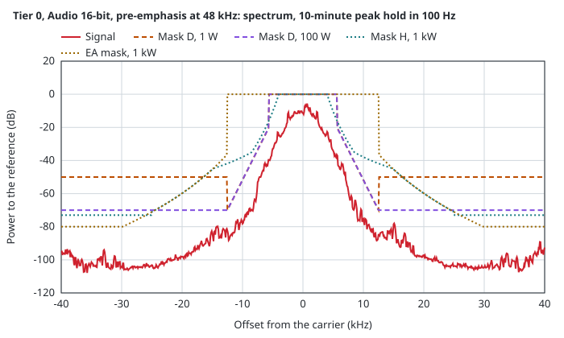
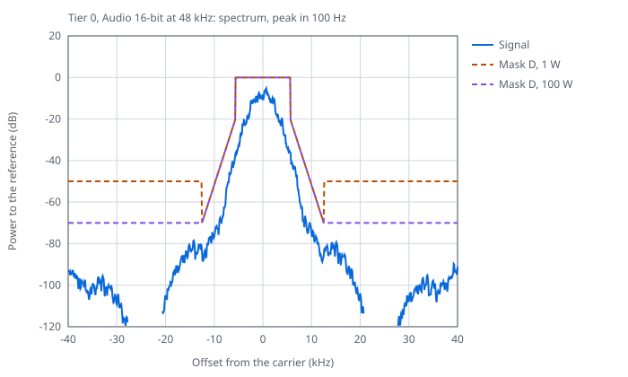
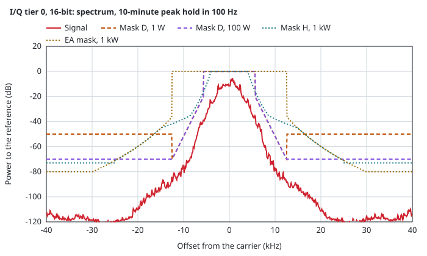
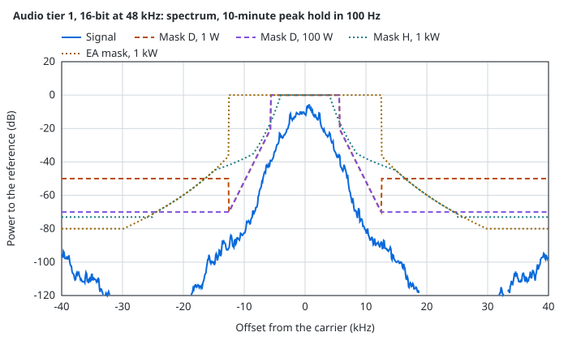
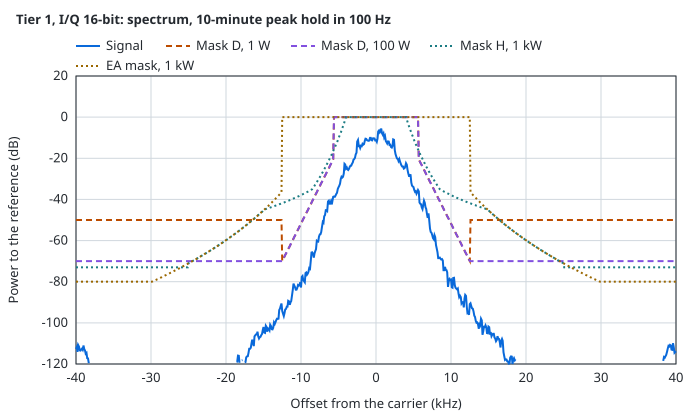
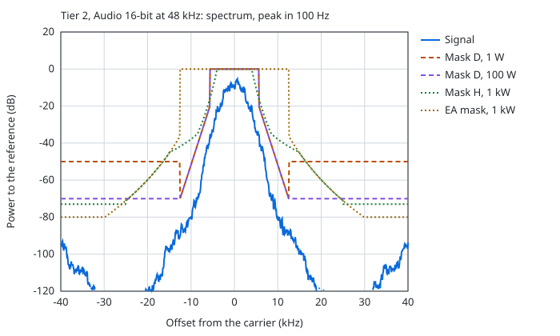
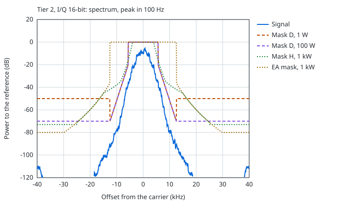

### Adjacent channel power

Power that the receiver filter of EN 300 113 Annex C passes, relative to the total, with the limit of EN 300 113 dashed. The floor far out is the 90 dB stopband of that filter.

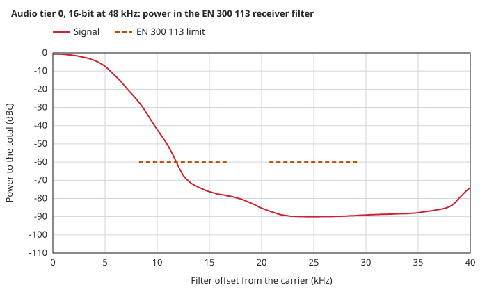
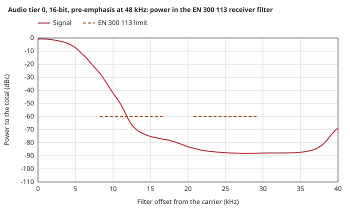
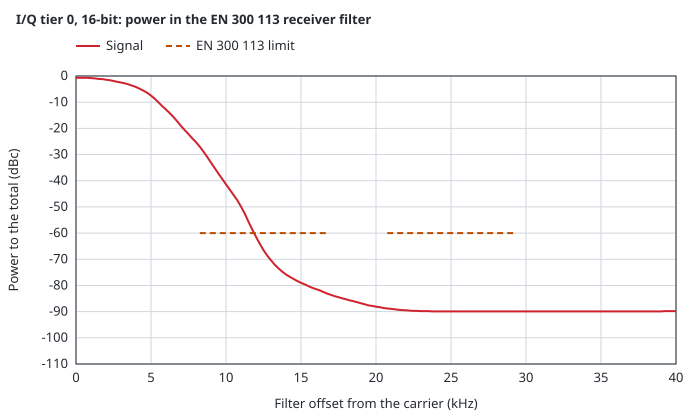
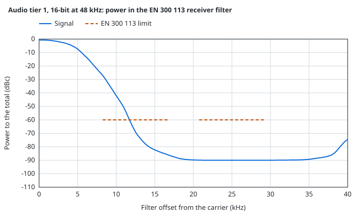
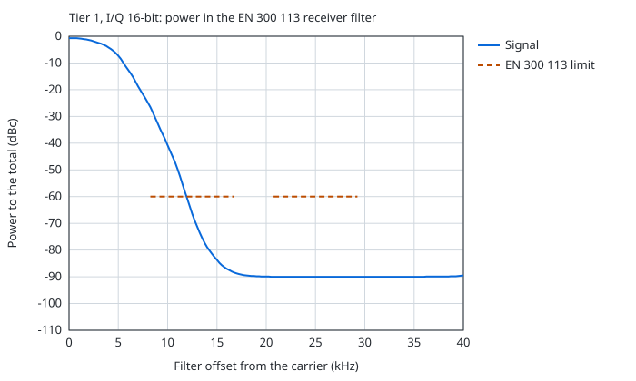
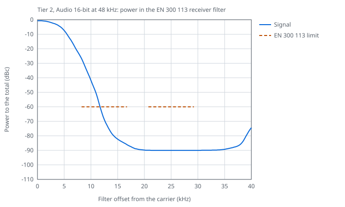

### Margins

Margin to each limit at 1 W over the margin that a setup needs, the worst over the measured points.

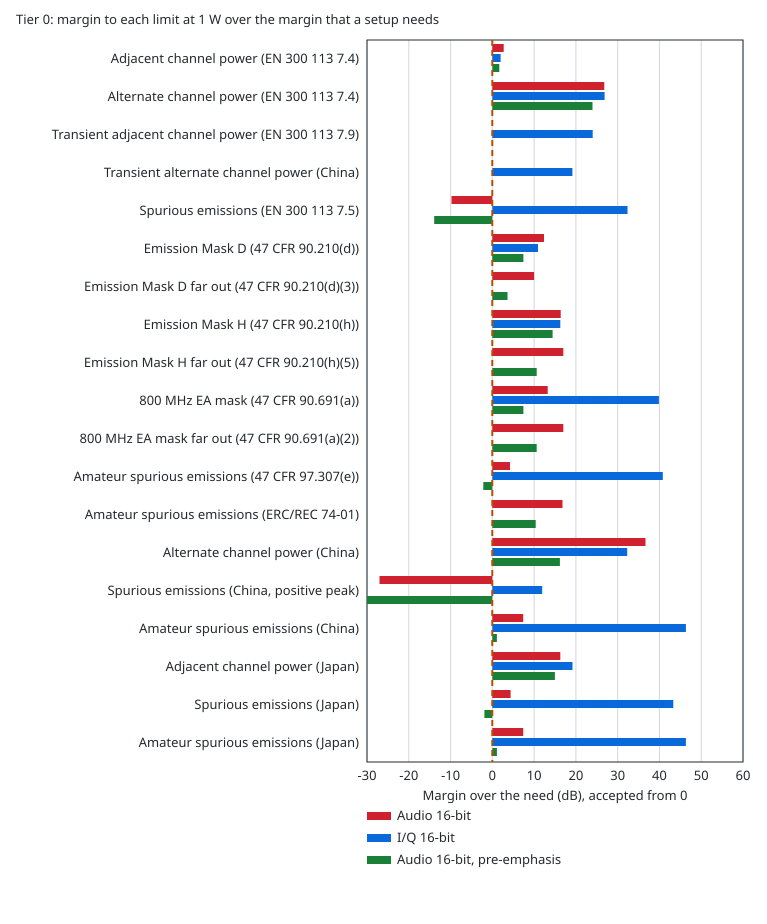
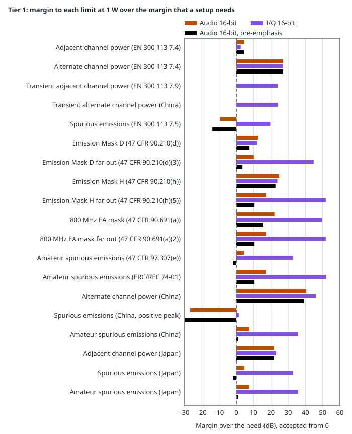
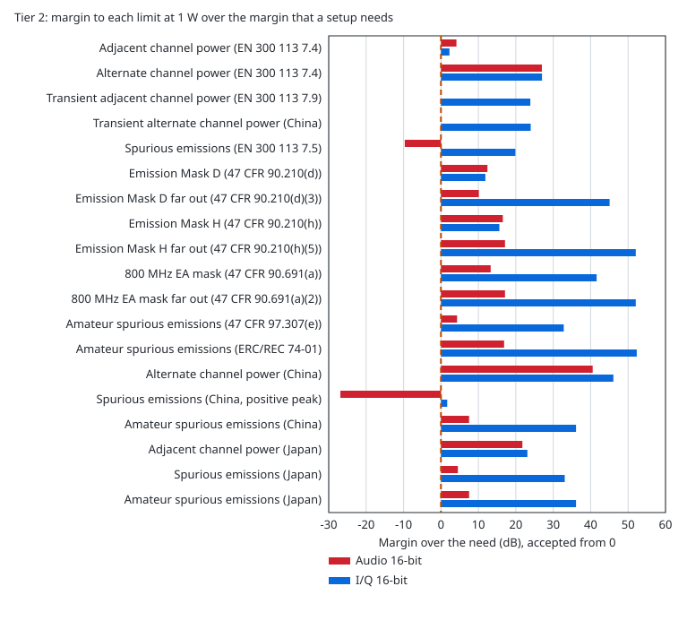

### Eye diagrams

Deviation after the receive filter of the FSK error measurement, at 48 kHz, on the symbol timing that the measurement fits.

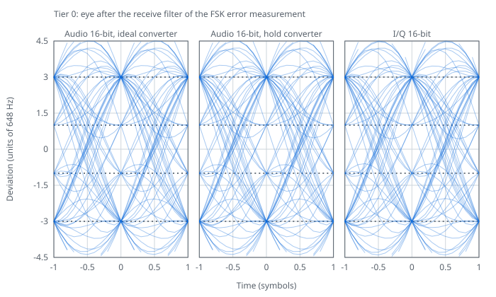
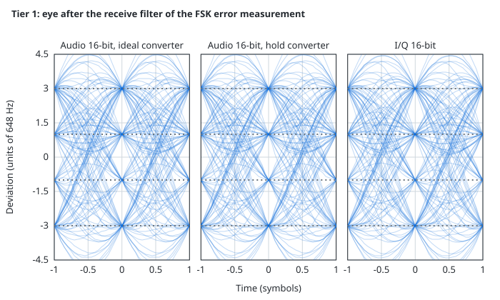
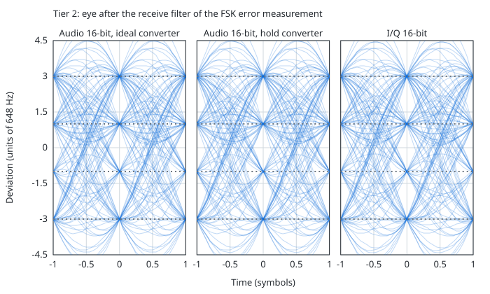

### FSK error

FSK error of each tier and output.

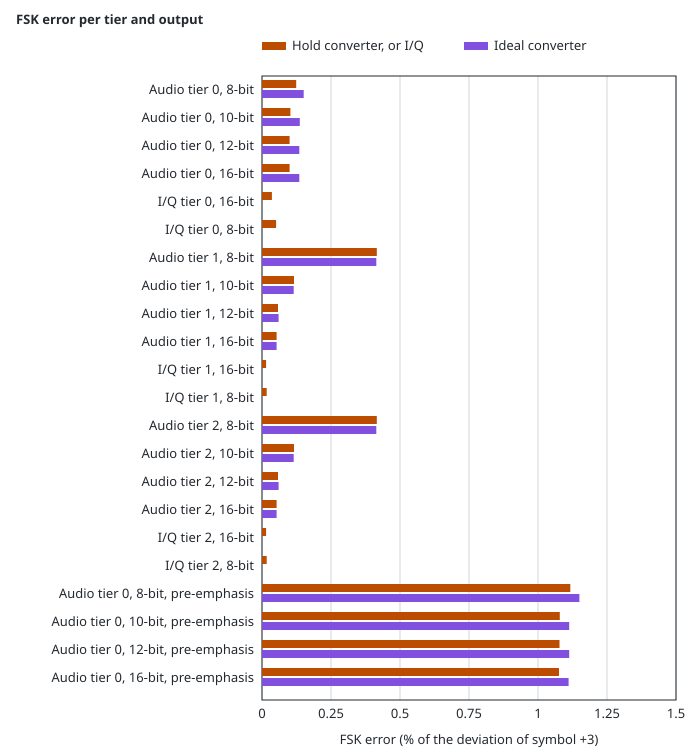

<!-- txsheet:graphs:end -->

<!-- txdoc:margins:begin -->

### Measured margins

Margin of the signal to each limit, the worst over the measured points. A positive value is inside the limit. A limit that changes with power has one value for each power breakpoint, 27, 30, 40, 44, 47, 50, 54, 57, 60 and 62 dBm, in that order. A dash is a limit that does not apply to the input. [Methods of the limits](#methods-of-the-limits) gives the margin that a setup needs.

Tier 0

| Limit | Audio 8-bit | Audio 10-bit | Audio 12-bit | Audio 16-bit | I/Q 16-bit | I/Q 8-bit | Audio 8-bit, pre-emphasis | Audio 10-bit, pre-emphasis | Audio 12-bit, pre-emphasis | Audio 16-bit, pre-emphasis |
|:---|---:|---:|---:|---:|---:|---:|---:|---:|---:|---:|
| Deviation error, % under the 10% limit (TS 102 361-1 10.2.2.3) | +9.9 | +9.9 | +9.9 | +9.9 | +9.6 | +9.6 | +8.8 | +8.6 | +8.4 | +8.3 |
| Adjacent channel power, dB (EN 300 113 7.4) | +3.6 | +5.7 | +5.9 | +5.9 | +5.0 | -0.7 | -13.0 | -1.8 | +3.8 | +4.7 |
| Alternate channel power, dB (EN 300 113 7.4) | +22.9 | +28.9 | +29.8 | +29.8 | +29.9 | +0.4 | +3.5 | +14.8 | +24.5 | +27.0 |
| Transient adjacent channel power, dB (EN 300 113 7.9) | - | - | - | - | +27.0 | +12.2 | - | - | - | - |
| Transient alternate channel power, dB (China) | - | - | - | - | +22.2 | -1.2 | - | - | - | - |
| Attack time t_p, ms over 0.1 ms (EN 300 113 7.9) | - | - | - | - | +0.3 | +0.3 | - | - | - | - |
| Release time t_d, ms over 0.1 ms (EN 300 113 7.9) | - | - | - | - | +0.3 | +0.3 | - | - | - | - |
| Transient power slope, dB (EN 300 113 7.9) | - | - | - | - | -0.0 | -0.0 | - | - | - | - |
| Transient frequency error, kHz (EN 300 113 7.9) | - | - | - | - | +6.2 | +6.2 | - | - | - | - |
| Spurious emissions, dB (EN 300 113 7.5) | +3.4 / +0.4 / -9.6 / -13.6 / -16.6 / -19.6 / -23.6 / -26.6 / -29.6 / -31.6 | +3.4 / +0.4 / -9.6 / -13.6 / -16.6 / -19.6 / -23.6 / -26.6 / -29.6 / -31.6 | +3.4 / +0.4 / -9.6 / -13.6 / -16.6 / -19.6 / -23.6 / -26.6 / -29.6 / -31.6 | +3.4 / +0.4 / -9.6 / -13.6 / -16.6 / -19.6 / -23.6 / -26.6 / -29.6 / -31.6 | +44.3 / +41.3 / +31.3 / +27.3 / +24.3 / +21.3 / +17.3 / +14.3 / +11.3 / +9.3 | +6.6 / +3.6 / -6.4 / -10.4 / -13.4 / -16.4 / -20.4 / -23.4 / -26.4 / -28.4 | -1.1 / -4.0 / -14.1 / -18.1 / -21.1 / -24.1 / -28.1 / -31.1 / -34.0 / -36.0 | -1.1 / -4.1 / -14.1 / -18.1 / -21.1 / -24.1 / -28.1 / -31.1 / -34.1 / -36.1 | -1.1 / -4.1 / -14.1 / -18.1 / -21.1 / -24.1 / -28.1 / -31.1 / -34.1 / -36.1 | -1.1 / -4.1 / -14.1 / -18.1 / -21.1 / -24.1 / -28.1 / -31.1 / -34.1 / -36.1 |
| Emission Mask D, dB (47 CFR 90.210(d)) | +9.7 / +9.7 / +8.1 / +4.1 / +1.1 / -1.9 / -1.9 / -1.9 / -1.9 / -1.9 | +14.8 / +14.8 / +8.1 / +4.1 / +1.1 / -1.9 / -1.9 / -1.9 / -1.9 / -1.9 | +15.7 / +15.7 / +8.1 / +4.0 / +1.1 / -1.9 / -1.9 / -1.9 / -1.9 / -1.9 | +15.7 / +15.7 / +8.1 / +4.0 / +1.1 / -1.9 / -1.9 / -1.9 / -1.9 / -1.9 | +14.0 / +14.0 / +14.0 / +14.0 / +14.0 / +14.0 / +14.0 / +14.0 / +14.0 / +14.0 | +3.5 / +3.5 / +3.5 / +3.5 / +3.5 / +3.0 / +3.0 / +3.0 / +3.0 / +3.0 | -8.8 / -8.8 / -8.8 / -8.8 / -8.8 / -10.3 / -10.3 / -10.3 / -10.3 / -10.3 | +1.2 / +1.2 / +0.5 / -3.5 / -6.5 / -9.5 / -9.5 / -9.5 / -9.5 / -9.5 | +11.0 / +10.5 / +0.5 / -3.5 / -6.5 / -9.5 / -9.5 / -9.5 / -9.5 / -9.5 | +12.2 / +10.5 / +0.5 / -3.5 / -6.5 / -9.5 / -9.5 / -9.5 / -9.5 / -9.5 |
| Emission Mask D far out, dB (47 CFR 90.210(d)(3)) | +23.0 / +20.0 / +10.0 / +6.0 / +3.0 / +0.0 / +0.0 / +0.0 / +0.0 / +0.0 | +23.0 / +20.0 / +10.0 / +6.0 / +3.0 / +0.0 / +0.0 / +0.0 / +0.0 / +0.0 | +23.0 / +20.0 / +10.0 / +6.0 / +3.0 / +0.0 / +0.0 / +0.0 / +0.0 / +0.0 | +23.0 / +20.0 / +10.0 / +6.0 / +3.0 / +0.0 / +0.0 / +0.0 / +0.0 / +0.0 | - | - | +16.2 / +13.2 / +3.2 / -0.8 / -3.8 / -6.8 / -6.8 / -6.8 / -6.8 / -6.8 | +16.5 / +13.5 / +3.5 / -0.5 / -3.5 / -6.5 / -6.5 / -6.5 / -6.5 / -6.5 | +16.5 / +13.5 / +3.5 / -0.5 / -3.5 / -6.5 / -6.5 / -6.5 / -6.5 / -6.5 | +16.5 / +13.5 / +3.5 / -0.5 / -3.5 / -6.5 / -6.5 / -6.5 / -6.5 / -6.5 |
| Emission Mask H, dB (47 CFR 90.210(h)) | +27.2 / +27.2 / +21.9 / +17.9 / +14.9 / +11.9 / +7.9 / +4.9 / +1.9 / -0.1 | +27.2 / +27.2 / +21.8 / +17.8 / +14.8 / +11.8 / +7.8 / +4.8 / +1.8 / -0.2 | +27.3 / +27.3 / +21.9 / +17.9 / +14.9 / +11.9 / +7.9 / +4.9 / +1.9 / -0.1 | +27.2 / +27.2 / +21.9 / +17.9 / +14.9 / +11.9 / +7.9 / +4.9 / +1.9 / -0.1 | +26.8 / +26.8 / +26.8 / +26.8 / +26.8 / +26.8 / +26.8 / +26.8 / +26.8 / +26.8 | +8.5 / +8.5 / +8.5 / +8.5 / +8.5 / +8.5 / +8.5 / +8.5 / +6.2 / +4.2 | +11.2 / +11.2 / +11.2 / +11.2 / +8.6 / +5.6 / +1.6 / -1.4 / -4.4 / -6.4 | +22.2 / +22.2 / +15.6 / +11.6 / +8.6 / +5.6 / +1.6 / -1.4 / -4.4 / -6.4 | +26.8 / +25.5 / +15.5 / +11.5 / +8.5 / +5.5 / +1.5 / -1.5 / -4.5 / -6.5 | +26.8 / +25.5 / +15.5 / +11.5 / +8.5 / +5.5 / +1.5 / -1.5 / -4.5 / -6.5 |
| Emission Mask H far out, dB (47 CFR 90.210(h)(5)) | +30.0 / +27.0 / +17.0 / +13.0 / +10.0 / +7.0 / +3.0 / +0.0 / -3.0 / -5.0 | +30.0 / +27.0 / +17.0 / +13.0 / +10.0 / +7.0 / +3.0 / +0.0 / -3.0 / -5.0 | +30.0 / +27.0 / +17.0 / +13.0 / +10.0 / +7.0 / +3.0 / +0.0 / -3.0 / -5.0 | +30.0 / +27.0 / +17.0 / +13.0 / +10.0 / +7.0 / +3.0 / +0.0 / -3.0 / -5.0 | - | - | +23.2 / +20.2 / +10.2 / +6.2 / +3.2 / +0.2 / -3.8 / -6.8 / -9.8 / -11.8 | +23.5 / +20.5 / +10.5 / +6.5 / +3.5 / +0.5 / -3.5 / -6.5 / -9.5 / -11.5 | +23.5 / +20.5 / +10.5 / +6.5 / +3.5 / +0.5 / -3.5 / -6.5 / -9.5 / -11.5 | +23.5 / +20.5 / +10.5 / +6.5 / +3.5 / +0.5 / -3.5 / -6.5 / -9.5 / -11.5 |
| 800 MHz EA mask, dB (47 CFR 90.691(a)) | +27.9 / +24.9 / +14.9 / +10.9 / +7.9 / +4.9 / +0.9 / -2.1 / -5.1 / -5.1 | +27.8 / +24.8 / +14.8 / +10.8 / +7.8 / +4.8 / +0.8 / -2.2 / -5.2 / -5.2 | +27.9 / +24.9 / +14.9 / +10.9 / +7.9 / +4.9 / +0.9 / -2.1 / -5.1 / -5.1 | +27.9 / +24.9 / +14.9 / +10.9 / +7.9 / +4.9 / +0.9 / -2.1 / -5.1 / -5.1 | +51.3 / +51.3 / +50.4 / +50.4 / +47.4 / +44.4 / +40.4 / +37.4 / +34.4 / +34.4 | +32.2 / +29.2 / +19.2 / +15.2 / +12.2 / +9.2 / +5.2 / +2.2 / -0.8 / -0.8 | +19.6 / +18.6 / +8.6 / +4.6 / +1.6 / -1.4 / -5.4 / -8.4 / -11.4 / -11.4 | +21.6 / +18.6 / +8.6 / +4.6 / +1.6 / -1.4 / -5.4 / -8.4 / -11.4 / -11.4 | +21.5 / +18.5 / +8.5 / +4.5 / +1.5 / -1.5 / -5.5 / -8.5 / -11.5 / -11.5 | +21.5 / +18.5 / +8.5 / +4.5 / +1.5 / -1.5 / -5.5 / -8.5 / -11.5 / -11.5 |
| 800 MHz EA mask far out, dB (47 CFR 90.691(a)(2)) | +30.0 / +27.0 / +17.0 / +13.0 / +10.0 / +7.0 / +3.0 / +0.0 / -3.0 / -5.0 | +30.0 / +27.0 / +17.0 / +13.0 / +10.0 / +7.0 / +3.0 / +0.0 / -3.0 / -5.0 | +30.0 / +27.0 / +17.0 / +13.0 / +10.0 / +7.0 / +3.0 / +0.0 / -3.0 / -5.0 | +30.0 / +27.0 / +17.0 / +13.0 / +10.0 / +7.0 / +3.0 / +0.0 / -3.0 / -5.0 | - | - | +23.2 / +20.2 / +10.2 / +6.2 / +3.2 / +0.2 / -3.8 / -6.8 / -9.8 / -11.8 | +23.5 / +20.5 / +10.5 / +6.5 / +3.5 / +0.5 / -3.5 / -6.5 / -9.5 / -11.5 | +23.5 / +20.5 / +10.5 / +6.5 / +3.5 / +0.5 / -3.5 / -6.5 / -9.5 / -11.5 | +23.5 / +20.5 / +10.5 / +6.5 / +3.5 / +0.5 / -3.5 / -6.5 / -9.5 / -11.5 |
| Amateur spurious emissions, dB (47 CFR 97.307(e)) | +17.2 / +14.2 / +4.2 / +0.2 / +0.2 / +0.2 / +0.2 / +0.2 / +0.2 / +0.2 | +17.2 / +14.2 / +4.2 / +0.3 / +0.3 / +0.3 / +0.3 / +0.3 / +0.3 / +0.3 | +17.2 / +14.2 / +4.2 / +0.3 / +0.3 / +0.3 / +0.3 / +0.3 / +0.3 / +0.3 | +17.2 / +14.2 / +4.2 / +0.3 / +0.3 / +0.3 / +0.3 / +0.3 / +0.3 / +0.3 | +53.3 / +50.3 / +40.3 / +36.3 / +36.3 / +36.3 / +36.3 / +36.3 / +36.3 / +36.3 | +12.1 / +9.1 / -0.9 / -4.9 / -4.9 / -4.9 / -4.9 / -4.9 / -4.9 / -4.9 | +9.8 / +6.8 / -3.2 / -7.2 / -7.2 / -7.2 / -7.2 / -7.2 / -7.2 / -7.2 | +10.8 / +7.8 / -2.2 / -6.1 / -6.1 / -6.1 / -6.1 / -6.1 / -6.1 / -6.1 | +10.9 / +7.9 / -2.1 / -6.1 / -6.1 / -6.1 / -6.1 / -6.1 / -6.1 / -6.1 | +10.9 / +7.9 / -2.1 / -6.1 / -6.1 / -6.1 / -6.1 / -6.1 / -6.1 / -6.1 |
| Amateur spurious emissions, dB (ERC/REC 74-01) | +29.8 / +26.8 / +16.8 / +12.8 / +9.8 / +6.8 / +2.8 / -0.2 / -0.2 / -0.2 | +29.8 / +26.8 / +16.8 / +12.8 / +9.8 / +6.8 / +2.8 / -0.2 / -0.2 / -0.2 | +29.8 / +26.8 / +16.8 / +12.8 / +9.8 / +6.8 / +2.8 / -0.2 / -0.2 / -0.2 | +29.8 / +26.8 / +16.8 / +12.8 / +9.8 / +6.8 / +2.8 / -0.2 / -0.2 / -0.2 | - | - | +23.0 / +20.0 / +10.0 / +6.0 / +3.0 / +0.0 / -4.0 / -7.0 / -7.0 / -7.0 | +23.4 / +20.4 / +10.4 / +6.4 / +3.4 / +0.4 / -3.6 / -6.6 / -6.6 / -6.6 | +23.5 / +20.5 / +10.5 / +6.5 / +3.5 / +0.5 / -3.5 / -6.5 / -6.5 / -6.5 | +23.5 / +20.5 / +10.5 / +6.5 / +3.5 / +0.5 / -3.5 / -6.5 / -6.5 / -6.5 |
| Alternate channel power, dB (China) | +13.0 | +25.5 | +35.7 | +40.1 | +35.3 | -9.6 | -6.5 | +4.8 | +15.2 | +19.3 |
| Occupied bandwidth, kHz under 8.5 kHz (China) | +0.9 | +0.9 | +0.9 | +0.9 | +0.9 | +0.9 | +0.8 | +0.8 | +0.8 | +0.8 |
| Spurious emissions, dB (China, positive peak) | -14.0 / -17.0 / -27.0 / -31.0 / -34.0 / -37.0 / -41.0 / -44.0 / -47.0 / -49.0 | -14.0 / -17.0 / -27.0 / -31.0 / -34.0 / -37.0 / -41.0 / -44.0 / -47.0 / -49.0 | -14.0 / -17.0 / -27.0 / -31.0 / -34.0 / -37.0 / -41.0 / -44.0 / -47.0 / -49.0 | -14.0 / -17.0 / -27.0 / -31.0 / -34.0 / -37.0 / -41.0 / -44.0 / -47.0 / -49.0 | +24.2 / +21.2 / +11.2 / +7.2 / +4.2 / +1.2 / -2.8 / -5.8 / -8.8 / -10.8 | -17.5 / -20.5 / -30.5 / -34.5 / -37.5 / -40.5 / -44.5 / -47.5 / -50.5 / -52.5 | -20.8 / -23.8 / -33.8 / -37.8 / -40.8 / -43.8 / -47.8 / -50.8 / -53.8 / -55.8 | -20.4 / -23.4 / -33.4 / -37.4 / -40.4 / -43.4 / -47.4 / -50.4 / -53.4 / -55.4 | -20.4 / -23.4 / -33.4 / -37.4 / -40.4 / -43.4 / -47.4 / -50.4 / -53.4 / -55.4 | -20.4 / -23.4 / -33.4 / -37.4 / -40.4 / -43.4 / -47.4 / -50.4 / -53.4 / -55.4 |
| Amateur spurious emissions, dB (China) | +20.4 / +17.4 / +7.4 / +3.4 / +0.4 / -2.6 / -6.6 / -9.6 / -9.6 / -9.6 | +20.4 / +17.4 / +7.4 / +3.4 / +0.4 / -2.6 / -6.6 / -9.6 / -9.6 / -9.6 | +20.4 / +17.4 / +7.4 / +3.4 / +0.4 / -2.6 / -6.6 / -9.6 / -9.6 / -9.6 | +20.4 / +17.4 / +7.4 / +3.4 / +0.4 / -2.6 / -6.6 / -9.6 / -9.6 / -9.6 | +58.6 / +55.6 / +45.6 / +41.6 / +38.6 / +35.6 / +31.6 / +28.6 / +28.6 / +28.6 | +16.9 / +13.9 / +3.9 / -0.1 / -3.1 / -6.1 / -10.1 / -13.1 / -13.1 / -13.1 | +13.6 / +10.6 / +0.6 / -3.4 / -6.4 / -9.4 / -13.4 / -16.4 / -16.4 / -16.4 | +14.0 / +11.0 / +1.0 / -3.0 / -6.0 / -9.0 / -13.0 / -16.0 / -16.0 / -16.0 | +14.0 / +11.0 / +1.0 / -3.0 / -6.0 / -9.0 / -13.0 / -16.0 / -16.0 / -16.0 | +14.0 / +11.0 / +1.0 / -3.0 / -6.0 / -9.0 / -13.0 / -16.0 / -16.0 / -16.0 |
| Adjacent channel power, dB (Japan) | +13.9 | +19.0 | +19.7 | +19.8 | +22.2 | +8.5 | -4.4 | +7.2 | +16.1 | +18.4 |
| Occupied bandwidth, kHz under 11.5 kHz (Japan) | +3.9 | +3.9 | +3.9 | +3.9 | +3.9 | +3.9 | +3.8 | +3.8 | +3.8 | +3.8 |
| Spurious emissions, dB (Japan) | +17.4 / +14.4 / +0.4 / +0.4 / +0.4 / -2.6 / -6.6 / -9.6 / -9.6 / -9.6 | +17.4 / +14.4 / +0.4 / +0.4 / +0.4 / -2.6 / -6.6 / -9.6 / -9.6 / -9.6 | +17.4 / +14.4 / +0.4 / +0.4 / +0.4 / -2.6 / -6.6 / -9.6 / -9.6 / -9.6 | +17.4 / +14.4 / +0.4 / +0.4 / +0.4 / -2.6 / -6.6 / -9.6 / -9.6 / -9.6 | +55.6 / +52.6 / +38.6 / +38.6 / +38.6 / +35.6 / +31.6 / +28.6 / +28.6 / +28.6 | +13.9 / +10.9 / -3.1 / -3.1 / -3.1 / -6.1 / -10.1 / -13.1 / -13.1 / -13.1 | +10.6 / +7.6 / -6.4 / -6.4 / -6.4 / -9.4 / -13.4 / -16.4 / -16.4 / -16.4 | +11.0 / +8.0 / -6.0 / -6.0 / -6.0 / -9.0 / -13.0 / -16.0 / -16.0 / -16.0 | +11.0 / +8.0 / -6.0 / -6.0 / -6.0 / -9.0 / -13.0 / -16.0 / -16.0 / -16.0 | +11.0 / +8.0 / -6.0 / -6.0 / -6.0 / -9.0 / -13.0 / -16.0 / -16.0 / -16.0 |
| Amateur spurious emissions, dB (Japan) | +20.4 / +17.4 / +0.4 / +0.4 / +0.4 / -2.6 / -6.6 / -9.6 / -9.6 / -9.6 | +20.4 / +17.4 / +0.4 / +0.4 / +0.4 / -2.6 / -6.6 / -9.6 / -9.6 / -9.6 | +20.4 / +17.4 / +0.4 / +0.4 / +0.4 / -2.6 / -6.6 / -9.6 / -9.6 / -9.6 | +20.4 / +17.4 / +0.4 / +0.4 / +0.4 / -2.6 / -6.6 / -9.6 / -9.6 / -9.6 | +58.6 / +55.6 / +38.6 / +38.6 / +38.6 / +35.6 / +31.6 / +28.6 / +28.6 / +28.6 | +16.9 / +13.9 / -3.1 / -3.1 / -3.1 / -6.1 / -10.1 / -13.1 / -13.1 / -13.1 | +13.6 / +10.6 / -6.4 / -6.4 / -6.4 / -9.4 / -13.4 / -16.4 / -16.4 / -16.4 | +14.0 / +11.0 / -6.0 / -6.0 / -6.0 / -9.0 / -13.0 / -16.0 / -16.0 / -16.0 | +14.0 / +11.0 / -6.0 / -6.0 / -6.0 / -9.0 / -13.0 / -16.0 / -16.0 / -16.0 | +14.0 / +11.0 / -6.0 / -6.0 / -6.0 / -9.0 / -13.0 / -16.0 / -16.0 / -16.0 |

Tier 1

| Limit | Audio 8-bit | Audio 10-bit | Audio 12-bit | Audio 16-bit | I/Q 16-bit | I/Q 8-bit |
|:---|---:|---:|---:|---:|---:|---:|
| Deviation error, % under the 10% limit (TS 102 361-1 10.2.2.3) | +9.9 | +9.9 | +9.9 | +9.9 | +10.0 | +10.0 |
| Adjacent channel power, dB (EN 300 113 7.4) | +2.7 | +6.9 | +7.3 | +7.3 | +5.5 | +4.8 |
| Alternate channel power, dB (EN 300 113 7.4) | +24.5 | +29.4 | +29.9 | +30.0 | +30.0 | +12.4 |
| Transient adjacent channel power, dB (EN 300 113 7.9) | - | - | - | - | +26.9 | +15.2 |
| Transient alternate channel power, dB (China) | - | - | - | - | +27.0 | +4.5 |
| Attack time t_p, ms over 0.1 ms (EN 300 113 7.9) | - | - | - | - | +0.3 | +0.3 |
| Release time t_d, ms over 0.1 ms (EN 300 113 7.9) | - | - | - | - | +0.3 | +0.3 |
| Transient power slope, dB (EN 300 113 7.9) | - | - | - | - | -0.0 | -0.0 |
| Transient frequency error, kHz (EN 300 113 7.9) | - | - | - | - | +6.2 | +6.2 |
| Spurious emissions, dB (EN 300 113 7.5) | +3.4 / +0.4 / -9.6 / -13.6 / -16.6 / -19.6 / -23.6 / -26.6 / -29.6 / -31.6 | +3.4 / +0.4 / -9.6 / -13.6 / -16.6 / -19.6 / -23.6 / -26.6 / -29.6 / -31.6 | +3.4 / +0.4 / -9.6 / -13.6 / -16.6 / -19.6 / -23.6 / -26.6 / -29.6 / -31.6 | +3.4 / +0.4 / -9.6 / -13.6 / -16.6 / -19.6 / -23.6 / -26.6 / -29.6 / -31.6 | +32.5 / +29.5 / +19.5 / +15.5 / +12.5 / +9.5 / +5.5 / +2.5 / -0.5 / -2.5 | -0.4 / -3.4 / -13.4 / -17.4 / -20.4 / -23.4 / -27.4 / -30.4 / -33.4 / -35.4 |
| Emission Mask D, dB (47 CFR 90.210(d)) | +5.2 / +5.2 / +5.2 / +4.2 / +1.2 / -1.8 / -1.8 / -1.8 / -1.8 / -1.8 | +14.6 / +14.6 / +8.2 / +4.2 / +1.2 / -1.8 / -1.8 / -1.8 / -1.8 / -1.8 | +15.5 / +15.5 / +8.2 / +4.2 / +1.2 / -1.8 / -1.8 / -1.8 / -1.8 / -1.8 | +15.6 / +15.6 / +8.2 / +4.2 / +1.2 / -1.8 / -1.8 / -1.8 / -1.8 / -1.8 | +15.0 / +15.0 / +15.0 / +15.0 / +15.0 / +15.0 / +15.0 / +15.0 / +15.0 / +15.0 | +15.0 / +15.0 / +15.0 / +15.0 / +15.0 / +14.5 / +14.5 / +14.5 / +14.5 / +14.5 |
| Emission Mask D far out, dB (47 CFR 90.210(d)(3)) | +23.1 / +20.1 / +10.1 / +6.1 / +3.1 / +0.1 / +0.1 / +0.1 / +0.1 / +0.1 | +23.1 / +20.1 / +10.1 / +6.1 / +3.1 / +0.1 / +0.1 / +0.1 / +0.1 / +0.1 | +23.1 / +20.1 / +10.1 / +6.1 / +3.1 / +0.1 / +0.1 / +0.1 / +0.1 / +0.1 | +23.1 / +20.1 / +10.1 / +6.1 / +3.1 / +0.1 / +0.1 / +0.1 / +0.1 / +0.1 | +57.8 / +54.8 / +44.8 / +40.8 / +37.8 / +34.8 / +34.8 / +34.8 / +34.8 / +34.8 | +14.7 / +11.7 / +1.7 / -2.3 / -5.3 / -8.3 / -8.3 / -8.3 / -8.3 / -8.3 |
| Emission Mask H, dB (47 CFR 90.210(h)) | +27.6 / +27.6 / +21.9 / +17.9 / +14.9 / +11.9 / +7.9 / +4.9 / +1.9 / -0.1 | +27.6 / +27.6 / +21.9 / +17.9 / +14.9 / +11.9 / +7.9 / +4.9 / +1.9 / -0.1 | +27.6 / +27.6 / +21.9 / +17.9 / +14.9 / +11.9 / +7.9 / +4.9 / +1.9 / -0.1 | +27.6 / +27.6 / +21.9 / +17.9 / +14.9 / +11.9 / +7.9 / +4.9 / +1.9 / -0.1 | +26.6 / +26.6 / +26.6 / +26.6 / +26.6 / +26.6 / +26.6 / +26.6 / +26.6 / +26.6 | +20.6 / +20.6 / +20.6 / +20.6 / +20.6 / +20.6 / +20.6 / +20.6 / +17.7 / +15.7 |
| Emission Mask H far out, dB (47 CFR 90.210(h)(5)) | +30.1 / +27.1 / +17.1 / +13.1 / +10.1 / +7.1 / +3.1 / +0.1 / -2.9 / -4.9 | +30.1 / +27.1 / +17.1 / +13.1 / +10.1 / +7.1 / +3.1 / +0.1 / -2.9 / -4.9 | +30.1 / +27.1 / +17.1 / +13.1 / +10.1 / +7.1 / +3.1 / +0.1 / -2.9 / -4.9 | +30.1 / +27.1 / +17.1 / +13.1 / +10.1 / +7.1 / +3.1 / +0.1 / -2.9 / -4.9 | +64.8 / +61.8 / +51.8 / +47.8 / +44.8 / +41.8 / +37.8 / +34.8 / +31.8 / +29.8 | +21.7 / +18.7 / +8.7 / +4.7 / +1.7 / -1.3 / -5.3 / -8.3 / -11.3 / -13.3 |
| 800 MHz EA mask, dB (47 CFR 90.691(a)) | +27.9 / +24.9 / +14.9 / +10.9 / +7.9 / +4.9 / +0.9 / -2.1 / -5.1 / -5.1 | +27.9 / +24.9 / +14.9 / +10.9 / +7.9 / +4.9 / +0.9 / -2.1 / -5.1 / -5.1 | +27.9 / +24.9 / +14.9 / +10.9 / +7.9 / +4.9 / +0.9 / -2.1 / -5.1 / -5.1 | +27.9 / +24.9 / +14.9 / +10.9 / +7.9 / +4.9 / +0.9 / -2.1 / -5.1 / -5.1 | +55.5 / +52.5 / +42.5 / +38.5 / +35.5 / +32.5 / +28.5 / +25.5 / +22.5 / +22.5 | +43.7 / +40.7 / +30.7 / +26.7 / +23.7 / +20.7 / +16.7 / +13.7 / +10.7 / +10.7 |
| 800 MHz EA mask far out, dB (47 CFR 90.691(a)(2)) | +30.1 / +27.1 / +17.1 / +13.1 / +10.1 / +7.1 / +3.1 / +0.1 / -2.9 / -4.9 | +30.1 / +27.1 / +17.1 / +13.1 / +10.1 / +7.1 / +3.1 / +0.1 / -2.9 / -4.9 | +30.1 / +27.1 / +17.1 / +13.1 / +10.1 / +7.1 / +3.1 / +0.1 / -2.9 / -4.9 | +30.1 / +27.1 / +17.1 / +13.1 / +10.1 / +7.1 / +3.1 / +0.1 / -2.9 / -4.9 | +64.8 / +61.8 / +51.8 / +47.8 / +44.8 / +41.8 / +37.8 / +34.8 / +31.8 / +29.8 | +21.7 / +18.7 / +8.7 / +4.7 / +1.7 / -1.3 / -5.3 / -8.3 / -11.3 / -13.3 |
| Amateur spurious emissions, dB (47 CFR 97.307(e)) | +17.3 / +14.3 / +4.3 / +0.3 / +0.3 / +0.3 / +0.3 / +0.3 / +0.3 / +0.3 | +17.3 / +14.3 / +4.3 / +0.4 / +0.4 / +0.4 / +0.4 / +0.4 / +0.4 / +0.4 | +17.3 / +14.3 / +4.3 / +0.4 / +0.4 / +0.4 / +0.4 / +0.4 / +0.4 / +0.4 | +17.3 / +14.3 / +4.3 / +0.4 / +0.4 / +0.4 / +0.4 / +0.4 / +0.4 / +0.4 | +45.7 / +42.7 / +32.7 / +28.7 / +28.7 / +28.7 / +28.7 / +28.7 / +28.7 / +28.7 | +18.6 / +15.6 / +5.6 / +1.6 / +1.6 / +1.6 / +1.6 / +1.6 / +1.6 / +1.6 |
| Amateur spurious emissions, dB (ERC/REC 74-01) | +29.9 / +26.9 / +16.9 / +12.9 / +9.9 / +6.9 / +2.9 / -0.1 / -0.1 / -0.1 | +29.9 / +26.9 / +16.9 / +12.9 / +9.9 / +6.9 / +2.9 / -0.1 / -0.1 / -0.1 | +29.9 / +26.9 / +16.9 / +12.9 / +9.9 / +6.9 / +2.9 / -0.1 / -0.1 / -0.1 | +29.9 / +26.9 / +16.9 / +12.9 / +9.9 / +6.9 / +2.9 / -0.1 / -0.1 / -0.1 | +65.0 / +62.0 / +52.0 / +48.0 / +45.0 / +42.0 / +38.0 / +35.0 / +35.0 / +35.0 | +21.7 / +18.7 / +8.7 / +4.7 / +1.7 / -1.3 / -5.3 / -8.3 / -8.3 / -8.3 |
| Alternate channel power, dB (China) | +16.6 | +28.8 | +39.3 | +43.5 | +49.1 | +2.4 |
| Occupied bandwidth, kHz under 8.5 kHz (China) | +0.9 | +0.9 | +0.9 | +0.9 | +0.8 | +0.8 |
| Spurious emissions, dB (China, positive peak) | -13.9 / -16.9 / -26.9 / -30.9 / -33.9 / -36.9 / -40.9 / -43.9 / -46.9 / -48.9 | -13.9 / -16.9 / -26.9 / -30.9 / -33.9 / -36.9 / -40.9 / -43.9 / -46.9 / -48.9 | -13.9 / -16.9 / -26.9 / -30.9 / -33.9 / -36.9 / -40.9 / -43.9 / -46.9 / -48.9 | -13.9 / -16.9 / -26.9 / -30.9 / -33.9 / -36.9 / -40.9 / -43.9 / -46.9 / -48.9 | +14.4 / +11.4 / +1.4 / -2.6 / -5.6 / -8.6 / -12.6 / -15.6 / -18.6 / -20.6 | -12.8 / -15.8 / -25.8 / -29.8 / -32.8 / -35.8 / -39.8 / -42.8 / -45.8 / -47.8 |
| Amateur spurious emissions, dB (China) | +20.5 / +17.5 / +7.5 / +3.5 / +0.5 / -2.5 / -6.5 / -9.5 / -9.5 / -9.5 | +20.5 / +17.5 / +7.5 / +3.5 / +0.5 / -2.5 / -6.5 / -9.5 / -9.5 / -9.5 | +20.5 / +17.5 / +7.5 / +3.5 / +0.5 / -2.5 / -6.5 / -9.5 / -9.5 / -9.5 | +20.5 / +17.5 / +7.5 / +3.5 / +0.5 / -2.5 / -6.5 / -9.5 / -9.5 / -9.5 | +48.8 / +45.8 / +35.8 / +31.8 / +28.8 / +25.8 / +21.8 / +18.8 / +18.8 / +18.8 | +21.6 / +18.6 / +8.6 / +4.6 / +1.6 / -1.4 / -5.4 / -8.4 / -8.4 / -8.4 |
| Adjacent channel power, dB (Japan) | +11.2 | +21.5 | +24.5 | +24.8 | +26.0 | +19.8 |
| Occupied bandwidth, kHz under 11.5 kHz (Japan) | +3.9 | +3.9 | +3.9 | +3.9 | +3.8 | +3.8 |
| Spurious emissions, dB (Japan) | +17.5 / +14.5 / +0.5 / +0.5 / +0.5 / -2.5 / -6.5 / -9.5 / -9.5 / -9.5 | +17.5 / +14.5 / +0.5 / +0.5 / +0.5 / -2.5 / -6.5 / -9.5 / -9.5 / -9.5 | +17.5 / +14.5 / +0.5 / +0.5 / +0.5 / -2.5 / -6.5 / -9.5 / -9.5 / -9.5 | +17.5 / +14.5 / +0.5 / +0.5 / +0.5 / -2.5 / -6.5 / -9.5 / -9.5 / -9.5 | +45.8 / +42.8 / +28.8 / +28.8 / +28.8 / +25.8 / +21.8 / +18.8 / +18.8 / +18.8 | +18.6 / +15.6 / +1.6 / +1.6 / +1.6 / -1.4 / -5.4 / -8.4 / -8.4 / -8.4 |
| Amateur spurious emissions, dB (Japan) | +20.5 / +17.5 / +0.5 / +0.5 / +0.5 / -2.5 / -6.5 / -9.5 / -9.5 / -9.5 | +20.5 / +17.5 / +0.5 / +0.5 / +0.5 / -2.5 / -6.5 / -9.5 / -9.5 / -9.5 | +20.5 / +17.5 / +0.5 / +0.5 / +0.5 / -2.5 / -6.5 / -9.5 / -9.5 / -9.5 | +20.5 / +17.5 / +0.5 / +0.5 / +0.5 / -2.5 / -6.5 / -9.5 / -9.5 / -9.5 | +48.8 / +45.8 / +28.8 / +28.8 / +28.8 / +25.8 / +21.8 / +18.8 / +18.8 / +18.8 | +21.6 / +18.6 / +1.6 / +1.6 / +1.6 / -1.4 / -5.4 / -8.4 / -8.4 / -8.4 |

Tier 2

| Limit | Audio 8-bit | Audio 10-bit | Audio 12-bit | Audio 16-bit | I/Q 16-bit | I/Q 8-bit |
|:---|---:|---:|---:|---:|---:|---:|
| Deviation error, % under the 10% limit (TS 102 361-1 10.2.2.3) | +9.9 | +9.9 | +9.9 | +9.9 | +10.0 | +10.0 |
| Adjacent channel power, dB (EN 300 113 7.4) | +2.7 | +6.9 | +7.3 | +7.3 | +5.5 | +4.8 |
| Alternate channel power, dB (EN 300 113 7.4) | +24.5 | +29.4 | +29.9 | +30.0 | +30.0 | +12.4 |
| Transient adjacent channel power, dB (EN 300 113 7.9) | - | - | - | - | +26.9 | +15.2 |
| Transient alternate channel power, dB (China) | - | - | - | - | +27.0 | +4.5 |
| Attack time t_p, ms over 0.1 ms (EN 300 113 7.9) | - | - | - | - | +0.3 | +0.3 |
| Release time t_d, ms over 0.1 ms (EN 300 113 7.9) | - | - | - | - | +0.3 | +0.3 |
| Transient power slope, dB (EN 300 113 7.9) | - | - | - | - | -0.0 | -0.0 |
| Transient frequency error, kHz (EN 300 113 7.9) | - | - | - | - | +6.2 | +6.2 |
| Spurious emissions, dB (EN 300 113 7.5) | +3.4 / +0.4 / -9.6 / -13.6 / -16.6 / -19.6 / -23.6 / -26.6 / -29.6 / -31.6 | +3.4 / +0.4 / -9.6 / -13.6 / -16.6 / -19.6 / -23.6 / -26.6 / -29.6 / -31.6 | +3.4 / +0.4 / -9.6 / -13.6 / -16.6 / -19.6 / -23.6 / -26.6 / -29.6 / -31.6 | +3.4 / +0.4 / -9.6 / -13.6 / -16.6 / -19.6 / -23.6 / -26.6 / -29.6 / -31.6 | +32.5 / +29.5 / +19.5 / +15.5 / +12.5 / +9.5 / +5.5 / +2.5 / -0.5 / -2.5 | -0.4 / -3.4 / -13.4 / -17.4 / -20.4 / -23.4 / -27.4 / -30.4 / -33.4 / -35.4 |
| Emission Mask D, dB (47 CFR 90.210(d)) | +5.2 / +5.2 / +5.2 / +4.2 / +1.2 / -1.8 / -1.8 / -1.8 / -1.8 / -1.8 | +14.5 / +14.5 / +8.2 / +4.2 / +1.2 / -1.8 / -1.8 / -1.8 / -1.8 / -1.8 | +15.4 / +15.4 / +8.2 / +4.2 / +1.2 / -1.8 / -1.8 / -1.8 / -1.8 / -1.8 | +15.6 / +15.6 / +8.2 / +4.2 / +1.2 / -1.8 / -1.8 / -1.8 / -1.8 / -1.8 | +15.0 / +15.0 / +15.0 / +15.0 / +15.0 / +15.0 / +15.0 / +15.0 / +15.0 / +15.0 | +15.0 / +15.0 / +15.0 / +15.0 / +15.0 / +14.5 / +14.5 / +14.5 / +14.5 / +14.5 |
| Emission Mask D far out, dB (47 CFR 90.210(d)(3)) | +23.1 / +20.1 / +10.1 / +6.1 / +3.1 / +0.1 / +0.1 / +0.1 / +0.1 / +0.1 | +23.1 / +20.1 / +10.1 / +6.1 / +3.1 / +0.1 / +0.1 / +0.1 / +0.1 / +0.1 | +23.1 / +20.1 / +10.1 / +6.1 / +3.1 / +0.1 / +0.1 / +0.1 / +0.1 / +0.1 | +23.1 / +20.1 / +10.1 / +6.1 / +3.1 / +0.1 / +0.1 / +0.1 / +0.1 / +0.1 | +57.7 / +54.7 / +44.7 / +40.7 / +37.7 / +34.7 / +34.7 / +34.7 / +34.7 / +34.7 | +14.7 / +11.7 / +1.7 / -2.3 / -5.3 / -8.3 / -8.3 / -8.3 / -8.3 / -8.3 |
| Emission Mask H, dB (47 CFR 90.210(h)) | +27.6 / +27.6 / +21.9 / +17.9 / +14.9 / +11.9 / +7.9 / +4.9 / +1.9 / -0.1 | +27.6 / +27.6 / +21.9 / +17.9 / +14.9 / +11.9 / +7.9 / +4.9 / +1.9 / -0.1 | +27.6 / +27.6 / +21.9 / +17.9 / +14.9 / +11.9 / +7.9 / +4.9 / +1.9 / -0.1 | +27.6 / +27.6 / +21.9 / +17.9 / +14.9 / +11.9 / +7.9 / +4.9 / +1.9 / -0.1 | +26.6 / +26.6 / +26.6 / +26.6 / +26.6 / +26.6 / +26.6 / +26.6 / +26.6 / +26.6 | +20.6 / +20.6 / +20.6 / +20.6 / +20.6 / +20.6 / +20.6 / +20.6 / +17.7 / +15.7 |
| Emission Mask H far out, dB (47 CFR 90.210(h)(5)) | +30.1 / +27.1 / +17.1 / +13.1 / +10.1 / +7.1 / +3.1 / +0.1 / -2.9 / -4.9 | +30.1 / +27.1 / +17.1 / +13.1 / +10.1 / +7.1 / +3.1 / +0.1 / -2.9 / -4.9 | +30.1 / +27.1 / +17.1 / +13.1 / +10.1 / +7.1 / +3.1 / +0.1 / -2.9 / -4.9 | +30.1 / +27.1 / +17.1 / +13.1 / +10.1 / +7.1 / +3.1 / +0.1 / -2.9 / -4.9 | +64.7 / +61.7 / +51.7 / +47.7 / +44.7 / +41.7 / +37.7 / +34.7 / +31.7 / +29.7 | +21.7 / +18.7 / +8.7 / +4.7 / +1.7 / -1.3 / -5.3 / -8.3 / -11.3 / -13.3 |
| 800 MHz EA mask, dB (47 CFR 90.691(a)) | +27.9 / +24.9 / +14.9 / +10.9 / +7.9 / +4.9 / +0.9 / -2.1 / -5.1 / -5.1 | +27.9 / +24.9 / +14.9 / +10.9 / +7.9 / +4.9 / +0.9 / -2.1 / -5.1 / -5.1 | +27.9 / +24.9 / +14.9 / +10.9 / +7.9 / +4.9 / +0.9 / -2.1 / -5.1 / -5.1 | +27.9 / +24.9 / +14.9 / +10.9 / +7.9 / +4.9 / +0.9 / -2.1 / -5.1 / -5.1 | +55.5 / +52.5 / +42.5 / +38.5 / +35.5 / +32.5 / +28.5 / +25.5 / +22.5 / +22.5 | +43.7 / +40.7 / +30.7 / +26.7 / +23.7 / +20.7 / +16.7 / +13.7 / +10.7 / +10.7 |
| 800 MHz EA mask far out, dB (47 CFR 90.691(a)(2)) | +30.1 / +27.1 / +17.1 / +13.1 / +10.1 / +7.1 / +3.1 / +0.1 / -2.9 / -4.9 | +30.1 / +27.1 / +17.1 / +13.1 / +10.1 / +7.1 / +3.1 / +0.1 / -2.9 / -4.9 | +30.1 / +27.1 / +17.1 / +13.1 / +10.1 / +7.1 / +3.1 / +0.1 / -2.9 / -4.9 | +30.1 / +27.1 / +17.1 / +13.1 / +10.1 / +7.1 / +3.1 / +0.1 / -2.9 / -4.9 | +64.7 / +61.7 / +51.7 / +47.7 / +44.7 / +41.7 / +37.7 / +34.7 / +31.7 / +29.7 | +21.7 / +18.7 / +8.7 / +4.7 / +1.7 / -1.3 / -5.3 / -8.3 / -11.3 / -13.3 |
| Amateur spurious emissions, dB (47 CFR 97.307(e)) | +17.3 / +14.3 / +4.3 / +0.3 / +0.3 / +0.3 / +0.3 / +0.3 / +0.3 / +0.3 | +17.3 / +14.3 / +4.3 / +0.4 / +0.4 / +0.4 / +0.4 / +0.4 / +0.4 / +0.4 | +17.3 / +14.3 / +4.3 / +0.4 / +0.4 / +0.4 / +0.4 / +0.4 / +0.4 / +0.4 | +17.3 / +14.3 / +4.3 / +0.4 / +0.4 / +0.4 / +0.4 / +0.4 / +0.4 / +0.4 | +45.7 / +42.7 / +32.7 / +28.7 / +28.7 / +28.7 / +28.7 / +28.7 / +28.7 / +28.7 | +18.6 / +15.6 / +5.6 / +1.6 / +1.6 / +1.6 / +1.6 / +1.6 / +1.6 / +1.6 |
| Amateur spurious emissions, dB (ERC/REC 74-01) | +29.9 / +26.9 / +16.9 / +12.9 / +9.9 / +6.9 / +2.9 / -0.1 / -0.1 / -0.1 | +29.9 / +26.9 / +16.9 / +12.9 / +9.9 / +6.9 / +2.9 / -0.1 / -0.1 / -0.1 | +29.9 / +26.9 / +16.9 / +12.9 / +9.9 / +6.9 / +2.9 / -0.1 / -0.1 / -0.1 | +29.9 / +26.9 / +16.9 / +12.9 / +9.9 / +6.9 / +2.9 / -0.1 / -0.1 / -0.1 | +65.0 / +62.0 / +52.0 / +48.0 / +45.0 / +42.0 / +38.0 / +35.0 / +35.0 / +35.0 | +21.7 / +18.7 / +8.7 / +4.7 / +1.7 / -1.3 / -5.3 / -8.3 / -8.3 / -8.3 |
| Alternate channel power, dB (China) | +16.6 | +28.8 | +39.2 | +43.5 | +49.1 | +2.4 |
| Occupied bandwidth, kHz under 8.5 kHz (China) | +0.9 | +0.9 | +0.9 | +0.9 | +0.8 | +0.8 |
| Spurious emissions, dB (China, positive peak) | -13.9 / -16.9 / -26.9 / -30.9 / -33.9 / -36.9 / -40.9 / -43.9 / -46.9 / -48.9 | -13.9 / -16.9 / -26.9 / -30.9 / -33.9 / -36.9 / -40.9 / -43.9 / -46.9 / -48.9 | -13.9 / -16.9 / -26.9 / -30.9 / -33.9 / -36.9 / -40.9 / -43.9 / -46.9 / -48.9 | -13.9 / -16.9 / -26.9 / -30.9 / -33.9 / -36.9 / -40.9 / -43.9 / -46.9 / -48.9 | +14.4 / +11.4 / +1.4 / -2.6 / -5.6 / -8.6 / -12.6 / -15.6 / -18.6 / -20.6 | -12.8 / -15.8 / -25.8 / -29.8 / -32.8 / -35.8 / -39.8 / -42.8 / -45.8 / -47.8 |
| Amateur spurious emissions, dB (China) | +20.5 / +17.5 / +7.5 / +3.5 / +0.5 / -2.5 / -6.5 / -9.5 / -9.5 / -9.5 | +20.5 / +17.5 / +7.5 / +3.5 / +0.5 / -2.5 / -6.5 / -9.5 / -9.5 / -9.5 | +20.5 / +17.5 / +7.5 / +3.5 / +0.5 / -2.5 / -6.5 / -9.5 / -9.5 / -9.5 | +20.5 / +17.5 / +7.5 / +3.5 / +0.5 / -2.5 / -6.5 / -9.5 / -9.5 / -9.5 | +48.8 / +45.8 / +35.8 / +31.8 / +28.8 / +25.8 / +21.8 / +18.8 / +18.8 / +18.8 | +21.6 / +18.6 / +8.6 / +4.6 / +1.6 / -1.4 / -5.4 / -8.4 / -8.4 / -8.4 |
| Adjacent channel power, dB (Japan) | +11.2 | +21.5 | +24.5 | +24.8 | +26.0 | +19.8 |
| Occupied bandwidth, kHz under 11.5 kHz (Japan) | +3.9 | +3.9 | +3.9 | +3.9 | +3.8 | +3.8 |
| Spurious emissions, dB (Japan) | +17.5 / +14.5 / +0.5 / +0.5 / +0.5 / -2.5 / -6.5 / -9.5 / -9.5 / -9.5 | +17.5 / +14.5 / +0.5 / +0.5 / +0.5 / -2.5 / -6.5 / -9.5 / -9.5 / -9.5 | +17.5 / +14.5 / +0.5 / +0.5 / +0.5 / -2.5 / -6.5 / -9.5 / -9.5 / -9.5 | +17.5 / +14.5 / +0.5 / +0.5 / +0.5 / -2.5 / -6.5 / -9.5 / -9.5 / -9.5 | +45.8 / +42.8 / +28.8 / +28.8 / +28.8 / +25.8 / +21.8 / +18.8 / +18.8 / +18.8 | +18.6 / +15.6 / +1.6 / +1.6 / +1.6 / -1.4 / -5.4 / -8.4 / -8.4 / -8.4 |
| Amateur spurious emissions, dB (Japan) | +20.5 / +17.5 / +0.5 / +0.5 / +0.5 / -2.5 / -6.5 / -9.5 / -9.5 / -9.5 | +20.5 / +17.5 / +0.5 / +0.5 / +0.5 / -2.5 / -6.5 / -9.5 / -9.5 / -9.5 | +20.5 / +17.5 / +0.5 / +0.5 / +0.5 / -2.5 / -6.5 / -9.5 / -9.5 / -9.5 | +20.5 / +17.5 / +0.5 / +0.5 / +0.5 / -2.5 / -6.5 / -9.5 / -9.5 / -9.5 | +48.8 / +45.8 / +28.8 / +28.8 / +28.8 / +25.8 / +21.8 / +18.8 / +18.8 / +18.8 | +21.6 / +18.6 / +1.6 / +1.6 / +1.6 / -1.4 / -5.4 / -8.4 / -8.4 / -8.4 |

<!-- txdoc:margins:end -->

## Application information

### Choosing a tier

Pick a tier by the margins of [Key specifications](#key-specifications) for the region, service and power of the station, and by the rates of [Formats and rates](#formats-and-rates).

### Wiring to a radio

- Drive the flat modulator input of the radio when it has one, and state any low pass of the radio in `InputLowpassHz`.
- With the microphone input, set `PreEmphasis` and state the low pass of the microphone path in `InputLowpassHz`.
- Key the radio with `Active`.
- Feed I/Q to a software radio at the stated `Rate` and `Format`.

### Bursts and keying

<!-- rfparams:tx-keying:begin -->
- `Transmitter.Write`: Write turns the bursts x into samples in stream mode and hands them to OnSamples. It returns len(x) and nil, dmrgo.ErrNilReceiver for a nil t, ErrNotSetUp before Init or NewTransmitter, a *dmrgo.ConfigError for OnSamples in append mode, and for a burst that it does not accept the count of bursts before it with ErrBurstOrder.
- `Transmitter.Active`: Active reports whether the stream is inside a transmission: from the key-up of its first burst to the key-down after its last. The carrier ramps down in each idle slot within it.
- `AudioTransmitter.Active`: Active reports whether the stream is inside a transmission: from the key-up of its first burst to the key-down after its last, the time that the radio must be keyed.
<!-- rfparams:tx-keying:end -->

### Levels and calibration

- Set the gain of the radio so that a run of symbol +3 gives the deviation of [Formats and rates](#formats-and-rates). A service monitor, or a software radio with `Receiver.DeviationHz`, measures it.
- Set `Offset` to the code that gives no deviation when the modulator input of the radio has a DC offset.
- Keep `Level` at or above the measured level of [Levels](#levels), and turn down the gain of the radio to get the deviation.
- For I/Q, set the gain of the software radio for the power of the station, and state that power in `Power`.

### Input low pass

<!-- txsheet:lowpass:begin -->
State a low pass of the radio before its modulator input in `AudioTxConfig.InputLowpassHz`: it lowers the least rate that keeps the limits. The limits are measured with a two-pole Butterworth low pass at 8000, 5000 and 3000 Hz, and a stated cutoff takes the next looser of these: 6000 Hz counts as 8000 Hz, and a cutoff above 8000 Hz as none.
<!-- txsheet:lowpass:end -->

### Input high pass

<!-- txhighpass:sheet:begin -->
State the AC coupling of the modulator input of the radio, a first-order high pass, in `AudioTxConfig.InputHighpassHz`, from 1 to 20 Hz. Tier 1 and Tier 2 then add back the low frequencies that it takes away, within the room of the converter above the peak at the measured level: up to 171 Hz of deviation at 16 bits, and none at fewer bits, where the statement has no effect. Through a radio with a 10 Hz high pass, the eye error of Tier 1 at 48 kHz falls from 0.291 to 0.253. The stated high pass keeps every limit at the measured points; [Input high pass](tx-notes.md#input-high-pass) gives the measurement.
<!-- txhighpass:sheet:end -->

### Pre-emphasis

<!-- txsheet:preemph:begin -->
Use the flat modulator input (data port) of the radio when it has one. The microphone input pre-emphasizes the audio, with a zero near 300 Hz and a pole near 3000 Hz, and spreads a DMR signal into the adjacent channel. For it, set `AudioTxConfig.PreEmphasis` to a `PreEmphasis` from `Init` or `NewPreEmphasis`, one for each transmitter. Only Tier 0 at 48 kHz takes it, in the setups of the Tier 0 table of [Least sample rate](#least-sample-rate).
<!-- txsheet:preemph:end -->

## Comparison with other transmitters

<!-- txcmp:begin -->

The audio tiers and the DMR DMO modulator of the MMDVM firmware (commit 046e1df1) make the same symbol stream at 24 kHz into a 12-bit converter and the same radio. [Other transmitters](#other-transmitters) gives the method.

| Transmitter | Adjacent channel (dBc) | Alternate channel (dBc) | Mask D margin (dB) | FSK error (%) | Deviation error (%) | ETSI pattern deviation error (%) | Voice, I/Q receiver (dB) | Data, I/Q receiver (dB) | Voice, FM receiver (dB) | Data, FM receiver (dB) |
|:---|---:|---:|---:|---:|---:|---:|---:|---:|---:|---:|
| dmrgo audio tier 0 | -64.9 | -70.1 | 16.1 | 0.09 | -0.04 | -0.12 | 6.1 | 4.7 | 9.5 | 6.4 |
| dmrgo audio tier 1 | -67.5 | -70.0 | 15.1 | 0.23 | -0.04 | 0.03 | 6.1 | 4.7 | 9.5 | 6.4 |
| dmrgo audio tier 2 | -67.5 | -70.0 | 15.1 | 0.23 | -0.04 | 0.03 | 6.1 | 4.7 | 9.5 | 6.4 |
| MMDVM firmware | -58.6 | -70.0 | 13.9 | 1.23 | 0.52 | -1.42 | 6.1 | 4.7 | 9.5 | 6.4 |

Channel power: lower is better. Mask D margin: higher is better. Receiver columns: Eb/N0 at which a reference receiver recovers 90% of the frames; lower is better.

Each receiver column less that of the MMDVM firmware in dB, over the same noise seeds, with one standard error from leaving out one seed at a time. A negative difference favors dmrgo.

| Transmitter | Voice, I/Q receiver (dB) | Data, I/Q receiver (dB) | Voice, FM receiver (dB) | Data, FM receiver (dB) |
|:---|---:|---:|---:|---:|
| dmrgo audio tier 0 | 0.01 ± 0.05 | 0.00 ± 0.05 | -0.08 ± 0.05 | 0.05 ± 0.04 |
| dmrgo audio tier 1 | -0.05 ± 0.04 | -0.03 ± 0.06 | -0.04 ± 0.04 | 0.03 ± 0.04 |
| dmrgo audio tier 2 | -0.05 ± 0.04 | -0.02 ± 0.05 | -0.04 ± 0.05 | 0.03 ± 0.04 |

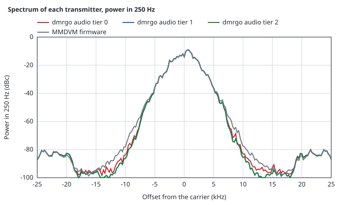
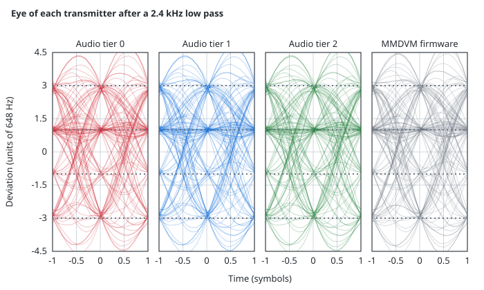

<!-- txcmp:end -->

## Measurement conditions

<!-- txdoc:methods:begin -->

### Methods of the limits

- Spurious emissions of EN 300 113: the power in 1 kHz from 31.25 kHz from the carrier (250% of the 12.5 kHz channel separation), in 10 kHz from 100 kHz, in 100 kHz beyond 500 kHz, the reference bandwidths of EN 300 113 V2.2.1 tables 6a and 6b. The other spurious domain rows take the mean power in 100 kHz.
- Emission Mask D: 47 CFR 90.210(d)(4) takes a reference in a bandwidth wide enough for the true peak (30 kHz here) and the emissions within 50 kHz of the band edge in 100 Hz in peak hold, over sweeps enough to develop the profile. The peak hold is modeled as 10 minutes of sweeps over 112.5 kHz: each frequency gets 53.3 independent 100 Hz looks (the hold time times the square of the bandwidth over the span), so the margin takes, at each frequency, the 0.9816 quantile of the 100 Hz power over the stream, the expected peak of those looks.
- Emission Mask H and the EA mask: 47 CFR 90.210 table note 6 puts digital emissions at 806-809/851-854 MHz under Mask H, and table note 3 puts 809-824/854-869 MHz under 90.691. Neither section states a method, and the preamble of 90.210 allows average values with the carrier power in the same terms, so both take the mean power in 100 Hz, about 1% of the emission bandwidth (the practice of FCC KDB 971168 and ANSI C63.26), against the mean carrier power.
- Adjacent and alternate channel power and spurious emissions of EN 300 113 take the mean power (clauses 7.4.2 and 7.5.2). The transients of clause 7.9.3.3 key the carrier unmodulated; the modulated transients of the datasheet take the worst over the keying edges of a voice superframe with its data bursts and of bursts of ten fixed symbol patterns.
- Each class is measured over a stream long enough that doubling it moves no margin by more than 0.25 dB (`TestLimLengths`): 16 superframes for 8-bit I/Q and 8 for the others.
  With Mask H and the EA mask, US land mobile audio at 30 dBm needs an input low pass for 24 kHz: Tier 0 at 16 bits takes 48 kHz with no `InputLowpassHz` and 24 kHz with 8000 Hz.

- A setup is accepted only with at least 10 dB on each spurious domain limit (the spurious emissions rows, the far out rows of the FCC masks and the amateur rows), where the amplifier shares the limit, at least 3 dB on each other limit in dB, except -0.01 dB on the power slope, and at least 0 on the others.
- China gives its spurious limit in positive peak: its row takes the mean power in 100 kHz plus 11.4 dB, the peak of Gaussian noise over a million samples.
- The margins take audio at 48 kHz, and I/Q at 96 kHz for Tier 0 and at 2.4 MHz for Tier 1 and Tier 2, with no input low pass. The least sample rates come from `TestMinRatesGenerated`, which writes `minrate_gen.go` in `v2/internal/fsktx`.
- FSK error: the RMS error of the symbol deviations after the receive filter over a random stream. Deviation error: the frequency is the phase step of the FM signal between samples, divided by the sinc response of that step; a fit of a constant and the 1200, 2400 and 3600 Hz tones over a whole number of periods of the middle half of the pattern gives the peak.

<!-- txdoc:methods:end -->

### Other transmitters

<!-- txcmp:methods:begin -->

- The MMDVM firmware runs its `DMRDMOTX.cpp` on the host. The tiers run at a Level of 960 codes, and the MMDVM firmware at a DMRTXLevel of 50, which gives 249 codes for a run of symbol +3. The stream is BS-sourced.
- The radio is a sample-and-hold converter, an 8 kHz two-pole low pass and an FM modulator set to 1944 Hz for a run of +3.
- Adjacent and alternate channel power is the power within 4.25 kHz of 12.5 and 25 kHz off, relative to the carrier, the larger side (EN 300 113 clause 7.4). The Mask D margin is the least margin of the peak spectrum to FCC Emission Mask D in 100 Hz.
- FSK error and deviation error compare the symbol-center frequencies with 1944 and 648 Hz (TS 102 361-1 clause 10.2). The ETSI pattern is the +3 +3 -3 -3 test pattern of clause 10.2.2.3. The frequency is the phase step of the FM signal between samples at 48 kHz, divided by the sinc response of that step. The symbol centers come through a root-raised-cosine receive filter 128 symbols to each side, with the timing, gain and offset fitted over the stream. The ETSI pattern deviation is the peak of a fit of a constant and the 1200, 2400 and 3600 Hz tones over a whole number of periods.
- The I/Q receiver is rf Tier 2 at 48 kHz, and the FM receiver is rf Tier 0 on the 9.6 kHz audio of a discriminator, over 64 noise seeds a point.
- The eye diagrams show the frequency of the FM signal after a 2.4 kHz low pass, over 120 symbol pairs.
- `DMRGO_MMDVMTX=<mmdvmtx> go test ./internal/fsktx -run TestTxCompare -update-txcmp` in v2 measures them into `v2/internal/fsktx/testdata/txcmp.json` and writes the comparison and its graphs.

<!-- txcmp:methods:end -->

[Transmitter design notes](tx-notes.md) records the audio correction on a flat radio and the transmitter pairs.

### Generating this page

`go test ./internal/fsktx -run TestTxDoc -update-txdoc` in v2 measures the margins into `v2/internal/fsktx/testdata/txmargins.json` and the spectra, eye diagrams and FSK error into `v2/internal/fsktx/testdata/txsheet.json`, and writes the tables and graphs of this page. `-render-txdoc` writes them from the committed data, with no measurement. Without these flags the tests fail when the page or a graph differs from the data. `DMRGO_DOCPARAMS=write go test ./rf -run TestDocParams` in v2 writes the formats, rates and limits of this page from the code of `rf`. `go run -C cmd/mcubench . -update` measures the Tier 0 cost into `v2/internal/fsktx/testdata/tier0cost.json`.
