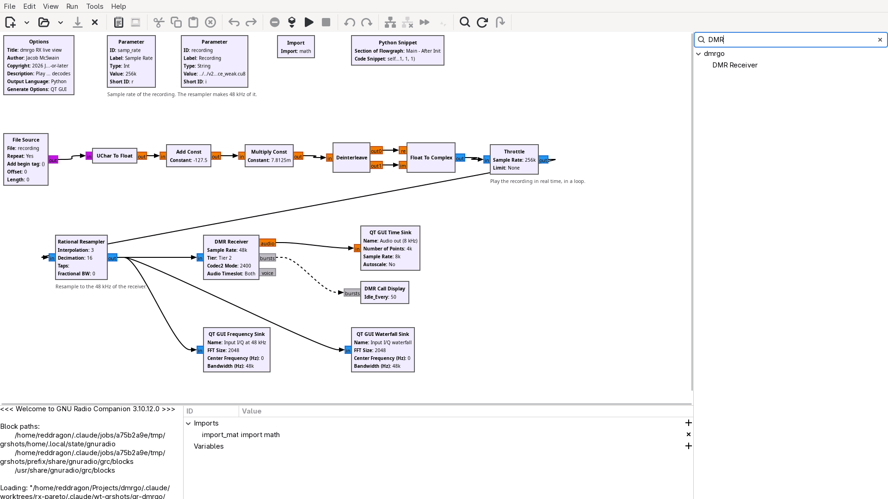
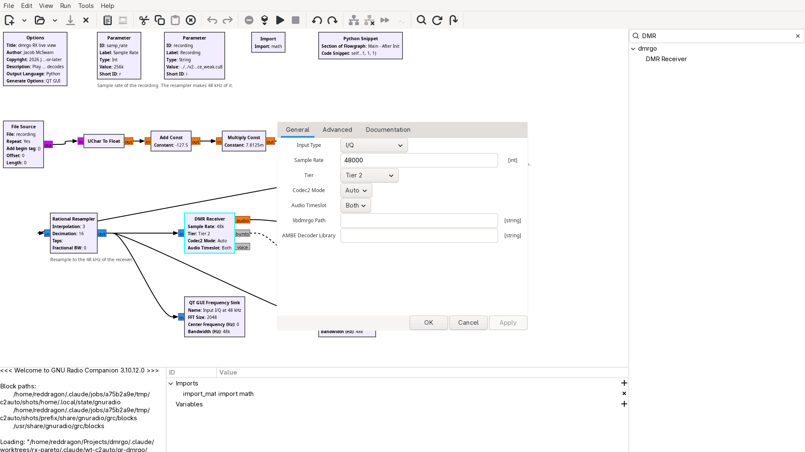
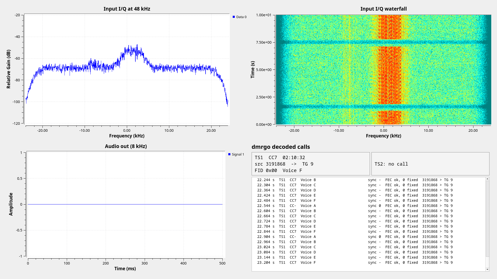
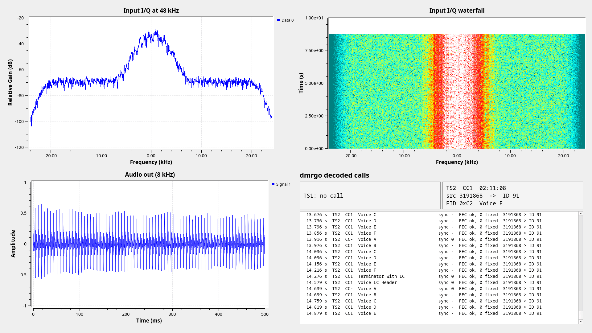

<!-- SPDX-License-Identifier: GPL-3.0-or-later -->

# gr-dmrgo

GNU Radio 3.10 blocks of [dmrgo](../README.md). The module is licensed under the GNU GPL version 3 or later (see LICENSE). It links libdmrgo, the MIT C API of dmrgo in `../v2/capi`, at run time, and dmrgo does not depend on it.

## Blocks

`DMR Receiver` (`gnuradio.dmrgo.rx`) takes complex baseband at 48 kHz, or the output of an FM discriminator at 24, 12 or 9.6 kHz, and has these outputs:

- `bursts`: one PDU per burst, with its timeslot, color code, kind, data type, superframe position, FEC results and call LC.
- `voice`: one PDU per AMBE+2 frame, with its bad-frame flag.
- `audio`: 8 kHz audio of Codec2 calls (FID 0xC2, as QRadioLink sends). The block detects the Codec2 mode, 2400 or 3200, of each call. This output is optional.

Put a resampler before the block for other sample rates, as `examples/dmrgo_rx_file.grc` does.

The module contains no AMBE+2 vocoder. To get audio of AMBE+2 calls, give the block the path of a separately installed decoder library that exports the functions that `python/dmrgo/ambe.py` describes.

## Screenshots

`examples/dmrgo_rx_gui.grc` plays a recording in a loop and shows the input spectrum, the decoded audio and the decoded calls.

The flowgraph in GNU Radio Companion:



The properties of the DMR Receiver block:



A recording of a group call through a Motorola XPR 8400 repeater. The call is AMBE+2 and no AMBE+2 decoder library is set, so the audio output is silent:



A Codec2 call in direct mode, with its audio on the audio output:



## Build

The build needs Go, a C compiler, libcodec2 and GNU Radio 3.10. It builds libdmrgo from `../v2/capi`; set `-DDMRGO_LIBRARY=<path>` to use a library that is already built.

```sh
cmake -S . -B build
cmake --build build
ctest --test-dir build
sudo cmake --install build
```
